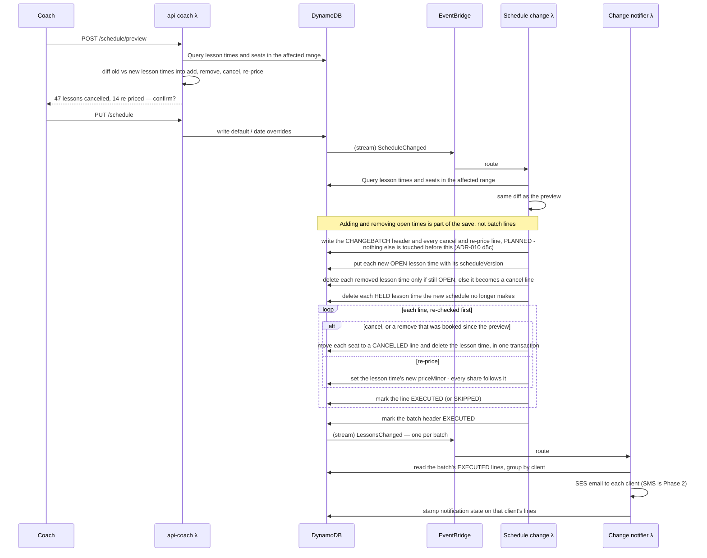

# ADR-006: Open Booking, Per-Date Overrides, Recurring Lessons, and Cancellation Records

## Status

**Accepted** — 2026-08-15.

**Extended by [ADR-020](ADR-020-repricing-booked-lessons.md)** — 2026-09-30. Decisions **5–7**'s
schedule-change path now re-prices upcoming bookings whose block price changed, as well as
cancelling conflicts; the preview shows both and one message per family covers both. The
batch header, event and consumer are renamed (`CHANGEBATCH#`, `LessonsChanged`,
`consumer-schedule-change`) throughout this ADR.

**Amended by [ADR-008](ADR-008-schedule-editor.md)** — 2026-08-23. Decision **2** keeps
per-date storage, but temporary schedules are *entered* as a date range plus a pattern and
regain a **header item** (`SCHEDULE#TEMP#<tempId>`) carrying a name, start date and end
date. The header is read only for management — listing, naming, overlap validation,
delete-as-a-unit — and never on the booking path, so decision 2's single-lookup resolution
rule is untouched. Decision **7**'s preview is confirmed as covering **both** default and
temporary schedule changes.

**Amended by [ADR-010](ADR-010-availability-and-reliability.md)** — 2026-08-28. Decision
**5**'s consumer no longer emits `LessonsChanged` itself; the `CANCELLED#` line write drives
the notifier through the same CDC path everything else uses, so "who has been told" derives
from `notificationStatus` rather than from whether an emit succeeded. ADR-010 decision 5 also
adds the write-ahead plan, the derived `batchId` and the per-cancellation transaction that
make that consumer safe to retry.

**Extended by [ADR-009](ADR-009-cancellation.md)** — 2026-08-23. Decision **5**'s
cancellation records now carry every cancellation in the system, not only schedule-driven
ones, gaining `cancelledBy`, `cancelledAt` and `noticeHours`. Decision **6** is amended:
one message per client per batch still holds, but a *client*-initiated cancellation
notifies the **coach**. ADR-009 also answers the open questions here about client-initiated
cancellation and ending a recurrence.

**Amended — 2026-09-29.** Decision **4** recurs every **1 to 4 weeks**, not only weekly, and
each recurrence gains a `RECURRENCE#` header. Both come from
[ADR-009](ADR-009-cancellation.md) decisions 4a and 4c, which introduced them for
recurrence management without amending the booking flow that creates a recurrence in the
first place. See decision **4a** below. Decision **4b**, added the same day, covers what
happens when a booking request fails partway: retries, headers that were never written, and
a client who resubmits a different request.

**Amended — 2026-10-01** by [ADR-022](ADR-022-client-isolation-at-the-database.md).
Decisions **3** and **4**'s `ReturnValuesOnConditionCheckFailure = ALL_OLD` is dropped on the
client path: it returns another family's booking, and no IAM condition can stop that. ~~A
failed date is attributed by looking for the client's own booking at that date and time on
GSI1 (now keyed by client), with one re-check after a short pause because the index is
eventually consistent.~~ *Replaced by ADR-031 decision 4 (2026-10-13): a failed date is
attributed by reading the family's own seat key directly; the read is strongly consistent, so
no pause or re-check is needed.* The `RECURRENCE#` header moves to the client's partition
(`CLIENT#<clientId>` / `RECURRENCE#<coachId>#<recurrenceId>`).

Supersedes:

- **ADR-005 decisions 1, 3 and 4** — the 7-day booking horizon, the horizon as the
  bound on a schedule change's blast radius, and the deferral of recurring lessons to
  Phase 2. ADR-005 **decision 2** (a temporary schedule is resolved by the date being
  booked, not by today) is retained, and becomes trivially true under decision 2 below.
- **ADR-004 decision 3a** — the single-day blackout expressed as a one-day temporary
  schedule. Blackouts now fall out of the storage shape.
- **ADR-004 decision 6** — schedule changes releasing bookings to `NEEDS_REBOOKING`.
  Replaced by cancellation with a durable, notified record.

Amends **ADR-004 decision 3**: the default schedule keeps its per-weekday block map;
temporary schedules become per-date overrides.

~~ADR-004 decisions **1** (availability is computed), **2** (a booking is claimed by a
conditional write on the booking item),~~ *Replaced by ADR-031 decisions 1 and 4 (2026-10-13):
open times are stored, and a booking is a transaction on the lesson time.* ADR-004 decisions
**4** (price and lesson length on the block)
and **5** (slot generation per block) are unaffected and are load-bearing here.
**ADR-003 decision 2** (price stamped at booking creation) becomes more load-bearing
still — see decision 4.

**Extended — 2026-10-06** by [ADR-026](ADR-026-shared-lessons-by-invitation.md): a booking can be shared by invitation. The slot lock is
unchanged; ~~each invited skater who joins gets their own `PARTICIPANT#` item, and the booking gains
`maxSkaters` and `skaterCount`.~~ *Replaced by ADR-031 decisions 2 and 5 (2026-10-13): every
skater, invited or not, has their own `SEAT#` item, and `maxSkaters` and `seatsTaken` sit on
the lesson time.* Pricing and several rules wait on Kim.

**Amended — 2026-10-08.** Kim's answer to `Items to ask Kim About.md` §7 (option **B**) settles **a booking that lands
between the coach's preview and save**. The preview reads a per-coach booking counter that
every booking increments; the save checks it. If it changed, the plan is recalculated and the
save **goes ahead without asking the coach**: any booking made since the preview that the change
cancels is cancelled like the rest, and its family gets a separate *"just booked"* email
(*"Coach updated their schedule just as you booked. Here are other open times."*). Slot holds
during preview (option D) are not built.

**Amended — 2026-10-09.** *Decided by the owner.* The *"just booked"* email is **Phase 2**. In MVP
the save still goes ahead without asking the coach (option B), and a booking made since the
preview that the change cancels gets the ordinary cancellation email. **No booking counter is
built in MVP:** it existed only to choose which email to send. When the email returns, the
likely mechanism is for the save to recalculate the plan and compare it with the preview's,
which needs no counter. **To be reconsidered if feedback supports that this is an issue.**

**Note — 2026-10-12.** [ADR-007](ADR-007-sms-message-constraints.md) (amended 2026-10-12): all SMS to clients is **Phase 2**. The cancellation digest goes by email only in MVP;
its SMS form (decision 6, the sequence diagram's SNS step) waits for it.

**Superseded in part — 2026-10-13.** *Decided by the owner.*
[ADR-031](ADR-031-lessons-and-seats.md) replaces how booking is stored and enforced:
- **Decision 3**'s computed availability → stored lesson times (`LESSON#<date>#<startTime>`),
  read with one range query (ADR-031 decision 1).
- **Decision 4**'s per-occurrence pattern check and conditional put → one transaction per date
  on the lesson time plus the skater's seat (ADR-031 decision 4). A series is still booked all
  at once, with partial success and the `RECURRENCE#` header written last.
- **Decision 4b**'s retry attribution → a direct, strongly consistent read of the family's own
  seat key (ADR-031 decision 4).
- **Decision 5**'s "cancelling deletes the booking" → seats move to `CANCELLED#` lines and the
  lesson time is deleted (ADR-031 decisions 2 and 11).
- **Decision 7**'s preview now diffs the lesson times the old and new schedules produce
  (ADR-031 decision 11).
- **Open**'s single-booking ceiling → ADR-031 decision 3's server-side booking window.

Every behaviour rule still holds unless ADR-031 says otherwise.

---

## Context

ADR-005 answered "how far ahead can a client book?" with a 7-day rolling window, and
justified it twice over: it bounded what one schedule save could destroy, and it
removed any need for an activation job. It also named its own cost plainly — *"MVP
asks every family to re-book weekly, including the ones who have had the same
Wednesday slot for two years"* — and deferred recurring lessons, the thing that would
have made that tolerable, to Phase 2.

That cost is the one the owner has now decided not to pay.

An intermediate design was considered and dropped: keep a horizon, but release it as a
**weekly batch** on a coach-selected release day, with a temporary schedule able to
carry its own release day. It is recorded here only so the reasoning is not
rediscovered. It died on the observation that release is a property of a *week* while
the release day was attached to a *schedule*, and temporary schedules do not align to
week boundaries — so every mixed week needed an arbitration rule that bought nothing a
coach would ever notice.

The replacement is simpler in intent and more expensive in consequence: **there is no
horizon at all.** Everything the pattern generates is bookable, arbitrarily far out. A
client who wants a standing slot books it once with an end date. The protection the
horizon used to provide is replaced by informed consent at save time and a durable
record of what a change destroyed.

Separately, the temporary-schedule editor the owner wants — enter a start and end
date, then fill in each day in the range — describes a per-date model, not the
per-weekday one ADR-004 stored. A camp where Tuesday of week one differs from Tuesday
of week two is not expressible as a weekday map, and a camp is precisely the case
temporary schedules exist for.

---

## Decision

### 1. ~~There is no booking horizon~~

*Revised 2026-10-13 (ADR-031): superseded by ADR-031 decisions 1 and 3 — a 3-month window on
picks, and stored lesson times.*

~~Availability is computed for any date requested~~, and a booking is accepted for any
date the pattern in effect generates a slot for. There is no release day, no rolling
window, no batch, ~~and no server-side date ceiling on an individual booking.~~ *Replaced by
ADR-031 decisions 1 and 3 (2026-10-13): open times are stored as lesson times, and each picked
time must fall inside the booking window — today to the end of the month two months ahead.*

~~The only bound anywhere in the system is the 12-month ceiling on a **recurrence**
(decision 4), which exists to cap a single write amplification, not to limit how far
ahead a person may book.~~ *Revised 2026-10-13 (ADR-031): ADR-031 d3: picks are checked against
the 3-month window.*

~~ADR-005's second justification for the horizon — that it removed the need for an
activation job — survives the deletion intact, because nothing was ever activated.
Availability was always a pure function of (pattern, date), and it still is.~~ *Replaced by
ADR-031 decision 1 (2026-10-13): the nightly `sched-lesson-roller` job keeps lesson times
stored about 15 months ahead.*

### 2. Temporary schedules become per-date overrides

The `SCHEDULE#TEMP#<startDate>` item, its `endDate`, and its weekday map are removed.
In their place, one item per overridden date:

| Item | PK | SK | Attributes |
|---|---|---|---|
| Default schedule | `COACH#<coachId>` | `SCHEDULE#DEFAULT` | `days` (weekday → blocks) |
| Date override | `COACH#<coachId>` | `SCHEDULE#DATE#<yyyy-mm-dd>` | `blocks` |

`blocks` is the same shape ADR-004 decision 3 defined — an ordered list, each block
carrying `startTime`, `endTime`, `lessonMinutes` and `priceMinor` — and the same write-time
validation applies (no overlap within the day, abutting allowed, `endTime` after `startTime`).

**Resolution for a date `D`, in full:**

```
if SCHEDULE#DATE#<D> exists  →  its blocks   (which may be empty)
otherwise                    →  SCHEDULE#DEFAULT.days[weekday(D)]
```

One rule. No precedence stack, no windows, no arbitration. This is what ADR-005
decision 2 was reaching for — resolution by the date being booked — expressed
directly in the key rather than as a range comparison.

Three problems disappear rather than being solved:

- **The overlap rule is gone.** ADR-004 rejected overlapping temporary schedules at
  write time because two windows covering one date had no non-arbitrary winner. One
  date is now one key, so a second override *is* an edit of the first. Uniqueness is a
  property of the table, not a validation we have to remember to run.
- **Blackouts are gone as a concept.** A date item with an empty `blocks` list is a
  day with no lessons. That is ADR-004 decision 3a without the special case, and it
  works during what used to be another temporary schedule's window, which is the exact
  situation ADR-004 flagged as unresolved.
- **The temp/blackout distinction is gone.** Both are "this date differs."

**The coach enters a date range; the range is not stored.** The editor takes a start
and end date, renders one row per date, and writes one item per date the coach
actually fills in. The range is an input to the UI, not an entity. This is what makes
the resolution rule a single lookup — and it is a deliberate trade, because a
temporary schedule is no longer a named thing that can be deleted as a unit. See Open.

**Deleting an override restores the default for that date** — the item is deleted, not
emptied. An empty `blocks` list means "no lessons"; absence means "whatever the default
says." These are different states and the editor must not conflate them.

### 3. Both the coach and the client get a monthly calendar and a week view

**Monthly calendar** — a month grid marking every date that carries an override, so
the coach can see at a glance where the schedule departs from the default and the
client can see where it does something unusual. One query:

```
Query PK = COACH#<coachId>,
      SK between SCHEDULE#DATE#<first-of-month> and SCHEDULE#DATE#<last-of-month>
```

The returned items *are* the marks. Nothing is computed to render the month.

**Week view** — Sunday through Saturday, with previous and next navigation. Clicking
any date in the month opens the week containing it. Days inside the week render
independently: in the owner's worked example, a client clicking Mon 17 Aug 2026 sees
Sun 16 – Sat 22, with 16–18 resolved from the default and 19–22 from overrides, and
"next" moves to Sun 23 – Sat 29, where 23–25 are overridden and 26–29 are not.

The week view is three reads:

1. `GetItem` the default schedule.
2. `Query` date overrides between that Sunday and Saturday.
3. ~~`Query` bookings between that Sunday and Saturday (`BOOKING#<date>#<startTime>`).~~

~~Then ADR-004 decision 1's expansion, per day: candidate slots minus existing bookings.~~
*Replaced by ADR-031 decision 1 (2026-10-13): availability is one `Query` on the stored
`LESSON#` items for that week. Each is free (`OPEN`) or taken (`BOOKED` or `HELD`), and none
says who booked it.*

Sunday-start weeks are a display convention only. Nothing in the data model knows
about weeks, and week boundaries are in the coach's IANA timezone (ADR-001 decision 4).

The coach's calendar is editable and shows bookings; the client's is bookable and shows
only whether a slot is free — never who holds a taken one.

### 4. Recurring lessons are MVP, and are materialized at booking time

At booking, the client may mark the booking **recurring** and give an **end date**. The
system expands weekly from the first occurrence — same weekday, same start time — and
writes one ordinary booking per occurrence.

ADR-005 §4a's design is discarded wholesale. The `RECURRING#` standing-intent item, the
materialization Lambda, and the ordering constraint where recurring writes had to land
before a window opened or lose a race to an ad-hoc client were all machinery for
feeding bookings into a rolling horizon. With no horizon there is nothing to feed. A
recurrence is N bookings, written once, and from that moment indistinguishable from
lessons booked by hand — which is what ADR-005 §4a wanted them to become anyway, just
without the intervening apparatus.

**End date is capped at 12 months** from the first occurrence. This is a write-volume
guardrail, not a product limit: 52 weekly occurrences is the largest single booking
action the system will perform.

~~**Each occurrence is written with ADR-004 decision 2's conditional put** —
`attribute_not_exists(SK)` on `BOOKING#<date>#<startTime>`.~~ *Replaced by ADR-031 decision 4
(2026-10-13): each date is one transaction that updates the lesson time from `OPEN` to
`BOOKED` and puts the skater's seat.* Every occurrence claims its own slot on its own merits.

> **Do not reach for `BatchWriteItem` here.** It does not support condition
> expressions, so batching would silently discard the lock that makes concurrent
> booking safe. `TransactWriteItems` supports conditions but is all-or-nothing and caps
> at 100 items, which contradicts the partial-success behavior below. The correct
> ~~implementation is individual conditional `PutItem` calls issued in parallel, with
> failures collected. At 52 occurrences this is well under a second and it is the only
> shape that is both concurrency-safe and partially successful.~~ *Replaced by ADR-031
> decision 4 (2026-10-13): one small transaction per date, issued in parallel with failures
> collected, keeps both properties.*

**Partial success is the specified behavior.** Occurrences that cannot be written are
skipped, not fatal. ~~An occurrence fails when the pattern in effect on that date
generates no slot at that start time and duration, or when the conditional put fails
because someone already holds it.~~ *Replaced by ADR-031 decision 4 (2026-10-13): an
occurrence fails when there is no `OPEN` lesson time at that date and time, or it has
already started.*

The client is shown what was booked and what was not:

> Booked 22 of 26 lessons. These dates could not be booked:
> 14 Sep, 21 Sep, 12 Oct, 23 Nov — *lesson slot either does not exist or is already
> taken.*

**The two failure causes are deliberately reported as one message.** Distinguishing
them would tell a client that a specific slot on a specific date is held by someone —
occupancy information about another family that they have no reason to receive. The
merged wording costs nothing and leaks nothing.

**Every occurrence carries a shared `recurrenceId`.** The bookings are otherwise
independent: cancelling three of twenty-four leaves the other twenty-one standing,
which is the behavior we want and which falls out for free. But "cancel the rest of my
Mondays" and "who is affected if this weekly slot moves" are unanswerable later if the
sibling link was never written, and it cannot be reconstructed after the fact. One
attribute at write time, no migration ever. This is the same argument ADR-001 decision
4 made for storing `Booking.startsAtUtc` before a second timezone existed.

#### 4a. Frequency is chosen at booking, every 1 to 4 weeks

*Decided by the owner, 2026-09-29.* The booking pop-up's recurring option carries a
frequency — every 1, 2, 3 or 4 weeks, defaulting to 1 — alongside the end date. This is
[ADR-009](ADR-009-cancellation.md) decision 4a's `intervalWeeks`, applied where a recurrence
is created rather than only where it is reduced.

- **Expansion steps by `intervalWeeks`** from the first occurrence — same weekday, same start
  time. Every other rule in this decision is unchanged: ~~one conditional put per occurrence,~~
  *one transaction per occurrence (ADR-031 decision 4, 2026-10-13),* partial success, retry
  attribution, price resolved per occurrence.
- **The 12-month cap is unchanged** and still bounds the date, not the count, so a recurrence
  holds at most 52 occurrences at interval 1 and 13 at interval 4. The largest single booking
  action is still 52 puts.
- **A `RECURRENCE#<recurrenceId>` header is written with the occurrences** — `studentId`,
  `clientId`, `weekday`, `startTime`, `intervalWeeks`, `endDate`, `startedOn` — in the shape
  ADR-009 decision 4c defines. It is needed because the interval cannot be recovered from
  the bookings once one has been cancelled by hand.
- **The header is written last**, after the occurrence puts, and only if at least one
  occurrence was booked — the same order ADR-008 decision 7 uses for a temporary schedule's
  header. A crash between them leaves bookings with no header: they are real, bookable and
  correctly priced, and only the management screen is missing them. A retry writes the same
  header at the same key, so it is idempotent. Header-first would leave a header describing
  an arrangement that has no lessons.
- **The header records what was asked for**, not what succeeded: `endDate` is the requested
  end date even when some occurrences were skipped. Bookings stay authoritative for what is
  actually scheduled (ADR-009 decision 4c).

This stays inside decision 4's "a recurrence is N bookings, written once." The header does
not generate anything; it describes an arrangement whose bookings already exist, and nothing
on the booking path reads it.

**One recurrence per selected slot.** The header holds one weekday and one start time
(ADR-009 decision 4c), so a client who selects Monday 4pm and Wednesday 4pm and marks them
recurring creates **two** recurrences, each with its own `recurrenceId` and header.

#### 4b. A failed booking request repairs itself; the client decides only what the system cannot

*Decided by the owner, 2026-09-29.* The rule behind this decision: **automate what is
certain or undoable; ask the client only when an action destroys something and their intent
is a guess.** Decision 4's partial-failure handling was written for the retry that repeats
the same request. Three further cases are covered here.

**1. The request carries its identity, so a retry recognises its own work.** Every booking
request carries a client-generated **idempotency key** (ADR-001 already requires one), and
each recurrence's `recurrenceId` is **derived from that key and the slot** — the same key,
weekday and start time always produce the same `recurrenceId`. Decision 4's attribution
only works if the retry's `recurrenceId` equals the first attempt's; a server-generated ID
would make a retry report the client's own lessons as taken by someone else.

- The web app **retries once automatically** on a server error, with the same key
  (ADR-001). Most failures end there: the retry recognises its own lessons, writes the
  header, and the client sees an ordinary result.
- **A key already seen with a different request body is rejected.** The app generates a
  fresh key whenever the request changes, so a changed request can never be mistaken for a
  retry.

**2. Each booking records the interval it was booked under, so a missing header can be
rebuilt.** Every occurrence is stamped with **`bookedIntervalWeeks`** at creation. It is a
fixed fact about the moment of booking — ~~like~~ unlike `priceMinor` *(Revised 2026-10-13: a re-price
changes the lesson time's `priceMinor`, ADR-020/ADR-031)*, it is never updated — and it is
**not** the current frequency. The header is the only source of that.

- A frequency change (ADR-009 decision 4) updates the header only. The remaining lessons
  keep the value they were booked with, and nothing reads it while a header exists.
- **Headers are never deleted by the application.** Cancelling all future lessons marks the
  header `ENDED` rather than removing it. (Time to Live removes a header long after its
  arrangement has ended — [ADR-017](ADR-017-data-retention-ttl-and-archive.md) decision 3 —
  which the repair guard below makes safe.) So a missing header always means one thing: the booking request
  failed before writing it — and such an arrangement cannot have had its frequency changed,
  because changing it needs the header.
- **Repair is automatic.** Whenever a client's bookings are loaded, any `recurrenceId` among
  them with no header gets one rebuilt from its bookings: student, client, weekday and start
  time from any occurrence; `intervalWeeks` from `bookedIntervalWeeks`; `startedOn` from the
  first; `endDate` from the last. The write is conditional on the header not existing, so it
  can never overwrite a real one. **Repair only runs for an arrangement with at least one
  upcoming lesson** (ADR-017 decision 3, 2026-09-30): an arrangement whose header has expired
  ended long ago, and its settled lessons must not trigger a rebuild. The requested end date is lost — the rebuilt one is the
  last lesson actually booked — which is the only difference from a header written normally.

**3. A resubmission reports the client's own lessons as theirs.** When a date is blocked,
~~the failed write already returns the booking that blocked it (decision 4's
`ReturnValuesOnConditionCheckFailure`). If that booking belongs to **the same student**, the
date is reported as *already booked for this student* rather than as unavailable.~~ *Replaced
by ADR-031 decision 4 (2026-10-13): the system reads the family's own seat key for that
skater. Present means already booked for this student; absent means unavailable.* Results
have three outcomes: **booked**, **already booked for this student**, and **unavailable**.

This keeps decision 4's privacy rule, which merges the two reasons a slot is unavailable so
that a client learns nothing about **another** family. Telling a client about their own
child's lessons reveals nothing. It also improves the ordinary case of a client booking a
slot they already hold.

**4. When the resubmission drops a slot, the client decides.** If a request fails and the
client then submits a new one that leaves out a slot the failed one included, they may now
hold lessons they no longer want — or they may have assumed that slot failed. The system
cannot tell which, and cancelling on a guess is the one thing it must not do: a released
slot can be taken by another family within minutes, while an unwanted lesson is visible and
easy to cancel. So the app does everything except the decision:

> *You also have Wednesdays at 4:00pm booked from your earlier attempt.* **[Keep them]
> [Cancel them]**

The app knows which slots the failed request included, because it sent it; it checks the
client's bookings for those slots and asks. *Cancel them* runs recurrence management's
existing *cancel all future lessons* (ADR-009 decision 4) on the header, which repair has
already rebuilt if it was missing.

**What this covers, end to end.** A crash before the header: the automatic retry finishes
it. No retry: the header is rebuilt the next time the client's bookings load. The client
resubmits with a slot added: their existing lessons show as theirs and the new slot books as
its own recurrence. The client resubmits with a slot removed: one prompt, one tap.

**Price is resolved per occurrence, not once.** ADR-003 decision 2's resolution runs
for each date against the pattern in effect *on that date*, so a recurrence spanning a
price change or a temporary block correctly carries different amounts on different
lessons. Stamping at creation is what makes this stable afterward.

**Materialization is retryable, and a retry must attribute its own writes.** If the
function dies partway — timeout, throttle, deploy — some occurrences exist and some do
not. Retrying is safe *because* every put is conditional: nothing is overwritten. But
the already-written occurrences now fail their condition, and reporting those to the
client as "could not be booked" would be a lie about lessons that are booked.

So **a conditional failure must be attributed before it is reported.** ~~Set
`ReturnValuesOnConditionCheckFailure = ALL_OLD` on every put; the
`ConditionalCheckFailedException` then carries the item that blocked the write, in the
same response. Compare its `recurrenceId`:~~

| Blocking item's `recurrenceId` | Meaning | Reported to the client as |
|---|---|---|
| ~~Equals this recurrence's~~ | ~~Written by an earlier attempt of this same booking~~ | ~~Booked — not a conflict~~ |
| ~~Anything else, or absent~~ | ~~Someone else holds that slot~~ | ~~Skipped~~ |

~~This costs one request parameter. The alternative — a `GetItem` per failed occurrence
to discover what is in the way — is a second round trip for every conflict, on a path
where the client is waiting for a response.~~ *Replaced by ADR-031 decision 4 (2026-10-13):
a failed date is attributed by one strongly consistent read of the family's own seat key.
Another family's seat is never read.*

### 5. A schedule change cancels conflicting bookings and records what it did

This replaces ADR-004 decision 6's `NEEDS_REBOOKING` status, which is removed. ~~The
conflict test is unchanged: **a booking conflicts unless the pattern in effect on its
date generates a slot with exactly its start time and duration.**~~ *Replaced by ADR-031
decision 11 (2026-10-13): the change compares the lesson times the old and new schedules
produce, and sorts each into add, remove, cancel or re-price.*

*Diagram updated 2026-10-13 for ADR-031.* *Revised 2026-10-13 (ADR-031 revision): the
re-price step no longer re-splits shares on the seats. It sets only the lesson time's
`priceMinor`; ~~each share not yet fixed~~ every share is worked out from it.*



*Amended 2026-10-13: diagram updated — every share follows a re-price; adding and removing open lesson times is part of the save, not batch lines; held times the new schedule doesn't make are removed (ADR-031).*

*Amended 2026-10-13: diagram updated to ADR-010 decision 5 (the plan is written first; one `LessonsChanged` per batch, driven by the header), ADR-020 re-pricing and the consumer rename. SMS to families is Phase 2 (ADR-007). [architecture.md §6.5](../architecture.md) has the full flow.*

*Amended 2026-10-13, later: participant names changed to match architecture.md §3.1 (`Schedule change λ`, `Change notifier λ`).*

*Amended 2026-10-20: diagram updated so the change batch is written before any lesson time is added or removed, matching the first 2026-10-13 note and §6.5 (ADR-010 d5c).*

~~**Conflicting bookings are deleted, not restatused.** ADR-004 decision 6 step 3's
reasoning is unchanged and still binding: the booking item *is* the lock, so a booking
whose time should become bookable again must stop existing.~~ *Replaced by ADR-031 decisions 2
and 11 (2026-10-13): a cancelled lesson's seats move to `CANCELLED#` lines and its lesson time
is deleted, in one transaction. A remove line deletes an `OPEN` lesson time only if it is
still `OPEN`; if a family booked it after the preview, the line becomes a cancel.* There is no
`NEEDS_REBOOKING` state and no `REBOOK#` record — the cancellation line item below
replaces both.

**Two new item types:**

| Item | PK | SK | Attributes |
|---|---|---|---|
| Cancellation batch | `COACH#<coachId>` | `CHANGEBATCH#<isoTs>#<batchId>` | `batchSource` (`DEFAULT` \| `DATE_OVERRIDE`), `affectedFrom`, `affectedTo`, `lessonCount`, `clientCount` |
| Cancelled lesson | `COACH#<coachId>` | ~~`CANCELLED#<isoTs>#<batchId>#<bookingId>`~~ `CANCELLED#<isoTs>#<batchId>#<seatKey>` *(ADR-031 decision 2, 2026-10-13: one line per seat)* | `lessonDate`, `startTime`, `durationMinutes`, `priceMinor`, `studentId`, `studentName`, `clientId`, `recurrenceId`, `notificationStatus`, `notifiedAt`, `channels`, `failureReason` |

ISO-8601 timestamps sort lexicographically, so "what did my last schedule change do"
is a `begins_with(SK, "CHANGEBATCH#")` query read backwards, and one batch's lines are
`begins_with(SK, "CANCELLED#<isoTs>#<batchId>")`.

**This lives in DynamoDB, not S3.** The owner offered either. S3 is right for the §6.4
daily report because that is written once and never read by the application. This is
the opposite: the coach reads it in the app, and every line mutates when notification
succeeds or fails. A batch **may additionally** be archived to the existing reports
bucket under `coach=<coachId>/cancellations/<batchId>.json` for later Athena queries,
following the §6.4 precedent — that is an archive of a record, not the record.

**Notification state is not a boolean.** `paymentReminderSent: bool` is the existing
precedent (ADR-003 decision 4) and it is the weak version. The case that matters is
failure — a bounced address, an unregistered number — because that is exactly when the
coach has to pick up the phone. So:

- `notificationStatus` — `PENDING` | `SENT` | `FAILED` | `SUPPRESSED`
- `notifiedAt`, `channels` (`[EMAIL]`, `[EMAIL, SMS]`), `failureReason`

**`SENT` means SES or SNS accepted the message.** It does not mean delivered and it
does not mean read. Honest delivery confirmation requires SES event destinations and
SNS delivery status logging, and is deliberately out of scope here.

**`SUPPRESSED` means the client has texted STOP** and we did not attempt the SMS
(ADR-007 decision 9). It is distinct from `FAILED` on purpose: `FAILED` means we tried
and could not reach them, `SUPPRESSED` means we were not permitted to try. The email
still went either way.

**The email says cancelled, and offers a link.** Per the owner: the lesson is
cancelled — not "needs rebooking" — and the message carries a link to availability if
the client wants a different time. ADR-004's stance that the system does not guess
which alternative a family can make survives unchanged; no specific slots are proposed
and nothing is auto-moved.

**Cancelling occurrences of a recurrence does not end the recurrence.** Siblings are
independent bookings and are untouched. `recurrenceId` on the line is what lets the
coach see "3 of this client's 24 Mondays" rather than three unrelated losses.

### 6. One message per client per batch — not one per lesson

**This is a deliberate departure from ADR-002 decision 7**, which established that
reminders are per lesson with no digest and no grouping.

That rule is right for its own case: a day-of reminder and a payment reminder are each
*about* one lesson, and the triggering event is one lesson. A cancellation batch is
not. The triggering event is one schedule change, and a coach blacking out a week can
easily destroy six lessons for one client with two children. Six emails describing one
decision is not thoroughness, it is a mailbox flood that obscures what happened.

So the notifier emits one message per (batch, client), listing that client's cancelled
lessons, and stamps the resulting status onto every line item belonging to that client
in that batch. The coach's per-lesson view still answers "was this client told about
this lesson," which is the question they will actually ask.

The **SMS** form of this message is constrained by [ADR-007](ADR-007-sms-message-constraints.md):
it states the count and the date range and points at the email, because a lesson list
does not fit in one 160-character segment.

ADR-002 decision 7 is otherwise unchanged and still governs reminders.

### 7. A schedule change is previewed before it is saved

`POST /schedule/preview` accepts the proposed schedule, runs the identical conflict
evaluation the consumer will run, writes nothing, and returns the conflict set. The
coach website must show the counts and the affected lessons and require confirmation
before the write.

**This is not a nicety, it is the replacement for the horizon.** ADR-005 decision 3
made an unbounded blast radius impossible by construction; ADR-005's own Open list
asked whether a preview was needed and answered "inside the horizon this matters;
outside it there is nothing to show." Both halves of that are now false. With
open-ended booking and 12-month recurrences, a three-week override dropped into
December can destroy several hundred lessons in one save, and the coach's first signal
under ADR-004's design would be their clients' replies. Informed consent at save time
is the only control left.

The preview and the consumer **must share one implementation** in `core/` — ADR-001's
framework-free core exists precisely so a rule like this has exactly one definition.
Two copies of the conflict test would drift, and the drift would show up as a preview
that under-reports.

**The preview is advisory, not a lock.** A client can book between preview and save.
The authoritative record of what was destroyed is always the batch the consumer
writes, never the number the coach was shown.

*Note — 2026-10-13 (ADR-031 decision 11):* the preview and the consumer now share one
evaluator that diffs the lesson times the old and new schedules produce. A booking made after
the preview on a time the save removes is still cancelled in the batch, with the ordinary
email. But a booking can no longer land on a time **after** it is removed: the booking and the
schedule save both change the same lesson-time record, and each lesson time records the
`scheduleVersion` that made it. This closes Open-Pending §4's gap.

---

## Model changes to `architecture.md`

**Removed:** the 7-day booking horizon; `SCHEDULE#TEMP#<startDate>` and its `endDate`;
the `NEEDS_REBOOKING` booking status and `REBOOK#` records; ADR-005's Phase-2
`RECURRING#` item and its materialization job.

**Added:** `SCHEDULE#DATE#<yyyy-mm-dd>` override items; `CHANGEBATCH#` and `CANCELLED#`
items; `Booking.recurrenceId`; a cancellation-notifier Lambda; a schedule-preview
endpoint.

**Changed:** ~~access pattern 4 no longer clamps to a horizon — it is a date-override
query plus the default plus a bookings query, per week or per month.~~ *Replaced by ADR-031
decision 1 (2026-10-13): access pattern 4 is one range query on stored `LESSON#` items.*
`LessonsChanged` in the §6 event catalog now also carries schedule-driven
cancellations and is consumed per client rather than per booking.

**Access patterns added to §5:**

| # | Query | Served by |
|---|---|---|
| 13 | List date overrides in a range (month grid, week view) | Main table, `SK between SCHEDULE#DATE#<from> and SCHEDULE#DATE#<to>` |
| 14 | List a coach's cancellation batches, newest first | Main table, `begins_with(SK, "CHANGEBATCH#")`, descending |
| 15 | List the cancelled lessons in one batch | Main table, `begins_with(SK, "CANCELLED#<isoTs>#<batchId>")` |
| 16 | List the surviving lessons of one recurrence | GSI1 by student, filtered on `recurrenceId` |

**§10 MVP scope grows** and should be restated: recurring lessons move from Phase 2 to
MVP; the coach and client calendar views, the schedule-change preview, and the
cancellation record and its notifier are all MVP work that §10 does not currently list.

**§8 is unchanged.** ~~The only scheduled jobs remain the 7am reminder and the 9pm
report.~~ Nothing in this ADR adds a cron. *ADR-031 (2026-10-13) adds two: the nightly
`sched-lesson-roller` (decision 1) and the hourly `sched-deadline-sweep` (decision 12).*

---

## Consequences

**Easier.** Recurring lessons — the largest deferred feature in the product — cost one
expansion loop and an attribute, rather than a new entity, a seventh Lambda, and a race
condition. The schedule resolution rule collapses to a single key lookup, and two of
ADR-004's open problems (overlapping overrides, blackouts inside an override) stop
existing rather than getting fixed. Families with a standing slot book it once instead
of every week, which was the single worst thing about the MVP as specified.

**Harder, and this is the real cost.** The blast radius of a schedule change is
unbounded again — exactly the problem ADR-005 was written to eliminate. It is now
mitigated by consent (decision 7) and auditability (decision 5) rather than prevented
by construction, and those are strictly weaker guarantees. A coach who confirms through
the preview without reading it can cancel hundreds of lessons, and the system will
faithfully record and announce every one.

**The cancellation path is a new durable pipeline, not a loop.** Several hundred
cancellations cannot be handled by a `for` loop inside the `ScheduleChanged` consumer:
it will hit the Lambda timeout, and SES's sending rate (which §9 already flags as
requiring a move out of the sandbox) will throttle it. The consumer writes records; a
separate notifier handles one client at a time, idempotently — guarded on
`notificationStatus`, so a retry cannot double-send — with a DLQ for what still fails.
Partial failure must leave a coherent record, because the record is the point.

**The coach's schedule surface roughly doubles.** ADR-004 already called the schedule
editor "the largest piece of MVP UI" when it was a per-weekday block editor. It is now
that, plus a per-date range editor, plus a month grid, plus a week view with
navigation, plus a preview-and-confirm dialog, plus a cancellation history view. The
client app gets the month grid and week view too. Feature #2 in §10 needs re-estimating
a second time.

**Booking volume grows by roughly an order of magnitude.** Open-ended booking plus
52-occurrence recurrences means the main table and GSI2 hold far more booking items
than a 7-day window ever would. At this scale it is still cents, and GSI2 is queried
one date at a time so its partitions stay small — but "how many bookings exist" is no
longer trivially bounded, and any future full-range scan needs to be written knowing
that.

**A named temporary schedule no longer exists.** Deleting "the August camp" means
selecting its dates and clearing them, because the range was never stored. This is the
price of the single-lookup resolution rule and it is charged to the UI.

---

## Open

- ~~**Should a single (non-recurring) booking have any date ceiling?** Recurrences cap at
  12 months; an individual booking currently has no limit at all, so a client can book
  a lesson in 2031 against a default pattern that will certainly have changed. Probably
  wants the same 12-month cap for symmetry, but nothing breaks without it.~~ **Settled by
  [ADR-031](ADR-031-lessons-and-seats.md) decision 3, 2026-10-13:** every picked time must fall
  inside a server-checked window — today to the end of the month two months ahead (about 3
  months). A series is checked on its first date only.
- ~~Can a client end a recurrence, or skip one week of it? `recurrenceId` makes both~~ **Settled by [ADR-009](ADR-009-cancellation.md) decision 4** — a client may move the end date earlier or cancel all future occurrences; a single week is an ordinary per-lesson cancel under decision 2.
- ~~Can a client cancel a single booking at all, and with what notice? Removing the~~ **Settled by [ADR-009](ADR-009-cancellation.md) decision 2** — per-lesson cancel with confirmation, with a late-cancellation notice rather than a notice bound.
- **Retention of cancellation records.** They name students and carry contact-adjacent
  data, so §7's minors' obligations apply. No TTL, no archival cutoff, and no coach
  ability to clear history is specified.
- ~~**Does the client ever see their own cancellation history**, or only the email at the
  time?~~ **Settled 2026-10-12 by the owner:** yes, in **Phase 2**. MVP stays email only.
- **Real delivery confirmation.** `SENT` currently means "accepted by SES." Bounce and
  complaint handling via SES event destinations would make the coach's "was this client
  reached" answer honest, and is not in MVP.
- ~~Does a coach need to cancel one lesson without touching the pattern? Carried~~ **Settled by [ADR-009](ADR-009-cancellation.md) decision 5.**
- ~~**Timezone of the week grid.**~~ Sunday–Saturday in the coach's timezone, per ADR-001
  decision 4. A client in a different timezone sees the coach's week, which is correct
  but unstated in the UI. **Settled 2026-10-12 by the owner:** every booking time is shown
  in the coach's timezone and always labelled with it, for every family. *Phase 2:* revisit
  for competitions, which can be in another timezone.

---

## Revisit if

- A coach destroys a large batch of lessons despite the preview. The next control is a
  hard confirmation threshold ("this affects more than 50 lessons — type the number to
  continue"), or an undo window that re-materializes the deleted bookings from the
  cancellation lines. The lines carry enough to reconstruct them, which is worth
  knowing before it is needed.
- Recurrence materialization shows up as latency at booking time. 52 parallel
  conditional puts is fine; 200 would not be, and a longer cap would force an async
  materialization with a "your lessons are being booked" state.
- Payments land (§10 Phase 2). A cancelled lesson that was already paid needs a refund
  or credit concept, and ADR-003 decision 4 explicitly has neither a ledger nor account
  credit. Today this is harmless only because payment follows check-in, so a future
  booking is always `UNPAID`.
- Coaches ask for named, reusable schedule templates ("summer camp", "off-season"),
  which is the temporary-schedule entity this ADR deliberately dissolved, returning in
  a more useful form.
- A second client per student arrives (ADR-002, Deferred) — cancellation notification
  then has to decide whether both contacts are told.
