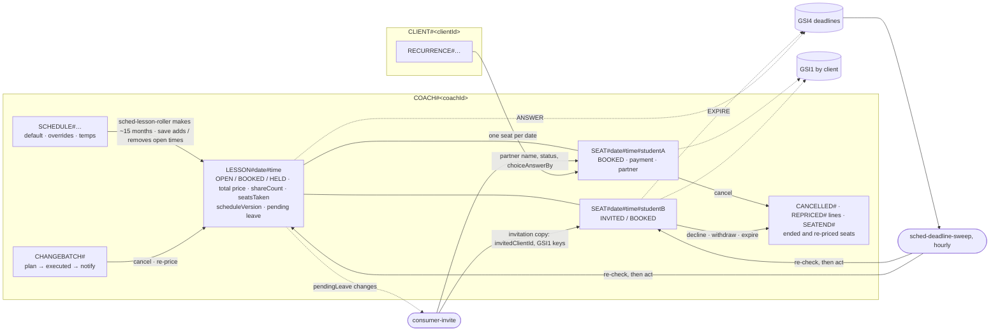
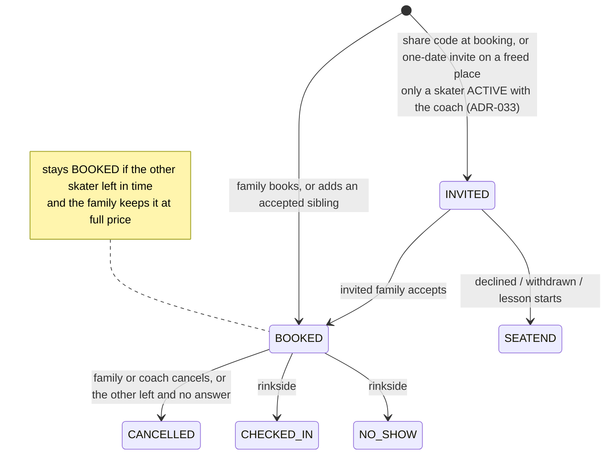

# ADR-031: Booking Rebuilt as Lessons and Seats

## Status

**Accepted** — 2026-10-13. *Decided by the owner*, worked through in one design session. The aim:
handle shared lessons and private lessons through **one** path, so the shared flow stops being a
set of special cases bolted onto a private booking.

**Revised — 2026-10-13, later.** *Decided by the owner:* **no family's action writes another
family's records, except answering an invitation addressed to their own skater (accept or
decline, decision 5).** The total price lives only on the lesson time, and each skater's share is
worked out from it (decision 7). A leave and the staying family's question are recorded on the
lesson time, not on the other family's seat (decision 8). The other skater's name and status are
copied onto each seat by `consumer-invite`, a system function, not by either family (decision 6).
An invited seat belongs to the inviting family until the invited family accepts it (decision 5).
So ADR-024's rule — a family writes only its own records — needs no other exception for shared
lessons. Option B, same day: an accepted invitation whose inviting family cancels first is ended
by the hourly sweep (`INVITER_LEFT`); `consumer-invite` only copies (Consequences).

**Replaces how booking is stored and enforced.** Every behaviour rule in the ADRs below still
holds unless this ADR says otherwise; what changes is the mechanism.

**Supersedes:**
- [ADR-004](ADR-004-schedule-patterns.md) decisions 1 and 2 (availability is computed; the
  booking is the lock). Open times are now **stored** (decision 1 below).
- [ADR-006](ADR-006-open-booking-recurring-lessons-and-cancellation.md) decision 3 (availability
  computed in memory), decision 4's per-occurrence pattern check and conditional put, decision
  4b's retry attribution, and decision 5's "cancelling deletes the booking".
- [ADR-009](ADR-009-cancellation.md) decision 2's "cancelling deletes the booking" and decision 5's
  `COACH_HELD` booking (now a held lesson time). Decision 4's three series operations stay, except
  on a **shared** series (decision 9 below).
- [ADR-022](ADR-022-client-isolation-at-the-database.md) decision 8's retry lookup through GSI1
  (now a direct read of the family's own seat, decision 4 below).
- [ADR-026](ADR-026-shared-lessons-by-invitation.md) decisions 2, 3 and 5's mechanics (the
  booking with participants, the `INVITE#` copies kept in step by a consumer, the
  `pendingJoins` list) and decision 5a's **nightly** sweep (now hourly, decision 12). Every
  ADR-026 behaviour rule — share codes, consent, the coach's acceptance, the warning, the
  banner, siblings, coaches seeing every skater — still holds.
- [ADR-006](ADR-006-open-booking-recurring-lessons-and-cancellation.md) decision 1 (no booking
  horizon; a 3-month window on picks returns, decision 3 below) and decision 7's preview (now
  compares lesson times, decision 11).
- [ADR-015](ADR-015-late-cancellation-and-no-show-charges.md) decision 3's stamps on the booking
  (now on the lesson time, decision 1).

**Closes:**
- Open-Pending §4's *booking doesn't check the schedule atomically* (Phase 2 fix no longer
  needed — decision 11).
- ADR-026's gaps: how a participant leaves, what happens when the booking family leaves and the
  invited family stays, whether a freed place can take a new invite, and how re-pricing applies
  to split shares (decisions 7–10).
- ADR-026 Open's partial joins for a recurring shared series (decision 6: lesson by lesson).

**Amends:** [ADR-010](ADR-010-availability-and-reliability.md) (a new nightly job, and the
hourly sweep's missed-run alarm), [ADR-015](ADR-015-late-cancellation-and-no-show-charges.md)
decision 4 (the charge lives on the seat's cancellation line),
[ADR-020](ADR-020-repricing-booked-lessons.md) (a re-price changes the lesson time's total; shares follow it),
[ADR-008](ADR-008-schedule-editor.md) (the odd-cents warning, decision 8),
[ADR-001](ADR-001-backend-stack.md) (the functions, and `consumer-invite`'s role),
[ADR-003](ADR-003-lesson-pricing-and-payment.md) (price and payment per seat),
[ADR-014](ADR-014-check-in-app-and-offline-capture.md) (attendance per seat),
[ADR-017](ADR-017-data-retention-ttl-and-archive.md) (retention),
[ADR-018](ADR-018-unpaid-lesson-reminder-to-coach.md) (the unpaid list is built from seats),
[ADR-024](ADR-024-client-write-link-check.md) (no shared-lesson exception),
[ADR-025](ADR-025-many-coaches-per-skater.md) decision 6 (family sync updates seat names),
[ADR-030](ADR-030-financial-page-gross-and-rink-fees.md) (gross is worked out from the lesson time).

**Superseded in part — 2026-10-20** by [ADR-033](ADR-033-invite-only-accepted-skaters.md). *Decided by the owner.* Moved to Phase 2:
decisions 2 and 5's `AWAITING_COACH` seat (siblings included), the "new to the coach" accept check
and `INVITER_LEFT`; decision 6's new-to-the-coach path and the coach's Accept turning seats
`BOOKED`; decision 12's `WARN` and `INVITER_LEFT` deadlines, the 9pm timing and the
late-confirmation rule. `seatStatus` is `INVITED | BOOKED | CHECKED_IN | NO_SHOW`; `dueKind` is
`EXPIRE | ANSWER`. Decision 4's booking transaction gains a `ConditionCheckItem` on
`COACH#<coachId>/STUDENT#<studentId>`, `studentStatus = ACTIVE`, for an invited skater or sibling.
Once the invited family accepts, the seat is `BOOKED`, and an inviting family's cancel is an
ordinary leave (decision 8).

**Amended — 2026-11-08.** *Decided by the owner, settling conflict S11 in the implementation
plan (`design/harbor/coach/screens-calendar.js`).* When the **coach cancels** a lesson whose
invited seat is still `INVITED`, the cancel deletes that seat in the same transaction as the
other seats, with **no `SEATEND#` record and no email** (MVP). A later accept or decline finds no
seat and writes nothing ("no longer available"). This is the one seat that ends without being
moved (decision 2). *Phase 2:* record the ending and tell the invited family.

**Amended — 2026-11-08.** *Decided by the owner, settling conflict B5:* decision 3 adds that the
family's day view shows only days inside the booking window.

---

## Context

Under ADR-006 and ADR-026 a booking belonged to the family who made it. A shared lesson was that
booking plus an invitation and a participant item hanging off it. That left real holes: when the
booking family left, the record carrying the lesson (and their payment) had to go, while the
other skater stayed. Invitation status lived in two families' partitions and was kept in step by a
consumer. And availability was computed, so a booking could slip in between the schedule check
and the write (Open-Pending §4).

The fix is to separate **the lesson**, which is the coach's, from **each skater's place in it**.

---

## Decision

### 1. Lesson times are stored

Every bookable time is a **lesson time** record, created from the schedule:
`PK = COACH#<coachId>`, `SK = LESSON#<yyyy-mm-dd>#<startTime>`.

It carries `lessonStatus` (`OPEN | BOOKED | HELD`), `lessonDate`, `startTime`, `startsAtUtc`,
`coachTz`, `durationMinutes`, `priceMinor`, `currency`, `missedLessonFeeMinor`,
`requiredNoticeHours`, `maxSkaters`, `seatsTaken`, `shareCount` (how many ways the price is
split, decision 7), `joinOrder` (the skater IDs sharing the price, earliest first, for the odd
cents), `blockSeq`, `iceType` and `scheduleVersion`, plus a **pending leave** while the
staying family has a question to answer (decision 8). **`priceMinor` is the lesson's total price
and the only place it is stored.**
Everything a booking used to stamp at creation is on the lesson time already, so it is stamped
by existing (ADR-003 d2, ADR-015 d3, ADR-026 d1). `maxSkaters` on a **booked** lesson time is
never lowered.

- **Nightly job `sched-lesson-roller`** keeps lesson times stored to the end of the booking window
  (decision 3) **plus 12 months** — about 15 months ahead — so every date a series can reach
  already exists.
- **A held lesson time** (`HELD`) is what ADR-009 d5's coach-held slot was. It has no seats.
- **Availability** is one range query on `LESSON#` items. A family sees only *free* (`OPEN`) or
  *taken* (`BOOKED` or `HELD`), exactly as before (ADR-006 d3, ADR-026 d2). Lesson-time items
  hold no names and nothing about who booked. **A family's read of lesson times may include
  `priceMinor`, `shareCount` and `joinOrder`** (to work out its own share), never the pending
  leave. `shareCount` and `joinOrder` show only that a lesson is shared, by random skater IDs;
  that is accepted (ADR-022).

### 2. Each skater has a seat

`PK = COACH#<coachId>`, `SK = SEAT#<yyyy-mm-dd>#<startTime>#<studentId>`. A **private lesson is a
lesson time with one seat; a shared lesson has two** (more if `maxSkaters` is ever raised). A
separate `SEAT#` prefix keeps seats out of the availability query.

A seat carries `studentId`, `clientId`, `studentName` (display form, "Mia R."), `seatStatus`,
copies of the lesson time's `startsAtUtc`, `coachTz` and `durationMinutes` (the 7am and 9pm jobs
read seats through GSI2 and filter on the coach's time zone, so they never need the lesson time),
`joinedAt`, `idempotencyKey` (the request that created it),
`recurrenceId` + `bookedIntervalWeeks`, `inviteId` and `invitedByClientId` (shared lessons),
**`partnerName` + `partnerStatus`** (written by `consumer-invite`, decision 6),
`invitedClientId` and `choiceAnswerBy` (read-only copies written by `consumer-invite`, decision 6), the reminder flags (`confirmationSent`, `remindedOn`,
`settleReminderSentOn`), attendance (`outcomeAt`, `recordedAt`), payment (`paymentStatus`,
`paidAt`, `markedPaidBy`, `paidVia`, `waivedAt`, `waivedBy`, `paymentReminderSent`) and the
deadline keys (decision 12).

*Phase 2 since ADR-033 (2026-10-20): `seatStatus` is `INVITED | BOOKED | CHECKED_IN | NO_SHOW`.* `seatStatus`: `INVITED | AWAITING_COACH | BOOKED | CHECKED_IN | NO_SHOW`. (*Keep or cancel?* is
not a seat status: it comes from the `choiceAnswerBy` copy on the family's own seat, decision 8.)

**Indexes**, the same roles as before, now on seats:
- **GSI1, by client** — `GSI1PK = CLIENT#<clientId>`, `GSI1SK = SEAT#<date>#<startTime>`: My
  bookings and Home.
- **GSI2, by date** — the 7am reminder and the 9pm report, one entry per seat.
- **GSI3, unpaid (sparse)** — while a seat is `UNPAID`.
- **GSI4, deadlines (sparse)** — new, decision 12.

**A seat that ends is moved, not kept.** Its key must stay free for the same skater to book the
same time again, so:
- a **cancelled** seat becomes a `CANCELLED#<isoTs>#<batchId>#<seatKey>` line (ADR-009 d1's
  shape) carrying `cancelledBy`, `cancelledAt`, `noticeHours` and, in Phase 2, the fee and its
  payment (ADR-015 d4);
- a **declined, withdrawn or expired** invitation becomes
  `SEATEND#<date>#<startTime>#<studentId>#<isoTs>` with its outcome.

Both moves are one transaction with the seat's delete.

### 3. The booking window is checked by the system

Each **picked** time must fall inside the months the booking page shows: from today to the end of
the month two months after the current one, in the coach's time zone (product rule, with its
examples and error wording — see `FeatureDecriptions/Bookings:`, the booking window). It's
checked with the request's other checks — the skater is linked and `ACTIVE`
(ADR-024), the end date is no more than 12 months after the first pick (ADR-006 d4) — before
anything is written.

- A repeating series is checked on its **first** date only; its later dates may run past the
  window up to the end date.
- A pick outside the window refuses the **whole** request; nothing is written. (Unlike
  *unavailable*, this can only come from something other than the booking page.)
- A retry is never refused by the window: the window only grows as time passes (on May 1 it
  runs to the end of July), so a pick that was inside it stays inside it.
- *Open (Phase 2):* whether a coach booking for a family (ADR-009) is held to the same window.
- **The family's day view shows only days inside the window.** Previous and next stop at its
  edges. *Added 2026-11-08 by the owner, settling conflict B5 in the implementation plan
  (`design/harbor/client/screens-booking.js`).*

### 4. Booking a time

Per date, **one transaction**:
- update the lesson time: `lessonStatus = OPEN` and `startsAtUtc` in the future → `BOOKED`,
  `seatsTaken = 1` (2 with an invitation);
- put the seat, `BOOKED`, if it doesn't exist; the lesson time's `shareCount` becomes the number
  of seats booked (`BOOKED`) now — 1, or 2 with a sibling — and `joinOrder` lists them;
- with a share code, also put the invited seat (decision 5).

Of two families racing, one transaction succeeds; the other gets **unavailable**. A failed date
is attributed by **reading the family's own seat key** for that skater — strongly consistent —
which turns ADR-022 d8's index lookup and its re-check after a pause into one exact read. The
three outcomes of ADR-006 d4b stay:
- the seat exists **and carries this request's `idempotencyKey`** → **booked** (a retry found
  its own write);
- the seat exists from another request → **already booked**;
- no seat → **unavailable**. The family only ever reads its own
skater's key, so another family's occupancy stays invisible (ADR-006 d4).

**Repeating bookings** stay as ADR-006 d4: every date is booked when the series is made, each
date its own transaction, partial success allowed, the `RECURRENCE#` header written last in the
family's partition. Idempotency keys, the deterministic `recurrenceId`, resubmission handling and
the multi-coach rules (ADR-025) are unchanged.

### 5. Sharing at booking

*Changed by ADR-033 (2026-10-20):* the invited skater or sibling must be `ACTIVE` with the coach, checked by a `ConditionCheckItem` on their `STUDENT#` item in decision 4's transaction and by the share-check endpoint at the share step (ADR-033 d2, d2a).

The share box (ADR-026 d5) adds the **invited seat** to the same transaction:
`seatStatus = INVITED`, the invited skater's `studentId` and display name, `inviteId` and
`invitedByClientId`. It has no `clientId` and no GSI1 keys yet.

- **The invited seat holds the place at once** (*owner, 2026-10-13*). Nobody can join without an
  invitation anyway.
- **The booking family pays the full price until the invited skater joins** (product rule — see
  `FeatureDecriptions/Schedule lesson split`, "Price"), so an `INVITED` seat isn't counted in
  `shareCount` (decision 7).
- One invitation covers a whole series: each date gets its own invited seat with the same
  `inviteId`.
- *Phase 2 since ADR-033 (2026-10-20): a sibling must already be `ACTIVE` and is created `BOOKED`.* **Siblings** (ADR-026 d5): the seat is created `BOOKED` directly, or `AWAITING_COACH` if the
  sibling isn't approved yet.

**Who owns the invited seat.** It is the **inviting family's** record until the invited family
accepts: only they can withdraw it, while it is still `INVITED` (`invitedByClientId` = the caller).
The invited family reaches it through the emailed link, Home or My bookings. **Accepting** is the
invited family's own write, after ADR-024's link check on their skater (or, for a skater new to
the coach, the check that the skater is in their own family). Its condition is: the seat has **no
`clientId`**, is `INVITED`, and its `studentId` is the caller's skater. It sets the seat's
`clientId` to them and moves it on (decision 6). From then on it is theirs, like any seat.
The coach's Accept (decision 6) is the coach's own write in their own partition.
*Phase 2 since ADR-033 (2026-10-20): every accept goes through `requireActive`; the coach's Accept joins no one.*
- **Declining** is the invited family's other possible answer, under the same condition as
  accepting: the invitation is addressed to their skater, so answering it, yes or no, is theirs to
  do. A decline moves the seat to `SEATEND#` as `DECLINED`. Nothing else of the inviting family's
  is touched.
- *Phase 2 since ADR-033 (2026-10-20): once accepted, the seat is `BOOKED` and the invited family's, like any seat.* **Withdrawing** is allowed only while the seat is `INVITED`. Once the invited family has
  accepted (`AWAITING_COACH`), the seat is theirs and only they, the coach or the deadline sweep
  can end it.
- *Phase 2 since ADR-033 (2026-10-20): only the first case remains. Once the invited family has accepted, the inviting family's cancel is an ordinary leave (decision 8); there is no `INVITER_LEFT`.* **If the inviting family cancels their own seat** while the invited seat is still unanswered or
  waiting for the coach, nobody is paying for the lesson yet, so the invitation ends (*owner,
  2026-10-13, option B*):
  - still `INVITED` — it is the inviting family's own record, so **their cancel ends it** as
    `WITHDRAWN` in the same transaction;
  - already `AWAITING_COACH` — it is the invited family's, so the cancel doesn't touch it. The
    cancel records an `INVITER_LEFT` deadline, due at once, on the **lesson time** (which it
    updates anyway, one fewer seat), naming the invited seat. **The hourly sweep ends that seat**
    as `WITHDRAWN` and the invited family is emailed that the lesson was cancelled, up to an hour
    later. *Revised 2026-10-13 by the owner: the deadline moved from the invited seat to the
    lesson time, so no family writes another family's seat.*

### 6. Joining

The invited family confirms on the signed-in page (ADR-026 d5); each date is **one transaction**:
- **Already the coach's student:** the seat `INVITED → BOOKED`, if the lesson hasn't started, and
  the lesson time's `shareCount` goes up by one. Nothing on the other family's seat changes; both
  shares follow from the new `shareCount` (decision 7).
- *Phase 2 since ADR-033 (2026-10-20): the new-to-the-coach path and the coach's Accept joining seats are Phase 2.* **New to the coach:** the seat `INVITED → AWAITING_COACH`, and the skater goes `PENDING` with the
  coach. The coach's **Accept** turns every one of that skater's `AWAITING_COACH` seats into
  `BOOKED` in the same request, each if its lesson hasn't started, raising each lesson's
  `shareCount`.
- *Phase 2 since ADR-033 (2026-10-20): no coach decline and no sweep withdrawal in MVP.* **Declined** (by the family or the coach), **withdrawn** (by the booking family while
  `INVITED`, or by the sweep after the inviting family cancelled, decision 5) or **expired**
  (the lesson starts first): the seat moves to `SEATEND#`, `seatsTaken` drops, and the lesson
  stays private at the full price, or reopens if no seat is left.
- **A series joins lesson by lesson.** Each date succeeds or fails on its own; the invited family
  gets the dates that work.

**`partnerName` + `partnerStatus`** on each seat show the *other* skater's display name and
status. **`consumer-invite` writes them**, reacting to changes to seats and to a lesson time's
`pendingLeave` (both reach it through the table's change stream), about a second later — never
either family. It also keeps two more views up to date, the same way:
- **the invitation, for the invited family:** it adds `invitedClientId` and GSI1 keys for the
  invited family to the invited seat, so the invitation shows on their Home and My bookings
  before they accept (the Harbor design, `home-invited`);
- **the question, for the staying family:** it copies the pending leave's `answerBy` onto the
  staying seat as `choiceAnswerBy`, sets `partnerStatus = LEFT`, and clears both once answered,
  so the staying family's screens read only their own seat (*owner, 2026-10-13*).
The lesson time's pending leave stays the authority; the copies are for reading. That replaces ADR-026's `INVITE#` copies: each family still reads only its own
seats (so the database keeps every other seat's name out of a family's reach) and still sees who
it shares with.

### 7. Price shares

- **The total price is on the lesson time** (`priceMinor`), and only there.
- **Each skater's share is worked out, not stored:** `priceMinor ÷ shareCount`, with **odd cents**
  one each to the earliest skaters in the lesson time's `joinOrder` (*owner: "I don't care which"*). $45.01 for two is $22.51
  and $22.50.
- **`joinOrder`** follows `shareCount`: a joining skater is added at the end. After an in-time
  leave, the leaver stays in it until the staying family answers; **Keep** sets it to the
  remaining skaters. **A late leaver stays in it**, as they stay in `shareCount`, so the odd cent
  may sit with them and the staying skater pays the lower share.
- **`shareCount`** is the number of skaters the price is split between. It goes up when a skater
  joins (or fills a freed place) and is set to the remaining skaters when the staying family keeps
  a lesson after an in-time leave. **A late leave doesn't change it**, so the staying skater keeps
  paying their share (decision 8). An `INVITED` or `AWAITING_COACH` seat doesn't count yet, so the
  booking family pays the full price until the invited skater joins.
  *Since ADR-033 (2026-10-20): only an `INVITED` seat isn't counted; `AWAITING_COACH` is Phase 2.*
- **No amount is ever copied onto a seat** (*owner, 2026-10-13*). Everything that shows what a
  skater owes works it out from the lesson time: the booking and cancel pop-ups, My bookings,
  the payment reminder, the coach's Payments page and unpaid list, the weekly unpaid reminder
  (ADR-018) and the financial page's gross (ADR-030). A past lesson's share can't change — price
  changes never reach past lessons (ADR-020), and nobody joins or leaves once a lesson has
  started — so working it out gives the same answer every time. The 9pm report job writes
  nothing to the table (ADR-014 d7).
- **A re-price** (ADR-020) changes only the lesson time's `priceMinor`, and every share follows
  it. One case isn't handled: a lesson **marked paid in advance** and then re-priced would show a
  different amount from what was paid. It's unlikely, so it isn't designed for (see Revisit if).

### 8. Leaving a shared lesson

The rules families see — either family, the same rules; keep or cancel after an in-time leave; the
late leaver's share of the fee; the answer-by time and its emails — are product rules in
`FeatureDecriptions/Schedule lesson split` ("A skater calls out") and
`FeatureDecriptions/cancelation.md` (shared lessons). This decision records how they are stored.

**Either family, the same rules** — neither owns the lesson. One transaction per date:

- **In time** (outside the notice period):
  - the leaver's seat → `CANCELLED#` line, `seatsTaken` drops;
  - the **lesson time** records a **pending leave**, a `pendingLeave` map: `leaveId`,
    `leftStudentId`, `leftAt`, `stayingStudentId` and `answerBy`. The staying family's seat isn't touched, and their share stands
    (`shareCount` doesn't change) until they answer. Their screens show *Keep or cancel?* from the
    `choiceAnswerBy` copy on their own seat, about a second after the leave (decision 6).
- **Late** (inside the notice period): the leaver's line records their share of the
  late-cancellation fee (half, for two — Phase 2 charge, ADR-015). The staying skater keeps
  their share and isn't asked anything.

**The answer-by time** (option C, *owner, 2026-10-13*) is whichever comes first:
- the start of that lesson's notice period, or
- **7 days after the leave**.

It applies to one-off cancels and to cancelling the series. Nothing waits in limbo for more than a
week.

**The staying family answers:**
- **Keep it private at the full price** → their own write to the lesson time: the pending leave
  is cleared and `shareCount` becomes 1. The write goes ahead only if the pending leave still
  names their skater as the one staying, checked as a condition on the write, so the family never
  reads it. The lesson is now a **freed place** (decision 10).
- **Cancel with no charge** → their own seat becomes a `CANCELLED#` line and the pending leave is
  cleared; the lesson time reopens (`OPEN`) when its last
  seat goes. The same is true whenever the last seat goes — a family's cancel, or a coach's
  cancel with **release**. A coach's **hold** sets it to `HELD` instead.
- **No answer by `answerBy`** → cancelled with no charge by the hourly sweep. (Which emails the
  family gets: `FeatureDecriptions/cancelation.md`.)

### 9. Changing a shared series

While a series is shared, a family can only cancel one lesson or cancel the series, and the
staying family answers several freed dates on one card per series (product rules — see
`FeatureDecriptions/Schedule lesson split`, "A shared repeating lesson", and
`FeatureDecriptions/cancelation.md`, "The staying family's card"; the options, card layout,
buttons and emails moved there on 2026-11-08). What that needs technically:

- **Whether a series is shared** is worked out from its seats: shared while **any future lesson
  in it has another skater, joined or invited**. Filling a freed date makes it shared again until
  that lesson is over.
- **The card is built from the family's own seats** (*owner, 2026-10-13*): every seat with
  `choiceAnswerBy` set is a date waiting for an answer. Who left comes from the seat's
  `partnerName` (with `partnerStatus = LEFT`), and the full price from the lesson time's
  `priceMinor`. Grouping the seats by series (`recurrenceId`) gives one card per series, which is
  what makes cards merge per series. Families never read the pending leave.
- **Remaining dates** are the dates that (1) this leave freed — a one-off cancel or cancelling the
  series; (2) were left in time; (3) the staying family hasn't answered; (4) are still waiting —
  not started, answer-by not passed, not cancelled by the coach.
- **Keep all / cancel all** run one transaction per date, each re-checked first; a date that has
  started, or was already answered or cancelled, is skipped.

### 10. A freed place can take a new skater

After the staying family keeps a lesson, they can invite a new skater to it (product rule, and
where the button appears — see `FeatureDecriptions/Schedule lesson split`, "A freed place", and
`FeatureDecriptions/C_Client My Bookings.md`).

- It works like decision 5: a new invited seat holds the place, the staying family pays the full
  price until the new skater joins, then `shareCount` goes up and both pay their share.
- **It covers that one lesson only** — never a series, the staying family's or the new skater's.
- *Phase 2 since ADR-033 (2026-10-20): the new skater must already be `ACTIVE` with the coach.* The new skater goes through the same steps: accepts, is approved by the coach if new, joins.

### 11. Schedule saves change lesson times

The preview compares the lesson times the old schedule produces with the new ones and sorts each
into **add, remove, cancel or re-price** — one evaluator for preview and execution (ADR-006 d7,
ADR-020 d5). Execution keeps ADR-010 d5's batch: claim, write the whole plan, re-check each line,
mark executed last, notify after.

- **A held lesson time** the new schedule no longer produces is removed, as ADR-009 d5's coach-held
  slot was; one it still produces stays held.
- **Remove** deletes an `OPEN` lesson time **only if it is still `OPEN`**. If a family booked it
  after the preview, that line becomes **cancel** in the same batch, and the family gets the
  ordinary cancellation email (ADR-006 d7's MVP rule).
- **Cancel** moves every seat to a `CANCELLED#` line and deletes the lesson time.
- **Re-price** sets the lesson time's new `priceMinor`, following ADR-020: increases only beyond
  the notice period, decreases at once; every share follows (decision 7). A `REPRICED#` line is
  written per seat whose share changes, for the email.
- **Every lesson time records the `scheduleVersion` that made it.** Because a booking and a
  schedule save both change the same lesson-time record, a booking can no longer land on a time
  the new schedule removed. This closes Open-Pending §4's gap.

### 12. The hourly sweep and the deadline index

ADR-026 d5a's **nightly** sweep becomes **`sched-deadline-sweep`, every hour** (*owner,
2026-10-13*).

- A record with a pending deadline carries `dueAt` and `dueKind`, and sits in **GSI4** (sparse,
  `GSI4PK = DUE`, `GSI4SK = <dueAtUtc>#<coachId>#<itemKey>`) only while it has one. Kinds:
  - *Phase 2 since ADR-033 (2026-10-20).* `WARN` — the shared-lesson warning (24 hours plus the notice period before the lesson), on the
    invited seat;
  - `EXPIRE` — an invitation still `INVITED` or `AWAITING_COACH` at the lesson's start, on the
    invited seat; *Since ADR-033 (2026-10-20): still `INVITED` only.*
  - `ANSWER` — the staying family's `answerBy`, on the **lesson time's** pending leave;
  - *Phase 2 since ADR-033 (2026-10-20).* `INVITER_LEFT` — an accepted invitation whose inviting family cancelled first, due at once,
    on the **lesson time**, naming the invited seat (decision 5).
- Each hour the sweep queries what's due, **re-checks each record**, acts, and sets the next
  deadline or removes it. A deadline that no longer applies is skipped. The sweep is a system
  function, so its writes are no family's.
- *Phase 2 since ADR-033 (2026-10-20): the warning is gone; urgent emails still go at once.* **Urgent emails** (expired, cancelled with no answer) go at once. **The warning waits for a
  friendly hour** — the 9pm run before it's due — so it's never late and never sent at night.
- *Phase 2 since ADR-033 (2026-10-20).* **A late confirmation** (ADR-026 d5a): if a seat becomes `AWAITING_COACH` when its warning is
  already due, or due before the next 9pm run, the warning is sent at once.
- Screens work out *expired* and *cancelled, no answer* from the time itself, so families never
  see a stale state between runs (ADR-026 d5a's banner rule).
- A missed hour catches up on the next run. The sweep's completion metric drives a missed-run
  alarm (ADR-010 d4): it pages when no run has completed for **2 hours** (*default, can be
  changed*).
- **`sched-lesson-roller`** reports a completion metric too. Because lesson times are already
  stored 12 months past the window, a missed night isn't urgent: it shows on the dashboard after
  one missed night and pages after **3** (*default, can be changed*).
- Both are scheduled functions, not event consumers, so neither needs a dead-letter queue. Each
  is safe to run twice: the sweep re-checks every record, and the roller only creates lesson times
  that don't exist.

### 13. Odd-cents warning in the schedule editor

*Moved to `FeatureDecriptions/Schedule Creater.md` ("Skaters per lesson") on 2026-11-08 — product
content, not an architecture decision.*

### 14. Details settled while updating the docs (2026-10-13)

- **`LessonBooked` fires per seat**, when a seat becomes `BOOKED`, so each skater's family gets
  its own confirmation (as each booking did).
- **Reminders and the report count only `BOOKED`, `CHECKED_IN` and `NO_SHOW` seats.** A seat
  gets its GSI2 keys only when it becomes `BOOKED`; `INVITED` and `AWAITING_COACH` seats have
  none. *Since ADR-033 (2026-10-20): `INVITED` seats only.* (A pending leave is always settled before the lesson day, because its answer-by is no
  later than the start of the notice period.)
- **Change batches record only what affects a family:** cancel and re-price lines, one per seat
  (`CANCELLED#…#<seatKey>`, `REPRICED#…#<seatKey>`). Adding or removing an *open* lesson time
  isn't a batch line; it's part of the save.
- **`scheduleVersion` lives on the `SCHEDULE#DEFAULT` item** and goes up on every save, default or
  temporary.
- **The sweep's cancellations go through a change batch** of their own, so the notifier sends the
  emails exactly as for any cancellation. `cancelledBy` gains a fourth value, **`NO_ANSWER`**,
  and is never chargeable. The sweep's completion metric is **`DeadlineSweepCompleted`**.
- **`SEATEND#` records** carry `seatOutcome` (`DECLINED | WITHDRAWN | EXPIRED`), `endedAt`, who
  ended it (`endedBy`: the family, the coach or `SWEEP`), and the seat's `studentId`, `studentName`,
  `clientId` and `inviteId`. They're kept for the same window as cancellation lines (ADR-017).
  *Changed 2026-10-20 (owner, ADR-033 d6): `endedBy` is the family or `SWEEP`; the coach from Phase 2.*
- *Phase 2 since ADR-033 (2026-10-20): no consent link and no "no longer available after the coach's Accept" email.* **Who sends what:** `consumer-invite` writes the partner fields and sends the invitation and every outcome email (joined,
  declined, withdrawn, expired, no longer available after the coach's Accept, and "the other skater can't
  make it — keep or cancel"). The change notifier sends cancellation emails, including cancel all
  and no answer.
- **A skater's name change reaches their seats.** `consumer-family-sync` (ADR-025 d6) already
  copies a skater's changes to every coach's record; it now also updates `studentName` on their
  upcoming seats, which it finds, for each of the skater's coaches, by querying that coach's
  upcoming `SEAT#` items and keeping the skater's (*owner, 2026-10-13*: no index access across
  families; name changes are rare enough that the extra reads don't matter); `consumer-invite` then refreshes `partnerName` on the seats sharing a lesson
  with them.
- *Open:* the IAM roles of the two new jobs. (`consumer-invite`'s is settled in Consequences.) Like GSI2 and GSI3, GSI4 is read across coaches, so
  only `sched-deadline-sweep` should be able to read it.

### 15. Unchanged

Cancelling by the coach (lesson, day, week; release or hold; preview and accept), check-in and
correction (now per seat: a capture succeeds only from `BOOKED`), payment status and how-paid
(per seat), the notice period and late-cancellation rules, notifications, isolation of pending
families, recent sign-in for schedule saves, multi-coach booking, and retention (ADR-017, applied
to seats and lines as it was to bookings and lines).

---

## The new picture

*Amended 2026-10-13: diagram updated — storage diagram: sweep acts on invited seats and lesson times; ANSWER and INVITER_LEFT on the lesson time; consumer-invite's read-only copies; decline, withdraw and expire on the invited seat; adding and removing open times is part of the save (ADR-031).*

*Amended 2026-10-20: diagram updated to MVP — the invited seat is INVITED or BOOKED, and only EXPIRE (seat) and ANSWER (lesson time) sit in GSI4; AWAITING_COACH, WARN and INVITER_LEFT are Phase 2 (ADR-033).*

*Amended 2026-10-13: diagram updated — seat states: a waiting seat also ends when the inviting family cancels first; keep-at-full-price shown as a note (ADR-031).*

*Amended 2026-10-20: diagram updated to MVP — no AWAITING_COACH state; only a skater ACTIVE with the coach can be invited or added as a sibling, and the invited family's accept takes the seat straight to BOOKED (ADR-033).*

---

## Alternatives considered

- **A relational database** (Postgres). Seat capacity and uniqueness would be plain constraints,
  but a small always-on server is about $12–15 a month and serverless Postgres that pauses to zero
  takes about 15 seconds to wake. Every rule here fits a single DynamoDB transaction, so it adds
  cost without solving anything new.
- **Keep computing availability.** Less to keep in step, but double-booking prevention and the
  schedule-save race each need their own lock; storing lesson times gives both for free.
- **Rolling series** (a job books a few weeks ahead). Smaller writes, but a family can lose a date
  long after booking. Booking every date at once keeps ADR-006's certainty.
- **One-off timers** (EventBridge Scheduler) instead of a sweep. Exact to the minute, but every
  seat change must create, move or cancel timers, a failed create loses a deadline (so a backup
  sweep is needed anyway), and what's scheduled is harder to see and test. Nothing here needs
  better than an hour.

---

## Consequences

- One path for private and shared lessons; no invitation copies and no `pendingJoins`.
- **No family writes another family's records,** so ADR-024 needs no shared-lesson exception.
  The price is stored once, on the lesson time.
- **`consumer-invite` stays, for emails and the read-only copies** (decision 6): the partner
  fields, the invited family's view of an invitation, and the staying family's `choiceAnswerBy`.
  **It only ever copies.** Its role allows reads, and `UpdateItem` limited by the
  `dynamodb:Attributes` condition to the key fields plus `partnerName`, `partnerStatus`,
  `invitedClientId`, `GSI1PK`, `GSI1SK` and `choiceAnswerBy`; no `PutItem` or `DeleteItem`
  (*owner, 2026-10-13*). The condition can't limit it to `SEAT#` items, but a lesson time has
  none of those fields, so a stray write could only add a meaningless copy. Ending seats is left
  to the families' own writes and the sweep, the one function that can delete records in every
  coach's area. *Corrected 2026-10-20: the sweep is one of three functions whose execution role can
  delete in any coach's partition (with `consumer-schedule-change` and `consumer-student-link`).*
  It reacts to seat changes and to a lesson time's `pendingLeave`, and sends the shared-lesson emails that aren't deadlines: the
  invitation to the invited family, and the outcome emails (joined, declined, withdrawn, no longer
  available, the other skater left). Its nightly run is replaced by `sched-deadline-sweep`. With
  `sched-lesson-roller`, that is **two new functions**.
- The schedule-save race and the retry attribution's eventual consistency both disappear.
- **A nightly job and more writes:** ~15 months of lesson times per coach, and a schedule save
  rewrites up to a year of them in the background — a few thousand writes, pennies.
- **Coach day view is two range queries** (`LESSON#` and `SEAT#`) instead of one.
- **Residual unchanged:** a family's writes land in the coach's partition, and only the code check
  keeps one family off another family's seat with the same coach (ADR-022 d8). The read
  allowlist (ADR-022 d6) must cover `LESSON#` attributes for availability and the family's own
  `SEAT#` read for retry attribution.
- **Gate tests** (ADR-021, ADR-022) need rows for `LESSON#`, `SEAT#`, `SEATEND#` and GSI4.
- **Retention** (ADR-017): a past lesson time is kept as long as any seat or line for it is kept,
  and expires with the last of them. A past lesson time that never had a seat expires on the
  date-override window.

## Open

- *Moved 2026-11-08 — product questions:* whether a coach booking for a family is held to the
  3-month window (→ `FeatureDecriptions/Bookings:`), and whether the 7 days in the answer-by rule
  should be a question for Kim (→ `FeatureDecriptions/Schedule lesson split`).
- ~~ADR-026's P5 (when an unanswered `INVITED` seat lapses before the lesson) still waits on Kim;
  it becomes one more `dueKind`.~~ **Settled by the owner 2026-10-13:** no cutoff before the lesson;
  an unanswered invitation expires at the lesson start (`EXPIRE`, decision 12). No new `dueKind`.
- The IAM roles of `sched-lesson-roller` and `sched-deadline-sweep`; only the sweep may read GSI4.

## Revisit if

- **Coaches mark lessons paid in advance and then change their prices.** A re-price changes the
  lesson time's total, so a lesson paid before the change shows the new amount, not what was
  paid. If this happens in practice: either don't re-price a lesson time that has a paid or waived
  seat, or record the amount when a lesson is marked paid. *Noted by the owner, 2026-10-13: not
  designed for now.*
- A coach needs lesson times further ahead than the window plus 12 months.
- Deadlines need to act within minutes rather than an hour.
- `maxSkaters` is raised well above 2 (shares, partner fields and the card would need a list).
