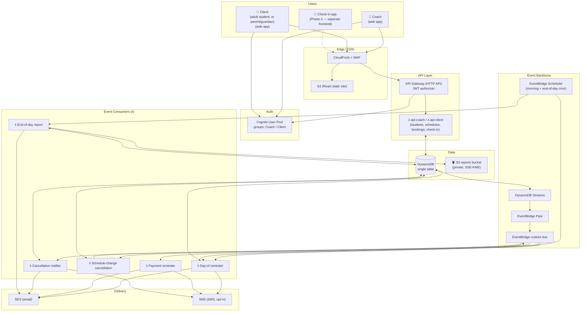
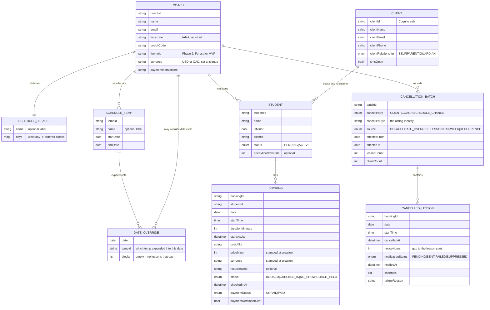
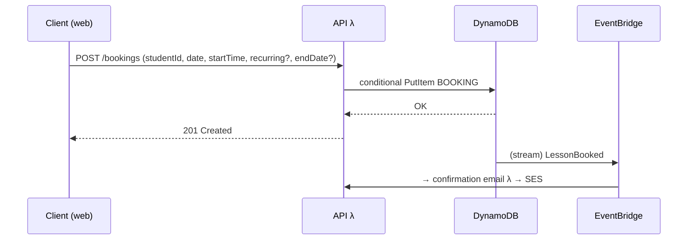
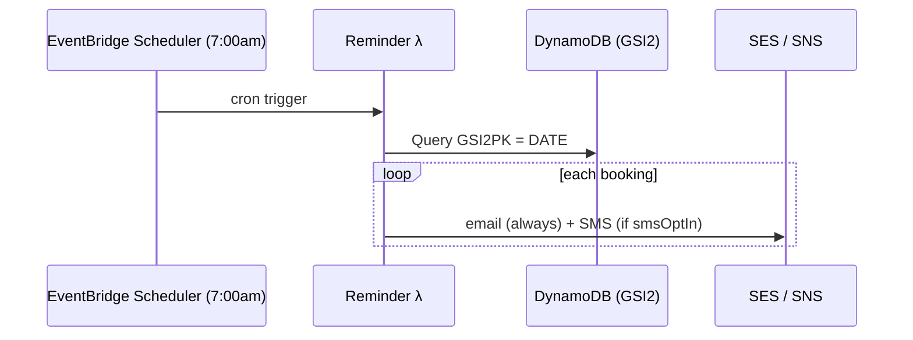
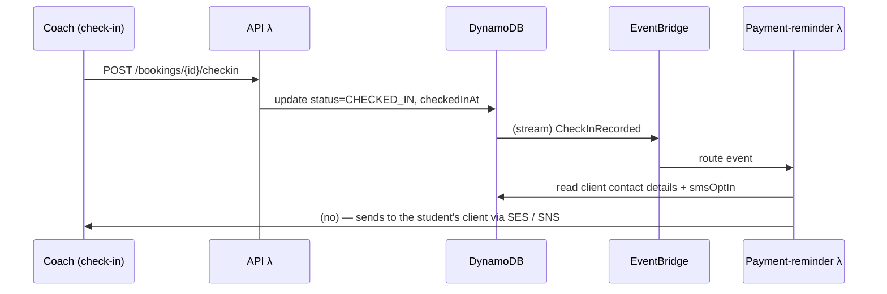
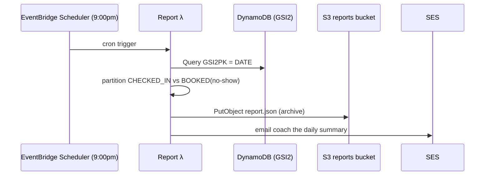
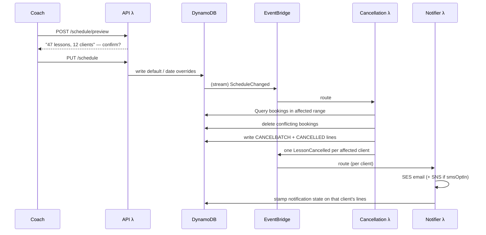

# BladeBook — Architecture

> A scheduling, student-management, and payment-reminder platform for hockey / figure-skating coaches.

**Status:** Design (pre-implementation)
**Last updated:** 2026-08-25
**Current through:** [ADR-009](adr/ADR-009-cancellation.md)

> This document describes the design as it currently stands. The reasoning behind each
> decision — and every alternative rejected along the way — lives in `docs/adr/`.
> Where this document and an ADR disagree, **the ADR is authoritative**; see §11 for
> the index.

---

## 0. Terminology

A **student** may be a child *or* an adult, so "parent" is not a universal role. The model uses **client** instead:

| Term | Meaning |
|---|---|
| **Student** | The person taking the lesson — any age. |
| **Client** | The person who books, is billed, and receives notifications for a student. For an adult student that's the student themselves; for a minor it's a parent or guardian. |
| **`clientRelationship`** | `SELF` \| `PARENT` \| `GUARDIAN` — records which of the above applies. |
| **`isMinor`** | Drives the child-data obligations in §7. Only students flagged as minors pull in consent/COPPA handling. |

"Parent" appears in this document only where it genuinely means a parent or guardian of a minor.

---

## 1. Goals & Priorities

| Priority | What it means for the design |
|---|---|
| **Security-first** | Least-privilege IAM per function, Cognito auth, encryption everywhere, PII minimization — and because **some students are minors**, explicit attention to guardian-consent / child-data handling wherever that applies (see §7). |
| **Event-driven** | Domain events (`LessonBooked`, `CheckInRecorded`, …) flow through EventBridge; reminders and reports are event/schedule consumers, not inline code. |
| **Low cost at low scale** | Fully serverless, pay-per-use, no always-on infrastructure. Target **~$2–10/month idle**. |
| **AWS-native** | Deployable to AWS from day one via infrastructure-as-code. |

---

## 2. Tech Stack

| Layer | Choice | Rationale |
|---|---|---|
| **Compute** | Java on AWS **Lambda** (eight functions) | Language you know; pay-per-use ≈ $0 at low traffic. |
| **Java runtime** | **Spring Boot 4** on the **`java25` managed runtime**, **arm64** | ADR-001. Chosen on ecosystem depth, published support policy, and AWS-managed JVM patching — *not* on latency. **SnapStart is withdrawn** (ADR-001 A1): cold start is no longer a design constraint. The async consumers use plain `RequestHandler` classes with no framework. |
| **API** | API Gateway (HTTP API) | Cheapest API GW tier ($1/M req); JWT authorizer integrates with Cognito. |
| **Data** | **DynamoDB** (single-table, on-demand) | No VPC required → avoids ~$32/mo NAT Gateway. ~$0–2/mo at our scale. |
| **Auth** | **Cognito** User Pool | Managed auth; free up to tens of thousands of users. Groups for `Coach` / `Client` (an adult student or a minor's parent/guardian). |
| **Events** | **EventBridge** (custom bus + Scheduler) | Central event backbone + cron for scheduled jobs. |
| **Email** | **SES** | ~$0.10 per 1,000 emails. |
| **SMS** | **SNS** (per-student **opt-in**) | ~$0.01–0.02/text; requires toll-free/10DLC registration. Opt-in keeps cost + compliance contained. |
| **Frontend** | **React + TypeScript** on **S3 + CloudFront** | ~$1/mo hosting; clean split from backend. Visual theme is **Forest** (`design/theme-forest.md`) — a 34-token contract; coach-selectable alternates are Phase 2. |
| **Edge security** | **WAF** on CloudFront/API GW | Optional for MVP (+~$8–15/mo), recommended given security priority. |
| **IaC** | **AWS CDK (TypeScript)** | ADR-001 decision 2. Maven wired into `cdk.json`'s app command so `cdk deploy` cannot ship a stale JAR. `cdk-nag` runs in CI as the §7 checklist. |

---

## 3. System Architecture



**Key idea:** the API Lambdas only read/write DynamoDB. All notification, cancellation
and reporting logic lives in **independent event/schedule consumers** — so we can add,
change, or split them (e.g. the separate check-in app) without touching the core API.
Domain events are derived from committed writes via change-data-capture (§6), never
published alongside them.

---

## 4. Domain Model



**There is no `AVAILABILITY_SLOT` entity and no `slotId`.** Availability is *computed*
from the schedule pattern minus existing bookings (ADR-004 decision 1). A slot's
identity is `(date, startTime)`, which is exactly what the booking sort key encodes.

*Check-in is state on the Booking (`status` + `checkedInAt`), not a separate entity —
simpler and matches the access patterns.*

*The client contact fields are denormalized onto `STUDENT` from `CLIENT#…/PROFILE`, so
notification code never branches on age and never needs a second read. `CLIENT` is the
source of truth; a profile edit fans out transactionally (ADR-002 decision 4).*

---

## 5. DynamoDB Single-Table Design

DynamoDB is **access-pattern-first**: we design keys around the queries, not the entities.

### Access patterns

| # | Query | Served by |
|---|---|---|
| 1 | Get a coach's profile | Main table, PK |
| 2 | List all students for a coach | Main table, `begins_with(SK, "STUDENT#")` |
| 3 | Get one student | Main table, PK+SK |
| 4 | **Compute a coach's availability for a date range** | Default schedule (`GetItem`) + date overrides (#13) + bookings in range (#5), expanded in memory |
| 5 | List a coach's bookings for a day or range | Main table, `begins_with(SK, "BOOKING#<date>")` / `between` |
| 6 | List a client's upcoming bookings (their own, or their child's) | **GSI1** (by student) |
| 7 | **List ALL bookings on a date across every coach** (for the scheduled jobs) | **GSI2** (by date) |
| 8 | List a client's students | Main table, `PK = CLIENT#<sub>`, `begins_with(SK, "STUDENT#")` |
| 9 | Resolve a coach code to a coach | Main table, `GetItem PK = CODE#<code>` |
| 10 | List a coach's pending students | Pattern #2, filtered on `status = PENDING` |
| 11 | List a coach's unpaid bookings, oldest first | **GSI3** (sparse), `GSI3PK = COACH#<coachId>` |
| 12 | List a student's unpaid bookings | GSI1, filtered on `paymentStatus` |
| 13 | List date overrides in a range (month grid, week view) | Main table, `SK between SCHEDULE#DATE#<from> and SCHEDULE#DATE#<to>` |
| 14 | List a coach's cancellation batches, newest first | Main table, `begins_with(SK, "CANCELBATCH#")`, descending |
| 15 | List the cancelled lessons in one batch | Main table, `begins_with(SK, "CANCELLED#<isoTs>#<batchId>")` |
| 16 | List the surviving lessons of one recurrence | GSI1, filtered on `recurrenceId` |
| 17 | List a coach's temporary schedules | Main table, `begins_with(SK, "SCHEDULE#TEMP#")` |
| 18 | Find temps overlapping a candidate date range | Pattern #17, filtered on `startDate`/`endDate` |
| 19 | A coach's week, slot by slot — open / booked / held | Pattern #5 over a Sun–Sat range, against computed availability |
| 20 | A client's cancellable upcoming bookings | GSI1, filtered on `status = BOOKED` |

### Table layout

**Main table** — partition key `PK`, sort key `SK`:

| Entity | PK | SK | Notable attributes |
|---|---|---|---|
| Coach profile | `COACH#<coachId>` | `PROFILE` | name, email, **timezone** (IANA, required), coachCode, currency (USD\|CAD), paymentInstructions, themeId *(Phase 2)* |
| Default schedule | `COACH#<coachId>` | `SCHEDULE#DEFAULT` | `name` (optional), `days` — weekday → ordered blocks |
| Temp schedule header | `COACH#<coachId>` | `SCHEDULE#TEMP#<tempId>` | `name` (optional), `startDate`, `endDate` |
| Date override | `COACH#<coachId>` | `SCHEDULE#DATE#<yyyy-mm-dd>` | `tempId`, `blocks` — empty list means no lessons that day |
| Student | `COACH#<coachId>` | `STUDENT#<studentId>` | isMinor, clientRelationship, clientId, status, clientName/Email/Phone, smsOptIn, priceMinorOverride |
| Booking | `COACH#<coachId>` | `BOOKING#<date>#<startTime>` | studentId, durationMinutes, **priceMinor + currency** (both stamped at creation), recurrenceId, startsAtUtc, coachTz, status, checkedInAt, paymentStatus, paidAt, markedPaidBy, paymentReminderSent |
| Cancellation batch | `COACH#<coachId>` | `CANCELBATCH#<isoTs>#<batchId>` | **cancelledBy** (`CLIENT\|COACH\|SCHEDULE_CHANGE`), cancelledById, source, affectedFrom, affectedTo, lessonCount, clientCount |
| Cancelled lesson | `COACH#<coachId>` | `CANCELLED#<isoTs>#<batchId>#<bookingId>` | date, startTime, durationMinutes, priceMinor, studentId, studentName, clientId, recurrenceId, **cancelledAt, noticeHours**, notificationStatus, notifiedAt, channels, failureReason |
| Client profile | `CLIENT#<cognitoSub>` | `PROFILE` | clientName, clientEmail, clientPhone, clientRelationship, smsOptIn |
| Client→student link | `CLIENT#<cognitoSub>` | `STUDENT#<coachId>#<studentId>` | studentName (denormalized), status |
| Coach code lookup | `CODE#<coachCode>` | `CODE` | coachId — written with `attribute_not_exists(PK)` |

A **block** is `{ seq, name?, start, end, lessonMinutes, priceMinor }` — the name optional
and **coach-facing only** (ADR-008 decision 2a); anything that must refer to a block falls
back to `Block <seq>`, a per-schedule sequence assigned at creation, never reused and never
renumbered — where `lessonMinutes` is one of
30, 45, 60, 90 or 120 (ADR-008 decision 5 — a UI constraint; the stored field is an
integer). Blocks within a day must not overlap (abutting is allowed); breaks are simply
the gaps between blocks. A whole schedule is one item, a few kilobytes, far inside the
400 KB limit.

**Resolution for a date `D`:** if `SCHEDULE#DATE#<D>` exists, its blocks apply (even if
empty); otherwise the default's weekday map applies. One rule, one lookup, no
precedence stack (ADR-006 decision 2).

**The temp header is never read on the booking path.** `SCHEDULE#TEMP#` items exist for
management only — listing, naming, "runs 7 days," delete-as-a-unit, and overlap validation
in the editor. Availability resolves from `SCHEDULE#DATE#` items alone, so a stale or
missing header can misname a listing but can never affect what a client is able to book
(ADR-008 decision 7). Date items are written first, header last.

**A `COACH_HELD` booking is a slot the coach has retained** after cancelling — same
`BOOKING#` key, no `studentId`, no price. It writes **no GSI keys at all**, which is what
keeps it out of the client's views (GSI1), out of the 7am reminder and 9pm report (GSI2),
and out of the unpaid list (GSI3) with no filtering logic anywhere (ADR-009 decision 5).

**GSI1 — "by student"** (client-facing views):
`GSI1PK = STUDENT#<studentId>`, `GSI1SK = BOOKING#<date>`

**GSI2 — "by date, global"** (the scheduled jobs):
`GSI2PK = DATE#<yyyy-mm-dd>`, `GSI2SK = COACH#<coachId>#<startTime>`
→ the morning reminder job and end-of-day report both do a single `Query(GSI2PK = DATE#today)`.

**GSI3 — "unpaid", sparse** (ADR-003 decision 5):
`GSI3PK = COACH#<coachId>`, `GSI3SK = UNPAID#<date>#<studentId>`, written **only while
a booking is `UNPAID`** and removed when marked paid, so the index holds only
outstanding debts and stays permanently small.

> **This is the crux of choosing DynamoDB here.** GSI2 is what makes the cross-coach
> "everyone with a lesson today" queries O(1)-ish instead of a full table scan. It's
> the modeling work we traded the ~$20–45/mo Postgres+VPC bill for.

---

## 6. Event-Driven Flows

We publish domain events **reliably** using **DynamoDB Streams → EventBridge Pipe → EventBridge bus** (change-data-capture). This avoids the "dual-write" problem of writing to the DB and separately to the bus and having one fail — the event is derived from the committed write.

### 6.1 Booking a lesson



**The booking item *is* the lock.** Two clients racing for the same start time attempt
the same key; one wins, the other gets a condition failure and is shown refreshed
availability (ADR-004 decision 2). There is no slot record and no transaction.

**Recurring bookings** materialize immediately: the client marks a booking recurring and
gives an end date (**capped at 12 months**), and the system writes one ordinary booking
per weekly occurrence, each with its own conditional put, each stamped with its own
price and a shared `recurrenceId`. Occurrences that cannot be claimed are skipped and
reported — see §10 feature 5 and ADR-006 decision 4. **There is no booking horizon**:
any date the pattern generates a slot for is bookable.

### 6.2 Day-of reminders



### 6.3 Check-in → payment reminder



The email states the **specific amount owed** for that lesson, formatted from the
booking's stamped `priceMinor`, plus the coach's `paymentInstructions` (HTML-escaped).

### 6.4 End-of-day report



**Report archival (S3).** Each daily report is persisted to a private S3 bucket keyed by coach and date:

```
s3://bladebook-reports/coach=<coachId>/date=<yyyy-mm-dd>/report.json
```

- `report.json` is machine-readable (per-student checked-in / no-show breakdown) so it can later feed the Phase-2 coach analytics dashboard — queryable directly with **Athena**, no DynamoDB load.
- The bucket is **private** (Block Public Access on, no public policy), **SSE-KMS** encrypted, with a **lifecycle policy**. See §7 — some of that data is about minors.

### 6.5 Schedule change → cancellation → notification



A booking **conflicts** unless the pattern in effect on its date generates a slot with
exactly its start time and duration. Conflicting bookings are **deleted** — because the
booking item is the lock, a released time must stop existing — and recorded as
cancellation lines. The client is told the lesson is cancelled and given a link to book
a different time; the system never guesses a replacement.

**The preview is mandatory and is the replacement for the old 7-day horizon.** With
open-ended booking, nothing else bounds how much one save can destroy. Preview and
consumer must share one conflict implementation in `core/`. The preview is advisory —
the authoritative record is always the batch the consumer writes.

**It covers default changes as well as temporary ones** (ADR-008 decision 8). A default
change is the more dangerous of the two: it governs every date without an override, so
with no horizon and 12-month recurrences behind it, one save can reach a year out. A temp
is bounded by its own range. The preview also states how long the schedule runs — until
the end date for a temp, indefinitely for the default — and that accepting will send
cancellation emails.

### 6.6 Direct cancellation

Client- and coach-initiated cancellations (ADR-009) write the **same** `CANCELBATCH#` and
`CANCELLED#` records as the schedule-driven path above, tagged with `cancelledBy`. A
single-lesson cancellation is a batch of one. Two differences from §6.5:

- **No `ScheduleChanged` event and no conflict re-evaluation.** Cancelling never alters
  `SCHEDULE#DEFAULT` or any `SCHEDULE#DATE#` item, so only booking items move.
- **The notification direction depends on the actor.** A coach cancelling notifies each
  affected client, once per batch. A **client** cancelling notifies the **coach** — they
  already know themselves.

A coach cancelling is asked whether to release the time for rebooking (delete the booking)
or hold it (replace it with a `COACH_HELD` item at the same key). Bookings already
`CHECKED_IN` or `NO_SHOW` are never cancelled by a bulk day or week operation.

### Event catalog

| Event | Source | Consumers |
|---|---|---|
| `LessonBooked` | Booking write | Confirmation email |
| `LessonCancelled` | Booking delete | Cancellation notifier — one message per batch, routed **by actor**: coach- and schedule-driven cancellations go to each affected client; client-driven ones go to the coach |
| `ScheduleChanged` | Schedule / date-override write | Cancellation λ |
| `CheckInRecorded` | Check-in write | Payment reminder |
| `DailyReminderDue` (scheduled) | Scheduler | Day-of reminder λ |
| `DailyReportDue` (scheduled) | Scheduler | End-of-day report λ |

---

## 7. Security Model

### Authentication
- **Cognito User Pool** with two groups: `Coach` and `Client` (an adult student booking for themselves, or a parent/guardian booking for a minor — same permissions either way).
- API Gateway **JWT authorizer** validates Cognito tokens on every request.
- MFA available for coaches (they hold the most sensitive data).

### Authorization (data isolation)
- The `coachId` / `clientId` comes from the **verified JWT claim**, never from the request body. `clientId` is the Cognito `sub`.
- Every DynamoDB key is scoped by that identity (`PK = COACH#<coachId-from-token>`), so a coach structurally cannot read another coach's students. Every client read is rooted at `PK = CLIENT#<sub-from-token>`, so a client cannot enumerate another client's students.
- **One check is not structural:** booking and GSI1 reads must verify in code that the target `studentId` appears in the caller's link set, because GSI1 is keyed by student rather than by client. This is the natural place for an authorization test (ADR-002).
- Clients see only whether a slot is free — never who holds a taken one.

### Least privilege
- **One IAM role per Lambda**, granted only the specific actions it needs (e.g. the report λ gets `dynamodb:Query` on GSI2 + `ses:SendEmail` + `s3:PutObject` scoped to the reports bucket/prefix — nothing else).
- No wildcard `dynamodb:*`, `ses:*`, or `s3:*`. `cdk-nag` fails the build on any.

### Data protection
- **At rest:** DynamoDB + SES + the S3 reports bucket encrypted with KMS (default or CMK).
- **In transit:** TLS everywhere (CloudFront, API GW); enforce `aws:SecureTransport` on the reports bucket policy.
- **S3 reports bucket:** private — **Block Public Access** on, no public bucket policy, SSE-KMS, versioning + a retention **lifecycle policy**.
- **Cancellation records** name students and carry contact-adjacent data, so they inherit the same posture as any other student data. Retention for them is unresolved — see ADR-006 Open.
- **Secrets:** any third-party keys in **Secrets Manager**, never in env vars/code.
- **Audit:** CloudTrail on. PII access logging, tenant-isolation proof and app-health
  monitoring are open — see [monitoring-questions.md](monitoring-questions.md). The one
  boundary in the system that is **not** structural is the GSI1 client→student check below;
  it is the thing most worth logging and testing.

### ⚠️ Minors' data (this is a real obligation, not a nice-to-have)
Students may be adults or children. Where `isMinor = true`, we're storing data about a child plus their **parent/guardian contact info**, which triggers:
- **Parental/guardian consent** as the lawful basis for contact; SMS especially is opt-in per student.
- Likely **COPPA** (US) considerations and, depending on where coaches operate, state privacy laws. *Flagging for legal review before launch — not something to hand-wave.*

Because a coach's roster can mix both, the safe default is to treat a student as a minor until the coach says otherwise, and to apply these controls to **all** students regardless of age:
- **Data minimization** — collect only what's needed for scheduling + contact.
- Access logging + the ability to delete a student's data on request.
- The storage guardrails above — they cost nothing extra to apply uniformly and avoid a per-record compliance branch.

### Edge
- **WAF** managed rule sets (SQLi/XSS, rate-based rules) on CloudFront and/or API GW.
- API Gateway **throttling** to cap abuse and cost.

---

## 8. Scheduled Jobs

| Job | Trigger | What it does |
|---|---|---|
| Day-of reminders | EventBridge Scheduler, ~7:00am (coach timezone) | Query `DATE#today`, notify each booking's client (email + opt-in SMS). |
| End-of-day report | EventBridge Scheduler, ~9:00pm | Query `DATE#today`, split checked-in vs no-show, email the coach. |

**These are the only two cron jobs.** Nothing in the schedule, booking, recurrence or
cancellation design adds a scheduled job — availability is computed on read, recurrences
are materialized at booking time, and cancellation is event-driven.

*Timezone:* `Coach.timezone` is a required IANA identifier stored from the first write,
and every booking carries `startsAtUtc` and `coachTz` (ADR-001 decision 4). MVP runs one
Scheduler rule per job pinned to the launch timezone using Scheduler's native IANA
support, which handles DST. A second timezone is one more rule — no migration, no key
redesign.

---

## 9. Notifications

| Channel | Service | Cost | Notes |
|---|---|---|---|
| Email | SES | ~$0.10 / 1,000 | Primary channel; ~$0 at our scale. Must move SES out of sandbox before prod. |
| SMS | SNS | ~$0.01–0.02 / msg | **Per-student opt-in.** Requires US toll-free/10DLC number registration (~$2/mo + one-time). |

Every client always gets **email**; SMS is layered on only where `smsOptIn = true`.
Delivery always targets the client contact fields, so an adult student is notified
directly and a minor's parent/guardian is notified on their behalf — same code path.

**Reminders are per lesson**, never grouped: a client with two children who both have
lessons on the same day receives two reminders (ADR-002 decision 7).

**Cancellations are the one exception** — one message per client per *batch*, listing
that client's cancelled lessons, because the triggering event is one decision that
happened to touch several lessons rather than one lesson (ADR-006 decision 6). When the
**client** is the one cancelling, the message goes to the **coach** instead (ADR-009
decision 9).

### SMS is one segment (ADR-007)

| Rule | Why |
|---|---|
| **160 characters, hard-enforced** before `sns:Publish` | Past one segment the carrier splits the message, bills per segment, and guarantees nothing about ordering or reassembly |
| **GSM-7 characters only** | One character outside GSM-7 — `’`, `—`, `é`, any emoji — flips the whole message to UCS-2 and drops the limit to **70**. Extension-table characters (`[ ] { } \ ~ ^ \|` and `€`) count as two |
| **The SMS is a pointer; the email is the record** | 160 characters cannot hold a lesson list or payment instructions, so it states what happened and directs to the email — which every client always receives |
| **Never interpolate user-authored free text** | `paymentInstructions` above all: unbounded, PII-adjacent, and half of it is worse than none because it looks complete |
| **Budget and truncate variable fields deterministically** | A long student name must never push a message into a second segment |

Worst-case lengths: day-of reminder **63**, payment reminder **90**, cancellation digest
**80**. As a consequence, ADR-003 decision 7's payment instructions are **email-only**.

**One message is exempt: the opt-in confirmation**, sent once per phone number when a
client enables SMS. It carries the program identity, frequency and rate disclosures, and
the HELP/STOP instructions — ~216 characters, two segments — so the recurring templates
don't have to spend budget on compliance text. The GSM-7 and no-free-text rules still
apply to it.

**Check `CheckIfPhoneNumberIsOptedOut` before every publish.** SNS honours STOP itself
but does not error when you publish to an opted-out number, so a naive send records
success for a message that was never delivered. A suppressed send is recorded as
`SUPPRESSED` — distinct from `FAILED` — and flips `smsOptIn` to false so the coach's view
matches reality.

**"Sent" means SES/SNS accepted the message**, not that it was delivered or read. Real
delivery confirmation needs SES event destinations and is not in MVP.

---

## 10. MVP Scope vs. Later Phases

### MVP (Phase 1)

| # | Feature | Source |
|---|---|---|
| 1 | Coach auth, student roster, and the **PENDING confirmation queue** | ADR-002 |
| 2 | Client **self-registration with a `coachCode`**, including multiple children in one sign-up | ADR-002 |
| 3 | Coach **schedule editor**: tabbed form (SOD, EOD, lesson length, cost, plus days for the default or a date range for a temp) with a live slot calendar and per-slot selection | ADR-008 |
| 4 | **Monthly calendar + Sun–Sat week view**, for both coach and client, with prev/next navigation | ADR-006 |
| 5 | Clients book open slots — **single or recurring with an end date** (≤12 months), partial success reported per skipped date | ADR-006 |
| 6 | **Validation, impact preview and explicit acceptance** before any schedule save — covering default *and* temporary changes | ADR-008 |
| 7 | **Cancellation records** + notification with send/failure state, routed by actor | ADR-006, ADR-009 |
| 8 | **Client cancellation** — per-lesson cancel with confirmation, plus recurrence management (move the end date earlier, or cancel all future lessons) | ADR-009 |
| 9 | **Coach week view** — the week by timeslot, showing *Open*, the student's name, or a held slot | ADR-009 |
| 10 | **Coach cancellation** — one lesson, one day, or one week, each choosing release-or-hold | ADR-009 |
| 11 | Day-of email reminders | §6.2 |
| 12 | Check-in *inside the coach app* (not yet a separate app) | §6.3 |
| 13 | **Payments surface**: price and currency stamped at booking, mark-as-paid, outstanding-lessons view, payment-reminder email stating the amount | ADR-003 |
| 14 | End-of-day report email to coach | §6.4 |
| 15 | SMS opt-in wiring, including the one-off opt-in confirmation message | §9, ADR-007 |

> **Scope warning.** This list has grown from eight features to fifteen across ADR-006,
> ADR-008 and ADR-009. Features 3, 4, 6, 9 and 10 are all the same surface — a coach
> spends nearly all their time in the schedule and week views, and that surface is now the
> largest single piece of MVP work by a wide margin, as well as the thing a coach judges
> the product by.

### Phase 2+
- **Applying a saved schedule** — the second half of ADR-008's optional Name field.
- **Recurrence extension** — moving a recurrence's end date *later*, which re-runs
  materialization. MVP only moves it earlier (ADR-009 decision 4).
- **A coach booking on a client's behalf** (ADR-009).
- **Late-cancellation fee** as a coach profile setting, changing the client-facing wording
  from "may incur" to "will incur" (ADR-009 decision 3).
- **Cancellation reasons** — distinct email templates for sick, emergency, vacation.
- **Cancelling from the week view** as a client, when the booking is theirs.
- Separate, mobile-friendly **check-in app** (shares the same event backbone).
- **In-app payments** (Stripe/AWS integration) — explicitly *not* an MVP goal. Introduces refunds/credits, which the current no-ledger payment model cannot express.
- Waitlists / package plans.
- **Named, reusable schedule templates** ("summer camp", "off-season") — the temporary-schedule entity ADR-006 deliberately dissolved, returning in a more useful form.
- **Coach-selectable themes** — a coach picks their theme, and **it runs throughout**:
  their own pages *and* the client-facing booking flow for every family they teach. It is
  the coach's brand, not a personal display setting. **Forest ships as the only theme in
  MVP** (`design/theme-forest.md`); four alternates are specified and measured in
  `design/themes-phase2/`, all implementing the same 34-token contract, so this is a
  stored preference plus a stylesheet swap rather than a redesign. Two consequences:
  `Coach.themeId` resolves from the **`coachId` of the page being rendered**, never from
  the signed-in user; and because a client reaching a booking page is unauthenticated,
  the theme must be resolvable before first paint rather than fetched from a session.
- **Real delivery confirmation** (SES event destinations, bounce/complaint handling).
- Coach analytics dashboard, fed by the archived daily reports.
- Multi-timezone scheduling (additive config — the data model already handles it).

---

## 11. Decision Record

Every significant decision, and the alternatives rejected, live in `docs/adr/`.
ADRs are append-only: a changed decision gets a new ADR, not an edit.

| ADR | Decides | Status |
|---|---|---|
| [001](adr/ADR-001-backend-stack.md) | Backend stack, IaC language, repo layout, timezone handling | Accepted; amended (SnapStart withdrawn) |
| [002](adr/ADR-002-client-registration.md) | Client registration, the client↔student link, coach codes | Accepted |
| [003](adr/ADR-003-lesson-pricing-and-payment.md) | Lesson pricing and payment tracking | Partially superseded by 004 |
| [004](adr/ADR-004-schedule-patterns.md) | Computed availability, schedule blocks, pattern-bound pricing | Partially superseded by 006 |
| [005](adr/ADR-005-booking-horizon-and-recurring-lessons.md) | 7-day booking horizon; recurring lessons deferred | Largely superseded by 006 |
| [006](adr/ADR-006-open-booking-recurring-lessons-and-cancellation.md) | Open booking, per-date overrides, recurring lessons in MVP, cancellation records | Accepted |
| [007](adr/ADR-007-sms-message-constraints.md) | SMS length, encoding, and content constraints | Accepted; amends 003 |
| [008](adr/ADR-008-schedule-editor.md) | The schedule editor; signup defaults removed; temp headers restored | Accepted; supersedes parts of 003, amends 004 and 006 |
| [009](adr/ADR-009-cancellation.md) | Client, coach and schedule-driven cancellation; coach-held slots | Accepted; extends 006 |

### The largest open threads

- **How a coach account comes to exist** (ADR-002 Open). Self-serve signup means anyone
  can create a coach account and start collecting children's data. Must be resolved
  before feature #1 is built.
- **Currency** is a field with no chosen value, and nothing establishes whether coaches
  are US or Canadian (ADR-003 Open).
- **Is a `NO_SHOW` owed?** The last unresolved question in the payment model. ADR-009
  settled that a *cancelled* lesson is never billed; a no-show is still unspecified, and
  as the model stands it is never billed either, which is probably not what a coach wants.
- **Student data deletion.** §7 commits to "the ability to delete a student's data on
  request" as part of the minors' obligations, and nothing implements it. **Deferred by the
  owner, 2026-08-25.** Worth knowing what deferring costs: the promise is already written
  into §7, so the gap is between a stated obligation and the product, not merely a missing
  feature.
- **Retention of cancellation records**, which name students (ADR-006 and ADR-009 Open).
  **Deferred by the owner, 2026-08-25** pending a conversation with a coach about whether
  cancellation records are needed for tax purposes — which would set the floor for any
  retention window, and would mean the answer is a business record-keeping requirement
  rather than a data-minimisation one.
- **Monitoring, logging and PII access auditing** — see
  [monitoring-questions.md](monitoring-questions.md).
- **How a coach releases a held slot** (ADR-009 Open) — holds are currently irreversible.
- **WAF in or out for MVP** — the one line item that would meaningfully move §12.

---

## 12. Cost Model (idle, us-east-1, approximate)

| Component | Monthly |
|---|---|
| Lambda (all functions) | ~$0 (free tier) |
| DynamoDB (on-demand) | ~$0–2 |
| API Gateway (HTTP) | ~$0–1 |
| Cognito | ~$0 |
| SES (email) | ~$0–1 |
| SNS (SMS) | ~$0 idle + ~$2/mo number once enabled |
| S3 + CloudFront | ~$1 |
| EventBridge | ~$0 |
| **Subtotal** | **~$2–6** |
| WAF (optional) | +~$8–15 |

> Costs scale with *usage*, and usage here is tiny — the design deliberately has **no always-on infrastructure** (no NAT gateway, no idle DB instance, no load balancer).
>
> Open-ended booking and 12-month recurrences mean the table holds an order of magnitude
> more booking items than a 7-day window would have. At this scale that is still cents,
> and GSI2 is queried one date at a time so its partitions stay small — but "how many
> bookings exist" is no longer trivially bounded, and any future full-range scan must be
> written knowing that.
