# BladeBook — Architecture

> A scheduling, student-management, and payment-reminder platform for hockey / figure-skating coaches.

**Status:** Design (pre-implementation)
**Last updated:** 2026-10-13
**Current through:** [ADR-030](adr/ADR-030-financial-page-gross-and-rink-fees.md)

> This document describes the design as it currently stands. The reasoning behind each
> decision — and every alternative rejected along the way — lives in `docs/adr/`.
> Where this document and an ADR disagree, **the ADR is authoritative**; see §11 for
> the index.
>
> For *why* each part was chosen, in one place, see
> [design-rationale.md](design-rationale.md).

---

## 0. Terminology

A **student** may be a child *or* an adult, so "parent" is not a universal role. The model uses **client** instead:

| Term | Meaning |
|---|---|
| **Student** | The person taking the lesson — any age. |
| **Client** | The person who books, is billed, and receives notifications for a student. For an adult student that's the student themselves; for a minor it's their guardian. |
| **`clientRelationship`** | `SELF` \| `GUARDIAN` — records which of the above applies. *`PARENT` was removed 2026-10-01: a parent is recorded as a guardian.* |
| **`isMinor`** | Drives the child-data obligations in §7. Only students flagged as minors pull in consent/COPPA handling. |

"Guardian" means whoever books for a minor, parent or otherwise. The product doesn't distinguish the two.

---

## 1. Goals & Priorities

| Priority | What it means for the design |
|---|---|
| **Security-first** | Least-privilege IAM per function, Cognito auth, encryption everywhere, PII minimization — and because **some students are minors**, explicit attention to guardian-consent / child-data handling wherever that applies (see §7). |
| **Event-driven** | Domain events (`LessonBooked`, `CheckInRecorded`, …) flow through EventBridge; reminders and reports are event/schedule consumers, not inline code. |
| **Low cost at low scale** | Fully serverless, pay-per-use, no always-on infrastructure. Target **~$20–32/month idle in production**, plus the dev environment for the hours it is up — restated 2026-09-30 from ~$2–10 once the WAF, SMS registration, alarms and domain were costed, and 2026-10-07 when staging was replaced by an on-demand dev environment (ADR-027, §12). |
| **AWS-native** | Deployable to AWS from day one via infrastructure-as-code. |

---

## 2. Tech Stack

| Layer | Choice | Rationale |
|---|---|---|
| **Compute** | Java on AWS **Lambda** (fourteen functions — ADR-001 A5, ADR-017, ADR-018, ADR-010 d5k, ADR-025, ADR-026, ADR-021, ADR-023) | Language you know; pay-per-use ≈ $0 at low traffic. |
| **Java runtime** | **Spring Boot 4** on the **`java25` managed runtime**, **arm64** | ADR-001. Chosen on ecosystem depth, published support policy, and AWS-managed JVM patching — *not* on latency. **SnapStart is withdrawn** (ADR-001 A1): cold start is no longer a design constraint. The async consumers use plain `RequestHandler` classes with no framework. |
| **API** | API Gateway (**REST API**) | Chosen over the cheaper HTTP API (~$3.50/M requests vs ~$1/M — cents at this volume) because only a REST API can take a Web Application Firewall (ADR-019, ADR-001 A7). Cognito authorizer on every protected route. |
| **Data** | **DynamoDB** (single-table, on-demand) | No VPC required → avoids ~$32/mo NAT Gateway. ~$0–2/mo at our scale. |
| **Auth** | **Cognito** User Pool | Managed auth; free up to tens of thousands of users. Groups for `Coach` / `Client` (an adult student or a minor's guardian). |
| **Events** | **EventBridge** (custom bus + Scheduler) | Central event backbone + cron for scheduled jobs. |
| **Email** | **SES** | ~$0.10 per 1,000 emails. |
| **SMS** | **SNS** (MVP: the coach's late-cancellation text only; client texts are **Phase 2**, ADR-007; **opt-in per phone number**) | ~$0.01–0.02/text; requires toll-free/10DLC registration. Opt-in keeps cost + compliance contained. |
| **Frontend** | **React + TypeScript** on **S3 + CloudFront** | ~$1/mo hosting; clean split from backend. Two sites: the **coach website**, which includes the rinkside check-in page at `/coach/rinkside` (ADR-023), and the **family website**. Visual theme is **Harbor** (`design/harbor/`; chosen 2026-10-01, replacing Forest, which moved to `design/DecidedAgainst/forest-theme/`). Coach-selectable alternates are Phase 2. |
| **Edge security** | **WAF** on the API and Cognito | **In MVP** (ADR-019): one web ACL attached to the REST API's stage and the Cognito user pool, so sign-up, sign-in and every API call pass through it. CloudFront serves only the static site. ~$10/mo per environment. |
| **IaC** | **AWS CDK (TypeScript) or Terraform** — *undecided* | ADR-001 decision 2 chose CDK, with Maven wired into `cdk.json`'s app command so `cdk deploy` cannot ship a stale JAR and `cdk-nag` in CI as the §7 checklist. **Re-opened 2026-09-04 (ADR-001 A4):** decision 2 never compared CDK to Terraform. The choice is open, judged against A4's criteria; whichever is chosen must enforce §7's least-privilege rules as a CI check. |

---

## 3. System Architecture

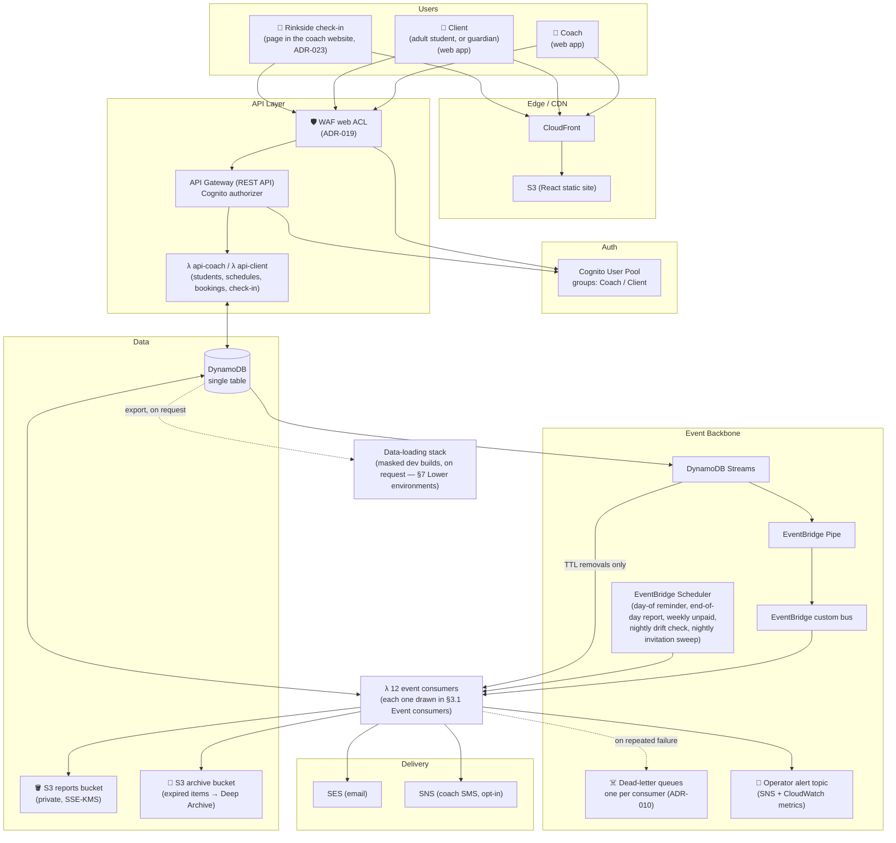

**Key idea:** the API Lambdas only read/write DynamoDB. All notification, cancellation
and reporting logic lives in **independent event/schedule consumers** — so we can add,
change, or split them (e.g. the rinkside check-in page) without touching the core API.
Domain events are derived from committed writes via change-data-capture (§6), never
published alongside them.

### 3.1 Event consumers

The twelve consumers in the box above, one by one: what starts each one, and what each one reads or writes. Events reach them through the EventBridge bus, schedules through EventBridge Scheduler, and expired items through DynamoDB Streams (§6 has the step-by-step flows).

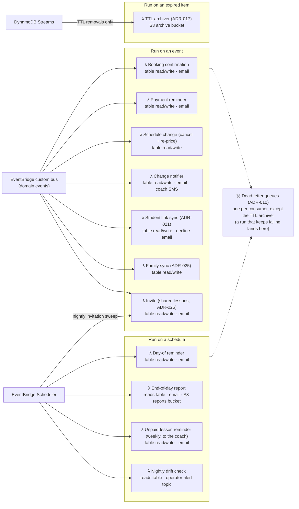

---

## 4. Domain Model

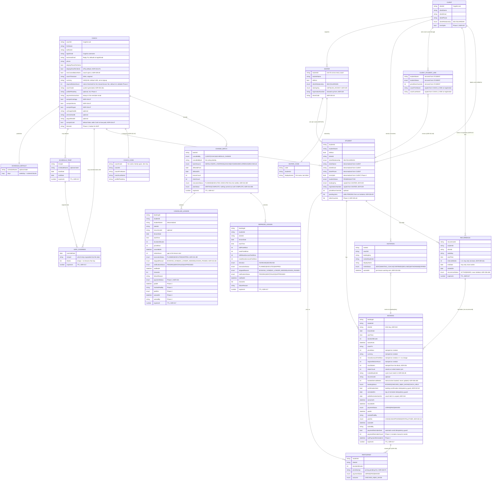

**There is no `AVAILABILITY_SLOT` entity and no `slotId`.** Availability is *computed*
from the schedule pattern minus existing bookings (ADR-004 decision 1). A slot's
identity is `(date, startTime)`, which is exactly what the booking sort key encodes.

*Attendance is state on the Booking (`bookingStatus` + `outcomeAt` + `recordedAt`), not a
separate entity —
simpler and matches the access patterns.*

*The client contact fields are denormalized onto `STUDENT` from `CLIENT#…/PROFILE`, so
notification code never branches on age and never needs a second read. `CLIENT` is the
source of truth; a profile edit fans out transactionally (ADR-002 decision 4).*

---

## 5. DynamoDB Single-Table Design

DynamoDB is **access-pattern-first**: we design keys around the queries, not the entities.

### Access patterns

| # | Query | Served by |
|---|---|---|
| 1 | Get a coach's profile | Main table, PK |
| 2 | List all students for a coach | Main table, `begins_with(SK, "STUDENT#")` |
| 3 | Get one student | Main table, PK+SK |
| 4 | **Compute a coach's availability for a date range** | Default schedule (`GetItem`) + date overrides (#13) + bookings in range (#5), expanded in memory |
| 5 | List a coach's bookings for a day or range | Main table, `begins_with(SK, "BOOKING#<date>")` / `between` |
| 6 | List a client's upcoming bookings (their own, or their child's) | **GSI1** (by client), filtered on `studentId` for one student (ADR-022 d4) |
| 7 | **List ALL bookings on a date across every coach** (for the scheduled jobs) | **GSI2** (by date) |
| 8 | List a client's students | Main table, `PK = CLIENT#<sub>`, `begins_with(SK, "STUDENT#")` |
| 9 | Resolve a coach code to a coach | Main table, `GetItem PK = CODE#<code>` |
| 10 | List a coach's pending students | Pattern #2, filtered on `studentStatus = PENDING` |
| 11 | List a coach's unpaid bookings, oldest first | **GSI3** (sparse), `GSI3PK = COACH#<coachId>` |
| 12 | List a student's unpaid bookings | Client: GSI1 (by client), filtered on `studentId` and `paymentStatus`. **Coach: GSI3, filtered on `studentId`** — `api-coach` holds no GSI1 (ADR-021 d4) |
| 12a | **Coach dashboard — every lesson in a date range** (serves both the payment section and the lesson list) | Main table, `SK between BOOKING#<from> and BOOKING#<to>`. The date range is **required before the list renders**, which is what keeps this query bounded. |
| 13 | List date overrides in a range (month grid, week view) | Main table, `SK between SCHEDULE#DATE#<from> and SCHEDULE#DATE#<to>` |
| 14 | List a coach's cancellation batches, newest first | Main table, `begins_with(SK, "CHANGEBATCH#")`, descending |
| 15 | List the cancelled and re-priced lessons in one batch | Main table, `begins_with(SK, "CANCELLED#<isoTs>#<batchId>")` and `begins_with(SK, "REPRICED#<isoTs>#<batchId>")` (ADR-020) |
| 16 | List the surviving lessons of one recurrence | GSI1 (by client), filtered on `recurrenceId` |
| 17 | List a coach's temporary schedules | Main table, `begins_with(SK, "SCHEDULE#TEMP#")` |
| 18 | Find temps overlapping a candidate date range | Pattern #17, filtered on `startDate`/`endDate` |
| 19 | A coach's week, slot by slot — open / booked / held | Pattern #5 over a Sun–Sat range, against computed availability |
| 20 | A client's cancellable upcoming bookings | GSI1 (by client), filtered on `bookingStatus = BOOKED` |
| 21 | A client's recurring arrangements (recurrence management) | Main table, `PK = CLIENT#<sub>`, `begins_with(SK, "RECURRENCE#")` — no filter (ADR-009 d4c, ADR-022 d5) |
| 22 | Every unpaid past lesson older than a cutoff, across coaches (the weekly coach reminder) | **Scan on GSI3** — sparse, so it holds only outstanding debts — filtered on the date in `GSI3SK` (ADR-018) |

### Attribute names avoid DynamoDB reserved words

DynamoDB reserves about 570 words — `NAME`, `STATUS`, `DATE`, `START`, `END`, `SOURCE`,
`TIMEZONE` among them, ignoring case — and an attribute with one of those names must be
aliased in every expression or the request fails. *Decided by the owner, 2026-09-30:* the
model uses none of them. Eight attributes were renamed:

| Was | Now |
|---|---|
| `status` (booking / student / recurrence header) | `bookingStatus` / `studentStatus` / `recurrenceStatus` |
| `date` (booking, cancelled and re-priced lines / date override) | `lessonDate` / `overrideDate` |
| `name` (schedules / blocks / student) | `scheduleName` / `blockName` / `studentName` |
| `start`, `end` (blocks) | `startTime`, `endTime` |
| `source` (change batch) | `batchSource` |
| `timezone` (coach) | `coachTimezone` |

**Any new attribute is checked against AWS's reserved-word list before it is used.**

### Table layout

**Main table** — partition key `PK`, sort key `SK`:

| Entity | PK | SK | Notable attributes |
|---|---|---|---|
| Coach profile | `COACH#<coachId>` | `PROFILE` | firstName, lastName, loginEmail, **businessEmail** (Reply-To; defaults to loginEmail), phone, displayPhoneToClients, **displayEmailToClients**, **coachTimezone** (IANA, required), currency (USD\|CAD, default USD), **requiredNoticeHours** (ADR-015 d3; default 24, editable from Phase 2), **smsCancellationAlerts** (ADR-009 d9; default false), coachCode, profilePhotoKey, paymentInstructions, cashapp/venmo/paypal handles, **acceptsCash / acceptsCashapp / acceptsVenmo / acceptsPaypal** (one switch per payment type, ADR-016 d7, 2026-10-12), themeId *(Phase 2)* (ADR-016) |
| Default schedule | `COACH#<coachId>` | `SCHEDULE#DEFAULT` | `scheduleName` (optional), `days` — weekday → ordered blocks |
| Temp schedule header | `COACH#<coachId>` | `SCHEDULE#TEMP#<tempId>` | `scheduleName` (optional), `startDate`, `endDate` |
| Date override | `COACH#<coachId>` | `SCHEDULE#DATE#<yyyy-mm-dd>` | `tempId`, `blocks` — empty list means no lessons that day |
| Student | `COACH#<coachId>` | `STUDENT#<studentId>` | studentName, isMinor, clientRelationship, clientId, studentStatus, clientName/Email/Phone, smsOptIn, priceMinorOverride, **pendingJoins** (while `PENDING` from a shared-lesson invitation: booking keys and invitation IDs for the coach's Accept to join; ADR-026 d5), **otherCoaches** (*Phase 2*; names of the skater's other `ACTIVE` coaches, kept by `consumer-student-link`; ADR-025 d4). One coach's view of a skater; the same `studentId` can appear under several coaches. |
| Booking | `COACH#<coachId>` | `BOOKING#<date>#<startTime>` | **maxSkaters + skaterCount** (ADR-026: stamped from the block and never lowered once booked; raised as invited skaters join), **invitedStudentId** (the skater the booking family invited; a join must match it, ADR-026 d5), studentId, **clientId** (GSI1 key, ADR-022), durationMinutes, **priceMinor + currency + missedLessonFeeMinor + requiredNoticeHours** (all stamped at creation), recurrenceId, **bookedIntervalWeeks** (never updated), startsAtUtc, coachTz, bookingStatus, **confirmationSent**, **remindedOn**, **settleReminderSentOn**, **outcomeAt + recordedAt**, paymentStatus, paidAt, markedPaidBy, **paidVia** (CASH\|CASHAPP\|VENMO\|PAYPAL\|OTHER; optional, editable, coach-only; none when waived, ADR-003 d4), **waivedAt + waivedBy**, paymentReminderSent, *(Phase 2)* paymentReminderCount + lastPaymentReminderAt |
| Lesson participant | `COACH#<coachId>` | `PARTICIPANT#<date>#<startTime>#<studentId>` | An invited skater who joined a shared booking (ADR-026): studentId, clientId, durationMinutes, price stamps, paymentStatus, outcome, reminder flags, and GSI1/GSI2/GSI3 keys as a booking has. A separate prefix keeps it out of availability queries. |
| Recurrence header | `CLIENT#<clientId>` — *moved from the coach's partition by ADR-022 d5* | `RECURRENCE#<coachId>#<recurrenceId>` | studentId, clientId, weekday, startTime, **intervalWeeks** (1–4), endDate, startedOn, **recurrenceStatus** (`ACTIVE\|ENDED` — never deleted) — read only by recurrence management, never on the booking path (ADR-009 d4c, ADR-006 d4b) |
| Cancellation batch | `COACH#<coachId>` | `CHANGEBATCH#<isoTs>#<batchId>` | **cancelledBy** (`CLIENT\|COACH\|SCHEDULE_CHANGE`), cancelledById, batchSource, affectedFrom, affectedTo, lessonCount, clientCount, **executionStatus** (`PLANNED\|EXECUTED`) |
| Cancelled lesson | `COACH#<coachId>` | `CANCELLED#<isoTs>#<batchId>#<bookingId>` | lessonDate, startTime, durationMinutes, priceMinor, studentId, studentName, clientId, recurrenceId, **cancelledAt, noticeHours**, **executionStatus** (`PLANNED\|EXECUTED\|SKIPPED`), notificationStatus, notifiedAt, channels, failureReason, *(Phase 2, ADR-015)* paymentStatus, paidAt, markedPaidBy, paidVia, waivedAt, waivedBy |
| Re-priced lesson | `COACH#<coachId>` | `REPRICED#<isoTs>#<batchId>#<bookingId>` | lessonDate, startTime, studentId, clientId, **oldPriceMinor + newPriceMinor**, old and new missedLessonFeeMinor, direction (`INCREASE\|DECREASE`), **executionStatus**, notificationStatus, notifiedAt, channels, failureReason (ADR-020) |
| Client profile | `CLIENT#<cognitoSub>` | `PROFILE` | clientName, clientEmail, clientPhone, clientRelationship, smsOptIn — copied to every coach's `STUDENT#` records by `consumer-family-sync` (ADR-025 d6) |
| Skater | `CLIENT#<cognitoSub>` | `SKATER#<studentId>` | studentName, isMinor, clientRelationship, **skatingOrg + registrationNumber** (ADR-029; copied to each coach's `STUDENT#` by `consumer-family-sync`) — the source of truth for who the skater is; one `studentId` across all their coaches (ADR-025 d1) |
| Client→student link | `CLIENT#<cognitoSub>` | `STUDENT#<coachId>#<studentId>` | studentName, studentStatus, priceMinorOverride — all mirrored from the `STUDENT#` item by `consumer-student-link` (ADR-021 d6, ADR-022 d6); coachFirstName, coachLastName — copied from the `CODE#` item at registration (ADR-022 d7) |
| Coach code lookup | `CODE#<coachCode>` | `CODE` | coachId, **coachFirstName, coachLastName, profilePhotoKey** (shown on the sign-up code screen before the family has an account, and on the pending screens; ADR-022 d7) — written with `attribute_not_exists(PK)` |
| Invitation | `CLIENT#<cognitoSub>` | `INVITE#<inviteId>` | coachId, booking key, **warnedAt** (the pre-lesson warning was sent, ADR-026 d5a), invited studentId and display name, inviteStatus (`SENT\|AWAITING_COACH\|CONFIRMED\|DECLINED\|WITHDRAWN\|EXPIRED`); one copy in each family's partition, kept in step by `consumer-invite` (ADR-026 d5) |
| Skater share code | `SKATERCODE#<code>` | `CODE` | studentId, display name (first name, last initial); issued by `consumer-family-sync` with `attribute_not_exists(PK)` (ADR-026 d4) |

A **block** is `{ seq, blockName?, startTime, endTime, lessonMinutes, priceMinor, missedLessonFeeMinor, maxSkaters }` (`maxSkaters` default 1, ADR-026) — the name optional
and **coach-facing only** (ADR-008 decision 2a); anything that must refer to a block falls
back to `Block <seq>`, a per-schedule sequence assigned at creation, never reused and never
renumbered — where `lessonMinutes` is one of
30, 45, 60, 90 or 120 (ADR-008 decision 5 — a UI constraint; the stored field is an
integer). Blocks within a day must not overlap (abutting is allowed); breaks are simply
the gaps between blocks. A whole schedule is one item, a few kilobytes, far inside the
400 KB limit.

**Resolution for a date `D`:** if `SCHEDULE#DATE#<D>` exists, its blocks apply (even if
empty); otherwise the default's weekday map applies. One rule, one lookup, no
precedence stack (ADR-006 decision 2).

**The temp header is never read on the booking path.** `SCHEDULE#TEMP#` items exist for
management only — listing, naming, "runs 7 days," delete-as-a-unit, and overlap validation
in the editor. Availability resolves from `SCHEDULE#DATE#` items alone, so a stale or
missing header can misname a listing but can never affect what a client is able to book
(ADR-008 decision 7). Date items are written first, header last.

**A `COACH_HELD` booking is a slot the coach has retained** after cancelling — same
`BOOKING#` key, no `studentId`, no price. It writes **no GSI keys at all**, which is what
keeps it out of the client's views (GSI1), out of the 7am reminder and 9pm report (GSI2),
and out of the unpaid list (GSI3) with no filtering logic anywhere (ADR-009 decision 5).

**Items expire through Time to Live (TTL)** (ADR-017). One attribute, `expiresAt` (seconds
since 1970), set per item from a per-item-type window held in configuration; an item without
it never expires. Past date overrides, temp headers and held slots expire a few weeks after
their dates. Bookings and chargeable cancellation lines get an expiry only **when settled**,
so an unpaid lesson never disappears. Profiles, links and codes are never on TTL — they end
by account closure or erasure on request. Parent records never expire before their children:
a batch header is raised to its latest line, and header repair (ADR-006 d4b) only runs for
arrangements with an upcoming lesson. The windows for records about people wait on the
legal review.

**GSI1 — "by client"** (client-facing views):
`GSI1PK = CLIENT#<clientId>`, `GSI1SK = BOOKING#<date>#<startTime>`. *Keyed by student until
ADR-022 (2026-10-01), which re-keyed it so a client's tenant role can be held to its own
bookings by the database.*

**GSI2 — "by date, global"** (the scheduled jobs):
`GSI2PK = DATE#<yyyy-mm-dd>`, `GSI2SK = COACH#<coachId>#<startTime>`
→ the morning reminder job and end-of-day report both do a single `Query(GSI2PK = DATE#today)`.

**GSI3 — "unpaid", sparse** (ADR-003 decision 5):
`GSI3PK = COACH#<coachId>`, `GSI3SK = UNPAID#<date>#<studentId>`, written **only while
a booking is `UNPAID`** and removed when marked paid or waived, so the index holds only
outstanding debts and stays permanently small. That smallness is what lets the weekly
unpaid-lesson reminder **scan** it across every coach (ADR-018) — the one scan in the design. *Phase 2:* late-cancellation `CANCELLED#`
lines join GSI3 while unpaid, because a late cancellation deletes its booking and the charge
has to live on the line instead (ADR-015 d4).

> **This is the crux of choosing DynamoDB here.** GSI2 is what makes the cross-coach
> "everyone with a lesson today" queries O(1)-ish instead of a full table scan. It's
> the modeling work we traded the ~$20–45/mo Postgres+VPC bill for.

---

## 6. Event-Driven Flows

We publish domain events **reliably** using **DynamoDB Streams → EventBridge Pipe → EventBridge bus** (change-data-capture). This avoids the "dual-write" problem of writing to the DB and separately to the bus and having one fail — the event is derived from the committed write.

### 6.1 Booking a lesson

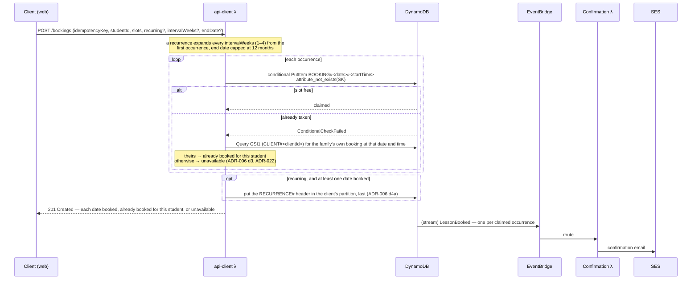

**The booking item *is* the lock.** Two clients racing for the same start time attempt
the same key; one wins, the other gets a condition failure and is shown refreshed
availability (ADR-004 decision 2). There is no slot record and no transaction.

**Recurring bookings** materialize immediately: the client marks a booking recurring,
picks a frequency of every 1–4 weeks (`intervalWeeks`), and gives an end date (**capped
at 12 months**). The system writes one ordinary booking per occurrence, each with its own
conditional put, each stamped with its own price and a shared `recurrenceId`, plus one
`RECURRENCE#` header recording the arrangement, written after the occurrences and only if
at least one was booked (ADR-006 d4a). The header exists because the current interval cannot
be recovered from the surviving bookings once one has been cancelled by hand (ADR-009 d4c).

**A failed booking repairs itself** (ADR-006 d4b). Each selected slot is its own recurrence,
and its `recurrenceId` is derived from the request's idempotency key and the slot, so the
app's automatic retry recognises the lessons its first attempt wrote. Every occurrence is
stamped with `bookedIntervalWeeks` — the interval it was booked under, never updated — and
headers are never deleted (ending an arrangement marks it `ENDED`), so a header that was
never written is rebuilt automatically the next time the client's bookings load. Results
distinguish *booked*, *already booked for this student* and *unavailable*; if a client
resubmits without a slot the failed request included, the app asks whether to keep or
cancel the lessons it already holds, rather than guessing. Occurrences that cannot be claimed are skipped and
reported — see §10 feature 5 and ADR-006 decision 4. **There is no booking horizon**:
any date the pattern generates a slot for is bookable.

### 6.2 Day-of reminders

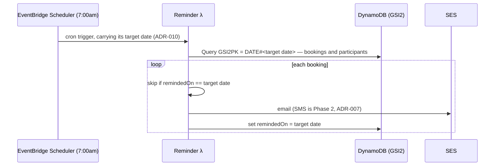

### 6.3 Attendance (check-in / no-show) → payment reminder

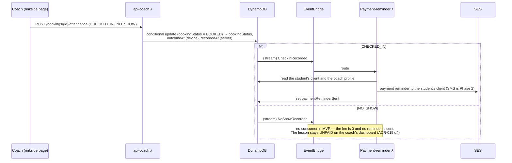

The email states the **specific amount owed** for that lesson, formatted from the
booking's stamped `priceMinor`, plus the coach's `paymentInstructions` (HTML-escaped).

**The coach records both outcomes.** The app marks a student **present or absent** — a
no-show is an affirmative act, not something inferred from silence (ADR-014 decision 6).
`CHECKED_IN` emits `CheckInRecorded` and `NO_SHOW` emits `NoShowRecorded` — two events, not
one, because the reminder wording differs (ADR-015 decision 5). **Both are charged, under one
rule**, since a no-show is a cancellation with zero notice: the lesson's
`missedLessonFeeMinor`. In MVP that fee is `0` and no reminder goes to the family, but a
recorded no-show still stays `UNPAID` on the coach's dashboard until the coach marks it paid
or waived (ADR-015 d4, amended 2026-09-30). For now the dashboard shows it at its **full
lesson price**, labelled as a no-show.

**Offline capture (ADR-014).** This is the only surface used *inside* a rink, where there
is often no signal. When the device is offline the app tells the coach, stores the student,
the outcome and the time in device storage, and replays the queue when connectivity
returns. Two consequences: `outcomeAt` is the **device's** time and `recordedAt` is the
server's, because an outcome replayed hours later must not read as though it happened
then; and the write is conditional on the booking still being `BOOKED`, so a duplicated
replay cannot emit `CheckInRecorded` twice and send a second payment reminder — and a
replay onto a booking cancelled while the phone was offline fails rather than overwriting
it. That last case is mostly the *client* cancelling a lesson the offline coach never got
told about, so the app reports it as a cancellation rather than as an error the coach
caused (ADR-014 decision 4). A queued check-in never expires: the server accepts the phone's time
whenever it arrives, **as long as it fits the lesson** — from an hour before the start to the
end of that day, in the coach's timezone — which catches a wrong clock (ADR-014 d2a). On
Android and Chrome the queue is sent in the background when signal returns (d1a); on an
iPhone, when the app next opens. The rare entry rejected for a wrong time is listed on the
phone for the coach to record on the website (d4a). If the app opens and today's lessons haven't loaded,
it says so — *"Today's lessons haven't loaded. Open the app with signal before you leave for
the rink."* — rather than showing an empty day (ADR-014 d5a). Because the reminder is driven by that event, an offline session delays
every reminder in it.

**Offline capture and replay, step by step** (ADR-014, amended 2026-10-13):

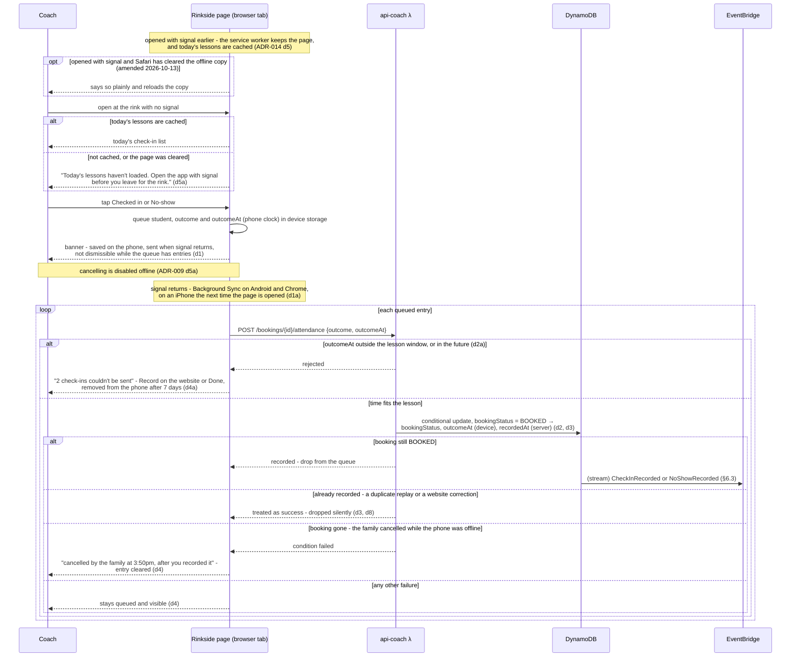

### 6.4 End-of-day report

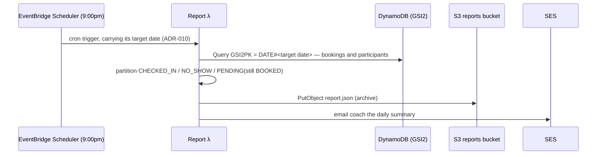

**Three buckets, and `PENDING` is the default.** *Decided by the owner, 2026-08-30.* The
report partitions the day into **checked in**, **no-show**, and **pending** — and a booking
the coach never recorded an outcome for lands in `PENDING`, not in no-show.

This matters because of offline capture. A booking still sitting at `BOOKED` at 9pm can
mean three different things: the coach forgot to record anything, the coach recorded it on
a phone that still has not regained signal, or the student genuinely never appeared. The
report cannot tell those apart, so it stops pretending it can. Reporting the unknown case
as a no-show would quietly convert "my phone never reconnected" into "your student did not
show up" — a claim about a family, made from missing data.

**The email names each pending student and lesson** and says what to do: open the rinkside
app with signal to send queued check-ins, or record them on the lesson list (ADR-014 d7). It
is the coach's only nightly prompt — no push notification is sent.

`PENDING` is a **bucket in the report, derived from `bookingStatus`**, not a stored booking state.
Nothing is written at 9pm; the absence of a recorded outcome *is* the pending state, and
once a queued outcome replays the booking simply leaves that bucket.

**The report is a snapshot, not a correction.** It states what the server knew at 9:00pm.
A check-in that replays at 10pm updates the booking but does not regenerate or re-send the
report — so a pending count that stays high across several days is the coach's signal that
a phone is not syncing. See ADR-014's Revisit list.

**Report archival (S3).** Each daily report is persisted to a private S3 bucket keyed by coach and date:

```
s3://bladebook-reports/coach=<coachId>/date=<yyyy-mm-dd>/report.json
```

- `report.json` is machine-readable (per-student checked-in / no-show / pending breakdown) so it can later feed the Phase-2 coach analytics dashboard — queryable directly with **Athena**, no DynamoDB load.
- The bucket is **private** (Block Public Access on, no public policy), **SSE-KMS** encrypted, with a **lifecycle policy**. See §7 — some of that data is about minors.

### 6.5 Schedule change → cancellation and re-pricing → notification

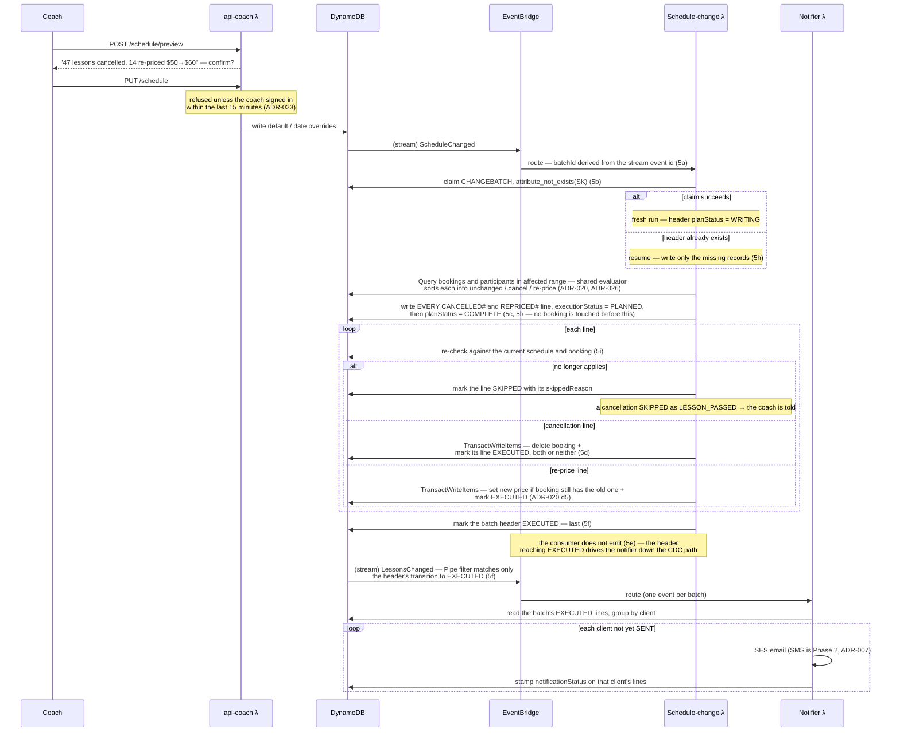

**The notifier fires once per batch, when the batch is finished** (ADR-010 d5f). Each
`CANCELLED#` line carries two separate states: `executionStatus` (`PLANNED` → `EXECUTED`, or
`SKIPPED` if its booking was already gone) and `notificationStatus` (has anyone been told).
Triggering on a line write would either tell families before their booking was deleted, or
split one client's cancellations across several messages. Triggering on the header means
nobody is told about a cancellation that has not happened, and each client gets one
complete message. The cost is that notification waits for the whole batch to run.

**Recovering from failure** (ADR-010 d5g–d5k):

- **Every key comes from the triggering event** — the batch ID and the header's timestamp
  from the stream record — so a retry can only resume, never start a second batch.
- **The header carries `planStatus`**: `WRITING`, then `COMPLETE`. No booking is touched until
  the whole plan is written; a resume on `WRITING` fills in only the records that are missing.
- **Every record is re-checked against the current schedule and booking before it is carried
  out**, and marked `SKIPPED` with a reason if it no longer applies — the booking is gone, the
  coach has since changed the schedule again, or the lesson's time has passed. Two batches in
  flight therefore end at the coach's latest intent. A cancellation skipped because the lesson
  has passed is the one unrecoverable case: the family was never told, so the coach is.
- **When retries run out, the consumer's dead-letter queue pages**, and the owner runs
  **`reconcile-schedule --coach <id> [--dry-run]`** instead of redriving: it first finishes the
  coach's unfinished batches, then checks the current schedule against every upcoming booking
  and fixes what doesn't match. It is also the recovery for an event lost outright.
- **A nightly, read-only drift check** runs the same checks for every coach with lessons in
  the next 30 days and alerts — paging for a stuck batch or a lesson that should have been
  cancelled, a dashboard entry for outstanding re-prices. It changes nothing.
- **The coach website shows the change's status** — applying, emailing families, done, or
  *"we're having trouble applying this change"* after an hour — read from the batch header
  (ADR-010 d5l, in MVP).
- **Other consumers' dead-letter queues** are replayed, discarded or re-run for their date
  according to ADR-010 d2a, with `redrive-dlq --function <name> [--dry-run]`. Scheduled jobs'
  triggers carry their target date, so a re-run works on that date. The operator's procedure
  is `docs/runbooks/reconcile-schedule.md`.

A booking **conflicts** unless the pattern in effect on its date generates a slot with
exactly its start time and duration. Conflicting bookings are **deleted** — because the
booking item is the lock, a released time must stop existing — and recorded as
cancellation lines. The client is told the lesson is cancelled and given a link to book
a different time; the system never guesses a replacement.

**A booking that still fits but whose block's price changed is re-priced** (ADR-020). An
upcoming lesson follows the coach's current price; a past lesson, or one already marked paid
or waived, never changes, and a student's personal price override is left alone.
**Increases** apply only to lessons beyond the booking's `requiredNoticeHours`, and the
preview tells the coach which nearer lessons keep the old price; **decreases** apply to every
upcoming lesson. The missed-lesson fee follows the same rules. Each family gets one message
per batch covering cancellations and price changes together — a decrease framed as good news.
**A large price change triggers a warning at the top of the preview that the coach must tick
to acknowledge** before Accept enables; the threshold is undecided.

**The preview is mandatory and is the replacement for the old 7-day horizon.** With
open-ended booking, nothing else bounds how much one save can destroy. Preview and
consumer must share one conflict implementation in `core/`. The preview is advisory —
the authoritative record is always the batch the consumer writes.

**It covers default changes as well as temporary ones** (ADR-008 decision 8). A default
change is the more dangerous of the two: it governs every date without an override, so
with no horizon and 12-month recurrences behind it, one save can reach a year out. A temp
is bounded by its own range. The preview also states how long the schedule runs — until
the end date for a temp, indefinitely for the default — and that accepting will send
cancellation emails.

### 6.6 Direct cancellation

Client- and coach-initiated cancellations (ADR-009) write the **same** `CHANGEBATCH#` and
`CANCELLED#` records as the schedule-driven path above, tagged with `cancelledBy`. A
single-lesson cancellation is a batch of one. The notifier trigger is the same too: the
header is marked `EXECUTED` last, and a single-lesson cancel writes header, line and booking
delete in one transaction with both already `EXECUTED` (ADR-010 d5f). Two differences from
§6.5:

- **No `ScheduleChanged` event and no conflict re-evaluation.** Cancelling never alters
  `SCHEDULE#DEFAULT` or any `SCHEDULE#DATE#` item, so only booking items move.
- **The notification direction depends on the actor.** A coach cancelling notifies each
  affected client, once per batch. A **client** cancelling notifies the **coach** only when it is
  inside the coach's notice period (`requiredNoticeHours`; ADR-009, amended 2026-10-08) — the
  client already knows.

A coach cancelling is asked whether to release the time for rebooking (delete the booking)
or hold it (replace it with a `COACH_HELD` item at the same key). Bookings already
`CHECKED_IN` or `NO_SHOW` are never cancelled by a bulk day or week operation.

**A coach cancels from two surfaces** (ADR-009 d5a): the week view on the website, and the
rinkside check-in page, also through `api-coach` (ADR-023). The page has a cancel section and a cancel action on each
lesson in the check-in list. "Part of a day" or "part of a week" is a multi-select of single
lessons, not a new scope, and **release-or-hold is asked once per lesson** because a hold is
permanent. Both surfaces write the same records and share the same preview. **A cancel
from the rinkside check-in list always confirms, even for a single lesson** — the button sits
beside check-in and no-show, and a cancel cannot be undone (ADR-009 d5a).

**A client can also reduce a recurrence's frequency** (ADR-009 d4): `intervalWeeks` may only
increase, and the occurrences that fall off the new interval are cancelled as one batch.
Recurrence management is subtractive only — it never claims a slot.

**Both paths, step by step** (ADR-009, ADR-010 d5f):

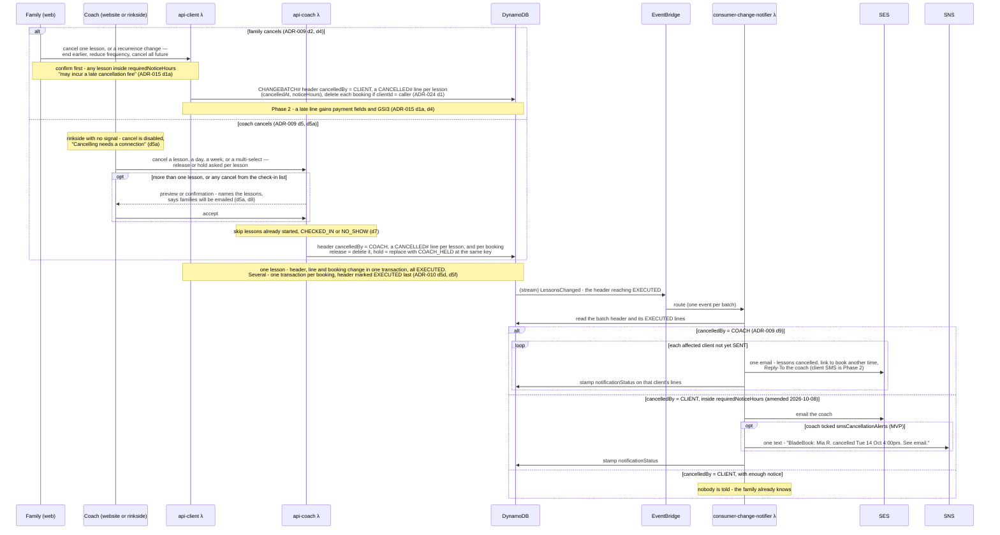

### 6.7 Client registration and coach approval

A family looks up one or more coach codes before it has an account, signs up through Cognito, then registers. The codes are resolved again in the family's own session, the family's partition is written, and a `PENDING` `STUDENT#` item goes to each coach. The coach accepts or declines through `api-coach`, which writes only the `STUDENT#` item; `consumer-student-link` mirrors the change onto the family's link item, and on a decline deletes it and sends the decline email (ADR-002, ADR-021 d6, ADR-022 d7, ADR-025 d2).

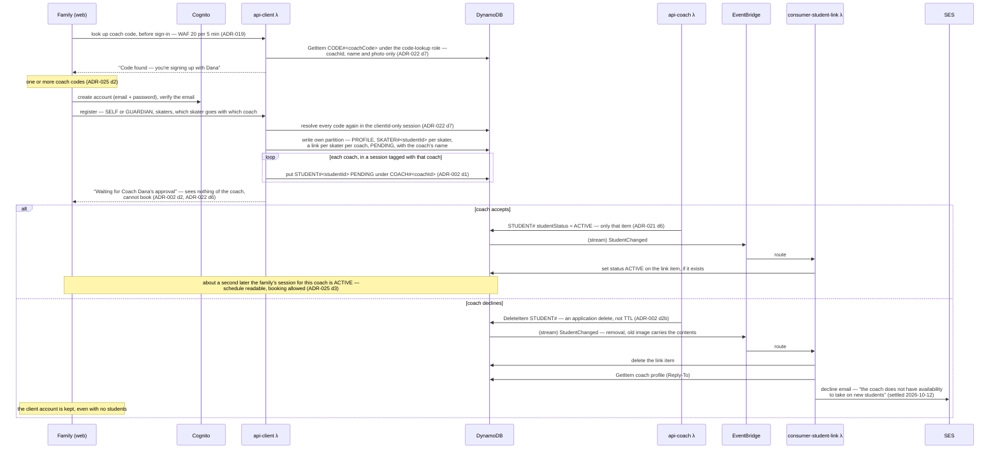

### 6.8 Family changes reach every coach

A family edits its profile or a skater in its own partition only. `FamilyChanged` triggers `consumer-family-sync`, which copies the fields onto every coach's `STUDENT#` record for that family, about a second later. For a new skater it also issues the `SKATERCODE#` share code (ADR-025 d6, ADR-026 d4, ADR-029 d3).

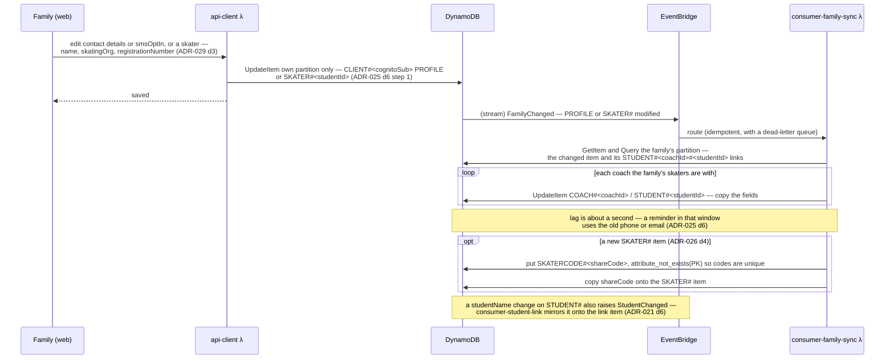

### 6.9 Shared lesson by invitation

Family A books a shareable time and invites skater B with B's share code, which writes an `INVITE#` item and stamps `invitedStudentId` on the booking. `consumer-invite` copies the invitation to Family B and emails them. B signs in to confirm, and either joins directly (already the coach's student) or becomes `PENDING` with `pendingJoins` until the coach's Accept joins them in `api-coach` (ADR-026 §3, §5).

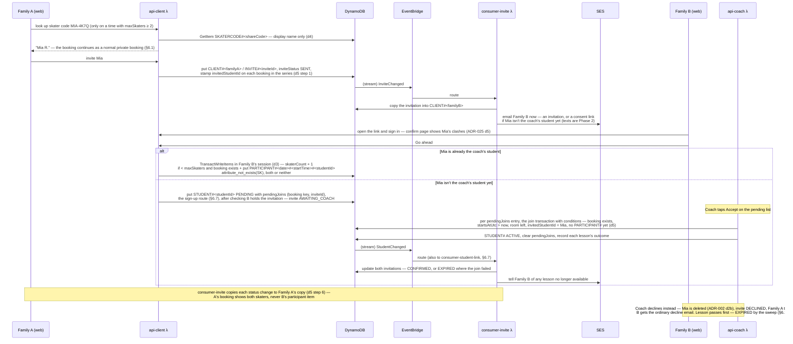

### 6.10 Nightly invitation sweep

Each night after the 9 PM report, `consumer-invite` reads upcoming bookings that carry an `invitedStudentId` through GSI2. It expires invitations whose lesson has started and emails both families, sends every pre-lesson warning due before the next run and stamps `warnedAt`, then emits `InviteSweepCompleted` for the missed-run alarm (ADR-026 §5a, §8).

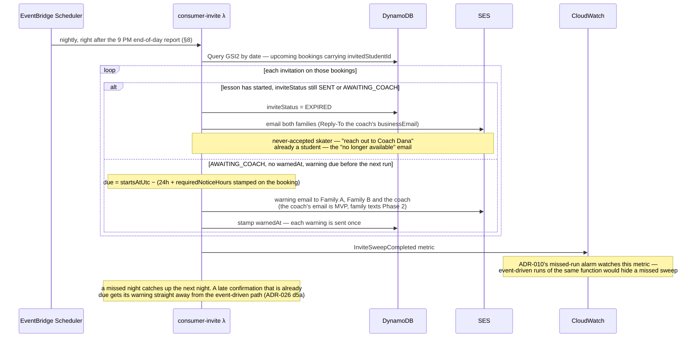

### 6.11 Coach sign-up

A coach signs up in two steps (ADR-016): a Cognito account with a verified email, then a profile. The profile write is safe to repeat, so a signup that fails between the two steps is finished by the coach's next sign-in rather than rolled back (ADR-016 d9).

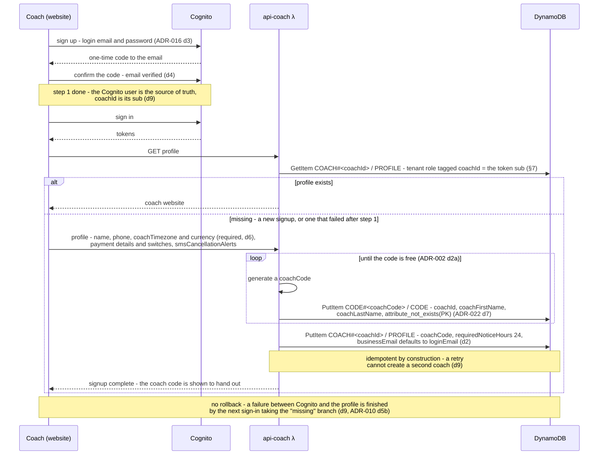

### Event catalog

| Event | Source | Consumers |
|---|---|---|
| `LessonBooked` | Booking write | Confirmation email |
| `LessonsChanged` | **`CHANGEBATCH#` header reaching `executionStatus = EXECUTED`** (ADR-010 d5e, d5f — *not* the booking delete and *not* a line write) | Change notifier — covers cancellations and re-pricing (ADR-020); one message per client per batch, routed **by actor**: coach- and schedule-driven cancellations go to each affected client; client-driven ones go to the coach, only inside the coach's `requiredNoticeHours` |
| `ScheduleChanged` | Schedule / date-override write | Cancellation λ |
| `CheckInRecorded` | Attendance write, `CHECKED_IN` only | Payment reminder |
| `NoShowRecorded` | Attendance write, `NO_SHOW` only | Payment reminder — **Phase 2**, when ADR-015's charge switches on. A separate event from `CheckInRecorded` because the reminder wording differs: a missed lesson is not an attended one. |
| `StudentChanged` | `STUDENT#` item under `COACH#` modified (`studentStatus`, `studentName` or `priceMinorOverride` changed) or removed | Student link sync λ — mirrors the change onto the client's link item (ADR-021 d6). Invite λ — when the coach accepts or declines a skater with `pendingJoins`, updates both invitations and tells the families, including any lesson that could no longer be joined (ADR-026 d5) |
| `FamilyChanged` | `CLIENT#` `PROFILE` or `SKATER#` item modified | Family sync λ — copies contact and skater details to every coach's `STUDENT#` record (ADR-025 d6); also issues each new skater's share code (ADR-026 d4) |
| `InviteChanged` | `CLIENT#` `INVITE#` item created or its status changed | Invite λ — copies the invitation to the invited family and emails them straight away; for a skater not yet with the coach, the email carries a consent link to join the coach's roster (ADR-026 d5); also runs nightly after the 9 PM report to send pre-lesson warnings and expire invitations whose lesson has started (ADR-026 d5a) |
| `DailyReminderDue` (scheduled) | Scheduler | Day-of reminder λ |
| `DailyReportDue` (scheduled) | Scheduler | End-of-day report λ |
| `UnpaidReminderDue` (scheduled) | Scheduler, weekly | Unpaid-lesson reminder λ (ADR-018) |
| `DriftCheckDue` (scheduled) | Scheduler, nightly | Drift check λ (ADR-010 d5k) — read-only, alerts only |

---

## 7. Security Model

### Authentication
- **Cognito User Pool** with two groups: `Coach` and `Client` (an adult student booking for themselves, or a guardian booking for a minor — same permissions either way).
- API Gateway's **Cognito authorizer** validates the token on every protected request (a REST
  API — ADR-001 A7). No custom authorizer is needed: since ADR-023 there is no second coach
  app client to tell apart.
- MFA available for coaches (they hold the most sensitive data).
- **Coach signup is self-serve and ungated for now** (ADR-016). Cognito owns credentials and
  recovery entirely — there is no custom forgot-password form — and the login email must be
  verified before the account can hold students. The signup is resumable: Cognito user
  first, then the profile and `CODE#` item, and first login completes a missing profile.
- **The rinkside check-in page shares the coach website's sign-in** (ADR-023, superseding
  ADR-014 d10–11). It is a section of the coach website at `/coach/rinkside`, signs in
  through the same app client, and its routes run in `api-coach`.
- **Schedule saves require a recent sign-in** (ADR-023 d4). Saving a schedule change is
  refused unless the token's `auth_time` is within the last 15 minutes; the website then asks
  for the password (and MFA code, if on) and retries. This guards the most destructive action
  in the system on every device, in place of the separate rinkside token.
- **Sessions last 60 minutes on the coach and family websites and 4 hours on the rinkside
  page**, counted from sign-in (ADR-023 d6). Cognito's refresh token lasts 4 hours; `api-coach`
  and `api-client` refuse requests whose `auth_time` is past their route's limit.

### Authorization (data isolation)
- The `coachId` / `clientId` comes from the **verified JWT claim**, never from the request body. `clientId` is the Cognito `sub`.
- Every DynamoDB key is scoped by that identity (`PK = COACH#<coachId-from-token>`), so a coach structurally cannot read another coach's students. Every client read is rooted at `PK = CLIENT#<sub-from-token>`, so a client cannot enumerate another client's students.
- **Coach access is gated twice — in code and at the database** (ADR-021). `api-coach`
  holds no DynamoDB permissions of its own. Per request, it assumes a
  tenant role tagged `coachId = <sub>`, whose policy allows only
  `LeadingKeys = COACH#${aws:PrincipalTag/coachId}` (plus a narrow `CODE#` statement). A
  query built against another coach's partition fails with `AccessDeniedException` rather
  than returning data. The repository gets this client from ADR-012's `AccessContext`, so
  the key the code builds and the tag DynamoDB checks come from the same verified token.
  **Clients are gated the same way** (ADR-022): a `client-tenant` role tagged `clientId`,
  `coachId` and `linkStatus` gives full access to `CLIENT#<sub>` and GSI1 (now keyed by
  client), reads of the coach's partition **limited to an attribute allowlist** — schedule,
  slot times and public profile fields, never another family's student, booking owner or
  price — **and only for an `ACTIVE` family**: a family with no approved skater reads
  nothing of the coach's, only their own account — and writes confined to that one coach's
  partition. The coach-code lookup before sign-in runs under a separate, untagged
  `code-lookup` role that can read only the `CODE#` item's display fields. The consumers and
  the scheduled jobs stay on their execution roles (ADR-021 d9).
- **One check is enforced only in code:** a client **write** into the coach's partition — booking, cancelling, editing a student — must verify that the target `studentId` appears in the caller's link set. The database confines the write to the right coach but cannot confine it to the right family (ADR-022 d8). Reads no longer depend on this check: GSI1 is keyed by client. This is the natural place for an authorization test (ADR-002). **Enforced structurally by ADR-024:** new writes take a `LinkedSkater` that only `core.data` creates after checking the family's links; writes to an existing booking carry a `clientId = :caller` condition, so DynamoDB refuses another family's. A never-linked failure is a logged security event, and repeated ones page (3+ in 15 minutes for one family, 10+ a day overall; both configurable).
- Clients see only whether a slot is free — never who holds a taken one. A client sees
  their own lessons as theirs; every other taken slot, whether booked by another family or
  held by the coach (`COACH_HELD`), looks identical (ADR-009, settled 2026-09-30).
- **One deliberate cross-coach disclosure** (ADR-025 d4): a coach sees the **names** of a
  skater's other coaches, and only once the skater is `ACTIVE` with both. It is a copy written by
  `consumer-student-link`, not a read permission, so no coach can read another coach's partition.
  The family is told when they add a coach. ***Phase 2*** *since 2026-10-07: not in MVP.*
- **Two ways onto a coach's roster** (ADR-002, ADR-026 d5): the coach code, or an invitation to
  share a lesson. The invitation's consent link needs the family to sign in and confirm, and
  then follows the coach code's route: the skater is `PENDING` until the coach accepts.
- **One write made for a family by someone else** (ADR-026 d5, ADR-024): when the coach accepts
  an invited skater, `api-coach`, in the coach's own session, joins that skater to the lessons
  in their `pendingJoins`. The database confines it to that coach's partition, and each join
  writes nothing unless the booking still exists, hasn't started, has room, and names that skater
  in `invitedStudentId`.
- A coach's phone, email and payment types (one switch per type, ADR-016 d7) are shown to
  families only if the coach switches each on, and **only to families the coach has confirmed** — never to a `PENDING` family,
  since a coach code can be passed around or guessed (ADR-016 d7a).

### Client writes into a coach's partition

How `api-client` checks a family's link before it writes anything into a coach's partition, and what it does when the check fails (ADR-022 d8, ADR-024).

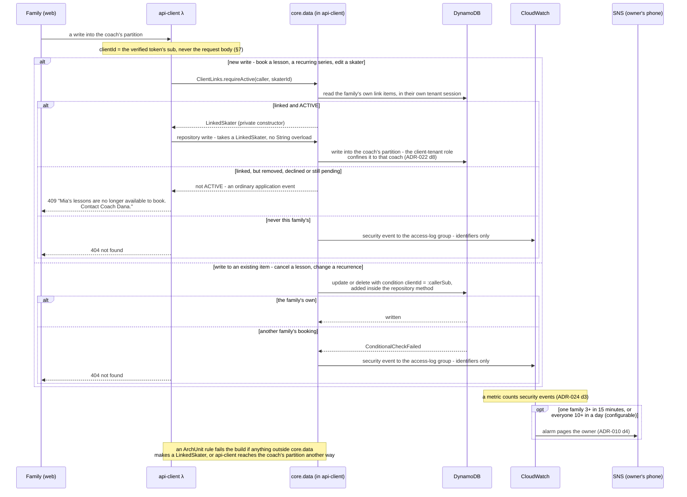

### Least privilege
- **One IAM role per Lambda**, granted only the specific actions it needs (e.g. the report λ gets `dynamodb:Query` on GSI2, `dynamodb:GetItem` for student names and the coach profile, `ses:SendEmail` and `s3:PutObject` scoped to the reports bucket/prefix — nothing else). The full per-function table is **ADR-001 amendment A6**. Only the three scheduled jobs that need it hold GSI2 (day-of reminder, end-of-day report, drift check), the one index that crosses tenants.
- No wildcard `dynamodb:*`, `ses:*`, or `s3:*`. `cdk-nag` fails the build on any.
- **A limit worth knowing before relying on this:** in a single-table design, per-function
  roles cannot separate *item types*. DynamoDB fine-grained access control conditions on the
  partition key (`dynamodb:LeadingKeys`) and on attributes — there is no sort-key condition —
  so a role permitted to write `CANCELLED#` lines can write `SCHEDULE#DATE#` items too.
  **A static execution role cannot scope a function to one coach** — `dynamodb:LeadingKeys`
  compares against the caller's credentials, and an execution role serves every tenant.
  That is why the two coach-facing functions use **per-request tenant roles** instead
  (ADR-021, reversing ADR-014 d11a's second point); everything else keeps its execution
  role. What roles bound is **which actions**, **which indexes** (index ARNs are separate
  resources, so omitting GSI2 genuinely blocks cross-tenant reads), **which services**, and —
  for the two API functions — **which coach** or **which client**. Item-type separation still comes
  from routing and token scope (ADR-014 d10, d11a), and ADR-012's `AccessContext` and
  ADR-013's cross-tenant test still carry real weight.

### Data protection
- **At rest:** the table and every bucket are encrypted with **AWS-managed keys** —
  `aws/dynamodb` and `aws/s3` — *decided by the owner, 2026-09-30.* No monthly fee, and every
  use of the key is logged in CloudTrail, unlike DynamoDB's default AWS-owned key.
  **Customer-managed keys** ($1/month each) are the upgrade if any of these arrive: a key
  policy as a second lock beyond IAM; **crypto-shredding** — deleting a key so everything
  encrypted under it, including backups and the archive, becomes unreadable, which the
  `design/deletion/erasure-by-token` draft points towards; or a customer or regulator
  requiring control of the keys.
- **Durability:** **Point-in-Time Recovery (PITR) is enabled** on the main table, with
  **deletion protection** and an explicit `RemovalPolicy.RETAIN` in the CDK stack
  (ADR-010 decision 7). Restores land in a *new* table, so recovery is a runbook rather
  than a button — and that runbook does not yet exist.
- **In transit:** TLS everywhere (CloudFront, API GW); enforce `aws:SecureTransport` on the reports bucket policy.
- **S3 reports bucket:** private — **Block Public Access** on, no public bucket policy, SSE-KMS, versioning + a retention **lifecycle policy**.
- **Cancellation records** name students and carry contact-adjacent data, so they inherit the same posture as any other student data. Their retention window is set by the legal review and applied through TTL (ADR-017).
- **Retention and archive** (ADR-017). Items expire from the table through TTL. A dedicated
  archiver — a second reader on the stream, separate from the notification Pipe — copies
  every TTL-removed item to a private archive bucket, one object per item keyed by coach and
  student so an erasure request can find and delete it. The bucket has versioning off, so a
  delete really deletes. A lifecycle rule moves objects to **S3 Glacier Deep Archive** after
  30 days — with an explicit size filter, since S3 does not transition objects under 128 KB
  by default — and expires them after a window the legal review sets. Deep storage is chosen
  for friction rather than cost: archived children's data can only be read through a
  deliberate restore that takes hours. The notification Pipe drops TTL removals explicitly.
- **Check-in device cache** (ADR-014 d5, d9b). The phone caches **today's lessons only** —
  student names and times, no contact details. A guardian's contact details are fetched from
  `api-coach` when the coach taps a student, **only with signal**, shown for that tap and
  never stored; offline the tap says *"Contact details need a connection."* Every reveal is
  logged when it happens (ADR-012).
- **Coach profile photos** (ADR-016 d5) are **Phase 2** (deferred by the owner,
  2026-10-05). MVP has no user-uploaded content: no photo bucket, upload path or resize
  step, and `profilePhotoKey` is never set. When photos arrive they are optional, capped at
  2 MB, resized to 512 px, original not kept.
- **Secrets:** any third-party keys in **Secrets Manager**, never in env vars/code.
- **Audit:** CloudTrail on, **with data events in both environments**. PII access logging is
  specified in [ADR-012](adr/ADR-012-pii-access-logging.md): application-layer logging names
  the human (CloudTrail could not, while every application read ran under the Lambda's
  execution role; since ADR-021 and ADR-022 the two API functions run under sessions named
  for the coach or client, so for them it now can), scheduled jobs emit one aggregate line per run, client reads are tagged by
  relationship, and log lines carry identifiers but **never values**. Retention is deferred
  to the legal review. Tenant-isolation proof and app-health monitoring remain open — see
  [monitoring-questions.md](monitoring-questions.md). The one boundary in the system that
  only code enforces is the client-write link check in the Authorization section above;
  it is the thing most worth logging and testing.

### Lower environments

**Production is the only long-running environment** (ADR-027). A **dev environment** — a full
stack built from the same infrastructure code — is built when there is work for it and
destroyed when that work is done; one at a time, not one per branch. It replaces the
long-running staging environment ADR-011 created. Each dev table is **created from one import file** when the
stack is built: **seed data** by default, or, after launch and only on request, a **masked
subset of production** — never both (ADR-028). Because a copy of
production is a copy of children's data, **masking happens in the export→transform→import
pipeline, never after loading** — an unmasked row must never exist in a dev table, even
briefly (ADR-011's masking rules, carried over unchanged).

**Production and dev are separate AWS accounts** under one AWS Organization (ADR-027 d8). The
account boundary is what keeps dev in Simple Email Service (SES) sandbox mode, which applies
per account, and it means dev credentials can't destroy anything in production. The masking
job, the load log and dev's access logs live in a small data-loading stack in the production
account, apart from the application stack (ADR-027 d9). **An AWS Step Functions workflow
prepares each masked build**: export → transform Lambda → masked file; a failed check stops it
before any file is written. Dev's table is then created from that file, and the scan runs as soon
as the build finishes (ADR-028). The raw export lands in an
export bucket only the transform can read, deleted automatically after a day; the masked output
goes to a separate bucket only dev's import can read, also deleted after 24 hours (ADR-028). A restart is a fresh run, never a resume
(ADR-027 d9, amended 2026-10-09).

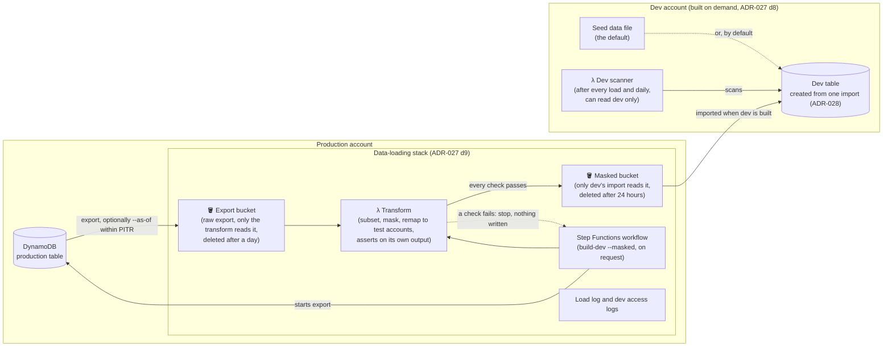

**One masked build, step by step** (ADR-027 d9, ADR-028):

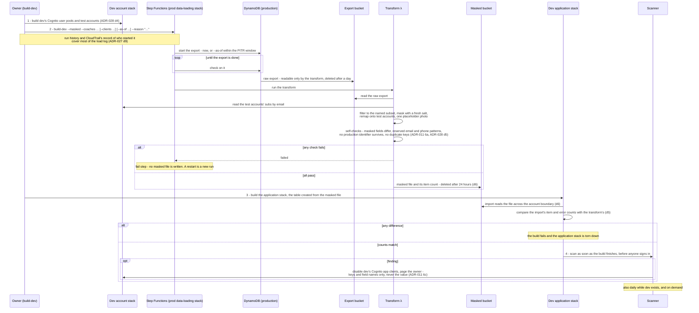

Replacements are **non-deliverable by construction**: emails become `@example.com` (reserved
by RFC 2606), phones become `+1 555 01XX` (reserved by the North American Numbering Plan).
Dev additionally never leaves Simple Email Service (SES) sandbox mode and has no
toll-free/10DLC number, so it cannot reach a real person even if a mask were missed.
Masking is deterministic per load so the model's denormalised copies stay consistent, and
the salt is rotated each time so no stable fake-to-real mapping accumulates.

**The transform asserts on its own output** (ADR-011 decision 6a) — every masked field must
differ from its source, emails and phones must match the reserved patterns, and every string
field must be either allowlisted as non-PII or recognisably masked. A failure aborts the
load: dev keeps what it had rather than receiving unmasked data.

**A load copies a subset, remapped onto test accounts** (ADR-011 decisions 8–9, ADR-027 d2–3).
Every coach and client partition is keyed by a Cognito `sub`, which dev accounts can never
share, so a straight copy would be data no dev login owns. Each load instead names the
coaches and clients to copy (`build-dev --masked --coaches …`, with `--clients`, and `--as-of` to
export the table as it stood at a past moment within the PITR window) — there is no default
list — and assigns them by order to pools of test accounts (`coach-a@example.com`,
`client-1@example.com`, …) that are created each time dev is built. Every occurrence of a
copied identifier is rewritten, and the transform aborts if any production identifier
survives. Nothing linking a real identity to a test login is stored. Profile photos are never
copied: every coach gets one shared placeholder.

**A separate scanner then checks dev from the outside** (ADR-011 decision 6b), applying
the same deny-by-default rule to the dev table and reports bucket. It runs as soon as
every masked build finishes, before anyone signs in (ADR-028 d4) — not after a failed build,
which leaves no dev table to check (no masked file is written, or the stack is torn down) —
on demand, and **daily while dev exists** — the only trigger that catches data written
between builds. Its Identity and Access Management (IAM) role can
read dev and nothing else; a component that scans for PII must not be able to reach the
real thing.

**On a finding it contains automatically and destroys nothing** (ADR-011 decision 6c): the
dev Cognito app clients are disabled (one for the coach website, which includes rinkside check-in since ADR-023), closing
every authenticated path to the data, and a
page goes out. Purge is a human action taken after triage, because deleting the data also
deletes the evidence of how it got there. The alert records item keys and field names and
**never the offending value** — writing an unmasked email into a log group moves the
exposure rather than ending it.

**Tearing dev down is a purge, so it follows the same rule** (ADR-027 d4–5): no teardown while
a scanner finding is open; dev's access logs and the load log are kept outside the stack so
triage can still ask "did anyone read it?" afterwards; and teardown deletes everything dev
created, while production's table and buckets stay retained and deletion-protected, asserted
by an infrastructure test.

### ⚠️ Minors' data (this is a real obligation, not a nice-to-have)
Students may be adults or children. Where `isMinor = true`, we're storing data about a child plus their **guardian's contact info**, which triggers:
- **Parental/guardian consent** as the lawful basis for contact; SMS especially is opt-in, per phone number (ADR-007 d8a); client SMS is Phase 2 (ADR-007, amended 2026-10-12).
- Likely **COPPA** (US) considerations and, depending on where coaches operate, state privacy laws. *Flagging for legal review before launch — not something to hand-wave.*

Because a coach's roster can mix both, the safe default is to treat a student as a minor until the coach says otherwise, and to apply these controls to **all** students regardless of age:
- **Data minimization** — collect only what's needed for scheduling + contact.
- Access logging + the ability to delete a student's data on request.
- The storage guardrails above — they cost nothing extra to apply uniformly and avoid a per-record compliance branch.

### Edge
- **WAF, in MVP** (ADR-019): one web ACL attached to the REST API's stage and to the Cognito
  user pool — AWS managed core rules (SQLi/XSS), known bad inputs and IP reputation, an
  overall rate rule and a tighter one on the unauthenticated routes (sign-up, coach-code
  lookup). Because it sits on the API itself, every request passes through it whatever address
  it was sent to. Limits per address per 5 minutes: **1,000** overall, **20** for client
  sign-up and coach-code lookup, **10** for Cognito sign-up and sign-in. **In production every
  rule counts, not blocks, for the first two weeks after launch**, then blocks. The WAF is a
  pair of settings per environment (`wafEnabled`, `wafMode`). **Dev starts with it off**;
  turning it on in block mode and re-running the Playwright flows is one of the last checks
  before the initial launch (ADR-019 d4a). **WAF logs** (`wafLogging`) record only requests a
  rule matched, with the sign-in token redacted, kept 30 days pending the legal review; on in
  production from launch, and in dev whenever its WAF is on (ADR-019 d4b). The browser calls the API on its
  own domain, so API Gateway allows cross-origin resource sharing (CORS) from the site's domain.
  The JWT and the WAF do different jobs: the token decides who may call a route; the WAF
  stops floods and attack patterns, including on routes with no token.
- API Gateway **throttling** to cap abuse and cost.

---

## 8. Scheduled Jobs

| Job | Trigger | What it does |
|---|---|---|
| Day-of reminders | EventBridge Scheduler, ~7:00am (coach timezone) | Query `DATE#today`, notify each booking's client by email (SMS is Phase 2). |
| End-of-day report | EventBridge Scheduler, ~9:00pm | Query `DATE#today`, split into checked-in, no-show and pending (§6.4), archive to S3, email the coach. |
| Unpaid-lesson reminder | EventBridge Scheduler, weekly (Monday morning, proposed) | Scan GSI3 for lessons still unpaid longer than the threshold, email each coach one list asking them to mark each paid or waived, stamp `settleReminderSentOn` so each lesson is listed once. **Off until the threshold is set** (ADR-018). |
| Drift check | EventBridge Scheduler, nightly | For every coach with lessons in the next 30 days (found through GSI2), check for unfinished change batches and for bookings that don't match the current schedule. **Read-only**: pages for a batch stuck over an hour or a lesson that should have been cancelled; dashboard for outstanding re-prices (ADR-010 d5k). |
| Shared-lesson invitation sweep | EventBridge Scheduler, nightly, right after the end-of-day report | `consumer-invite`'s second trigger (no new function). Reads upcoming bookings with an `invitedStudentId` by date (GSI2); sends every pre-lesson warning due before the next run and stamps `warnedAt`; marks invitations still `SENT` or `AWAITING_COACH` whose lesson has started `EXPIRED` and emails both families. ADR-010's missed-run alarm watches its own `InviteSweepCompleted` metric (ADR-026 d5a). |

**These are the only five cron jobs.** The third exists because a lesson only expires once
settled (ADR-017), so an unsettled one would otherwise sit forever unnoticed. The fourth
exists because a lost event raises no error and leaves nothing retrying (ADR-010 d5k). The
fifth exists because a warning and an expiry are due at a time, not on an event (ADR-026 d5a);
it is a schedule on `consumer-invite`, so the function count is unchanged. Nothing in the
schedule, booking, recurrence or cancellation design adds a scheduled job — availability is
computed on read, recurrences are materialized at booking time, and cancellation is
event-driven.

*Timezone:* `Coach.coachTimezone` is a required IANA identifier stored from the first write,
and every booking carries `startsAtUtc` and `coachTz` (ADR-001 decision 4). MVP runs one
Scheduler rule per job pinned to the launch timezone using Scheduler's native IANA
support, which handles DST. A second timezone is one more rule — no migration, no key
redesign.

---

## 9. Notifications

| Channel | Service | Cost | Notes |
|---|---|---|---|
| Email | SES | ~$0.10 / 1,000 | Primary channel; ~$0 at our scale. Must move SES out of sandbox before prod. |
| SMS | SNS | ~$0.01–0.02 / msg | **MVP: the coach's late-cancellation text only** (`smsCancellationAlerts`, ADR-009 d9). Client texts are **Phase 2** (ADR-007, amended 2026-10-12); their opt-in is per phone number, held on the client profile and copied to each student (ADR-007 d8a). Requires US toll-free/10DLC number registration (~$2/mo + one-time). |

Every client always gets **email**, and in MVP only email. Layering SMS on where `smsOptIn = true`
is **Phase 2** (ADR-007, amended 2026-10-12).
Delivery always targets the client contact fields, so an adult student is notified
directly and a minor's guardian is notified on their behalf — same code path.

**Replies go to the coach.** Every client-facing email sets `Reply-To: businessEmail` from
the coach profile (ADR-016 d8), which defaults to the login email. The envelope sender stays
the application's verified domain, so SES identity and bounce handling are unaffected. This
means the day-of and payment reminders now read the coach profile as well as the student.

**Reminders are per lesson**, never grouped: a client with two children who both have
lessons on the same day receives two reminders (ADR-002 decision 7).

**Cancellations are the one exception** — one message per client per *batch*, listing
that client's cancelled lessons, because the triggering event is one decision that
happened to touch several lessons rather than one lesson (ADR-006 decision 6). When the
**client** cancels **inside the coach's notice period** (`requiredNoticeHours`), the message
goes to the **coach** instead (ADR-009 decision 9, amended 2026-10-08) — by email, and **by text too if the coach has opted in**
(`smsCancellationAlerts`, unticked by default): *"BladeBook: Mia R. cancelled Tue 14 Oct
4:00pm. See email."*

### SMS is one segment (ADR-007)

*In MVP these rules apply to the coach's late-cancellation text; the client templates below are
Phase 2 (ADR-007, amended 2026-10-12).*

| Rule | Why |
|---|---|
| **160 characters, hard-enforced** before `sns:Publish` | Past one segment the carrier splits the message, bills per segment, and guarantees nothing about ordering or reassembly |
| **GSM-7 characters only** | One character outside GSM-7 — `’`, `—`, `é`, any emoji — flips the whole message to UCS-2 and drops the limit to **70**. Extension-table characters (`[ ] { } \ ~ ^ \|` and `€`) count as two |
| **The SMS is a pointer; the email is the record** | 160 characters cannot hold a lesson list or payment instructions, so it states what happened and directs to the email — which every client always receives |
| **Never interpolate user-authored free text** | `paymentInstructions` above all: unbounded, PII-adjacent, and half of it is worse than none because it looks complete |
| **Budget and truncate variable fields deterministically** | A long student name must never push a message into a second segment |

Every message opens **`<Coach name> via BladeBook:`** — the coach's name budgeted at 20
characters and transliterated to GSM-7 (ADR-007 d5a). Worst-case lengths: day-of reminder
**88**, payment reminder **115**, cancellation digest **105**. As a consequence, ADR-003 decision 7's payment instructions are **email-only**.

**One message is exempt: the opt-in confirmation**, sent once per phone number when SMS is
turned on: in MVP, when a coach ticks `smsCancellationAlerts` (ADR-009 d9); for clients, Phase 2. It carries the program identity, frequency and rate disclosures, and
the HELP/STOP instructions — at most ~230 characters, two segments — so the recurring templates
don't have to spend budget on compliance text. The GSM-7 and no-free-text rules still
apply to it.

**Check `CheckIfPhoneNumberIsOptedOut` before every publish.** SNS honours STOP itself
but does not error when you publish to an opted-out number, so a naive send records
success for a message that was never delivered. A suppressed send is recorded as
`SUPPRESSED` — distinct from `FAILED` — and flips `smsOptIn` to false so the coach's view
matches reality.

**"Sent" means SES/SNS accepted the message**, not that it was delivered or read. Real
delivery confirmation needs SES event destinations and is not in MVP.

---

## 10. MVP Scope vs. Later Phases

### MVP (Phase 1)

| # | Feature | Source |
|---|---|---|
| 1 | **Coach signup** (self-serve; timezone + currency captured here), coach auth, student roster, and the **PENDING confirmation queue** | ADR-002, ADR-016 |
| 2 | Client **self-registration with a `coachCode`**, including multiple children in one sign-up, and **adding further coaches** later; a skater can have several coaches, each approving separately (ADR-025) | ADR-002, ADR-025 |
| 3 | Coach **schedule editor**, reached from two dashboard buttons — *Edit weekly schedule* and *Add time off or a special schedule*. Time off is a name and a date range, nothing else; a special schedule is the tabbed form (SOD, EOD, lesson length, cost, **rink** — fixed to Pelham Civic Center (PCC) in Phase 1 — and **ice type**, required and never shown to families) with a live slot calendar and per-slot selection | ADR-008; `FeatureDecriptions/Schedule Creater.md` |
| 4 | **Monthly calendar + Sun–Sat week view**, for both coach and client, with prev/next navigation | ADR-006 |
| 5 | Clients book open slots — **single or recurring with an end date** (≤12 months), partial success reported per skipped date. Every booking is private; the booking family can **invite another family's skater by share code** to share it, up to the block's `maxSkaters` (default 1, at most 2 — a setting that may be raised; pricing waits on Kim). A skater not yet with the coach joins the coach's roster through the invitation and is added once the coach accepts | ADR-006, ADR-026 |
| 6 | **Validation, impact preview and explicit acceptance** before any schedule save — covering default *and* temporary changes, cancellations *and* re-pricing, with a large-price-change warning, and the change's status shown until it finishes | ADR-008, ADR-020, ADR-010 d5l |
| 7 | **Cancellation records** + notification with send/failure state, routed by actor | ADR-006, ADR-009 |
| 8 | **Client cancellation** — per-lesson cancel with confirmation, plus recurrence management (move the end date earlier, reduce the frequency, or cancel all future lessons) | ADR-009 |
| 9 | **Coach week view** — the week by timeslot, showing *Open*, the student's name, or a held slot | ADR-009 |
| 10 | **Coach cancellation** — one lesson, one day, or one week, from the week view or the rinkside check-in page, choosing release-or-hold per lesson | ADR-009 |
| 11 | Day-of email reminders | §6.2 |
| 12 | **Attendance on the rinkside check-in page**, a mobile-first section of the coach website at `/coach/rinkside` (ADR-023) — check-in *and* no-show, recorded rinkside on a phone, capturing offline and replaying when signal returns; guardian contact details on a tap, only with signal and never cached (ADR-014 d9b); lesson cancellation. Same sign-in as the coach website; routes in `api-coach` | §6.3, ADR-014, ADR-023 |
| 13 | **Payments surface**: price and currency stamped at booking, plus a **coach payment dashboard** — lessons in a required date range, mark as paid with **how the client paid** (the payment types on the coach's profile, including Cash if the coach turned it on, plus *Other*; no free text; optional, editable, seen only by the coach), **mark as waived**, filter by unpaid — plus a **coach lesson list** over the same date range where attendance can be corrected to attended or no-show | ADR-003, ADR-014 |
| 14 | End-of-day report email to coach | §6.4 |
| 15 | **Coach late-cancellation text** (`smsCancellationAlerts`), including its one-off opt-in confirmation message. Client SMS is Phase 2 | §9, ADR-007, ADR-009 d9 |
| 16 | **Financial page** for taxes: year-to-date (YTD) total gross (money received: lessons marked paid plus missed-lesson fees collected; counted by lesson date; calendar year, closed once it ends) and fees paid to the rink, **calculated by BladeBook** from the rink's terms (how is open, `Q_Rink-Fees.md`), plus a **summary CSV download** for this year or last | ADR-030, `FeatureDecriptions/Coach Financial Page.md` |

> **Scope warning.** This list has grown from eight features to sixteen across ADR-006,
> ADR-008 and ADR-009. Features 3, 4, 6, 9 and 10 are all the same surface — a coach
> spends nearly all their time in the schedule and week views, and that surface is now the
> largest single piece of MVP work by a wide margin, as well as the thing a coach judges
> the product by. Feature 12 adds the **rinkside check-in page** (2026-08-30), which is
> less work than that schedule surface but has its own offline requirements: a service
> worker, a replay queue and its own entry point (ADR-014, ADR-023). Its Harbor design is
> in `design/harbor/rinkside/`.

### Phase 2+
- **SMS to clients**: day-of and payment reminders, the cancellation digest, shared-lesson
  invitation and price-change texts, with the client's opt-in and its confirmation (ADR-007,
  amended 2026-10-12). MVP's only text is the coach's late-cancellation alert.
- **Client views of their own history**: unpaid lessons (ADR-003) and cancellations (ADR-006).
  MVP is coach-only and email-only.
- **Skate Canada and Hockey Canada numbers** at sign-up. Phase 1 takes US Figure Skating or USA
  Hockey only (Open-Pending §2b).
- **Financial page: past years on screen, and a detailed per-lesson export** with skater names (a logged PII read, ADR-012). The summary export is MVP (ADR-030 d7).
- **Rink selection** in the schedule builder, from the rinks BladeBook has ice types for. Phase 1
  is fixed to PCC.
- **"Also coached by"** — a coach sees the names of a skater's other coaches (ADR-025 d4),
  with a one-off backfill of `otherCoaches` when it ships.
- **Applying a saved schedule** — the second half of ADR-008's optional Name field.
- **Recurrence extension** — moving a recurrence's end date *later*, which re-runs
  materialization. MVP only moves it earlier (ADR-009 decision 4).
- **A coach booking on a client's behalf** (ADR-009).
- **Changing a coach's currency** after signup. The value is chosen once at signup and is
  stamped onto every booking, so a later change leaves earlier bookings in the original
  currency — correct, but it means the payment dashboard must render a mixed list without
  totalling it.
- **Late-cancellation and no-show charges** (ADR-015). One rule covers both, and **only the
  client pays, for their own late cancellation or a no-show** — never for a coach or
  schedule-change cancellation. A late cancellation is charged whichever screen made it, so
  recurrence management charges for an occurrence inside the threshold too, and says so in
  its confirmation (ADR-015 d1a). Until then every cancel confirmation says a late
  cancellation "may incur" a fee. The amount is
  set **per block in the schedule builder** and stamped on the booking alongside
  `priceMinor`, so the client sees it at the point of booking; `0` means no charge. The
  work is not the fee but the plumbing: `CANCELLED#` records gain a payment lifecycle and
  GSI3 membership, since a late cancellation deletes its booking and a no-show does not.
- **Cancellation reasons** — distinct email templates for sick, emergency, vacation.
- **Cancelling from the week view** as a client, when the booking is theirs.
- **In-app payments** (Stripe/AWS integration) — explicitly *not* an MVP goal. Introduces refunds/credits, which the current no-ledger payment model cannot express.
- Waitlists / package plans.
- **Named, reusable schedule templates** ("summer camp", "off-season") — the temporary-schedule entity ADR-006 deliberately dissolved, returning in a more useful form.
- **Coach-selectable themes** — a coach picks their theme, and **it runs throughout**:
  their own pages *and* the client-facing booking flow for every family they teach. It is
  the coach's brand, not a personal display setting. **Harbor ships as the only theme in
  MVP** (`design/harbor/`, chosen 2026-10-01 in place of Forest). Four alternates are specified and measured in
  `design/themes-phase2/`, but against Forest's 34-token contract; they need mapping onto
  Harbor's token set before this is a stored preference plus a stylesheet swap rather than a redesign. Two consequences:
  `Coach.themeId` resolves from the **`coachId` of the page being rendered**, never from
  the signed-in user; and because a client reaching a booking page is unauthenticated,
  the theme must be resolvable before first paint rather than fetched from a session.
- **Coach profile photos** (ADR-016 d5, deferred 2026-10-05) — upload, a private bucket,
  a resize step and how the family's code screen shows the photo before sign-in. Until then every
  screen takes ADR-016's no-photo path.
- **Real delivery confirmation** (SES event destinations, bounce/complaint handling).
- Coach analytics dashboard, fed by the archived daily reports.
- Multi-timezone scheduling (additive config — the data model already handles it).

---

## 11. Decision Record

Every significant decision, and the alternatives rejected, live in `docs/adr/`.
ADRs keep their original reasoning intact. **A reversed decision gets a new ADR** that
supersedes the old one — ADR-006 replacing ADR-005's booking horizon is the model. **A
clarification or extension is a dated amendment inside the existing ADR**, noted in its
Status section and added alongside the decision it extends, never rewriting the original
text — as ADR-001's A1–A5 and ADR-010's decision 5f do.

| ADR | Decides | Status |
|---|---|---|
| [001](adr/ADR-001-backend-stack.md) | Backend stack, IaC language, repo layout, timezone handling | Accepted; amended (SnapStart withdrawn; check-in as a third frontend, A3, *superseded by 023*; **IaC re-opened, CDK or Terraform undecided, A4**; fourteen functions (A5 and later amendments); tenant roles A8–A9; **execution roles restated, A6**; **REST API, A7**) |
| [002](adr/ADR-002-client-registration.md) | Client registration, the client↔student link, coach codes | Accepted; **d5 (one coach) superseded by 025**; amended 2026-10-07 (an invitation is a second way onto a roster, 026) and 2026-10-08 (Kim confirms the `PENDING` step stays in MVP); amended 2026-10-09 (siblings need approval too; no reminder; pending count on the Students tab) |
| [003](adr/ADR-003-lesson-pricing-and-payment.md) | Lesson pricing and payment tracking | Partially superseded by 004; d2 amended by 020 (the stamp protects past lessons only); amended 2026-10-09 (how the client paid, d4); amended 2026-10-12 (Cash, how-paid optional/editable/coach-only; unpaid history to client is Phase 2) |
| [004](adr/ADR-004-schedule-patterns.md) | Computed availability, schedule blocks, pattern-bound pricing | Partially superseded by 006 |
| [005](adr/ADR-005-booking-horizon-and-recurring-lessons.md) | 7-day booking horizon; recurring lessons deferred | Largely superseded by 006 |
| [006](adr/ADR-006-open-booking-recurring-lessons-and-cancellation.md) | Open booking, per-date overrides, recurring lessons in MVP, cancellation records | Accepted; amended 2026-09-29 (d4a — recurrence every 1–4 weeks, `RECURRENCE#` header written at booking; d4b — failed bookings repair themselves); extended 2026-10-06 (shared bookings, 026); amended 2026-10-08 (booking between preview and save: per-coach counter, save goes ahead, "just booked" email); amended 2026-10-09 ("just booked" email and its counter moved to Phase 2) |
| [007](adr/ADR-007-sms-message-constraints.md) | SMS length, encoding, and content constraints | Accepted; amends 003; amended 2026-10-12 (client SMS is Phase 2; only the coach's late-cancellation text is MVP) |
| [008](adr/ADR-008-schedule-editor.md) | The schedule editor; signup defaults removed; temp headers restored | Accepted; supersedes parts of 003, amends 004 and 006; amended 2026-09-29 (missed-lesson fee field, Phase 2); extended by 026 (`maxSkaters`); amended 2026-10-08 (booking counter checked at save, "just booked" email, no slot holds); amended 2026-10-09 ("just booked" email and its counter moved to Phase 2) |
| [009](adr/ADR-009-cancellation.md) | Client, coach and schedule-driven cancellation; coach-held slots; rinkside app as a second cancel surface | Accepted; extends 006; amended 2026-09-22 (d5a), 2026-10-01 (d4c header in the client's partition), 2026-10-08 (coach told of a client cancellation only inside `requiredNoticeHours`) |
| [010](adr/ADR-010-availability-and-reliability.md) | Availability and reliability tiers, dead-letter queues, idempotency, alerting, Point-in-Time Recovery | Accepted; amends 006 d5; amended 2026-09-29 (d5f — the notifier fires when a batch finishes); amended 2026-09-30 (d5g–d5l — recovery: event-derived keys, plan-complete marker, re-check before acting, reconcile command, nightly drift check, status on the coach website; d2a — dead-letter policy per consumer) |
| [011](adr/ADR-011-staging-environment.md) | Staging environment; production data masked before it lands there | Accepted; supersedes 010's "no staging"; amended 2026-09-29 (masking list follows ADR-016; containment disables both app clients, *one since 023*; subset remapped onto test accounts, d8; photo placeholder, d9); **d1, d7a, d8a's default list and d8c superseded by 027** — masking carried over to dev |
| [012](adr/ADR-012-pii-access-logging.md) | Who read what — application logging, CloudTrail data events, cron aggregation | Accepted; answers monitoring §2 |
| [013](adr/ADR-013-testing-requirement.md) | Every feature requires automated tests, across all three packages | Accepted; **enforcement deferred to the first CI pipeline** |
| [014](adr/ADR-014-check-in-app-and-offline-capture.md) | Attendance as an MVP surface; offline capture, device timestamps, idempotent replay, explicit no-show, `PENDING` report default | Accepted; amends 001 (A3); **d10–11 superseded by 023** (no separate app client or function) |
| [015](adr/ADR-015-late-cancellation-and-no-show-charges.md) | Late cancellation and no-show both charged, one rule; fee per block, stamped on the booking | Accepted; **charge is Phase 2**; supersedes 009 d3 and d11 in part, amends 014 d3; amended 2026-09-29 (d1a — only the client's own late cancellation is charged, from any screen); d3 amended by 020 |
| [016](adr/ADR-016-coach-signup.md) | Coach signup — **ungated for now**, licence gate intended; Cognito-owned credentials; the coach profile | Accepted; closes §11's oldest open thread; extends 002; amended 2026-09-29 (`requiredNoticeHours` on the profile); amended 2026-10-01, 2026-10-05 (photo to Phase 2), 2026-10-12 (`acceptsCash`) |
| [017](adr/ADR-017-data-retention-ttl-and-archive.md) | Data retention — Time to Live on `expiresAt`, an archiver copying expired items to S3, and a lifecycle rule into Glacier Deep Archive | Accepted; **windows for records about people await the legal review**; constrains 006 d4b, extends 010 d5f; amended 2026-10-12 (16-month floor for lesson and payment records; archived-history message; restores logged under 012) |
| [018](adr/ADR-018-unpaid-lesson-reminder-to-coach.md) | A weekly email telling each coach which lessons are still unpaid after a threshold, asking them to mark each paid or waived | Accepted; **threshold to be set — off until then**; answers 017's open question |
| [019](adr/ADR-019-waf-in-mvp.md) | A Web Application Firewall in MVP, on the API and Cognito; API Gateway becomes a REST API | Accepted; idle budget restated 2026-09-30; d3's authorizer question closed by 023 |
| [020](adr/ADR-020-repricing-booked-lessons.md) | Upcoming lessons follow the coach's current price: increases beyond the notice period, decreases at once, families told; renames the change batch, event and consumers | Accepted; amends 003 d2 and 015 d3; **large-change warning threshold undecided**; amended 2026-10-08 (booking counter checked at save, "just booked" email); amended 2026-10-09 ("just booked" email and its counter moved to Phase 2) |
| [021](adr/ADR-021-tenant-isolation-at-the-database.md) | Tenant isolation at the database as well as in code: per-request tenant roles tagged with the coach for `api-coach` (and `api-checkin` until 023); `api-coach` drops GSI1; a stream consumer writes the client's link item | Accepted; database-gate tests **passed 2026-10-05** (d7); reverses 014 d11a's second point; amends 001 (A8), 002, 012, 013; extended to clients by 022; extended by 025 (`otherCoaches`, Phase 2); amended 2026-10-08 (d7 tests run in dev; `StudentChanged` also triggers `consumer-invite`) |
| [022](adr/ADR-022-client-isolation-at-the-database.md) | Client isolation at the database: a per-request `client-tenant` role; GSI1 re-keyed by client; recurrence headers move to the client's partition; coach-partition reads limited to an attribute allowlist; writes confined to the client's coach | Accepted; client-gate tests **passed 2026-10-05** (d9); amends 001 (A9), 002, 006, 009, 012, 013, 016, 021 |
| [023](adr/ADR-023-rinkside-check-in-joins-the-coach-website.md) | Rinkside check-in is a section of the coach website at `/coach/rinkside`: same sign-in, routes in `api-coach`, no separate app client, function or authorizer; schedule saves require a sign-in within 15 minutes | Accepted; supersedes 014 d10–11 and 001 A3; amends 011, 012, 013, 019, 021 |
| [024](adr/ADR-024-client-write-link-check.md) | The client write link check: a `LinkedSkater` type only `core.data` creates, a `clientId` ownership condition on existing items, an ArchUnit rule; failures split by reason, logged, and paged on configurable thresholds | Accepted; amends 010, 012, 013, 022 |
| [025](adr/ADR-025-many-coaches-per-skater.md) | Skaters and coaches are many-to-many: one `studentId` per skater across coaches, a family-owned `SKATER#` item, per-coach approval and `linkStatus`, other coaches' names shown to each coach (Phase 2); no limit on coaches; clashing bookings warned about, family changes copied by a consumer | Accepted; supersedes 002 d4–5; amends 001, 011, 021, 022 |
| [026](adr/ADR-026-shared-lessons-by-invitation.md) | Shared lessons by invitation: `maxSkaters` per block, private by default, a skater share code, the invited family confirms, one `PARTICIPANT#` item per extra skater; the slot lock unchanged | Accepted; max 2 and approval decided by the owner; price and booker-cancels pending Kim, lapse in part; a skater not yet with the coach joins via a consent link and the coach's Accept; extends 006, 008; amends 001, 002, 021 d6, 022, 024, 025; amended 2026-10-09 (pre-lesson warning, banner, nightly sweep, coach email in MVP); 2026-10-12 (`maxSkaters` never lowered on a booked lesson) |
| [027](adr/ADR-027-on-demand-dev-environment.md) | Production is the only long-running environment: an on-demand dev stack, built from the same code and destroyed when done, replaces staging; a masked production subset is loaded only on request; no teardown while a scanner finding is open; the scheduled canary runs against production as a test coach and family; production and dev are separate AWS accounts; masking job and surviving logs in a data-loading stack | Accepted; supersedes 011 d1, d7a, d8a (default list), d8c; amends 001, 010, 012, 013, 017, 019, 021, 023, 024, 025; amended 2026-10-09 (a Step Functions workflow runs each load); amended by 028 (dev built from one import) |
| [028](adr/ADR-028-dev-table-built-from-one-import.md) | The dev table is created from one import file when the stack is built: seed data (default) or masked production (on request), never both; dev is two stacks, test accounts first; a build fails if the import doesn't match the file | Accepted; amends 027 d2, d3, d4, d9 |
| [029](adr/ADR-029-skater-registration-number.md) | Every skater gives a US Figure Skating or USA Hockey registration number, per skater, required at sign-up; checked for shape only; Canada is Phase 2; never a key; the coach code is never a registration number | Accepted; extends 002, 025 d1 |
| [030](adr/ADR-030-financial-page-gross-and-rink-fees.md) | Financial page: YTD gross is money received, counted by lesson date, calendar year; a finished year is closed; the page says figures come from lessons marked paid; BladeBook calculates rink fees from terms the developer sets; a summary CSV export in MVP | Accepted in part; how rink fees are calculated is open (`Q_Rink-Fees.md`) |

**Every feature requires automated tests** (ADR-013), covering `backend/`, `infra/` **and**
`web/`. Integration tests count — several of the tests that matter most, such as
cross-tenant isolation, cannot be anything else. **Logic that lives on both sides is tested
on both sides, against the same cases**: slot expansion, price totalling and week arithmetic
all exist in Java and in TypeScript, and no shared implementation is possible across a
runtime boundary.

Duplicated logic is driven from a **root-level JSON fixture both suites read**, with expected
outputs written by hand — if each side computed its own expectation it would be asserting
against its own implementation, and both could drift together.

Tooling: JUnit with DynamoDB Local for `backend/`, Jest with CDK `assertions` for `infra/`,
**Vitest with React Testing Library** for `web/`, and **Playwright for two end-to-end flows**
— booking a lesson, and saving a schedule change that cancels bookings. The second doubles
as ADR-010's synthetic canary, run on a schedule **against production** as a dedicated test
coach and test family (ADR-027 d7).

The gate is an ArchUnit rule — every public class in `core/` has a test class — plus
**mutation testing (PIT) on `core/` only**, where an assertion-free test is most dangerous.
A coverage threshold is deliberately not used: it measures execution and gets read as though
it measured quality. Enforcement switches on with the first continuous integration (CI)
pipeline.

### The largest open threads

- ~~Does check-in get its own API function and Cognito app client?~~ **Settled 2026-09-22
  (ADR-014 decisions 10, 11, 11a): both. Reversed 2026-10-05 by
  [ADR-023](adr/ADR-023-rinkside-check-in-joins-the-coach-website.md): neither.** Check-in
  is a page in the coach website at `/coach/rinkside`, with the website's sign-in and its
  routes in `api-coach`; schedule saves require a recent sign-in instead. The 2026-09-22
  reasoning, kept for the record: A distinct Cognito app client whose tokens
  `api-coach` refuses — the same account and password, a differently scoped token — and a
  third API function, `api-checkin`, with its own role holding no GSI access and no SES, SNS
  or S3 reach. **One limit is recorded rather than glossed:** IAM cannot separate item types
  inside the single table, because DynamoDB conditions on the partition key and not on
  sort-key prefixes, so the role cannot stop a schedule write. Token scope and routing do
  that; the role bounds cross-tenant reads and outbound reach.
- ~~What check-in does with no signal.~~ **Settled 2026-08-30 (ADR-014):** capture
  locally, tell the coach, replay when signal returns. Correcting a recorded outcome is also
  settled — website only, from the coach lesson list (ADR-014 d8). What remains open is how
  long a queued entry may sit unreplayed.
- ~~How a coach account comes to exist.~~ **Settled 2026-09-22 ([ADR-016](adr/ADR-016-coach-signup.md)):
  self-serve and ungated.** An Employer Identification Number (EIN) gate was researched and
  abandoned — it cannot be validated without a paid vendor, and it excluded Canada by
  construction. What makes this acceptable is recorded as decision 1a rather than assumed:
  **a fraudulent coach account is empty**, because student data arrives only when a family
  enters a `coachCode` handed over in person, and even then the student is `PENDING` until
  the coach confirms them. **This is interim:** the signup URL is intended to be gated by a
  **licence number issued on purchase** (ADR-016 decision 1b). That gate will work where the
  EIN could not — you issue the licence, so you can validate it — but it gates *commerce,
  not identity*, and does not discharge §7. If enrolment ever stops requiring an out-of-band
  code, the gate question reopens regardless.
- ~~Currency.~~ **Settled 2026-08-30 (ADR-003):** `USD` or `CAD`, default `USD`, chosen at
  signup and stamped on every booking. Changing it later is Phase 2.
- ~~Is a `NO_SHOW` owed?~~ **Settled 2026-08-30 (ADR-015): yes, and so is a late
  cancellation — one rule for both**, because a no-show is a cancellation with zero notice
  and charging only one of them rewards not showing up. The charge is Phase 2; the fields
  are designed now. A coach **can waive** a charge, from MVP (ADR-003 amendment). What
  remains open lives in ADR-015: what the fee is charged against when it differs from the
  lesson price, and the bounds on `requiredNoticeHours`.
- **Student data deletion.** §7 commits to "the ability to delete a student's data on
  request" as part of the minors' obligations, and nothing implements it. **Deferred by the
  owner, 2026-08-25.** Worth knowing what deferring costs: the promise is already written
  into §7, so the gap is between a stated obligation and the product, not merely a missing
  feature.
- **Retention of cancellation records**, which name students (ADR-006 and ADR-009 Open).
  **Deferred by the owner, 2026-08-25** pending a conversation with a coach about whether
  cancellation records are needed for tax purposes — which would set the floor for any
  retention window, and would mean the answer is a business record-keeping requirement
  rather than a data-minimisation one.
- **Monitoring, logging and PII access auditing** — see
  [monitoring-questions.md](monitoring-questions.md).
- ~~How a coach releases a held slot.~~ **Settled 2026-08-25 (ADR-009 d5): holds are
  permanent for MVP.** Revisit when a coach holds one by mistake.
- ~~WAF in or out for MVP.~~ **Settled 2026-09-30 (ADR-019): in**, on the API and Cognito, with
  API Gateway becoming a REST API. §1's target
  was restated to match (2026-09-30).

---

## 12. Cost Model (idle, us-east-1, approximate)

*Restated 2026-09-30; dev and canary rows 2026-10-07; masked-build row 2026-10-09.*

**Production**

| Component | Monthly |
|---|---|
| Lambda (all functions) | ~$0 (free tier) |
| DynamoDB (on-demand), PITR, monthly backup *(if adopted; Open-Pending §10)* | ~$0–2 |
| API Gateway (REST) | ~$0–1 |
| Cognito | ~$0 |
| EventBridge | ~$0 |
| SES (email) | ~$0–1 |
| S3 + CloudFront, including the archive | ~$1 |
| **WAF** (ADR-019) — web ACL + 5 rules | ~$10 |
| **SMS** — for the coach's late-cancellation text (client texts are Phase 2): the number, plus carrier registration fees; a monthly campaign fee if 10DLC is chosen (toll-free vs 10DLC is open) | ~$3–12 |
| **CloudWatch alarms** — ADR-010's pages and dead man's switches, ~15–20 | ~$2 |
| **Route 53 hosted zone + domain** (~$15–20/year) | ~$2 |
| Encryption keys — **AWS-managed**, no monthly fee (§7) | ~$0 |
| CloudTrail data events, Secrets Manager (including the production canary's test-account credentials, ~$0.40 — ADR-027 d7), WAF logs | under $1 |
| **Production subtotal** | **~$20–32** |

**Dev** (ADR-027 — built on demand, destroyed when done)

| State | Monthly |
|---|---|
| Not running — most months | ~$0.50 — the `dev.<domain>` hosted zone, kept in the dev account between builds (ADR-027 d8) |
| Up for a session — WAF off (ADR-019 d4a), alarms off (ADR-010 d4), no SMS number (ADR-011) | pennies to a few dollars, for the hours it is up |
| WAF on — before launch and before WAF-relevant releases | the web ACL and rules prorated for those hours |
| A masked build — after launch, on request (ADR-028) | a cent or two per build: the production export, the transform and the import |

**Total, most months: ~$21–33** (production, plus dev's hosted zone), plus dev for the hours it is up.

> Costs scale with *usage*, and usage here is tiny — the design deliberately has **no always-on infrastructure** (no NAT gateway, no idle DB instance, no load balancer).
>
> Open-ended booking and 12-month recurrences mean the table holds an order of magnitude
> more booking items than a 7-day window would have. At this scale that is still cents,
> and GSI2 is queried one date at a time so its partitions stay small — but "how many
> bookings exist" is no longer trivially bounded, and any future full-range scan must be
> written knowing that.
