# BladeBook — Architecture

> A scheduling, student-management, and payment-reminder platform for hockey / figure-skating coaches.

**Status:** Design (pre-implementation)
**Last updated:** 2026-10-20
**Current through:** [ADR-033](adr/ADR-033-invite-only-accepted-skaters.md)

> This document describes the design as it currently stands. The reasoning behind each
> decision — and every alternative rejected along the way — lives in `docs/adr/`.
> Where this document and an ADR disagree, **the ADR is authoritative**; see §11 for
> the index.
>
> For *why* each part was chosen, in one place, see
> [design-rationale.md](design-rationale.md).

---

## 0. Terminology

*Updated 2026-10-13 for ADR-031 (lessons and seats).*
*Updated 2026-10-13 for the ADR-031 revision.*
*Updated 2026-10-20 for ADR-033.*

A **student** may be a child *or* an adult, so "parent" is not a universal role. The model uses **client** instead:

| Term | Meaning |
|---|---|
| **Student** | The person taking the lesson — any age. |
| **Client** | The person who books, is billed, and receives notifications for a student. For an adult student that's the student themselves; for a minor it's their guardian. |
| **`clientRelationship`** | `SELF` \| `GUARDIAN` — records which of the above applies. *`PARENT` was removed 2026-10-01: a parent is recorded as a guardian.* |
| **`isMinor`** | Drives the child-data obligations in §7. Only students flagged as minors pull in consent/COPPA handling. |

"Guardian" means whoever books for a minor, parent or otherwise. The product doesn't distinguish the two.

Booking is stored as **lesson times** and **seats** (ADR-031):

| Term | Meaning |
|---|---|
| **Lesson time** | One bookable time in a coach's schedule, stored as its own record (`LESSON#<date>#<startTime>`). It belongs to the coach and is `OPEN`, `BOOKED` or `HELD`. It carries the lesson's total price (`priceMinor`, stored nowhere else), `shareCount` (how many ways that price is split), the notice period, `maxSkaters`, how many seats are taken and, while one waits, a **pending leave**. A **held** lesson time is one the coach kept after cancelling; it has no seats. |
| **Seat** | One skater's place in a lesson time (`SEAT#<date>#<startTime>#<studentId>`). A private lesson is a lesson time with one seat; a shared lesson has two. Each seat carries that skater's payment, attendance and reminder flags. Its share of the price is always worked out from the lesson time (`priceMinor ÷ shareCount`); no amount is ever copied onto the seat (ADR-031 d7). |
| **Share** | One skater's part of a lesson's price: `priceMinor ÷ shareCount`, with odd cents one each to the earliest skaters in the lesson time's `joinOrder`. Always worked out, never stored (ADR-031 d7). |
| **Pending leave** | What the lesson time records when one skater leaves a shared lesson in time, as a `pendingLeave` map: `leaveId`, `leftStudentId`, `leftAt`, `stayingStudentId` and `answerBy`. The staying family's seat isn't touched by the leave; `consumer-invite` copies the `answerBy` onto it as `choiceAnswerBy` for reading, and their screens ask *Keep or cancel?* (ADR-031 d6, d8). |
| **Freed place** | A shared lesson the staying family kept at the full price after the other skater left in time. Its family can invite one new skater to that one lesson (ADR-031 d10). |
| **Remaining dates** | On the staying family's card, the dates a leave freed that are still waiting for their answer: left in time, not answered, not started, answer-by time not passed, not cancelled by the coach (ADR-031 d9). |
| **Deadline** | A time at which the hourly sweep must act: `EXPIRE` (an invitation not accepted by the lesson's start) on the **invited seat**, and `ANSWER` (the staying family's answer-by time, with its pending leave) on the **lesson time**. Stored as `dueAt` + `dueKind` (ADR-031 d12, ADR-033 d5). |

---

## 1. Goals & Priorities

| Priority | What it means for the design |
|---|---|
| **Security-first** | Least-privilege IAM per function, Cognito auth, encryption everywhere, PII minimization — and because **some students are minors**, explicit attention to guardian-consent / child-data handling wherever that applies (see §7). |
| **Event-driven** | Domain events (`LessonBooked`, `CheckInRecorded`, …) flow through EventBridge; reminders and reports are event/schedule consumers, not inline code. |
| **Low cost at low scale** | Fully serverless, pay-per-use, no always-on infrastructure. Target **~$22–34/month idle in production**, plus the dev environment for the hours it is up — restated 2026-09-30 from ~$2–10 once the WAF, SMS registration, alarms and domain were costed, 2026-10-07 when staging was replaced by an on-demand dev environment (ADR-027), and 2026-10-20 when the firewall's rules were recounted (§12). |
| **AWS-native** | Deployable to AWS from day one via infrastructure-as-code. |

---

## 2. Tech Stack

| Layer | Choice | Rationale |
|---|---|---|
| **Compute** | Java on AWS **Lambda** (sixteen functions — ADR-001 A5, ADR-017, ADR-018, ADR-010 d5k, ADR-025, ADR-026, ADR-021, ADR-023, plus ADR-031's `sched-lesson-roller` and `sched-deadline-sweep`. `consumer-invite` stays, for the shared-lesson emails and the seats' read-only copies — ADR-031 d6, Consequences) | Language you know; pay-per-use ≈ $0 at low traffic. |
| **Java runtime** | **Spring Boot 4** on the **`java25` managed runtime**, **arm64** | ADR-001. Chosen on ecosystem depth, published support policy, and AWS-managed JVM patching — *not* on latency. **SnapStart is withdrawn** (ADR-001 A1): cold start is no longer a design constraint. The async consumers use plain `RequestHandler` classes with no framework. |
| **API** | API Gateway (**REST API**) | Chosen over the cheaper HTTP API (~$3.50/M requests vs ~$1/M — cents at this volume) because only a REST API can take a Web Application Firewall (ADR-019, ADR-001 A7). Cognito authorizer on every protected route. |
| **Data** | **DynamoDB** (single-table, on-demand) | No VPC required → avoids ~$32/mo NAT Gateway. ~$0–2/mo at our scale. |
| **Auth** | **Cognito** User Pool | Managed auth; free up to tens of thousands of users. Groups for `Coach` / `Client` (an adult student or a minor's guardian). |
| **Events** | **EventBridge** (custom bus + Scheduler) | Central event backbone + cron for scheduled jobs. |
| **Email** | **SES** | ~$0.10 per 1,000 emails. |
| **SMS** | **SNS** (MVP: the coach's late-cancellation text only; client texts are **Phase 2**, ADR-007; **opt-in per phone number**) | ~$0.01–0.02/text; requires toll-free/10DLC registration. Opt-in keeps cost + compliance contained. |
| **Frontend** | **React + TypeScript** on **S3 + CloudFront** | ~$1/mo hosting; clean split from backend. Two sites: the **coach website**, which includes the rinkside check-in page at `/coach/rinkside` (ADR-023), and the **family website**. Visual theme is **Harbor** (`design/harbor/`; chosen 2026-10-01, replacing Forest, which moved to `design/DecidedAgainst/forest-theme/`). Coach-selectable alternates are Phase 2. |
| **Edge security** | **WAF** on the API and Cognito | **In MVP** (ADR-019): one web ACL attached to the REST API's stage and the Cognito user pool, so sign-up, sign-in and every API call pass through it. CloudFront serves only the static site. ~$12/mo per environment (7 rules, recounted 2026-10-20). |
| **IaC** | **AWS CDK (TypeScript) or Terraform** — *undecided* | ADR-001 decision 2 chose CDK, with Maven wired into `cdk.json`'s app command so `cdk deploy` cannot ship a stale JAR and `cdk-nag` in CI as the §7 checklist. **Re-opened 2026-09-04 (ADR-001 A4):** decision 2 never compared CDK to Terraform. The choice is open, judged against A4's criteria; whichever is chosen must enforce §7's least-privilege rules as a CI check. |

---

## 3. System Architecture

*Updated 2026-10-13 for ADR-031 (lessons and seats); 2026-10-15 for the up-check and `/health` (ADR-027, ADR-019).*

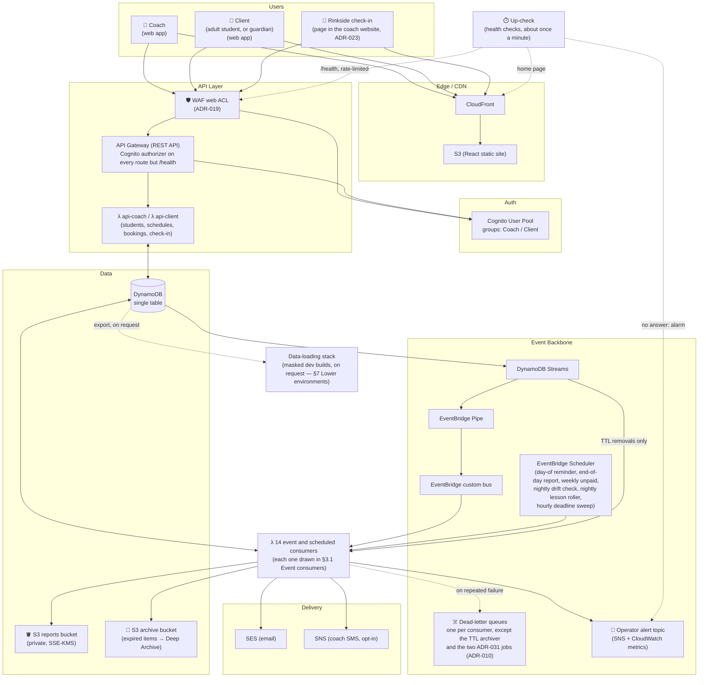

**Key idea:** the API Lambdas only read/write DynamoDB. All notification, cancellation
and reporting logic lives in **independent event/schedule consumers** — so we can add,
change, or split them (e.g. the rinkside check-in page) without touching the core API.
Domain events are derived from committed writes via change-data-capture (§6), never
published alongside them.

### 3.1 Event consumers

*Updated 2026-10-13 for ADR-031 (lessons and seats).*
*Updated 2026-10-13 for the ADR-031 revision.*

The fourteen consumers in the box above, one by one: what starts each one, and what each one reads or writes. Events reach them through the EventBridge bus, schedules through EventBridge Scheduler, and expired items through DynamoDB Streams (§6 has the step-by-step flows).

**What ADR-031 changed here:**

- **`consumer-invite` no longer keeps invitations in step.** There are no `INVITE#` copies to sync. Each seat carries the other skater's name and status (`partnerName` + `partnerStatus`), and **`consumer-invite` writes them**, reacting to seat changes about a second later — never either family's request (ADR-031 d6). It keeps two more read-only copies the same way: `invitedClientId` + GSI1 keys on an invited seat, so the invitation shows on the invited family's Home and My bookings before they accept, and `choiceAnswerBy` on the staying seat while a pending leave waits. The lesson time's pending leave stays the authority. **It only ever copies:** its role allows reads, and `UpdateItem` limited by the `dynamodb:Attributes` condition to the key fields plus `partnerName`, `partnerStatus`, `invitedClientId`, `GSI1PK`, `GSI1SK` and `choiceAnswerBy` — no `PutItem` or `DeleteItem` (ADR-031 Consequences, *owner, 2026-10-13, option B*). The coach's Accept changes only the `STUDENT#` item (ADR-033).
- **`consumer-invite` stays, for the read-only copies and the emails** (ADR-031 d6, Consequences). It reacts to seat changes and to lesson-time `pendingLeave` changes, through the change stream, and sends the shared-lesson emails that aren't deadlines: the invitation to the invited family, and every outcome email — joined, declined, withdrawn, expired, and "the other skater can't make it — keep or cancel". It never ends a seat: the inviting family's cancel ends an invited seat still `INVITED` as `WITHDRAWN` in the same transaction; once accepted, the seat is `BOOKED` and the cancel is an ordinary leave (ADR-033 d4). Cancellation emails, including *cancel all* and *no answer*, come from the change notifier.
- **The nightly invitation sweep is gone.** Its work moves to **`sched-deadline-sweep`**, which runs **every hour** (d12, §6.10).
- **`sched-lesson-roller`** is new. It runs **nightly** and keeps lesson times stored about 15 months ahead (d1).
- **`consumer-family-sync` does one more thing:** a skater's name change now also updates `studentName` on their upcoming seats, found per coach by querying that coach's upcoming `SEAT#` items and keeping the skater's (no index across families; ADR-025 d6, amended 2026-10-13); `consumer-invite` then refreshes `partnerName` on the seats sharing a lesson with them (d14).
- **The two new jobs have no dead-letter queues.** They are scheduled functions, not event consumers, and each is safe to run twice. Their completion metrics drive missed-run alarms instead (d12).

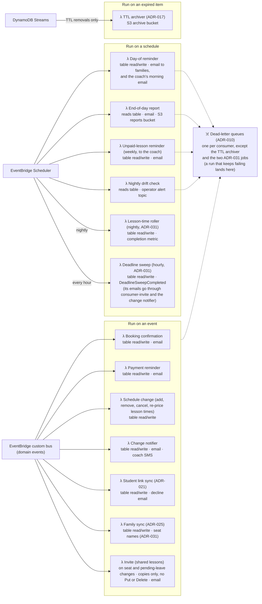

---

## 4. Domain Model

*Updated 2026-10-13 for ADR-031 (lessons and seats).*
*Updated 2026-10-13 for the ADR-031 revision.*
*Updated 2026-10-20 for ADR-033.*

**The whole model at a glance.** Boxes and relationships only; each group's fields are in the
smaller diagrams below.

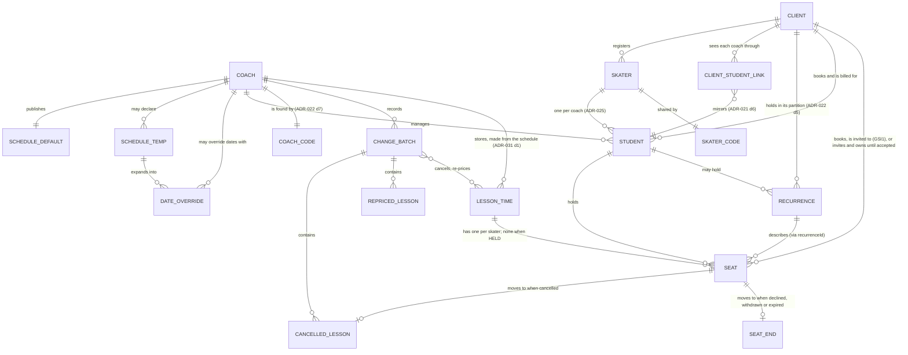

**Coach and schedule**

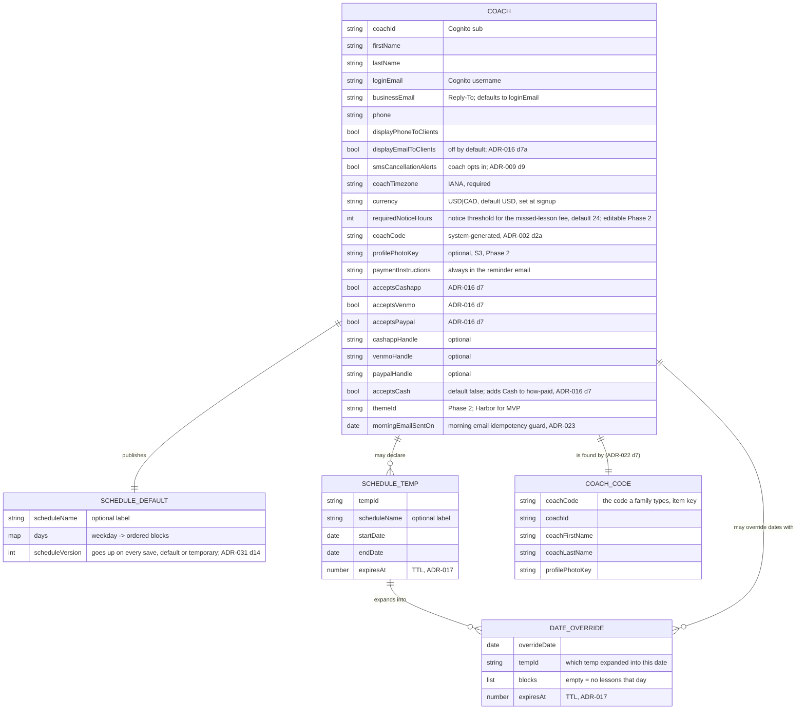

**Families and skaters**

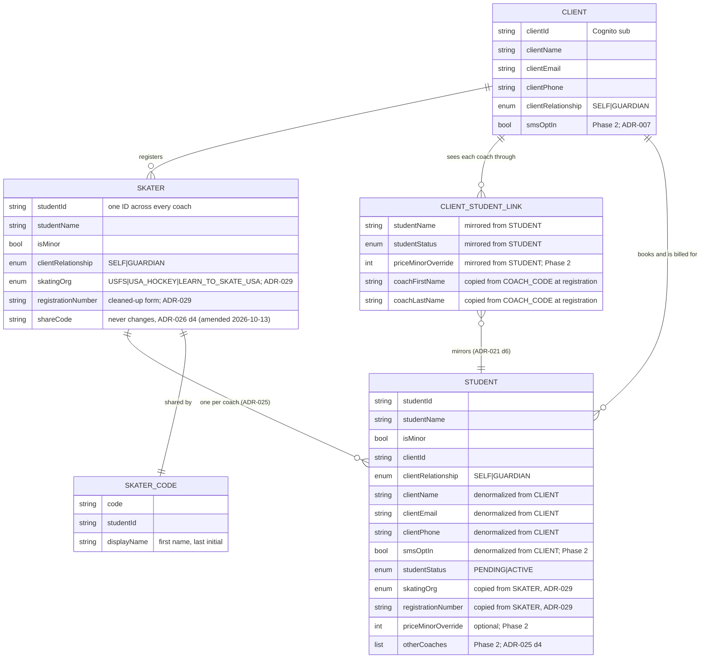

**Lesson times and seats**

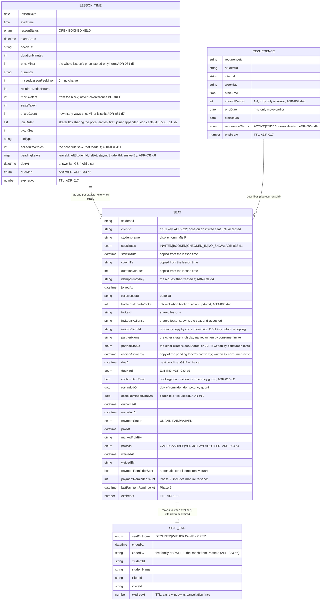

**Schedule changes and cancellations**

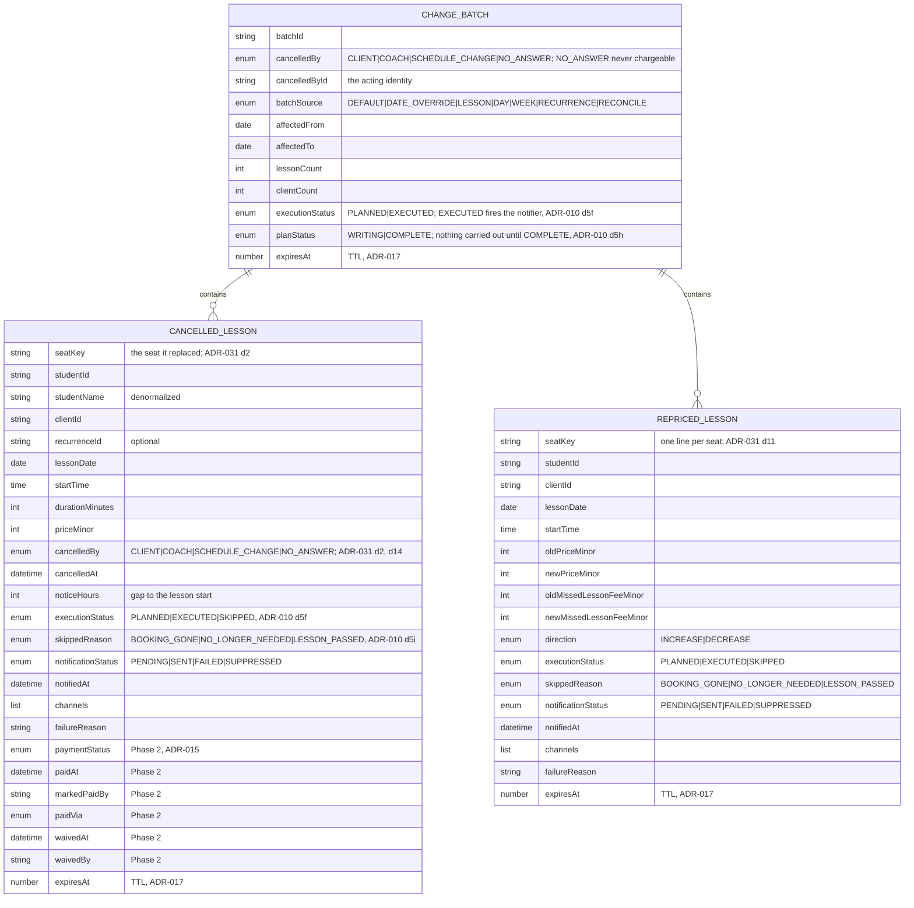

**Open times are stored, as lesson times** (ADR-031 d1, superseding ADR-004 d1–2). The
nightly `sched-lesson-roller` writes one `LESSON#` record for every time the schedule
produces, from today to the end of the booking window plus 12 months — about 15 months
ahead — so every date a series can reach already exists. A lesson time's identity is
`(date, startTime)`, which is exactly what its sort key encodes. It holds nothing about who
booked it, so reading it reveals nothing.

**The lesson is the coach's; each skater's place in it is a seat** (ADR-031 d2). A private
lesson is a lesson time with one seat, a shared lesson has two. Neither family owns a shared
lesson, so either can leave under the same rules. There is no booking item, no participant
item and no invitation item: an invitation *is* a seat with `seatStatus = INVITED`.

**No family's action writes another family's records, except answering an invitation addressed to their own skater** (ADR-031, revised 2026-10-13). The
lesson's total price is stored once, on the lesson time (`priceMinor`), and each skater's share
is always worked out from it (`priceMinor ÷ shareCount`); no amount is ever copied onto a
seat (d7). A leave is recorded on the lesson time as a **pending leave**, not on the
other family's seat (d8). The partner fields and the other read-only copies on seats are written by
`consumer-invite` (d6). An invited seat belongs to the inviting family until the invited
family accepts it (d5).

**A seat that ends is moved, not kept**, so its key stays free for the same skater to book
the same time again. A cancelled seat becomes a `CANCELLED#` line; a declined, withdrawn or
expired invitation becomes a `SEATEND#` record. Each move is one transaction with the seat's
delete.

**Seat states** (ADR-031):

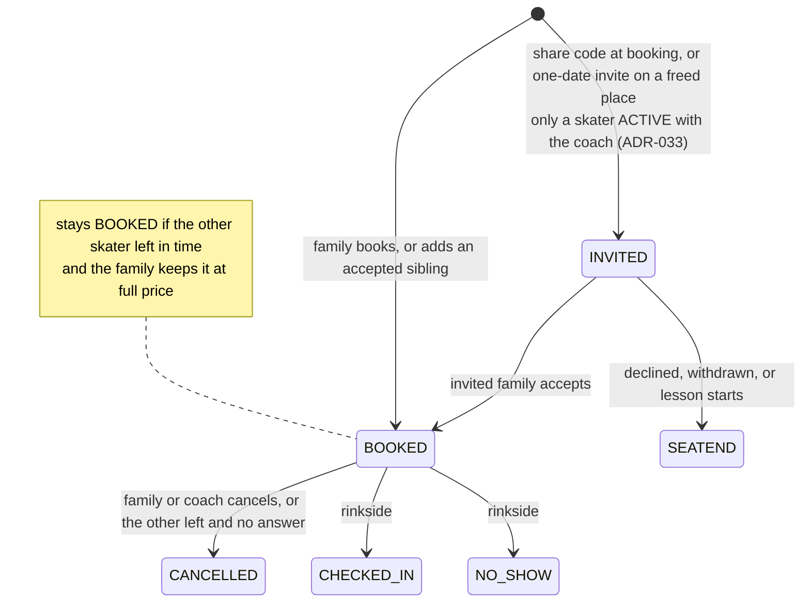

*`SEATEND` and `CANCELLED` are not seat states: they are the records a seat moves to.
"Keep or cancel?" is not a seat state either: it comes from the pending leave on the lesson
time, and the staying seat stays `BOOKED` throughout (ADR-031 d8).*

**Seats copy `startsAtUtc`, `coachTz` and `durationMinutes` from their lesson time** (ADR-031
d2), so the 7am and 9pm jobs read seats through GSI2 and never need the lesson time.

*Attendance is state on the seat (`seatStatus` + `outcomeAt` + `recordedAt`), not a
separate entity — simpler and matches the access patterns.*

*The client contact fields are denormalized onto `STUDENT` from `CLIENT#…/PROFILE`, so
notification code never branches on age and never needs a second read. `CLIENT` is the
source of truth; `consumer-family-sync` copies a profile edit to every coach's `STUDENT#` record about a second
later (ADR-025 d6, superseding ADR-002 d4).*

---

## 5. DynamoDB Single-Table Design

*Updated 2026-10-13 for ADR-031 (lessons and seats).*
*Updated 2026-10-13 for the ADR-031 revision.*
*Updated 2026-10-20 for ADR-033.*

DynamoDB is **access-pattern-first**: we design keys around the queries, not the entities.

### Access patterns

| # | Query | Served by |
|---|---|---|
| 1 | Get a coach's profile | Main table, PK |
| 2 | List all students for a coach | Main table, `begins_with(SK, "STUDENT#")` |
| 3 | Get one student | Main table, PK+SK |
| 4 | **A coach's availability for a date range** | **One range query on lesson times**: main table, `SK between LESSON#<from> and LESSON#<to>`. `OPEN` is free; `BOOKED` and `HELD` both show as taken (ADR-031 d1) |
| 5 | A coach's day or range — lesson times and who is in them (coach day view) | **Two range queries** on the main table: `SK between LESSON#<from> and LESSON#<to>`, and `SK between SEAT#<from> and SEAT#<to>` (ADR-031 Consequences) |
| 6 | List a client's upcoming bookings (their own, or their child's) | **GSI1** (by client) **on seats**, filtered on `studentId` for one student (ADR-022 d4, ADR-031 d2). An invited seat is in the invited family's GSI1 before they accept it, through the `invitedClientId` copy `consumer-invite` writes (ADR-031 d6) |
| 7 | **List ALL seats on a date across every coach** (for the scheduled jobs) | **GSI2** (by date) **on seats** — one entry per seat, written only once a seat is `BOOKED` (ADR-031 d14) |
| 8 | List a client's students | Main table, `PK = CLIENT#<sub>`, `begins_with(SK, "STUDENT#")` |
| 9 | Resolve a coach code to a coach | Main table, `GetItem PK = CODE#<code>` |
| 10 | List a coach's pending students | Pattern #2, filtered on `studentStatus = PENDING` |
| 11 | List a coach's unpaid seats, oldest first | **GSI3** (sparse) **on seats**, `GSI3PK = COACH#<coachId>` |
| 12 | List a student's unpaid seats | Client: GSI1 (by client), filtered on `studentId` and `paymentStatus`. **Coach: GSI3, filtered on `studentId`** — `api-coach` holds no GSI1 (ADR-021 d4) |
| 12a | **Coach dashboard — every lesson in a date range** (serves both the payment section and the lesson list) | Main table, `SK between SEAT#<from> and SEAT#<to>`, with pattern #5's `LESSON#` range for price and time. The date range is **required before the list renders**, which is what keeps this query bounded. |
| 13 | List date overrides in a range (month grid, week view) | Main table, `SK between SCHEDULE#DATE#<from> and SCHEDULE#DATE#<to>` |
| 14 | List a coach's cancellation batches, newest first | Main table, `begins_with(SK, "CHANGEBATCH#")`, descending |
| 15 | List the cancelled and re-priced lessons in one batch | Main table, `begins_with(SK, "CANCELLED#<isoTs>#<batchId>")` and `begins_with(SK, "REPRICED#<isoTs>#<batchId>")` (ADR-020) |
| 16 | List the surviving seats of one recurrence | GSI1 (by client), filtered on `recurrenceId` |
| 17 | List a coach's temporary schedules | Main table, `begins_with(SK, "SCHEDULE#TEMP#")` |
| 18 | Find temps overlapping a candidate date range | Pattern #17, filtered on `startDate`/`endDate` |
| 19 | A coach's week, time by time — open / booked / held | Pattern #5 over a Sun–Sat range — `lessonStatus` from the lesson times, names from the seats |
| 20 | A client's cancellable upcoming bookings | GSI1 (by client), filtered on `seatStatus = BOOKED` |
| 21 | A client's recurring arrangements (recurrence management) | Main table, `PK = CLIENT#<sub>`, `begins_with(SK, "RECURRENCE#")` — no filter (ADR-009 d4c, ADR-022 d5) |
| 22 | Every unpaid past seat older than a cutoff, across coaches (the weekly coach reminder) | **Scan on GSI3** — sparse, so it holds only outstanding debts — filtered on the date in `GSI3SK` (ADR-018) |
| 23 | **Every deadline now due** — invited seats (`EXPIRE`) and lesson times (`ANSWER`, with a pending leave) (the hourly sweep) | **GSI4** (sparse, ADR-031 d12): `GSI4PK = DUE`, `GSI4SK` up to the current time — read across every coach |
| 24 | **Retry attribution** — what happened to a failed date for this skater? | **`GetItem` on the family's own seat key**, `SEAT#<date>#<startTime>#<studentId>`, strongly consistent. The seat carries this request's `idempotencyKey` → *booked* (a retry found its own write); a seat from another request → *already booked*; no seat → *unavailable* (ADR-031 d4, replacing ADR-022 d8's GSI1 lookup) |
| 25 | **Is an invited skater on this coach's student list?** (the share-check, before the booking is sent) | `GetItem` on `COACH#<coachId>/STUDENT#<studentId>`, projection `studentStatus` only, in the family's tagged session (ADR-033 d2a) |

### Attribute names avoid DynamoDB reserved words

DynamoDB reserves about 570 words — `NAME`, `STATUS`, `DATE`, `START`, `END`, `SOURCE`,
`TIMEZONE` among them, ignoring case — and an attribute with one of those names must be
aliased in every expression or the request fails. *Decided by the owner, 2026-09-30:* the
model uses none of them. Eight attributes were renamed:

| Was | Now |
|---|---|
| `status` (booking / student / recurrence header) | `bookingStatus` / `studentStatus` / `recurrenceStatus` |
| `date` (booking, cancelled and re-priced lines / date override) | `lessonDate` / `overrideDate` |
| `name` (schedules / blocks / student) | `scheduleName` / `blockName` / `studentName` |
| `start`, `end` (blocks) | `startTime`, `endTime` |
| `source` (change batch) | `batchSource` |
| `timezone` (coach) | `coachTimezone` |

*`bookingStatus` went with the booking item in ADR-031: the lesson time has `lessonStatus`
and the seat has `seatStatus`.*

**Any new attribute is checked against AWS's reserved-word list before it is used.**
ADR-031's new names were checked on 2026-10-13 and none is reserved: `lessonStatus`,
`seatStatus`, `seatsTaken`, `shareCount`, `joinOrder`, `pendingLeave`, `leftStudentId`, `leftAt`, `stayingStudentId`,
`invitedClientId`, `choiceAnswerBy`, `dueAt`, `dueKind`,
`answerBy`, `leaveId`, `partnerName`, `partnerStatus`, `joinedAt`, `scheduleVersion`,
`blockSeq`, `iceType`, `inviteId`, `invitedByClientId`, `idempotencyKey`, `seatOutcome`,
`endedAt` and `endedBy`. The bare words they avoid — `STATUS`, `NAME` — are
reserved, which is why each carries a prefix.

### Table layout

**Main table** — partition key `PK`, sort key `SK`:

| Entity | PK | SK | Notable attributes |
|---|---|---|---|
| Coach profile | `COACH#<coachId>` | `PROFILE` | firstName, lastName, loginEmail, **businessEmail** (Reply-To; defaults to loginEmail), phone, displayPhoneToClients, **displayEmailToClients**, **coachTimezone** (IANA, required), currency (USD\|CAD, default USD), **requiredNoticeHours** (ADR-015 d3; default 24, editable from Phase 2), **smsCancellationAlerts** (ADR-009 d9; default false), coachCode, profilePhotoKey, paymentInstructions, cashapp/venmo/paypal handles, **acceptsCash / acceptsCashapp / acceptsVenmo / acceptsPaypal** (one switch per payment type, ADR-016 d7, 2026-10-12), **morningEmailSentOn** (the date the coach's morning email went out; retry guard, ADR-023, 2026-10-13), themeId *(Phase 2)* (ADR-016) |
| Default schedule | `COACH#<coachId>` | `SCHEDULE#DEFAULT` | `scheduleName` (optional), `days` — weekday → ordered blocks, **scheduleVersion** (goes up on every save, default or temporary; each lesson time records the version that made it — ADR-031 d14) |
| Temp schedule header | `COACH#<coachId>` | `SCHEDULE#TEMP#<tempId>` | `scheduleName` (optional), `startDate`, `endDate` |
| Date override | `COACH#<coachId>` | `SCHEDULE#DATE#<yyyy-mm-dd>` | `tempId`, `blocks` — empty list means no lessons that day |
| Student | `COACH#<coachId>` | `STUDENT#<studentId>` | studentName, isMinor, clientRelationship, clientId, studentStatus, clientName/Email/Phone, smsOptIn, **skatingOrg + registrationNumber** (copied from the skater's `SKATER#` by `consumer-family-sync`; shown on the Students list and Waiting for approval, ADR-029 d3), priceMinorOverride (Phase 2), **otherCoaches** (*Phase 2*; names of the skater's other `ACTIVE` coaches, kept by `consumer-student-link`; ADR-025 d4). One coach's view of a skater; the same `studentId` can appear under several coaches. |
| Lesson time | `COACH#<coachId>` | `LESSON#<yyyy-mm-dd>#<startTime>` | **lessonStatus** (`OPEN\|BOOKED\|HELD`), lessonDate, startTime, startsAtUtc, coachTz, durationMinutes, **priceMinor + currency + missedLessonFeeMinor + requiredNoticeHours** (stamped from the schedule when the lesson time is made, so a booking stamps nothing new — ADR-003 d2, ADR-015 d3, ADR-026 d1), **maxSkaters** (from the block; never lowered once `BOOKED`) + **seatsTaken**, **shareCount** (how many ways the price is split: +1 when a skater joins or fills a freed place, set to the remaining skaters when the staying family keeps after an in-time leave, unchanged by a late leave — ADR-031 d7), **joinOrder** (the skater IDs sharing the price, earliest first; a joiner is appended; after an in-time leave the leaver stays in it until the staying family answers, and Keep sets it to the remaining skaters; a late leaver stays in it and in `shareCount`, so the odd cent may sit with them; odd cents go to the earliest — ADR-031 d1, d7), blockSeq, iceType, **scheduleVersion** (the schedule save that made it, ADR-031 d11), and while the staying family has a question to answer, a **pending leave** (`pendingLeave` map: `leaveId`, `leftStudentId`, `leftAt`, `stayingStudentId`, `answerBy` — ADR-031 d8) with **dueAt + dueKind** (`ANSWER`) and its GSI4 keys. **`priceMinor` is the lesson's total price and the only place it is stored** (ADR-031 d7). Made by the nightly `sched-lesson-roller` about 15 months ahead. Holds no names and nothing about who booked — a pending leave holds only random skater IDs and a time, and isn't in the availability read — so the availability query reveals nothing (ADR-031 d1). No GSI keys except GSI4 while a pending leave waits. |
| Seat | `COACH#<coachId>` | `SEAT#<yyyy-mm-dd>#<startTime>#<studentId>` | One skater's place in a lesson time (ADR-031 d2): studentId, **clientId** (GSI1 key, ADR-022; an invited seat has none until the invited family accepts it, ADR-031 d5), studentName (display form, "Mia R."), **seatStatus** (`INVITED\|BOOKED\|CHECKED_IN\|NO_SHOW`), copies of the lesson time's **startsAtUtc, coachTz and durationMinutes** (so the 7am and 9pm jobs never read the lesson time), **idempotencyKey** (the request that created it, for retry attribution, ADR-031 d4), joinedAt (no amount: what this skater owes is always worked out from the lesson time — ADR-031 d7), recurrenceId + **bookedIntervalWeeks** (never updated), inviteId + **invitedByClientId** (shared lessons; the inviting family owns an invited seat until it is accepted, ADR-031 d5), **partnerName + partnerStatus** (the other skater's display name and status), **invitedClientId** (on an invited seat, the invited family, with their GSI1 keys, so the invitation shows on their Home and My bookings before they accept) and **choiceAnswerBy** (on the staying seat, a copy of the pending leave's `answerBy`, cleared once answered) — all three **read-only copies written by `consumer-invite`**, never by a family's request; the lesson time's pending leave stays the authority (ADR-031 d6), **confirmationSent**, **remindedOn**, **settleReminderSentOn**, **outcomeAt + recordedAt**, paymentStatus, paidAt, markedPaidBy, **paidVia** (CASH\|CASHAPP\|VENMO\|PAYPAL\|OTHER; optional, editable, coach-only; none when waived, ADR-003 d4), **waivedAt + waivedBy**, paymentReminderSent, *(Phase 2)* paymentReminderCount + lastPaymentReminderAt, **dueAt + dueKind** (`EXPIRE`, on an invited seat, ADR-031 d12, ADR-033 d5), and its GSI1 (from `clientId`, or before accepting from `invitedClientId`), GSI2 (only once `BOOKED`), GSI3 and GSI4 keys. A separate `SEAT#` prefix keeps seats out of the availability query. |
| Seat end | `COACH#<coachId>` | `SEATEND#<yyyy-mm-dd>#<startTime>#<studentId>#<isoTs>` | A declined, withdrawn or expired invitation, moved here in one transaction with the seat's delete, **seatOutcome** (`DECLINED\|WITHDRAWN\|EXPIRED`), **endedAt**, **endedBy** (the family or `SWEEP`; the coach from Phase 2, ADR-033 d6), studentId, studentName, clientId, inviteId (ADR-031 d2, d14). Kept for the same window as cancellation lines (ADR-017). |
| Recurrence header | `CLIENT#<clientId>` — *moved from the coach's partition by ADR-022 d5* | `RECURRENCE#<coachId>#<recurrenceId>` | studentId, clientId, weekday, startTime, **intervalWeeks** (1–4), endDate, startedOn, **recurrenceStatus** (`ACTIVE\|ENDED` — never deleted) — read only by recurrence management, never on the booking path (ADR-009 d4c, ADR-006 d4b) |
| Cancellation batch | `COACH#<coachId>` | `CHANGEBATCH#<isoTs>#<batchId>` | **cancelledBy** (`CLIENT\|COACH\|SCHEDULE_CHANGE\|NO_ANSWER` — `NO_ANSWER` is the hourly sweep's, never chargeable, ADR-031 d14), cancelledById, batchSource, affectedFrom, affectedTo, lessonCount, clientCount, **executionStatus** (`PLANNED\|EXECUTED`), **planStatus** (`WRITING\|COMPLETE`; nothing carried out until `COMPLETE`, ADR-010 d5h) |
| Cancelled lesson | `COACH#<coachId>` | `CANCELLED#<isoTs>#<batchId>#<seatKey>` — one line per cancelled **seat** (ADR-031 d2) | **cancelledBy**, lessonDate, startTime, durationMinutes, priceMinor, studentId, studentName, clientId, recurrenceId, **cancelledAt, noticeHours**, **executionStatus** (`PLANNED\|EXECUTED\|SKIPPED`), **skippedReason** (`BOOKING_GONE\|NO_LONGER_NEEDED\|LESSON_PASSED`, ADR-010 d5i), notificationStatus, notifiedAt, channels, failureReason, *(Phase 2, ADR-015 d4)* the fee — for a late leave of a shared lesson, the leaver's share of it (ADR-031 d8) — and its paymentStatus, paidAt, markedPaidBy, paidVia, waivedAt, waivedBy |
| Re-priced lesson | `COACH#<coachId>` | `REPRICED#<isoTs>#<batchId>#<seatKey>` — one line per **seat** (ADR-031 d11, d14) | lessonDate, startTime, studentId, clientId, **oldPriceMinor + newPriceMinor**, old and new missedLessonFeeMinor, direction (`INCREASE\|DECREASE`), **executionStatus** (`PLANNED\|EXECUTED\|SKIPPED`), **skippedReason** (`BOOKING_GONE\|NO_LONGER_NEEDED\|LESSON_PASSED`), notificationStatus, notifiedAt, channels, failureReason (ADR-020) |
| Client profile | `CLIENT#<cognitoSub>` | `PROFILE` | clientName, clientEmail, clientPhone, clientRelationship, smsOptIn — copied to every coach's `STUDENT#` records by `consumer-family-sync` (ADR-025 d6) |
| Skater | `CLIENT#<cognitoSub>` | `SKATER#<studentId>` | studentName, isMinor, clientRelationship, **skatingOrg** (`USFS\|USA_HOCKEY\|LEARN_TO_SKATE_USA`; Phase 2 adds `SKATE_CANADA\|HOCKEY_CANADA`) **+ registrationNumber** (ADR-029, amended 2026-10-16; copied to each coach's `STUDENT#` by `consumer-family-sync`), **shareCode** (never changes, ADR-026 d4) — the source of truth for who the skater is; one `studentId` across all their coaches (ADR-025 d1) |
| Client→student link | `CLIENT#<cognitoSub>` | `STUDENT#<coachId>#<studentId>` | studentName, studentStatus, priceMinorOverride (Phase 2) — all mirrored from the `STUDENT#` item by `consumer-student-link` (ADR-021 d6, ADR-022 d6); coachFirstName, coachLastName — copied from the `CODE#` item at registration (ADR-022 d7) |
| Coach code lookup | `CODE#<coachCode>` | `CODE` | coachId, **coachFirstName, coachLastName, profilePhotoKey** (shown on the sign-up code screen before the family has an account, and on the pending screens; ADR-022 d7) — written with `attribute_not_exists(PK)` |
| Skater share code | `SKATERCODE#<code>` | `CODE` | studentId, display name (first name, last initial); issued by `consumer-family-sync` with `attribute_not_exists(PK)` (ADR-026 d4) |

A **block** is `{ seq, blockName?, startTime, endTime, lessonMinutes, priceMinor, missedLessonFeeMinor, maxSkaters }` (`maxSkaters` default 1, ADR-026) — the name optional
and **coach-facing only** (ADR-008 decision 2a); anything that must refer to a block falls
back to `Block <seq>`, a per-schedule sequence assigned at creation, never reused and never
renumbered — where `lessonMinutes` is one of
30, 45, 60, 90 or 120 (ADR-008 decision 5 — a UI constraint; the stored field is an
integer). Blocks within a day must not overlap (abutting is allowed); breaks are simply
the gaps between blocks. A whole schedule is one item, a few kilobytes, far inside the
400 KB limit.

**Resolution for a date `D`:** if `SCHEDULE#DATE#<D>` exists, its blocks apply (even if
empty); otherwise the default's weekday map applies. One rule, one lookup, no
precedence stack (ADR-006 decision 2).

**The temp header is never read on the booking path.** `SCHEDULE#TEMP#` items exist for
management only — listing, naming, "runs 7 days," delete-as-a-unit, and overlap validation
in the editor. Availability resolves from `SCHEDULE#DATE#` items alone, so a stale or
missing header can misname a listing but can never affect what a client is able to book
(ADR-008 decision 7). Date items are written first, header last.

**A held lesson time is a time the coach has kept** after cancelling (ADR-009 d5, now
ADR-031 d1): the lesson time stays, with `lessonStatus = HELD` and **no seats**. A family
sees it as *taken*, exactly like a booked one. Because the GSI keys live only on seats, a held
lesson time is out of the client's views (GSI1), the 7am reminder and 9pm report (GSI2) and
the unpaid list (GSI3) with no filtering logic anywhere.

**Items expire through Time to Live (TTL)** (ADR-017). One attribute, `expiresAt` (seconds
since 1970), set per item from a per-item-type window held in configuration; an item without
it never expires. Past date overrides, temp headers and held lesson times expire a few weeks
after their dates. Seats and chargeable cancellation lines get an expiry only **when
settled**, so an unpaid lesson never disappears (ADR-017, applied to seats and lines as it
was to bookings, ADR-031 d15). A past lesson time is kept as long as any seat or line for it
is kept, and expires with the last of them; one that never had a seat expires on the
date-override window. `SEATEND#` records are kept for the same window as cancellation lines
(ADR-031 Consequences, d14). Profiles, links and codes are never on TTL — they end
by account closure, or by erasure on request once it ships (Phase 2, owner 2026-10-20). Parent records never expire before their children:
a batch header is raised to its latest line, and header repair (ADR-006 d4b) only runs for
arrangements with an upcoming lesson. The windows for records about people wait on the
legal review.

**GSI1–GSI3 are written by seats** (ADR-031 d2) — the same roles they had on bookings.
**GSI4 is written by invited seats and by lesson times with a pending leave** (d12). Lesson
times write no other GSI keys.

**GSI1 — "by client"** (client-facing views — My bookings and Home):
`GSI1PK = CLIENT#<clientId>`, `GSI1SK = SEAT#<date>#<startTime>`. An invited seat has **no
`clientId`** until the invited family accepts it (ADR-031 d5), but `consumer-invite` copies the
invited family onto it as `invitedClientId` and adds their GSI1 keys, so the invitation shows
on their Home and My bookings before they accept (d6). Accepting sets the seat's `clientId`.
*Keyed by
student until ADR-022 (2026-10-01), which re-keyed it so a client's tenant role can be held
to its own seats by the database.*

**GSI2 — "by date, global"** (the scheduled jobs):
`GSI2PK = DATE#<yyyy-mm-dd>`, `GSI2SK = COACH#<coachId>#<startTime>`, one entry per seat.
A seat gets its GSI2 keys **only when it becomes `BOOKED`**: `INVITED` seats have none, so the jobs see only `BOOKED`, `CHECKED_IN` and `NO_SHOW` seats
(ADR-031 d14)
→ the morning reminder job and end-of-day report both do a single `Query(GSI2PK = DATE#today)`.

**GSI3 — "unpaid", sparse** (ADR-003 decision 5):
`GSI3PK = COACH#<coachId>`, `GSI3SK = UNPAID#<date>#<studentId>`, written **only while
a seat is `UNPAID`** and removed when marked paid or waived, so the index holds only
outstanding debts and stays permanently small. That smallness is what lets the weekly
unpaid-lesson reminder **scan** it across every coach (ADR-018) — the one scan in the design. *Phase 2:* late-cancellation `CANCELLED#`
lines join GSI3 while unpaid, because a cancelled seat is moved to its line and the charge
has to live on the line instead (ADR-015 d4, ADR-031 d2).

**GSI4 — "deadlines", sparse** (ADR-031 d12):
`GSI4PK = DUE`, `GSI4SK = <dueAtUtc>#<coachId>#<itemKey>`, written **only while a record has a
pending deadline** (`dueAt` + `dueKind`) and removed when the sweep acts or the deadline no
longer applies. `EXPIRE` sits on the **invited seat**; `ANSWER` (with its pending leave) on the **lesson time** (ADR-033 d5). `<itemKey>` is that record's sort key. The hourly `sched-deadline-sweep` queries everything due up to now. It reads
across every coach, like GSI2, so only `sched-deadline-sweep` should be able to read it.
*The two new jobs' IAM roles are still open (ADR-031 d14).*

> **This is the crux of choosing DynamoDB here.** GSI2 is what makes the cross-coach
> "everyone with a lesson today" queries O(1)-ish instead of a full table scan. It's
> the modeling work we traded the ~$20–45/mo Postgres+VPC bill for.

---

## 6. Event-Driven Flows

We publish domain events **reliably** using **DynamoDB Streams → EventBridge Pipe → EventBridge bus** (change-data-capture). This avoids the "dual-write" problem of writing to the DB and separately to the bus and having one fail — the event is derived from the committed write.

### 6.1 Booking a lesson

*Updated 2026-10-13 for ADR-031 (lessons and seats).*
*Updated 2026-10-13 for the ADR-031 revision.*

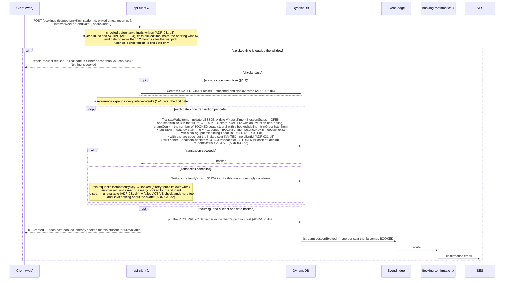

**The lesson time is the lock** (ADR-031 d4, superseding ADR-004 d2). Each date is one
transaction: the lesson time moves from `OPEN` to `BOOKED` only if it is still `OPEN` and
hasn't started, and the seat is put only if it doesn't exist. Of two families racing for the
same time, one transaction succeeds and the other gets **unavailable**.

**Every picked time must be inside the booking window** (ADR-031 d3): from today to the end
of the month two months after the current one, in the coach's time zone (on April 24: April,
May and June). It is checked with the request's other checks, before anything is written. A
repeating series is checked on its **first** date only; its later dates may run past the
window up to the end date. A pick outside the window refuses the **whole** request — unlike
*unavailable*, it can only come from something other than the booking page. A retry
is never refused by the window: the window only grows as time passes (on May 1 it runs to
the end of July), so a pick that was inside it stays inside it. *Open (Phase 2): whether a coach booking for a family is held to the same window.*

**A failed date is attributed by reading the family's own seat** (ADR-031 d4). The family
reads only its own skater's key, strongly consistent, and ADR-006 d4b's three outcomes stay:
the seat carries this request's `idempotencyKey` → *booked* (a retry found its own write); a
seat from another request → *already booked for this student*; no seat → *unavailable*.
Another family's occupancy stays invisible. This
replaces ADR-022 d8's GSI1 lookup and its re-check after a pause.

**Sharing at booking** adds the invited seat to the same transaction (ADR-031 d5, §6.9). It
holds the place at once, and the booking family pays the full price until the invited
skater joins: the lesson time's `shareCount` is 1, and an invited seat doesn't count. The
invited seat is the booking family's record until the invited family accepts it, so it has
no `clientId` yet; `consumer-invite` adds the read-only `invitedClientId` and GSI1 keys a
second later, so the invitation shows on the invited family's Home and My bookings.

**Only a skater `ACTIVE` with the coach can be invited or added as a sibling** (ADR-033). The
same transaction holds a `ConditionCheckItem` on `COACH#<coachId>/STUDENT#<studentId>`,
`studentStatus = ACTIVE`, for the invited skater or sibling; a failed check fails that date's
transaction and returns nothing about the item (ADR-033 d2). So the family learns at the share
step rather than when the booking is sent, the booking page first calls the **share-check**
endpoint, `POST /api/client/share-check` with `{ shareCode, coachId }`, which answers
`{ displayName, onCoachRoster }` (§6.9, ADR-033 d2a). A skater who isn't on the coach's list
stops the booking at the share step with *"Mia R. isn't one of Coach Dana's students yet. Mia's
family can sign up with Coach Dana's code, and once Coach Dana accepts Mia you can share a
lesson."* Nothing is booked. A sibling not yet accepted is shown as **not available to add
until Coach Dana accepts them**, and can't be picked. The transaction's check stays the
authority.

**Recurring bookings** materialize immediately: the client marks a booking recurring,
picks a frequency of every 1–4 weeks (`intervalWeeks`), and gives an end date (**capped
at 12 months** after the first pick). The system books every date when the series is made,
each date its own transaction, partial success allowed, each seat carrying a shared
`recurrenceId`, plus one `RECURRENCE#` header recording the arrangement, written last in the
family's partition and only if at least one date was booked (ADR-006 d4a, ADR-031 d4). The
lesson roller keeps lesson times stored about 15 months ahead, so every date a series can
reach already exists. The header exists because the current interval cannot be recovered
from the surviving seats once one has been cancelled by hand (ADR-009 d4c).

**A failed booking repairs itself** (ADR-006 d4b). Each selected time is its own recurrence,
and its `recurrenceId` is derived from the request's idempotency key and the time, so the
app's automatic retry recognises the lessons its first attempt wrote. Every seat is
stamped with `bookedIntervalWeeks` — the interval it was booked under, never updated — and
headers are never deleted (ending an arrangement marks it `ENDED`), so a header that was
never written is rebuilt automatically the next time the client's bookings load. Results
distinguish *booked*, *already booked for this student* and *unavailable*; if a client
resubmits without a time the failed request included, the app asks whether to keep or
cancel the lessons it already holds, rather than guessing. Dates that cannot be booked are
skipped and reported — see §10 feature 5 and ADR-006 decision 4. Multi-coach booking is
unchanged (ADR-025).

### 6.2 Day-of reminders

*Updated 2026-10-13 for ADR-031 (lessons and seats): reminders are per seat.*

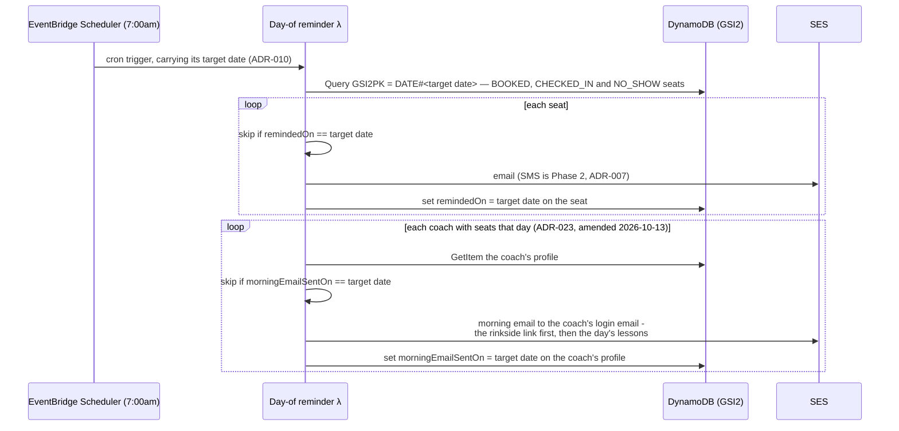

*Added 2026-10-13 (ADR-023):* the same run also sends each coach with lessons that day **one
morning email** listing them, with the rinkside link first. It goes to the coach's **login email**, not the business email (amended 2026-10-15). It is marked as sent on the coach's
profile (`morningEmailSentOn`), the way `remindedOn` marks a seat, so a retry never sends it
twice.

Only `BOOKED`, `CHECKED_IN` and `NO_SHOW` seats are on GSI2: a seat gets its GSI2 keys only
when it becomes `BOOKED` (ADR-031 d14). A pending leave on the lesson time is always settled
before the lesson day, because its answer-by is no later than the start of the notice period.

### 6.3 Attendance (check-in / no-show) → payment reminder

*Updated 2026-10-13 for ADR-031 (lessons and seats): attendance and payment are per seat.*
*Updated 2026-10-13 for the ADR-031 revision.*

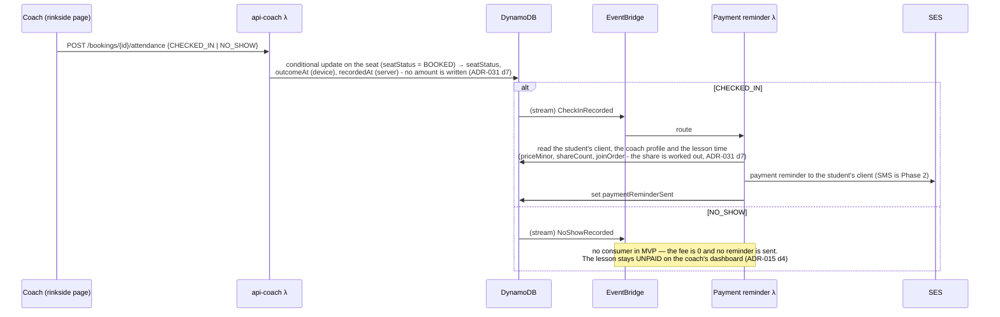

The email states the **specific amount owed** for that lesson — the full price for a private
lesson, the skater's share of a shared one — plus the coach's `paymentInstructions`
(HTML-escaped). **No amount is ever copied onto the seat** (ADR-031 d7): the share is worked
out from the lesson time as `priceMinor ÷ shareCount`, odd cents one each to the earliest
skaters in its `joinOrder`. Check-in, no-show and marking paid or waived write no amount. The
payment reminder, the unpaid list and weekly reminder (ADR-018) and the financial page
(ADR-030) all work it out the same way. A past lesson's share can't change — price changes
never reach past lessons (ADR-020) and nobody joins or leaves once a lesson has started — so
it gives the same answer every time.

**The coach records both outcomes.** The app marks a student **present or absent** — a
no-show is an affirmative act, not something inferred from silence (ADR-014 decision 6).
`CHECKED_IN` emits `CheckInRecorded` and `NO_SHOW` emits `NoShowRecorded` — two events, not
one, because the reminder wording differs (ADR-015 decision 5). **Both are charged, under one
rule**, since a no-show is a cancellation with zero notice: the lesson's
`missedLessonFeeMinor`. In MVP that fee is `0` and no reminder goes to the family, but a
recorded no-show still stays `UNPAID` on the coach's dashboard until the coach marks it paid
or waived (ADR-015 d4, amended 2026-09-30). For now the dashboard shows it at its **full
lesson price** — the skater's share of a shared lesson, worked out from the lesson time —
labelled as a no-show.

**Offline capture (ADR-014).** This is the only surface used *inside* a rink, where there
is often no signal. When the device is offline the app tells the coach, stores the student,
the outcome and the time in device storage, and replays the queue when connectivity
returns. Two consequences: `outcomeAt` is the **device's** time and `recordedAt` is the
server's, because an outcome replayed hours later must not read as though it happened
then; and the write is conditional on the seat still being `BOOKED`, so a duplicated
replay cannot emit `CheckInRecorded` twice and send a second payment reminder — and a
replay onto a seat cancelled while the phone was offline fails rather than overwriting
it. That last case is mostly the *client* cancelling a lesson the offline coach never got
told about, so the app reports it as a cancellation rather than as an error the coach
caused (ADR-014 decision 4). A queued check-in never expires: the server accepts the phone's time
whenever it arrives, **as long as it fits the lesson** — from an hour before the start to the
end of that day, in the coach's timezone — which catches a wrong clock (ADR-014 d2a). On
Android and Chrome the queue is sent in the background when signal returns (d1a); on an
iPhone, when the app next opens. The rare entry rejected for a wrong time is listed on the
phone for the coach to record on the website (d4a). If the app opens and today's lessons haven't loaded,
it says so — *"Today's lessons haven't loaded. Open the app with signal before you leave for
the rink."* — rather than showing an empty day (ADR-014 d5a). Because the reminder is driven by that event, an offline session delays
every reminder in it.

**Offline capture and replay, step by step** (ADR-014, amended 2026-10-13):

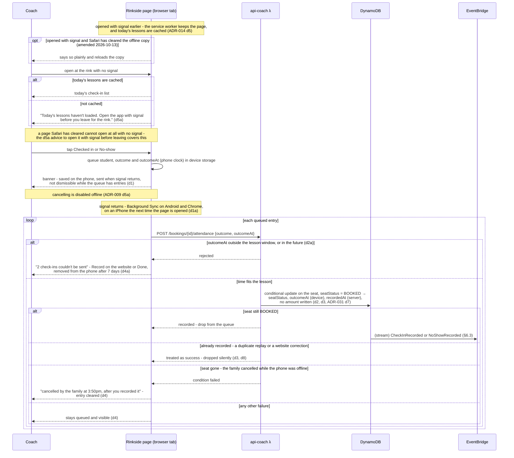

### 6.4 End-of-day report

*Updated 2026-10-13 for ADR-031 (lessons and seats): the report reads seats.*
*Updated 2026-10-13 for the ADR-031 revision.*

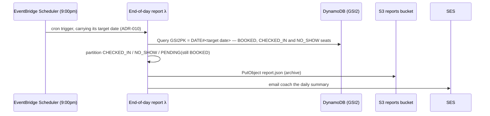

**Three buckets, and `PENDING` is the default.** *Decided by the owner, 2026-08-30.* The
report partitions the day into **checked in**, **no-show**, and **pending** — and a seat
the coach never recorded an outcome for lands in `PENDING`, not in no-show.

This matters because of offline capture. A seat still sitting at `BOOKED` at 9pm can
mean three different things: the coach forgot to record anything, the coach recorded it on
a phone that still has not regained signal, or the student genuinely never appeared. The
report cannot tell those apart, so it stops pretending it can. Reporting the unknown case
as a no-show would quietly convert "my phone never reconnected" into "your student did not
show up" — a claim about a family, made from missing data.

**The email names each pending student and lesson** and says what to do: open the rinkside
app with signal to send queued check-ins, or record them on the lesson list (ADR-014 d7). It
is the coach's only nightly prompt — no push notification is sent.

`PENDING` is a **bucket in the report, derived from `seatStatus`**, not a stored seat state.
**The 9pm job writes nothing to the table** (ADR-014 d7, ADR-031 d7) — no status and no
amount. The absence of a recorded outcome *is* the pending state, and
once a queued outcome replays the seat simply leaves that bucket.

**The report is a snapshot, not a correction.** It states what the server knew at 9:00pm.
A check-in that replays at 10pm updates the seat but does not regenerate or re-send the
report — so a pending count that stays high across several days is the coach's signal that
a phone is not syncing. See ADR-014's Revisit list.

**Report archival (S3).** Each daily report is persisted to a private S3 bucket keyed by coach and date:

```
s3://bladebook-reports/coach=<coachId>/date=<yyyy-mm-dd>/report.json
```

- `report.json` is machine-readable (per-student checked-in / no-show / pending breakdown) so it can later feed the Phase-2 coach analytics dashboard — queryable directly with **Athena**, no DynamoDB load.
- The bucket is **private** (Block Public Access on, no public policy), **SSE-KMS** encrypted, with a **lifecycle policy**. See §7 — some of that data is about minors.

### 6.5 Schedule change → lesson times added, removed, cancelled and re-priced → notification

*Updated 2026-10-13 for ADR-031 (lessons and seats).*
*Updated 2026-10-13 for the ADR-031 revision.*

**First, a recent sign-in** (ADR-023 d4). A schedule save is the most destructive action in the system, so `api-coach` refuses it unless the coach typed their password in the last 15 minutes. The preview is not guarded.

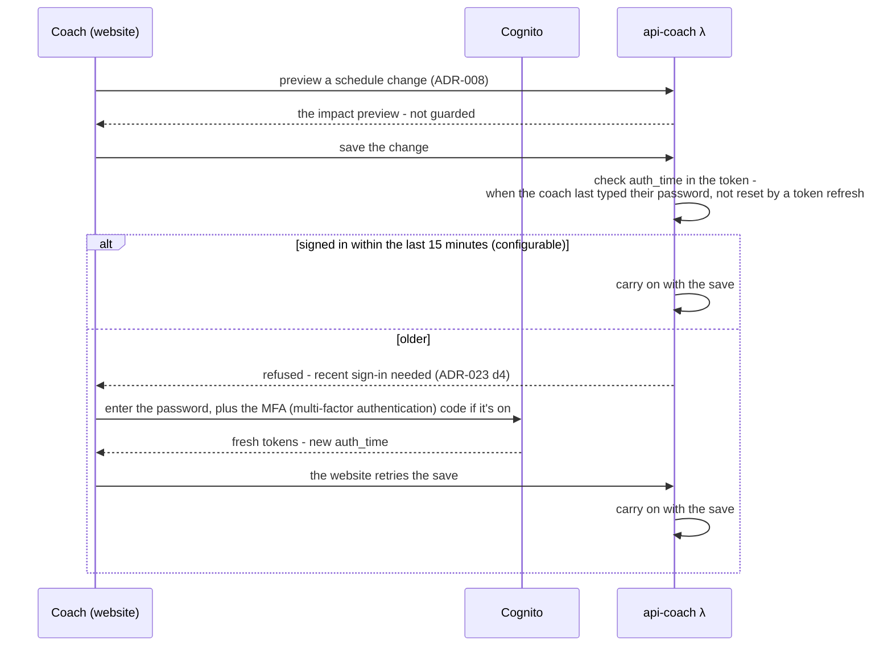

**Then the save itself:**

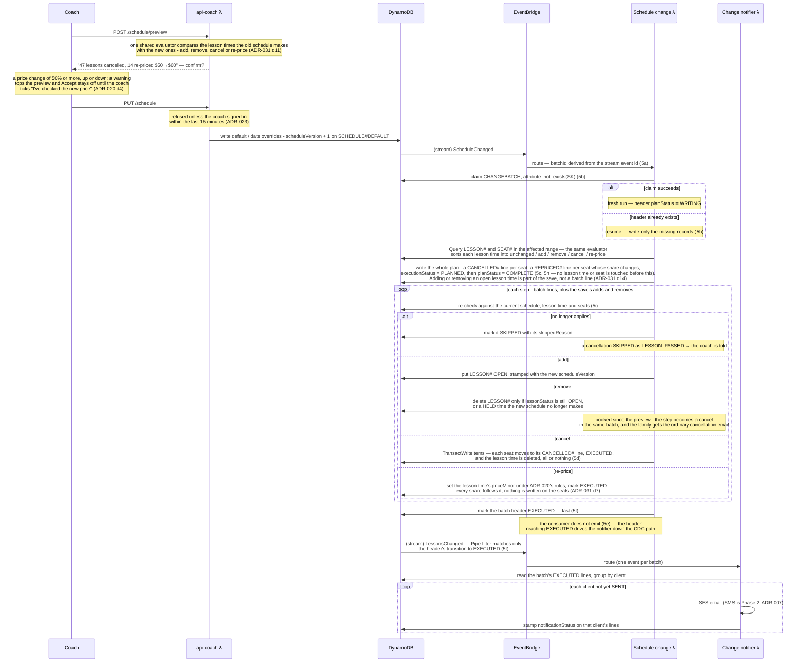

**A schedule save changes stored lesson times** (ADR-031 d11). The preview compares the
lesson times the old schedule produces with the ones the new schedule produces, and sorts
each into **add, remove, cancel or re-price**. Preview and execution share one evaluator in
`core/` (ADR-006 d7, ADR-020 d5).

- **Add** puts a new `OPEN` lesson time.
- **Remove** deletes an `OPEN` lesson time **only if it is still `OPEN`**. A **held** lesson time
  the new schedule no longer produces is removed too, as ADR-009 d5's held slot was; one it
  still produces stays held. If a family booked
  it after the preview, that step becomes a **cancel** in the same batch, and the family gets
  the ordinary cancellation email (ADR-006 d7's MVP rule).
- **Cancel** moves every seat to a `CANCELLED#` line and deletes the lesson time. The client
  is told the lesson is cancelled and given a link to book a different time; the system never
  guesses a replacement.
- **Re-price** sets the lesson time's new `priceMinor`, following ADR-020 (below). That is the
  only write: every share follows it, because shares are always worked out from the lesson
  time. A `REPRICED#` line is written per seat whose share changes, for the email.

**The batch records only what affects a family** (ADR-031 d14): cancel and re-price lines, one
per seat (`CANCELLED#…#<seatKey>`, `REPRICED#…#<seatKey>`). Adding or removing an *open* lesson
time isn't a batch line; it is part of the save.

**Every lesson time records the `scheduleVersion` that made it.** The version lives on the
`SCHEDULE#DEFAULT` item and goes up on every save, default or temporary (ADR-031 d14). A booking and a schedule
save both change the same lesson-time record, so a booking can no longer land on a time the
new schedule removed. This closes Open-Pending §4's gap (ADR-031 d11).

**The notifier fires once per batch, when the batch is finished** (ADR-010 d5f). Each
`CANCELLED#` line carries two separate states: `executionStatus` (`PLANNED` → `EXECUTED`, or
`SKIPPED` if its seat was already gone) and `notificationStatus` (has anyone been told).
Triggering on a line write would either tell families before their seat was cancelled, or
split one client's cancellations across several messages. Triggering on the header means
nobody is told about a cancellation that has not happened, and each client gets one
complete message. The cost is that notification waits for the whole batch to run.

**Recovering from failure** (ADR-010 d5g–d5k):

- **Every key comes from the triggering event** — the batch ID and the header's timestamp
  from the stream record — so a retry can only resume, never start a second batch.
- **The header carries `planStatus`**: `WRITING`, then `COMPLETE`. No lesson time or seat is
  touched until the whole plan is written; a resume on `WRITING` fills in only the records
  that are missing.
- **Every step is re-checked against the current schedule, lesson time and seats before it is
  carried out**, and marked `SKIPPED` with a reason if it no longer applies — the seat is gone,
  the coach has since changed the schedule again, or the lesson's time has passed. Two batches
  in flight therefore end at the coach's latest intent. A cancellation skipped because the
  lesson has passed is the one unrecoverable case: the family was never told, so the coach is.
- **When retries run out, the consumer's dead-letter queue pages**, and the owner runs
  **`reconcile-schedule --coach <id> [--dry-run]`** instead of redriving: it first finishes the
  coach's unfinished batches, then checks the current schedule against every upcoming lesson
  time and fixes what doesn't match. It is also the recovery for an event lost outright.
- **A nightly, read-only drift check** runs the same checks for every coach with lessons in
  the next 30 days and alerts — paging for a stuck batch or a lesson that should have been
  cancelled, a dashboard entry for outstanding re-prices. It changes nothing.
- **The coach website shows the change's status** — applying, emailing families, done, or
  *"we're having trouble applying this change"* after an hour — read from the batch header
  (ADR-010 d5l, in MVP).
- **Other consumers' dead-letter queues** are replayed, discarded or re-run for their date
  according to ADR-010 d2a, with `redrive-dlq --function <name> [--dry-run]`. Scheduled jobs'
  triggers carry their target date, so a re-run works on that date. The operator's procedure
  is `docs/runbooks/reconcile-schedule.md`.

**A booked lesson time that still fits but whose block's price changed is re-priced**
(ADR-020; on the lesson time since ADR-031 d11). An upcoming lesson follows the coach's current price;
a past lesson never changes, and (Phase 2) a
student's personal price override is left alone. **Increases** apply only to lessons beyond
the lesson time's `requiredNoticeHours`, and the preview tells the coach which nearer lessons
keep the old price; **decreases** apply to every upcoming lesson. The missed-lesson fee
follows the same rules. After a re-price, every share follows the new price
(`priceMinor ÷ shareCount`, same cent rule), since no amount is copied onto a seat (ADR-031 d7).
A lesson marked paid in advance and then re-priced would show the new amount, not what was
paid; that case isn't designed for (ADR-031 Revisit if). Each family gets one message per batch covering cancellations and price
changes together — a decrease framed as good news. **A large price change triggers a warning
at the top of the preview that the coach must tick to acknowledge** before Accept enables;
it shows when a price changes by 50% or more of the old price, up or down (ADR-020, 2026-10-13).

**The preview is mandatory.** Families can book only three months ahead (ADR-031 d3), but a
series can run 12 months past its first date, and lesson times are stored about 15 months
ahead. Nothing else bounds how much one save can destroy. The preview is advisory — the
authoritative record is always the batch the consumer writes. A save rewrites up to a year
of lesson times in the background — a few thousand writes, pennies (ADR-031 Consequences).

**It covers default changes as well as temporary ones** (ADR-008 decision 8). A default
change is the more dangerous of the two: it governs every date without an override, so
with 12-month series behind it, one save can reach a year out. A temp is bounded by its own
range. The preview also states how long the schedule runs — until the end date for a temp,
indefinitely for the default — and that accepting will send cancellation emails.

**The odd-cents warning** (ADR-031 d13). When a block allows 2 or more skaters and its price
doesn't split evenly, the editor warns: "Split 2 ways, $45.01 is $22.51 and $22.50. One
family will pay a cent more." It shows whenever the price or the skaters-per-lesson changes,
and the coach can still save.

### 6.6 Direct cancellation

*Updated 2026-10-13 for ADR-031 (lessons and seats).*
*Updated 2026-10-13 for the ADR-031 revision.*

Client- and coach-initiated cancellations (ADR-009) write the **same** `CHANGEBATCH#` and
`CANCELLED#` records as the schedule-driven path above, tagged with `cancelledBy`. A
single-lesson cancellation is a batch of one. **Cancelling moves a seat, it doesn't keep it**
(ADR-031 d2): the seat is deleted and its `CANCELLED#` line written in one transaction, which
leaves the seat's key free for the same skater to book that time again. The lesson time's
`seatsTaken` drops, and the lesson time **reopens** (`OPEN`) when its last seat goes — unless
the coach holds it. The notifier trigger is the same too: the header is marked `EXECUTED`
last, and a single-lesson cancel writes header, line, seat delete and lesson-time update in
one transaction, already `EXECUTED` (ADR-010 d5f). Two differences from §6.5:

- **No `ScheduleChanged` event and no conflict re-evaluation.** Cancelling never alters
  `SCHEDULE#DEFAULT` or any `SCHEDULE#DATE#` item, so only seats and lesson times move.
- **The notification direction depends on the actor.** A coach cancelling notifies each
  affected client, once per batch. A **client** cancelling notifies the **coach** only when it is
  inside the coach's notice period (`requiredNoticeHours`; ADR-009, amended 2026-10-08) — the
  client already knows.

A coach cancelling is asked whether to **release** the time for rebooking (every seat moves
to its line and the lesson time goes back to `OPEN`) or **hold** it (the lesson time becomes
`HELD`, with no seats — ADR-031 d1, replacing ADR-009 d5's `COACH_HELD` booking). Seats already
`CHECKED_IN` or `NO_SHOW` are never cancelled by a bulk day or week operation.

**A family cancelling a shared lesson is leaving it** (ADR-031 d8). Their seat moves to its
line. If they leave in time, the lesson time records a **pending leave** asking the staying
family to keep or cancel; if late, nothing is asked. The other family's seat isn't touched
either way — see §6.9. The inviting family's cancel ends an invited seat still `INVITED` as
`WITHDRAWN` in the same transaction: it is their own record, and nobody else is paying yet
(ADR-031 d5). Once the invited family has accepted, the seat is `BOOKED` and theirs, and the
cancel is an ordinary leave of a shared lesson, in time or late (ADR-033 d4).

**A coach cancels from two surfaces** (ADR-009 d5a): the week view on the website, and the
rinkside check-in page, also through `api-coach` (ADR-023). The page has a cancel section and a cancel action on each
lesson in the check-in list. "Part of a day" or "part of a week" is a multi-select of single
lessons, not a new scope, and **release-or-hold is asked once per lesson** because a hold is
permanent. Both surfaces write the same records and share the same preview. **A cancel
from the rinkside check-in list always confirms, even for a single lesson** — the button sits
beside check-in and no-show, and a cancel cannot be undone (ADR-009 d5a).

**A client can also reduce a recurrence's frequency** (ADR-009 d4): `intervalWeeks` may only
increase, and the dates that fall off the new interval are cancelled as one batch.
Recurrence management is subtractive only — it never books a lesson time. **While a series
is shared**, only *cancel one lesson* and *cancel the series* are offered (ADR-031 d9, §6.9).

**Both paths, step by step** (ADR-009, ADR-010 d5f):

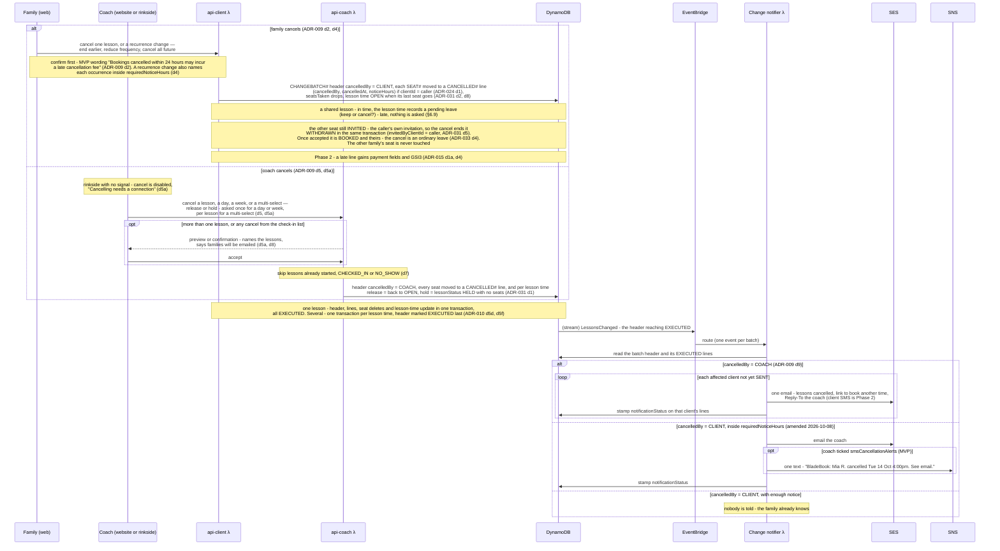

### 6.7 Client registration and coach approval

A family looks up one or more coach codes before it has an account, signs up through Cognito, then registers. The codes are resolved again in the family's own session, the family's partition is written, and a `PENDING` `STUDENT#` item goes to each coach. The coach accepts or declines through `api-coach`, which writes only the `STUDENT#` item; `consumer-student-link` mirrors the change onto the family's link item, and on a decline deletes it and sends the decline email (ADR-002, ADR-021 d6, ADR-022 d7, ADR-025 d2).

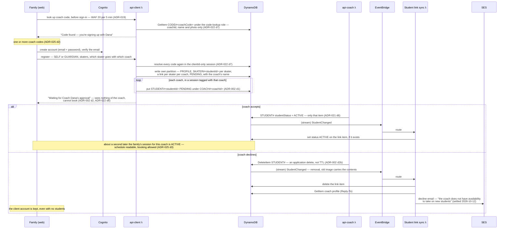

### 6.8 Family changes reach every coach

*Updated 2026-10-13 for the ADR-031 revision.*

A family edits its profile or a skater in its own partition only. `FamilyChanged` triggers `consumer-family-sync`, which copies the fields onto every coach's `STUDENT#` record for that family, about a second later. For a new skater it also issues the `SKATERCODE#` share code (ADR-025 d6, ADR-026 d4, ADR-029 d3). *Since ADR-031 d14*, a skater's name change also updates `studentName` on their upcoming seats; `consumer-invite`, reacting to those seat changes, then refreshes `partnerName` on the seats sharing a lesson with them.

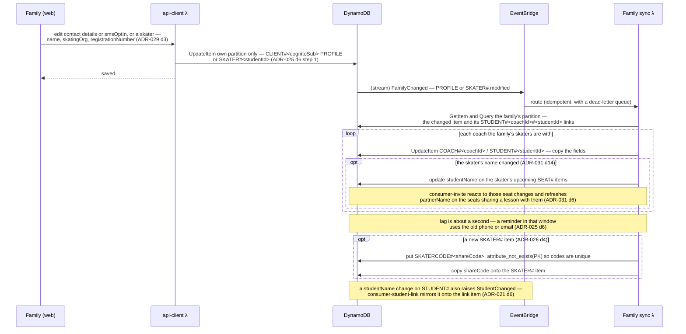

### 6.9 Shared lesson by invitation

*Updated 2026-10-13 for ADR-031 (lessons and seats).*
*Updated 2026-10-13 for the ADR-031 revision.*
*Updated 2026-10-20 for ADR-033.*

A shared lesson is a lesson time with **two seats**. Neither family owns it. Every ADR-026
behaviour rule still holds — share codes, the invited family confirming while signed in,
siblings, coaches seeing every skater. What changed is the mechanism (ADR-031 d5–d10). *Since
ADR-033 (2026-10-20), only a skater `ACTIVE` with the coach can be invited or added as a
sibling; the consent-link roster join, the warning and the banners are Phase 2.*

**No family's action writes another family's records, except answering an invitation addressed to their own skater** (ADR-031, revised 2026-10-13). The
price is stored once, on the lesson time; a leave is recorded on the lesson time; the partner
fields and the other read-only copies on seats are written by `consumer-invite`; and an invited seat is the inviting family's record
until the invited family accepts it. So ADR-024's rule — a family writes only its own records —
needs no exception for shared lessons.

**Inviting, at booking** (ADR-031 d5). Family A gives skater B's share code in the share box
while booking (§6.1). The share-code record gives only B's `studentId` and display name. The
same transaction adds an **invited seat** for B: `seatStatus = INVITED`, B's `studentId` and
display name, `inviteId` and `invitedByClientId`. It has **no `clientId`** yet. About a second
later `consumer-invite` adds the read-only `invitedClientId` and Family B's GSI1 keys, so the
invitation shows on Family B's Home and My bookings before they accept (ADR-031 d6).

**Only a skater `ACTIVE` with the coach can be invited or added as a sibling** (ADR-033). The
booking transaction holds a `ConditionCheckItem` on `COACH#<coachId>/STUDENT#<studentId>`,
`studentStatus = ACTIVE`; a failed check fails that date's transaction (ADR-033 d2). It needs no
policy change: `client-tenant` already allows `ConditionCheckItem` in the coach's partition
(ADR-022 d8).

**The share-check** (ADR-033 d2a) tells the booking page as soon as the code is entered.
`POST /api/client/share-check` on `api-client`, with `{ shareCode, coachId }`, answers
`200 { displayName, onCoachRoster }`, or `404` if the code doesn't exist. The sender comes from
the verified token, never the body, and must have a skater `ACTIVE` with that coach; anything
else is the ordinary 404. `api-client` resolves the code to B's `studentId` (never returned),
then reads `COACH#<coachId>/STUDENT#<studentId>` with `Select = SPECIFIC_ATTRIBUTES` and the
projection `studentStatus`, in the family's tagged session. `onCoachRoster` is true only for
`ACTIVE`; a `PENDING` skater and one the coach has never had both answer false, so the response
doesn't say whether a request is waiting. The firewall's code-lookup rule (20 per 5 minutes, shared with sign-up and the coach-code lookup) covers the route
(ADR-019), and it writes an access-log line (ADR-012). It is advice for the screen: the
transaction's check stays the authority. When the answer is false, the share step shows
*"Mia R. isn't one of Coach Dana's students yet. Mia's family can sign up with Coach Dana's
code, and once Coach Dana accepts Mia you can share a lesson."* and nothing is booked.
**Book stays disabled** while the share-code box has anything in it, until the share-check for
that exact code and coach answers `onCoachRoster: true` (ADR-033 d2a, amended 2026-10-20). A check
in flight, a failed or rate-limited check, and a changed code or coach all keep it off; clearing
the box allows a private booking.

- **The invited seat holds the place at once.** Nobody can join without an invitation anyway.
- **Family A pays the full price until B joins.** An `INVITED` seat doesn't count in the
  lesson time's `shareCount`, which stays 1.
- **One invitation covers a whole series:** each date gets its own invited seat with the
  same `inviteId`.
- **Siblings:** added directly, `BOOKED`. A sibling not yet accepted is shown as **not
  available to add until Coach Dana accepts them**, and can't be picked. No invitation.
- **The invitation email** (ADR-026 d5) still goes to Family B. `consumer-invite` sends it,
  reacting to the seat change (ADR-031 d14). It also sends every outcome email: joined,
  declined, withdrawn, expired ("no longer available"), and "the other skater can't make it —
  keep or cancel". *The stream event's name is still to be set.*

**Who owns the invited seat** (ADR-031 d5). It is **Family A's** record until Family B accepts.
Family B reaches it through the emailed link, Home or My bookings.

- **Accepting is Family B's own write**, always after ADR-024's link check on their skater
  (`ClientLinks.requireActive`, ADR-033 d3). Its condition:
  the seat has **no `clientId`**, is `INVITED`, and its `studentId` is the caller's skater. It
  sets the seat's `clientId` to Family B and moves it on (below). From then on it is theirs,
  like any seat.
- **Declining** is Family B's response too, under the same condition (no `clientId`, `INVITED`,
  `studentId` = the caller's skater): the seat moves to `SEATEND#` with `seatOutcome =
  DECLINED`.
- **Withdrawing** is Family A's, and only while the seat is `INVITED` (`invitedByClientId` = the
  caller). Once Family B has accepted, the seat is `BOOKED` and theirs, like any seat.
- **If Family A cancels their own seat** while the invited seat is still `INVITED`, nobody else
  is paying yet, and it is Family A's own record, so **their cancel ends it** as `WITHDRAWN` in
  the same transaction. Once Family B has accepted, the seat is `BOOKED`, and Family A's cancel
  is an ordinary leave of a shared lesson, in time or late (ADR-033 d4).
  `consumer-invite` never ends a seat — it only copies.

**Joining** (ADR-031 d6). Family B confirms on the signed-in page. **Each date is one
transaction**, so a series joins lesson by lesson and Family B gets the dates that work.

- **Accepted:** after `requireActive`, B's seat goes `INVITED → BOOKED`, if the lesson hasn't
  started, and the lesson time's `shareCount` goes up by one. Nothing on Family A's seat
  changes; both shares follow from the new `shareCount`. A skater no longer `ACTIVE` with the
  coach (in MVP, one the coach declined since the invitation) is refused with ADR-024's
  ordinary "no longer available" message (ADR-033 d3).
- **Declined** (by Family B, under the accept condition), **withdrawn** (by Family A, or by
  Family A's own cancel while still `INVITED`) or **expired** (the lesson starts first): the seat
  moves to `SEATEND#`, `seatsTaken` drops, and the lesson stays private at the full price.

**Each family sees the other skater through its own seat.** `partnerName` + `partnerStatus`
on each seat show the *other* skater's display name and status. **`consumer-invite` writes
them**, reacting to seat changes, about a second later — never either family's request
(ADR-031 d6). It keeps two more read-only copies the same way: `invitedClientId` and GSI1 keys
on the invited seat (the invitation, for the invited family), and `choiceAnswerBy` on the
staying seat (the question, for the staying family — a copy of the pending leave's `answerBy`,
cleared once answered). The lesson time's pending leave stays the authority; the copies are for
reading. Each family still reads only its own seats, so the database keeps every other
seat's name out of a family's reach, and still sees who it shares with. This replaces
ADR-026's `INVITE#` copies and the consumer that kept them in step.

**Price shares** (ADR-031 d7). **The total price is on the lesson time** (`priceMinor`), and
only there. **Each skater's share is worked out, not stored:** `priceMinor ÷ shareCount`, with
odd cents one each to the earliest skaters in the lesson time's `joinOrder` (the skater IDs
sharing the price, earliest first; a joiner is appended): $45.01 for two is $22.51 and $22.50.

- **`shareCount`** is the number of skaters the price is split between. It goes up by one when
  a skater joins or fills a freed place, and is set to the remaining skaters when the staying
  family keeps a lesson after an in-time leave. **A late leave doesn't change it**, so the
  staying skater keeps paying their share.
- **`joinOrder` follows the same moves.** After an in-time leave the leaver stays in it until
  the staying family answers; Keep sets it to the remaining skaters. A late leaver stays in
  both `joinOrder` and `shareCount`, so the odd cent may sit with them.
- **No amount is ever copied onto a seat.** Everything that shows what a skater owes works it
  out from the lesson time: the booking and cancel pop-ups, My bookings, the payment reminder,
  the coach's Payments page and unpaid list, the weekly unpaid reminder (ADR-018) and the
  financial page's gross (ADR-030). Check-in, no-show and marking paid or waived write no
  amount, and the 9pm report job writes nothing to the table (§6.4). A past lesson's share
  can't change — price changes never reach past lessons (ADR-020) and nobody joins or leaves
  once a lesson has started — so working it out gives the same answer every time.
- **A re-price** (ADR-020) changes only the lesson time's `priceMinor`, and every share
  follows it. A lesson marked paid in advance and then re-priced would show the new amount,
  not what was paid; it isn't designed for (ADR-031 Revisit if). A `REPRICED#` line is written per
  seat whose share changes, for the email (§6.5).

**Inviting and joining, step by step:**

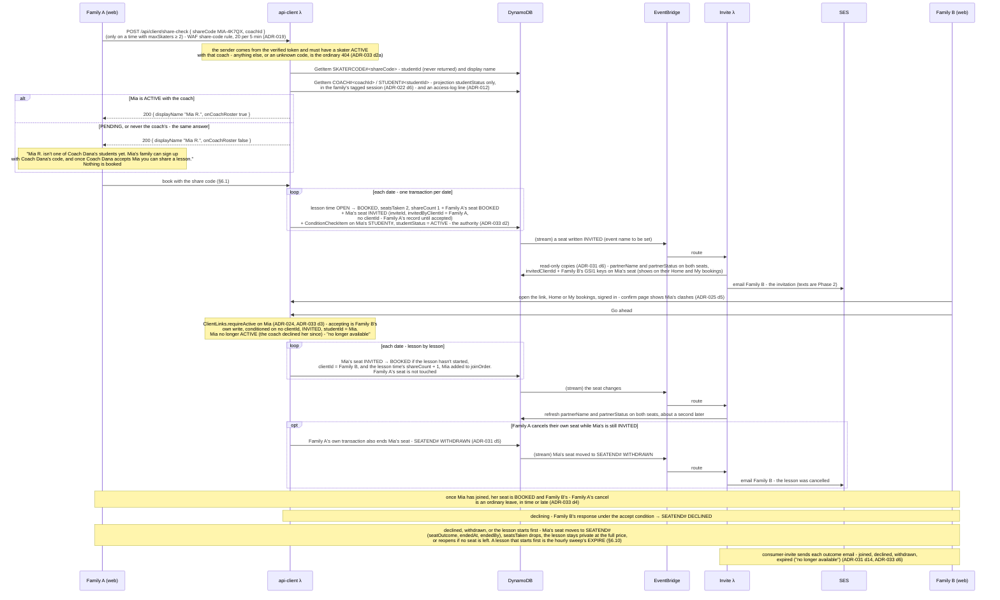

**Leaving a shared lesson** (ADR-031 d8). Either family, the same rules. One transaction per
date:

- **In time** (outside the notice period): the leaver's seat moves to a `CANCELLED#` line and
  `seatsTaken` drops. The **lesson time** records a **pending leave** — `leaveId`, `leftStudentId`,
  `leftAt`, `stayingStudentId` and `answerBy` — and its `ANSWER` deadline (GSI4, on the lesson
  time). **The staying family's seat isn't touched**, and their share stands (`shareCount`
  doesn't change) until they answer. `consumer-invite` copies the `answerBy` onto the staying
  seat as `choiceAnswerBy`, so their screens show *Keep or cancel?* reading only their own
  seat (ADR-031 d6).
- **Late** (inside the notice period): the leaver's line records their share of the
  late-cancellation fee — half, for two (Phase 2 charge, ADR-015). `shareCount` doesn't change,
  so the staying skater keeps paying their share, and isn't asked anything.

**The answer-by time** is whichever comes first: the start of that lesson's notice period, or
**7 days after the leave**. It applies to one-off cancels and to cancelling the series, so
nothing waits more than a week.

**The staying family answers:**

- **Keep it private at the full price** → their own write to the lesson time: the pending
  leave is cleared, `shareCount` becomes 1 and `joinOrder` becomes the remaining skaters. The lesson is now a **freed place**.
- **Cancel with no charge** → their own seat becomes a `CANCELLED#` line and the pending leave
  is cleared. The lesson time reopens (`OPEN`) when its last seat goes.
- **No answer by `answerBy`** → cancelled with no charge by the hourly sweep, a system function
  (§6.10).

Both emails are always sent: "keep at full price or cancel" by `consumer-invite`, and
"cancelled, no answer" by the change notifier, through the sweep's own change batch
(ADR-031 d14).

**Changing a shared series** (ADR-031 d9). While a series is shared, a family can only
**cancel one lesson** or **cancel the series** (all future lessons, not today's — ADR-009 d4).
*End earlier* and *make less frequent* are hidden. A series counts as shared while **any future
lesson in it has another skater, joined or invited**. Once none does, both come back; filling a
freed date makes it shared again until that lesson is over.

**The staying family's card** is built from **their own seats** (ADR-031 d9, 2026-10-13): every
seat with `choiceAnswerBy` set is a remaining date — freed by the other skater leaving in time,
not yet answered, and still waiting (not started, answer-by not passed, not cancelled by the
coach). Who left comes from `partnerName` with `partnerStatus = LEFT`; the full price from the
lesson time's `priceMinor`. Grouping by `recurrenceId` gives one card per series. Families never
read the pending leave; Keep's write to the lesson time is conditioned on the pending leave still
naming their skater.

- **One freed date** gets the ordinary card: keep at full price, or cancel with no charge.
- **More than one** gets one card for the series, listing each date with its answer-by and
  the totals, with **Keep all remaining dates**, **Cancel all remaining dates** (confirmation
  first: "No charge. This can't be undone.") and a keep-or-cancel choice per date.
- **Cards merge per series:** dates still waiting from earlier one-off cancels by the same
  skater join the series card, each keeping its own answer-by.
- **Keep all and cancel all** run one transaction per date, each re-checked first. A date that
  has started, or was already answered or cancelled, is skipped and listed as no longer
  available.
- Cancelling all sends the family one email listing the dates, from the change notifier. The
  coach isn't emailed: none of these cancellations is late.

**A freed place can take a new skater** (ADR-031 d10). After the staying family keeps a lesson,
**Invite a skater** appears on it in My bookings — only there; otherwise sharing is offered only
while booking. It works like inviting at booking: a new invited seat holds the place, and the
staying family pays the full price until the new skater joins, then `shareCount` goes up and
both pay their share. **It covers that one lesson only** — never a series. The new skater goes
through the same steps: must already be `ACTIVE` with the coach, accepts, joins.

**Leaving and answering, step by step:**

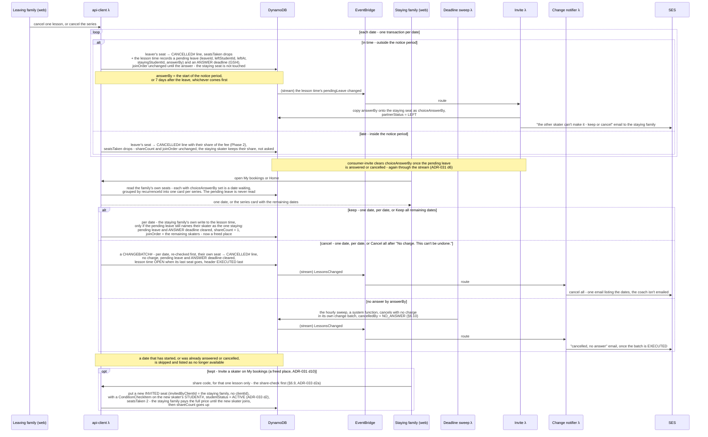

### 6.10 Hourly deadline sweep

*Updated 2026-10-13 for ADR-031 (lessons and seats): replaces ADR-026 d5a's nightly invitation sweep.*
*Updated 2026-10-13 for the ADR-031 revision.*
*Updated 2026-10-20 for ADR-033.*

**`sched-deadline-sweep` runs every hour** (ADR-031 d12). A record with a pending deadline
carries `dueAt` and `dueKind`, and sits in **GSI4** only while it has one
(`GSI4SK = <dueAtUtc>#<coachId>#<itemKey>`). There are two kinds (ADR-033 d5):

- **`EXPIRE`** — an invitation still `INVITED` at the lesson's start. On the **invited seat**.
- **`ANSWER`** — the staying family's `answerBy` (§6.9). On the **lesson time's** pending
  leave.

Each hour the sweep queries what's due, **re-checks each record**, acts, and then sets the
record's next deadline or removes it. A deadline that no longer applies is skipped. The sweep
is a system function, so its writes are no family's.

- **Urgent emails go at once** — expired (sent by `consumer-invite` when the seat moves to
  `SEATEND#`) and cancelled with no answer (sent by the change notifier).
- **The sweep's cancellations go through a change batch of their own**, with
  `cancelledBy = NO_ANSWER`, so the change notifier sends the "cancelled, no answer" email
  exactly as for any cancellation. `NO_ANSWER` is never chargeable (ADR-031 d14).
- **An expiry moves the seat to `SEATEND#`** with `seatOutcome = EXPIRED` and
  `endedBy = SWEEP`. `consumer-invite` sends the *expired* email — the ordinary "no longer
  available" (d14, ADR-033 d6).
- **The sweep is one of three functions whose execution role can delete in any coach's
  partition** (with `consumer-schedule-change` and `consumer-student-link`).
  `consumer-invite` only copies (§7).
- **Screens work out *expired* and *cancelled, no answer* from the time itself**, so families
  never see a stale state between runs (ADR-031 d12).
- **A missed hour catches up on the next run.** The sweep emits **`DeadlineSweepCompleted`**,
  and ADR-010's missed-run alarm pages when no run has completed for **2 hours** (a default
  that can be changed).
- **The sweep sends no email itself** and holds no `ses:SendEmail` (owner, 2026-10-20): the expired email comes from `consumer-invite`, the no-answer email from the change notifier.
- **No dead-letter queue.** The sweep is a scheduled function, not an event consumer, and is
  safe to run twice because it re-checks every record.
- ~~*Open, waiting on Kim (ADR-026 P5): when an unanswered `INVITED` seat lapses before the
  lesson. It becomes one more `dueKind`.*~~ *Settled 2026-10-13 (ADR-031 Open): no cutoff before
  the lesson; an unanswered invitation expires at the lesson start (`EXPIRE`). No new `dueKind`.*

```mermaid
sequenceDiagram
    participant Sch as EventBridge Scheduler
    participant Sw as Deadline sweep λ
    participant DB as DynamoDB
    participant Bus as EventBridge
    participant Inv as Invite λ
    participant N as Change notifier λ
    participant SES as SES
    participant CW as CloudWatch
    Sch->>Sw: every hour (§8)
    Sw->>DB: Query GSI4 - GSI4PK = DUE, everything due up to now
    loop each due record - an invited seat (EXPIRE), or a lesson time (ANSWER) - ADR-033 d5
        Sw->>DB: re-read the record, and the lesson time and its seats
        alt the deadline no longer applies
            Note over Sw: skipped - answered, joined, cancelled or moved since
        else EXPIRE - still INVITED at the lesson's start
            Sw->>DB: seat moves to SEATEND#35; - seatOutcome EXPIRED, endedBy SWEEP,<br/>seatsTaken drops, the lesson stays private at the full price
            DB->>Bus: (stream) the seat change
            Bus->>Inv: route
            Inv->>SES: the ordinary "no longer available" email to both families at once<br/>(Reply-To the coach's businessEmail, ADR-033 d6)
        else ANSWER - no answer by answerBy
            Sw->>DB: its own CHANGEBATCH#35; with cancelledBy = NO_ANSWER - the staying seat to a CANCELLED#35; line,<br/>no charge, pending leave cleared, lesson time OPEN when its last seat goes, header EXECUTED last
            DB->>Bus: (stream) LessonsChanged
            Bus->>N: route
            N->>SES: "cancelled, no answer" email at once
        end
        Sw->>DB: set the record's next deadline (dueAt, dueKind, GSI4 key), or remove it
    end
    Sw->>CW: DeadlineSweepCompleted metric
    Note over CW: ADR-010's missed-run alarm pages after 2 hours with no completed run.<br/>A missed hour catches up on the next run
```

### 6.11 Coach sign-up

A coach signs up in two steps (ADR-016): a Cognito account with a verified email, then a profile. The profile write is safe to repeat, so a signup that fails between the two steps is finished by the coach's next sign-in rather than rolled back (ADR-016 d9).

```mermaid
sequenceDiagram
    participant C as Coach (website)
    participant Cog as Cognito
    participant API as api-coach λ
    participant DB as DynamoDB
    C->>Cog: sign up - login email and password (ADR-016 d3)
    Cog-->>C: one-time code to the email
    C->>Cog: confirm the code - email verified (d4)
    Note over C,Cog: step 1 done - the Cognito user is the source of truth,<br/>coachId is its sub (d9)
    C->>Cog: sign in
    Cog-->>C: tokens
    C->>API: GET profile
    API->>DB: GetItem COACH#35;<coachId> / PROFILE - tenant role tagged coachId = the token sub (§7)
    alt profile exists
        API-->>C: coach website
    else missing - a new signup, or one that failed after step 1
        C->>API: profile - name, phone, coachTimezone and currency (required, d6),<br/>payment details and switches, smsCancellationAlerts
        loop until the code is free (ADR-002 d2a)
            API->>API: generate a coachCode
            API->>DB: PutItem CODE#35;<coachCode> / CODE - coachId, coachFirstName,<br/>coachLastName, attribute_not_exists(PK) (ADR-022 d7)
        end
        API->>DB: PutItem COACH#35;<coachId> / PROFILE - coachCode, requiredNoticeHours 24,<br/>businessEmail defaults to loginEmail (d2)
        Note over API,DB: idempotent by construction - a retry<br/>cannot create a second coach (d9)
        API-->>C: signup complete - the coach code is shown to hand out
    end
    Note over C,DB: no rollback - a failure between Cognito and the profile is finished<br/>by the next sign-in taking the "missing" branch (d9, ADR-010 d5b)
```

### 6.12 Nightly lesson-time roller

*Added 2026-10-13 (ADR-031 d1, d12).* Lesson times are stored, so something must keep them
stored far enough ahead. Each night `sched-lesson-roller` works out, for every coach, every lesson
time from today to the end of the booking window plus 12 months, and creates any that don't exist
yet as `OPEN`, stamped from the schedule. It never changes or removes an existing lesson time;
schedule saves do that (§6.5).

```mermaid
sequenceDiagram
    participant Sch as EventBridge Scheduler
    participant R as Lesson-time roller λ (sched-lesson-roller)
    participant DB as DynamoDB
    participant CW as CloudWatch
    participant SNS as SNS (owner's phone)
    Sch->>R: nightly (§8)
    loop each coach
        R->>DB: read SCHEDULE#35;DEFAULT (blocks, scheduleVersion)<br/>and the SCHEDULE#35;DATE#35; overrides
        R->>R: work out every lesson time from today to the end of the<br/>booking window plus 12 months - about 15 months ahead
        loop each lesson time not yet stored
            R->>DB: put LESSON#35;<date>#35;<startTime> OPEN, condition attribute_not_exists -<br/>stamped with priceMinor, currency, missedLessonFeeMinor,<br/>requiredNoticeHours, maxSkaters and scheduleVersion
        end
    end
    R->>CW: completion metric
    alt one missed night
        Note over CW: shows on the dashboard - not urgent, lesson times are stored 12 months past the window
    else three missed nights
        CW->>SNS: alarm pages the owner (ADR-010 d4)
    end
    Note over R,DB: a scheduled function, not an event consumer - no dead-letter queue.<br/>Safe to run twice - it only creates lesson times that don't exist (ADR-031 d1, d12)
```

### Event catalog

*Updated 2026-10-13 for ADR-031 (lessons and seats).*
*Updated 2026-10-13 for the ADR-031 revision.*

| Event | Source | Consumers |
|---|---|---|
| `LessonBooked` | A seat becoming `BOOKED` — **one per seat**, so each skater's family gets its own confirmation, as each booking did (ADR-031 d14) | Confirmation email |
| `LessonsChanged` | **`CHANGEBATCH#` header reaching `executionStatus = EXECUTED`** (ADR-010 d5e, d5f — *not* the seat's move and *not* a line write) | Change notifier — covers cancellations and re-pricing (ADR-020); one message per client per batch, routed **by actor**: coach- and schedule-driven cancellations go to each affected client; client-driven ones go to the coach, only inside the coach's `requiredNoticeHours`; the hourly sweep's `NO_ANSWER` batches go to the staying family (ADR-031 d14) |
| `ScheduleChanged` | Schedule / date-override write | Schedule change λ — adds, removes, cancels and re-prices lesson times (ADR-031 d11) |
| `CheckInRecorded` | Attendance write, `CHECKED_IN` only | Payment reminder |
| `NoShowRecorded` | Attendance write, `NO_SHOW` only | Payment reminder — **Phase 2**, when ADR-015's charge switches on. A separate event from `CheckInRecorded` because the reminder wording differs: a missed lesson is not an attended one. |
| `StudentChanged` | `STUDENT#` item under `COACH#` modified (`studentStatus`, `studentName` or, from Phase 2, `priceMinorOverride` changed) or removed | Student link sync λ — mirrors the change onto the client's link item (ADR-021 d6). The Invite λ doesn't react to it: the coach's Accept changes only the `STUDENT#` item (ADR-033). |
| `FamilyChanged` | `CLIENT#` `PROFILE` or `SKATER#` item modified | Family sync λ — copies contact and skater details to every coach's `STUDENT#` record (ADR-025 d6); also issues each new skater's share code (ADR-026 d4); and, since ADR-031 d14, updates `studentName` on the skater's upcoming seats (`consumer-invite` then refreshes `partnerName` on the seats sharing a lesson with them) |
| *(name to be set)* — replaces `InviteChanged` | A shared-lesson seat change: a seat written `INVITED`, accepted, joined, moved to `SEATEND#` (declined, withdrawn, expired) or to a `CANCELLED#` line (a leave, or the inviting family cancelling), or its `studentName` changed; or a lesson time's `pendingLeave` written or cleared — both through the change stream. There is no `INVITE#` item any more (ADR-031 d5, d6). *ADR-031 names the consumer but not the event.* | Invite λ — writes the read-only copies on the seats in that lesson, about a second later (ADR-031 d6): `partnerName` + `partnerStatus`, `invitedClientId` + GSI1 keys on an invited seat, and `choiceAnswerBy` on the staying seat while a pending leave waits; and sends the shared-lesson emails that aren't deadlines: the invitation and every outcome email — joined, declined, withdrawn, expired ("no longer available"), and "the other skater can't make it — keep or cancel" (ADR-031 d14, ADR-033 d6). A system function, so its writes are no family's. It never ends a seat: the inviting family's own cancel, or the hourly sweep's `EXPIRE`, does (ADR-031 d5, ADR-033 d4). |
| `DailyReminderDue` (scheduled) | Scheduler | Day-of reminder λ |
| `DailyReportDue` (scheduled) | Scheduler | End-of-day report λ |
| `UnpaidReminderDue` (scheduled) | Scheduler, weekly | Unpaid-lesson reminder λ (ADR-018) |
| `DriftCheckDue` (scheduled) | Scheduler, nightly | Drift check λ (ADR-010 d5k) — read-only, alerts only |
| *(name to be set)* (scheduled) | Scheduler, nightly | Lesson roller λ (`sched-lesson-roller`, ADR-031 d1) — keeps lesson times stored to the end of the booking window plus 12 months |
| *(name to be set)* (scheduled) | Scheduler, every hour | Deadline sweep λ (`sched-deadline-sweep`, ADR-031 d12) — acts on `EXPIRE` deadlines (invited seats) and `ANSWER` deadlines (lesson times) through GSI4; replaces the Invite λ's nightly run; emits `DeadlineSweepCompleted` (ADR-031 d14) |

---

## 7. Security Model

### Authentication
- **Cognito User Pool** with two groups: `Coach` and `Client` (an adult student booking for themselves, or a guardian booking for a minor — same permissions either way).
- API Gateway's **Cognito authorizer** validates the token on every protected request (a REST
  API — ADR-001 A7). No custom authorizer is needed: since ADR-023 there is no second coach
  app client to tell apart.
- MFA available for coaches (they hold the most sensitive data).
- **Coach signup is self-serve and ungated for now** (ADR-016). Cognito owns credentials and
  recovery entirely — there is no custom forgot-password form — and the login email must be
  verified before the account can hold students. The signup is resumable: Cognito user
  first, then the profile and `CODE#` item, and first login completes a missing profile.
- **The rinkside check-in page shares the coach website's sign-in** (ADR-023, superseding
  ADR-014 d10–11). It is a section of the coach website at `/coach/rinkside`, signs in
  through the same app client, and its routes run in `api-coach`.
- **Only a coach can use `api-coach`, rinkside routes included** (ADR-023 d7). Coaches and
  families share one user pool, so a family's token passes the Cognito authorizer. `api-coach`
  therefore also requires `Coach` in the token's `cognito:groups` claim, in one shared check on
  every route, and refuses a token without it with 403. `api-client` does the same for the
  `Client` group, so a coach's token can't use the family website's routes. The rinkside page
  shows only its sign-in screen until the coach signs in, and every screen after that links
  back to the coach website's Today page (ADR-023 d8).
- **Schedule saves require a recent sign-in** (ADR-023 d4). Saving a schedule change is
  refused unless the token's `auth_time` is within the last 15 minutes; the website then asks
  for the password (and MFA code, if on) and retries. This guards the most destructive action
  in the system on every device, in place of the separate rinkside token.
- **Sessions last 60 minutes on the coach and family websites and 4 hours on the rinkside
  page**, counted from sign-in (ADR-023 d6). Cognito's refresh token lasts 4 hours; `api-coach`
  and `api-client` refuse requests whose `auth_time` is past their route's limit.

### Authorization (data isolation)

*Updated 2026-10-13 for ADR-031 (lessons and seats).*
*Updated 2026-10-13 for the ADR-031 revision.*

- The `coachId` / `clientId` comes from the **verified JWT claim**, never from the request body. `clientId` is the Cognito `sub`.
- Every DynamoDB key is scoped by that identity (`PK = COACH#<coachId-from-token>`), so a coach structurally cannot read another coach's students. Every client read is rooted at `PK = CLIENT#<sub-from-token>`, so a client cannot enumerate another client's students.
- **Coach access is gated twice — in code and at the database** (ADR-021). `api-coach`
  holds no DynamoDB permissions of its own. Per request, it assumes a
  tenant role tagged `coachId = <sub>`, whose policy allows only
  `LeadingKeys = COACH#${aws:PrincipalTag/coachId}` (plus a narrow `CODE#` statement). A
  query built against another coach's partition fails with `AccessDeniedException` rather
  than returning data. The repository gets this client from ADR-012's `AccessContext`, so
  the key the code builds and the tag DynamoDB checks come from the same verified token.
  **Clients are gated the same way** (ADR-022): a `client-tenant` role tagged `clientId`,
  `coachId` and `linkStatus` gives full access to `CLIENT#<sub>` and GSI1 (now keyed by
  client), reads of the coach's partition **limited to an attribute allowlist** — schedule,
  `LESSON#` attributes for availability (and, for any lesson time — an attribute list can't be limited to their own; not yet written in the policy (ADR-022) — `priceMinor`,
  `shareCount` and `joinOrder`, never `pendingLeave` — ADR-031 d1), the family's own `SEAT#` key for retry attribution
  (ADR-031 Consequences), `studentStatus` on `STUDENT#` items, by key only, for the share-check
  (ADR-033 d2a), and public profile fields, never another family's student or seat
  — **and only for an `ACTIVE` family**: a family with no approved skater reads
  nothing of the coach's, only their own account — and writes confined to that one coach's
  partition. The coach-code lookup before sign-in runs under a separate, untagged
  `code-lookup` role that can read only the `CODE#` item's display fields. The consumers and
  the scheduled jobs stay on their execution roles (ADR-021 d9).
- **One check is enforced only in code:** a client **write** into the coach's partition — booking, cancelling, editing a student — must verify that the target `studentId` appears in the caller's link set. The database confines the write to the right coach but cannot confine it to the right family (ADR-022 d8). Reads no longer depend on this check: GSI1 is keyed by client. This is the natural place for an authorization test (ADR-002). **Enforced structurally by ADR-024:** new writes take a `LinkedSkater` that only `core.data` creates after checking the family's links; writes to an existing seat carry a `clientId = :caller` condition, so DynamoDB refuses another family's. An invited seat has no `clientId` yet (ADR-031 d5): withdrawing it is conditioned on `invitedByClientId = :caller` and `seatStatus = INVITED`; accepting it is the invited family's own write, after the link check on the invited skater, conditioned on the seat having no `clientId`, being `INVITED`, and its `studentId` being the caller's skater. Declining is the invited family's response under the same condition. Inviting is checked by the database too: the booking transaction's `ConditionCheckItem` requires the invited skater's `studentStatus = ACTIVE` (ADR-033 d2). A never-linked failure is a logged security event, and repeated ones page (3+ in 15 minutes for one family, 10+ a day overall; both configurable).
- Clients see only whether a lesson time is free — never who holds a taken one. A client sees
  their own lessons as theirs; every other taken lesson time, whether `BOOKED` by another
  family or `HELD` by the coach, looks identical (ADR-009, settled 2026-09-30; ADR-031 d1).
  Lesson-time items hold nothing about who booked, so reading them reveals nothing.
- **One deliberate cross-coach disclosure** (ADR-025 d4): a coach sees the **names** of a
  skater's other coaches, and only once the skater is `ACTIVE` with both. It is a copy written by
  `consumer-student-link`, not a read permission, so no coach can read another coach's partition.
  The family is told when they add a coach. ***Phase 2*** *since 2026-10-07: not in MVP.*
- **One way onto a coach's roster** (ADR-002, ADR-033): the coach code. An invitation reaches
  only a skater already `ACTIVE` with the coach, so it can't put a family on a stranger's
  roster. The consent-link roster join is Phase 2.
- **No family's action writes another family's records, except answering an invitation
  addressed to their own skater** (accept or decline; ADR-024, ADR-031 revised 2026-10-13), so
  ADR-024 needs no other exception for shared lessons:
  - **The price is stored once, on the lesson time** — the coach's record — and each share is
    worked out from it (`priceMinor ÷ shareCount`), so joining, keeping or re-pricing never
    rewrites the other family's seat (ADR-031 d7).
  - **A leave is recorded on the lesson time** as a pending leave; the staying family's seat
    isn't touched. Keeping is the staying family's own write to the lesson time, after the
    link check on the staying skater; cancelling is a write to their own seat (d8).
  - **An invited seat is the inviting family's record until accepted** — no `clientId`, and
    only the inviter can withdraw it, while `INVITED`. **Accepting** is the invited family's own
    write, after ADR-024's link check, conditioned on no `clientId`, `INVITED` and the caller's
    skater: it sets their `clientId` (d5).
  - **The read-only copies on seats are written by `consumer-invite`**, a system function
    reacting to seat changes — never by a family's request (d6): `partnerName` +
    `partnerStatus`, `invitedClientId` + GSI1 keys on an invited seat, and `choiceAnswerBy` on
    the staying seat. **It only ever copies** (ADR-031 Consequences, *owner, 2026-10-13,
    option B*): its role allows reads, and `UpdateItem` limited by the `dynamodb:Attributes`
    condition to the key fields plus `partnerName`, `partnerStatus`, `invitedClientId`,
    `GSI1PK`, `GSI1SK` and `choiceAnswerBy`; no `PutItem` or `DeleteItem`. The condition can't
    limit it to `SEAT#` items, but a lesson time has none of those fields, so a stray write
    could only add a meaningless copy.
  - **Ending an invited seat when the inviting family cancels first** (d5): the inviting
    family's cancel ends an invited seat still `INVITED` as `WITHDRAWN` in the same
    transaction; once accepted, the seat is `BOOKED` and the cancel is an ordinary leave
    (ADR-033 d4). An invitation still unanswered at the lesson's start is ended by the hourly
    sweep. The sweep's writes are a system function's (d12), and it is **one of three
    functions whose execution role can delete in any coach's partition** (with
    `consumer-schedule-change` and `consumer-student-link`).
- **A family's read of its own lesson time** may include `priceMinor`, `shareCount` and
  `joinOrder`, which they need to work out their share — **never `pendingLeave`**; the
  keep-or-cancel question is read from their own seat's `choiceAnswerBy` (ADR-031 d1, d6).
  *Accepted residual:* `shareCount` and `joinOrder` show a family that a lesson is shared — the
  other skater's random ID, never a name.
- **Residual, unchanged** (ADR-022 d8, ADR-031 Consequences): a family's writes land in the
  coach's partition, and only the code check keeps one family off another family's seat with
  the same coach. Gate tests (ADR-021, ADR-022) need rows for `LESSON#`, `SEAT#`, `SEATEND#`
  and GSI4, and, for ADR-033: a booking transaction whose invited seat names a skater who isn't
  `ACTIVE` with the coach is refused whole; a `GetItem` of a `STUDENT#` item projecting only
  `studentStatus` is allowed for an `ACTIVE` session; any other `STUDENT#` attribute is still
  refused; and a `PENDING` session is refused.
- A coach's phone, email and payment types (one switch per type, ADR-016 d7) are shown to
  families only if the coach switches each on, and **only to families the coach has confirmed** — never to a `PENDING` family,
  since a coach code can be passed around or guessed (ADR-016 d7a).

**The database gate, step by step** (ADR-021 d2, ADR-022 d1–d2): neither API function can reach the table on its own; each request gets temporary credentials stamped with who is asking, and DynamoDB refuses any key outside that person's partition.

```mermaid
sequenceDiagram
    participant U as Coach or family (web)
    participant GW as API Gateway
    participant F as api-coach λ<br/>or api-client λ
    participant STS as AWS STS (Security Token Service)
    participant DB as DynamoDB
    U->>GW: request with Cognito token
    GW->>F: authorizer passed
    Note over F: the function's own role has no DynamoDB actions at all (ADR-021 d2, ADR-022 d1)
    F->>F: verify the token - the caller is its sub, never the request body
    alt api-coach
        F->>STS: AssumeRole coach-tenant - tag coachId = sub,<br/>source identity sub, session name coach-sub
        STS-->>F: credentials for that coach only (cached per container)
    else api-client
        F->>STS: session 1 - AssumeRole client-tenant tagged clientId = sub
        F->>DB: read the family's own link items (CLIENT#35;sub)
        DB-->>F: coachId and linkStatus (ACTIVE or PENDING)
        F->>STS: session 2 - tagged clientId, coachId, linkStatus (ADR-022 d2)
        STS-->>F: credentials (cached per tag set)
    end
    F->>DB: read or write with those credentials
    alt key inside the tagged partition
        DB-->>F: done
    else any other partition
        DB-->>F: AccessDenied - refused by the database,<br/>whatever the code asked for (LeadingKeys condition)
    end
```

### Client writes into a coach's partition

*Updated 2026-10-13 for the ADR-031 revision.*

How `api-client` checks a family's link before it writes anything into a coach's partition, and what it does when the check fails (ADR-022 d8, ADR-024).

```mermaid
sequenceDiagram
    participant F as Family (web)
    participant API as api-client λ
    participant CD as core.data (in api-client)
    participant DB as DynamoDB
    participant CW as CloudWatch
    participant SNS as SNS (owner's phone)
    F->>API: a write into the coach's partition
    Note over API: clientId = the verified token's sub, never the request body (§7)
    alt new write - book a lesson, a recurring series, edit a skater
        API->>CD: ClientLinks.requireActive(caller, skaterId)
        CD->>DB: read the family's own link items, in their own tenant session
        alt linked and ACTIVE
            CD-->>API: LinkedSkater (private constructor)
            API->>CD: repository write - takes a LinkedSkater, no String overload
            CD->>DB: write into the coach's partition - the client-tenant role<br/>confines it to that coach (ADR-022 d8). A booking with an invited skater or a sibling<br/>also holds a ConditionCheckItem on their STUDENT#35;, studentStatus = ACTIVE (ADR-033 d2)
        else linked, but declined or still pending (removed: Phase 2)
            CD-->>API: not ACTIVE - an ordinary application event
            API-->>F: 409 "Mia's lessons are no longer available to book.<br/>Contact Coach Dana."
        else never this family's
            CD->>CW: security event to the access-log group - identifiers only
            API-->>F: 404 not found
        end
    else write to an existing item - cancel a lesson, change a recurrence
        CD->>DB: update or delete with condition clientId = :callerSub,<br/>added inside the repository method
        alt the family's own
            DB-->>CD: written
        else another family's seat
            DB-->>CD: ConditionalCheckFailed
            CD->>CW: security event to the access-log group - identifiers only
            API-->>F: 404 not found
        end
        opt the cancelled seat had invited another skater, still INVITED (ADR-031 d5)
            CD->>DB: in the same transaction, end it WITHDRAWN -<br/>condition invitedByClientId = :callerSub and INVITED
        end
        Note over CD,DB: once accepted, that seat is BOOKED and the other family's -<br/>the cancel is an ordinary leave and doesn't touch it (ADR-033 d4)
    else Keep after the other skater left (ADR-031 d8)
        CD->>DB: update the lesson time - condition pendingLeave.stayingStudentId<br/>= the caller's skater (the family never reads the pending leave)
        Note over CD,DB: ConditionalCheckFailed here - answered or cancelled since - shows as no longer available
    else answer an invitation - accept or decline (ADR-031 d5)
        API->>CD: ClientLinks.requireActive(caller, skaterId) - always (ADR-033 d3)
        CD->>DB: update the invited seat, or move it to SEATEND#35; DECLINED -<br/>condition no clientId, INVITED, studentId = the caller's skater
    end
    Note over API,DB: besides its own seats and invitations, a family writes only the coach's lesson time<br/>(every booking and cancel updates it). The one record of another family's it can change -<br/>answering an invitation addressed to its own skater, accept or decline (ADR-031)
    Note over CW: a metric counts security events (ADR-024 d3)
    opt one family 3+ in 15 minutes, or everyone 10+ in a day (configurable)
        CW->>SNS: alarm pages the owner (ADR-010 d4)
    end
    Note over API,CD: an ArchUnit rule fails the build if anything outside core.data<br/>makes a LinkedSkater, or api-client reaches the coach's partition another way
```

### Least privilege
- **One IAM role per Lambda**, granted only the specific actions it needs (e.g. the report λ gets `dynamodb:Query` on GSI2, `dynamodb:GetItem` for student names and the coach profile, `ses:SendEmail` and `s3:PutObject` scoped to the reports bucket/prefix — nothing else). The full per-function table is **ADR-001 amendment A6**. Only the three scheduled jobs that need it hold GSI2 (day-of reminder, end-of-day report, drift check), an index that crosses tenants. GSI4 crosses tenants too: `sched-deadline-sweep` reads it every hour (ADR-031 d12). The end-of-day report only reads the table; it writes nothing (ADR-014 d7, ADR-031 d7). `consumer-invite` writes across coaches, but only copies: reads, plus `UpdateItem` limited by the `dynamodb:Attributes` condition to the key fields and `partnerName`, `partnerStatus`, `invitedClientId`, `GSI1PK`, `GSI1SK` and `choiceAnswerBy`; no `PutItem` or `DeleteItem` (ADR-031 Consequences, *owner, 2026-10-13, option B*). `sched-deadline-sweep` is one of three functions whose execution role can delete in any coach's partition (with `consumer-schedule-change` and `consumer-student-link`). `sched-deadline-sweep` holds no `ses:SendEmail`: it sends no email (owner, 2026-10-20). *The two new jobs' roles are still open (ADR-031 d14); only `sched-deadline-sweep` should be able to read GSI4.*
- No wildcard `dynamodb:*`, `ses:*`, or `s3:*`. `cdk-nag` fails the build on any.
- **Production deploys come only from GitHub Actions, with no stored AWS keys** (ADR-032). Each account has its own least-privilege deploy role, reached through OpenID Connect (OIDC) by a trust rule locked to this repository and, for production, its `production` environment on `main`. Production takes only a tagged build from `main`, and every production deploy waits for the owner's approval; actions are pinned to commit hashes. Dev may also be built by hand with `build-dev`, signed in through IAM Identity Center (ADR-032, amended 2026-10-15).
- **A limit worth knowing before relying on this:** in a single-table design, per-function
  roles cannot separate *item types*. DynamoDB fine-grained access control conditions on the
  partition key (`dynamodb:LeadingKeys`) and on attributes — there is no sort-key condition —
  so a role permitted to write `CANCELLED#` lines can write `SCHEDULE#DATE#` items too.
  **A static execution role cannot scope a function to one coach** — `dynamodb:LeadingKeys`
  compares against the caller's credentials, and an execution role serves every tenant.
  That is why the two coach-facing functions use **per-request tenant roles** instead
  (ADR-021, reversing ADR-014 d11a's second point); everything else keeps its execution
  role. What roles bound is **which actions**, **which indexes** (index ARNs are separate
  resources, so omitting GSI2 genuinely blocks cross-tenant reads), **which services**, and —
  for the two API functions — **which coach** or **which client**. Item-type separation still comes
  from routing and token scope (ADR-014 d10, d11a), and ADR-012's `AccessContext` and
  ADR-013's cross-tenant test still carry real weight.

### Deploys

*Added 2026-10-15 (ADR-032, ADR-027 amended 2026-10-15).* The only way code reaches
production. Every merge into `main` builds, runs every test that needs no AWS, and tags a
version; production deploys only a tagged build, after the owner's approval. The browser flows
run in dev while the change is worked on and check production right after the deploy (ADR-032,
amended 2026-10-15).

```mermaid
sequenceDiagram
    participant O as Owner
    participant GH as GitHub (main, protected)
    participant W as GitHub Actions workflow
    participant Env as production environment
    participant PrR as Production deploy role
    participant SM as Secrets Manager
    participant Prod as Production
    O->>GH: merge a pull request - ADR-013 checks must pass (ADR-032 d2.5)
    GH->>W: the push to main starts the workflow
    Note over O,GH: earlier, while working: the browser flows run in dev
    Note over W: actions pinned to commit hashes,<br/>read-only token by default (d2.1, d2.6)
    W->>W: build the JARs, run the unit tests, ArchUnit and mutation testing (ADR-013)
    W->>GH: tag the build with a version - production deploys only tagged builds
    W->>Env: ask to deploy to production
    Env->>O: waits for the owner's approval
    O->>Env: approve - deploys from main only (d2.4)
    W->>PrR: OpenID Connect (OIDC) token - must come from the production environment
    PrR-->>W: short-lived credentials (d2.3, d2.7)
    W->>Prod: deploy the tagged build
    W->>SM: read the test accounts' passwords - the one secret it may read
    W->>Prod: post-deploy check - as the test coach and family,<br/>save a schedule change that cancels a booking (ADR-013 3c flow 2)
    alt check passes
        Note over W: release done
    else check fails
        W-->>O: the job fails - the owner rolls back
    end
    Note over Prod: between releases the up-check watches -<br/>a scheduled canary is Phase 2 (ADR-027)
```

### Data protection
- **At rest:** the table and every bucket are encrypted with **AWS-managed keys** —
  `aws/dynamodb` and `aws/s3` — *decided by the owner, 2026-09-30.* No monthly fee, and every
  use of the key is logged in CloudTrail, unlike DynamoDB's default AWS-owned key.
  **Customer-managed keys** ($1/month each) are the upgrade if any of these arrive: a key
  policy as a second lock beyond IAM; **crypto-shredding** — deleting a key so everything
  encrypted under it, including backups and the archive, becomes unreadable, which the
  `docs/deletion/erasure-by-token` draft points towards; or a customer or regulator
  requiring control of the keys.
- **Durability:** **Point-in-Time Recovery (PITR) is enabled** on the main table, with
  **deletion protection** and an explicit `RemovalPolicy.RETAIN` in the CDK stack
  (ADR-010 decision 7). Restores land in a *new* table, so recovery is a runbook rather
  than a button — and that runbook does not yet exist. A **monthly DynamoDB export to S3** (Glacier
  Instant Retrieval, kept 12 months) covers what PITR's 35 days can't (ADR-010, 2026-10-12).
- **In transit:** TLS everywhere (CloudFront, API GW); enforce `aws:SecureTransport` on the reports bucket policy.
- **S3 reports bucket:** private — **Block Public Access** on, no public bucket policy, SSE-KMS, versioning + a retention **lifecycle policy**.
- **Cancellation records** name students and carry contact-adjacent data, so they inherit the same posture as any other student data. Their retention window is set by the legal review and applied through TTL (ADR-017).
- **Retention and archive** (ADR-017). Items expire from the table through TTL. A dedicated
  archiver — a second reader on the stream, separate from the notification Pipe — copies
  every TTL-removed item to a private archive bucket, one object per item keyed by coach and
  student so an erasure request can find and delete it. The bucket has versioning off, so a
  delete really deletes. A lifecycle rule moves objects to **S3 Glacier Deep Archive** after
  30 days — with an explicit size filter, since S3 does not transition objects under 128 KB
  by default — and expires them after a window the legal review sets. Deep storage is chosen
  for friction rather than cost: archived children's data can only be read through a
  deliberate restore that takes hours. The notification Pipe drops TTL removals explicitly.

  **Expiry to archive, step by step** (ADR-017 d4, ADR-010):

```mermaid
sequenceDiagram
    participant DB as DynamoDB
    participant St as DynamoDB Streams
    participant P as EventBridge Pipe
    participant A as TTL archiver λ
    participant S3 as S3 archive bucket
    DB->>DB: TTL deletes an item past its expiresAt (typically within a few days)
    DB->>St: REMOVE record with the item's old image
    St->>P: read by the notification pipe
    Note over P: drops TTL removals on purpose - nothing reacts to an expiry (ADR-017 d4)
    St->>A: second reader - its filter matches only REMOVEs made by DynamoDB itself
    Note over St,A: deletes the app makes (a cancelled seat) are not archived -<br/>they already leave a CANCELLED#35; record
    A->>S3: PutObject the old image, key derived from the item's key
    Note over A,S3: a redelivered event rewrites the same object - idempotent.<br/>No table access at all.
    Note over S3: moves to Glacier Deep Archive after 30 days
    opt the archiver keeps failing
        Note over St,A: no dead-letter queue - the stream-age alarm (ADR-010 d6) raises it,<br/>PITR (point-in-time recovery, 35 days) is the fallback (ADR-010)
    end
```

- **Check-in device cache** (ADR-014 d5, d9b). The phone caches **today's lessons only** —
  student names and times, no contact details. A guardian's contact details are fetched from
  `api-coach` when the coach taps a student, **only with signal**, shown for that tap and
  never stored; offline the tap says *"Contact details need a connection."* Every reveal is
  logged when it happens (ADR-012).
- **Coach profile photos** (ADR-016 d5) are **Phase 2** (deferred by the owner,
  2026-10-05). MVP has no user-uploaded content: no photo bucket, upload path or resize
  step, and `profilePhotoKey` is never set. When photos arrive they are optional, capped at
  2 MB, resized to 512 px, original not kept.
- **Secrets:** any third-party keys in **Secrets Manager**, never in env vars/code.
- **Audit:** CloudTrail on, **with data events in both environments**. PII access logging is
  specified in [ADR-012](adr/ADR-012-pii-access-logging.md): application-layer logging names
  the human (CloudTrail could not, while every application read ran under the Lambda's
  execution role; since ADR-021 and ADR-022 the two API functions run under sessions named
  for the coach or client, so for them it now can), scheduled jobs emit one aggregate line per run, client reads are tagged by
  relationship, the share-code lookup and the share-check are logged reads (each returns a child's
  display name; ADR-012, ADR-033, 2026-10-20), and log lines carry identifiers but **never values**. Retention is deferred
  to the legal review. Tenant-isolation proof and app-health monitoring remain open — see
  [monitoring-questions.md](monitoring-questions.md). The one boundary in the system that
  only code enforces is the client-write link check in the Authorization section above;
  it is the thing most worth logging and testing.

### Lower environments

**Production is the only long-running environment** (ADR-027). A **dev environment** — a full
stack built from the same infrastructure code — is built when there is work for it and
destroyed when that work is done; one at a time, not one per branch. The owner builds it with
`build-dev`, from their own machine signed in through IAM Identity Center, or from a workflow
(ADR-032, amended 2026-10-15; ADR-027 d8). It replaces the
long-running staging environment ADR-011 created. Each dev table is **created from one import file** when the
stack is built: **seed data** by default, or, after launch and only on request, a **masked
subset of production** — never both (ADR-028). Because a copy of
production is a copy of children's data, **masking happens in the export→transform→import
pipeline, never after loading** — an unmasked row must never exist in a dev table, even
briefly (ADR-011's masking rules, carried over; since 2026-10-20 they also replace each registration number with a fake in the right shape for its organization, ADR-028).

**Production and dev are separate AWS accounts** under one AWS Organization (ADR-027 d8). The
account boundary is what keeps dev in Simple Email Service (SES) sandbox mode, which applies
per account, and it means dev credentials can't destroy anything in production. The masking
job, the load log and dev's access logs live in a small data-loading stack in the production
account, apart from the application stack (ADR-027 d9). **An AWS Step Functions workflow
prepares each masked build**: export → transform Lambda → masked file; a failed check stops it
before any file is written. Dev's table is then created from that file, and the scan runs as soon
as the build finishes (ADR-028). The raw export lands in an
export bucket only the transform can read, deleted automatically after a day; the masked output
goes to a separate bucket only dev's import can read, also deleted after 24 hours (ADR-028). A restart is a fresh run, never a resume
(ADR-027 d9, amended 2026-10-09).

```mermaid
flowchart LR
    subgraph Prod["Production account"]
        DDB[("DynamoDB<br/>production table")]
        subgraph DataLoad["Data-loading stack (ADR-027 d9)"]
            SFN["Step Functions workflow<br/>(build-dev --masked, on request)"]
            ExportB["🪣 Export bucket<br/>(raw export, only the transform reads it,<br/>deleted after a day)"]
            L_Transform["λ Transform<br/>(subset, mask, remap to test accounts,<br/>asserts on its own output)"]
            MaskedB["🪣 Masked bucket<br/>(only dev's import reads it,<br/>deleted after 24 hours)"]
            Logs["Load log and dev access logs"]
        end
    end
    subgraph Dev["Dev account (built on demand, ADR-027 d8)"]
        Seed["Seed data file<br/>(the default)"]
        DevTable[("Dev table<br/>created from one import (ADR-028)")]
        DevReports["🪣 Dev reports bucket"]
        Scanner["λ Dev scanner<br/>(after every masked build,<br/>daily, and on demand -<br/>can read dev only)"]
    end
    SFN -->|starts export| DDB
    DDB -->|export, optionally --as-of within PITR| ExportB --> L_Transform
    SFN --> L_Transform
    L_Transform -->|every check passes| MaskedB
    L_Transform -.->|a check fails: stop, nothing written| SFN
    MaskedB -->|imported when dev is built| DevTable
    Seed -.->|or, by default| DevTable
    Scanner -->|scans| DevTable
    Scanner -->|scans| DevReports
```

**One masked build, step by step** (ADR-027 d9, ADR-028):

```mermaid
sequenceDiagram
    participant O as Owner (build-dev)
    participant Acc as Dev account stack
    participant SF as Step Functions (prod data-loading stack)
    participant Prod as DynamoDB (production)
    participant Ex as Export bucket
    participant T as Transform λ
    participant Mb as Masked bucket
    participant App as Dev application stack
    participant Sc as Scanner
    O->>Acc: 1 - build dev's Cognito user pools and test accounts (ADR-028 d4)
    O->>SF: 2 - build-dev --masked --coaches ... [--clients ...] [--as-of ...] --reason "..."
    Note over O,SF: run history and CloudTrail's record of who started it<br/>cover most of the load log (ADR-027 d9)
    SF->>Prod: start the export - now, or --as-of within the PITR window
    loop until the export is done
        SF->>Prod: check on it
    end
    Prod->>Ex: raw export - readable only by the transform, deleted after a day
    SF->>T: run the transform
    T->>Ex: read the raw export
    T->>Acc: read the test accounts' subs by email
    T->>T: filter to the named subset, mask with a fresh salt,<br/>remap onto test accounts, one placeholder photo
    T->>T: self-checks - masked fields differ, reserved email and phone patterns,<br/>no production identifier survives, no duplicate keys (ADR-011 6a, ADR-028 d5)
    alt any check fails
        T-->>SF: failed
        Note over SF: fail step - no masked file is written. A restart is a new run
    else all pass
        T->>Mb: masked file and its item count - deleted after 24 hours (d6)
    end
    O->>App: 3 - build the application stack, the table created from the masked file
    App->>Mb: import reads the file across the account boundary (d6)
    App->>App: compare the import's item and error counts with the transform's (d5)
    alt any difference
        Note over App: the build fails and the application stack is torn down
    else counts match
        App->>Sc: 4 - scan as soon as the build finishes, before anyone signs in
        opt finding
            Sc->>Acc: disable dev's Cognito app clients, page the owner -<br/>keys and field names only, never the value (ADR-011 6c)
        end
    end
    Note over Sc: also daily while dev exists, and on demand
```

Replacements are **non-deliverable by construction**: emails become `@example.com` (reserved
by RFC 2606), phones become `+1 555 01XX` (reserved by the North American Numbering Plan).
Dev additionally never leaves Simple Email Service (SES) sandbox mode and has no
toll-free/10DLC number, so it cannot reach a real person even if a mask were missed.
Masking is deterministic per load so the model's denormalised copies stay consistent, and
the salt is rotated each time so no stable fake-to-real mapping accumulates.

**The transform asserts on its own output** (ADR-011 decision 6a) — every masked field must
differ from its source, emails and phones must match the reserved patterns, and every string
field must be either allowlisted as non-PII or recognisably masked. A failure aborts the
load: dev keeps what it had rather than receiving unmasked data.

**A load copies a subset, remapped onto test accounts** (ADR-011 decisions 8–9, ADR-027 d2–3).
Every coach and client partition is keyed by a Cognito `sub`, which dev accounts can never
share, so a straight copy would be data no dev login owns. Each load instead names the
coaches and clients to copy (`build-dev --masked --coaches …`, with `--clients`, and `--as-of` to
export the table as it stood at a past moment within the PITR window) — there is no default
list — and assigns them by order to pools of test accounts (`coach-a@example.com`,
`client-1@example.com`, …) that are created each time dev is built. Every occurrence of a
copied identifier is rewritten, and the transform aborts if any production identifier
survives. Nothing linking a real identity to a test login is stored. Profile photos are never
copied: every coach gets one shared placeholder.

**A separate scanner then checks dev from the outside** (ADR-011 decision 6b), applying
the same deny-by-default rule to the dev table and reports bucket. It runs as soon as
every masked build finishes, before anyone signs in (ADR-028 d4) — not after a failed build,
which leaves no dev table to check (no masked file is written, or the stack is torn down) —
on demand, and **daily while dev exists** — the only trigger that catches data written
between builds. Its Identity and Access Management (IAM) role can
read dev and nothing else; a component that scans for PII must not be able to reach the
real thing.

**On a finding it contains automatically and destroys nothing** (ADR-011 decision 6c): the
dev Cognito app clients are disabled (one for the coach website, which includes rinkside check-in since ADR-023), closing
every authenticated path to the data, and a
page goes out. Purge is a human action taken after triage, because deleting the data also
deletes the evidence of how it got there. The alert records item keys and field names and
**never the offending value** — writing an unmasked email into a log group moves the
exposure rather than ending it.

**Tearing dev down is a purge, so it follows the same rule** (ADR-027 d4–5): no teardown while
a scanner finding is open; dev's access logs and the load log are kept outside the stack so
triage can still ask "did anyone read it?" afterwards; and teardown deletes everything dev
created, while production's table and buckets stay retained and deletion-protected, asserted
by an infrastructure test.

### ⚠️ Minors' data (this is a real obligation, not a nice-to-have)
Students may be adults or children. Where `isMinor = true`, we're storing data about a child plus their **guardian's contact info**, which triggers:
- **Parental/guardian consent** as the lawful basis for contact; SMS especially is opt-in, per phone number (ADR-007 d8a); client SMS is Phase 2 (ADR-007, amended 2026-10-12).
- Likely **COPPA** (US) considerations and, depending on where coaches operate, state privacy laws. *Flagging for legal review before launch — not something to hand-wave.*

Because a coach's roster can mix both, the safe default is to treat a student as a minor until the coach says otherwise, and to apply these controls to **all** students regardless of age:
- **Data minimization** — collect only what's needed for scheduling, contact and the skater's registration number, which the rinks require and the coach passes on (ADR-029, amended 2026-10-16).
- Access logging + the ability to delete a student's data on request. *Deletion on request
  is Phase 2 (owner, 2026-10-20); the legal review should confirm launching without it.*
- The storage guardrails above — they cost nothing extra to apply uniformly and avoid a per-record compliance branch.

### Edge
- **WAF, in MVP** (ADR-019): one web ACL attached to the REST API's stage and to the Cognito
  user pool — AWS managed core rules (SQLi/XSS), known bad inputs and IP reputation, an
  overall rate rule and a tighter one on the unauthenticated routes (sign-up, coach-code
  lookup, `/health`). Because it sits on the API itself, every request passes through it whatever address
  it was sent to. Limits per address per 5 minutes: **1,000** overall, **20** for client
  sign-up, the coach-code lookup, the share-code lookup and the share-check (one rule, `/share-check` added 2026-10-20, ADR-033 d2a), **10** for Cognito sign-up and sign-in; `/health` has its own limit, number Open (ADR-019,
  amended 2026-10-15). **In production every
  rule counts, not blocks, for the first two weeks after launch**, then blocks. The WAF is a
  pair of settings per environment (`wafEnabled`, `wafMode`). **Dev starts with it off**;
  turning it on in block mode and re-running the Playwright flows is one of the last checks
  before the initial launch (ADR-019 d4a). **WAF logs** (`wafLogging`) record only requests a
  rule matched, with the sign-in token redacted, kept 30 days pending the legal review; on in
  production from launch, and in dev whenever its WAF is on (ADR-019 d4b). The browser calls the API on its
  own domain, so API Gateway allows cross-origin resource sharing (CORS) from the site's domain.
  The JWT and the WAF do different jobs: the token decides who may call a route; the WAF
  stops floods and attack patterns, including on routes with no token.
- API Gateway **throttling** to cap abuse and cost.

---

## 8. Scheduled Jobs

*Updated 2026-10-13 for ADR-031 (lessons and seats).*
*Updated 2026-10-13 for the ADR-031 revision.*

| Job | Trigger | What it does |
|---|---|---|
| Day-of reminders | EventBridge Scheduler, ~7:00am (coach timezone) | Query `DATE#today` on GSI2, notify each seat's client by email (SMS is Phase 2). *Since 2026-10-13 (ADR-023):* also email each coach with lessons that day one list of them, at their login email, with the rinkside link first; no lessons, no email. |
| End-of-day report | EventBridge Scheduler, ~9:00pm | Query `DATE#today` on GSI2, split the seats into checked-in, no-show and pending (§6.4), archive to S3 (writes nothing to the table), email the coach. |
| Unpaid-lesson reminder | EventBridge Scheduler, weekly (Monday morning, proposed) | Scan GSI3 for seats still unpaid longer than the threshold, email each coach one list asking them to mark each paid or waived, stamp `settleReminderSentOn` so each lesson is listed once. **Off until the threshold is set** (ADR-018). |
| Drift check | EventBridge Scheduler, nightly | For every coach with lessons in the next 30 days (found through GSI2), check for unfinished change batches and for lesson times that don't match the current schedule. **Read-only**: pages for a batch stuck over an hour or a lesson that should have been cancelled; dashboard for outstanding re-prices (ADR-010 d5k). |
| **Lesson roller** (`sched-lesson-roller`) | EventBridge Scheduler, nightly | Keeps lesson times stored to the end of the booking window **plus 12 months** — about 15 months ahead — so every date a series can reach already exists, creating only lesson times that don't exist (ADR-031 d1). Reports a completion metric: a missed night shows on the dashboard after one night and pages after **3** (defaults that can be changed). No dead-letter queue (ADR-031 d12). |
| **Deadline sweep** (`sched-deadline-sweep`) | EventBridge Scheduler, **every hour** | Queries GSI4 for invited seats and lesson times whose deadline is due, re-checks each, and acts: expires invitations not accepted by the lesson's start (`EXPIRE`), cancels the staying seat with no charge where the staying family didn't answer a pending leave by `answerBy`. Sets each record's next deadline or removes it. Its `DeadlineSweepCompleted` metric drives ADR-010's missed-run alarm, which pages after **2 hours** with no completed run (a default that can be changed). Its no-answer cancellations go through a change batch with `cancelledBy = NO_ANSWER`. No dead-letter queue (§6.10, ADR-031 d12, d14, ADR-033 d5). |

**These are the only six scheduled functions.** One more schedule runs no function of ours: a monthly DynamoDB export to S3, started by EventBridge Scheduler, kept in S3 Glacier Instant Retrieval and deleted after 12 months (ADR-010, decided 2026-10-12). The third exists because a lesson only expires once
settled (ADR-017), so an unsettled one would otherwise sit forever unnoticed. The fourth
exists because a lost event raises no error and leaves nothing retrying (ADR-010 d5k). The
fifth exists because open times are now **stored**, not computed, so something must keep
them stored ahead of the families (ADR-031 d1). The sixth exists because an expiry and an
answer-by are due at a time, not on an event. It runs hourly, replacing ADR-026 d5a's
nightly invitation sweep on `consumer-invite`, because nothing here needs better than an hour
and one-off timers would each need creating, moving and cancelling (ADR-031 d12,
Alternatives). Neither new job has a dead-letter queue: each is safe to run twice, and a
missed run is caught by its completion metric's alarm instead (ADR-031 d12). Their IAM
roles are still open (ADR-031 d14). Recurrences are materialized at booking time, and cancellation is
event-driven.

*Timezone:* `Coach.coachTimezone` is a required IANA identifier stored from the first write,
and every lesson time carries `startsAtUtc` and `coachTz` (ADR-001 decision 4). MVP runs one
Scheduler rule per job pinned to the launch timezone using Scheduler's native IANA
support, which handles DST. A second timezone is one more rule — no migration, no key
redesign.

---

## 9. Notifications

| Channel | Service | Cost | Notes |
|---|---|---|---|
| Email | SES | ~$0.10 / 1,000 | Primary channel; ~$0 at our scale. Must move SES out of sandbox before prod. |
| SMS | SNS | ~$0.01–0.02 / msg | **MVP: the coach's late-cancellation text only** (`smsCancellationAlerts`, ADR-009 d9). Client texts are **Phase 2** (ADR-007, amended 2026-10-12); their opt-in is per phone number, held on the client profile and copied to each student (ADR-007 d8a). Requires US toll-free/10DLC number registration (~$2/mo + one-time). |

Every client always gets **email**, and in MVP only email. Layering SMS on where `smsOptIn = true`
is **Phase 2** (ADR-007, amended 2026-10-12).
Delivery always targets the client contact fields, so an adult student is notified
directly and a minor's guardian is notified on their behalf — same code path.

**Replies go to the coach.** Every client-facing email sets `Reply-To: businessEmail` from
the coach profile (ADR-016 d8), which defaults to the login email. The envelope sender stays
the application's verified domain, so SES identity and bounce handling are unaffected. This
means the day-of and payment reminders now read the coach profile as well as the student.

**Email to the coach goes to the login email.** The morning email, the end-of-day report and the weekly unpaid-lesson reminder go to `loginEmail`, the address Cognito verified, never to `businessEmail` (ADR-018, ADR-023 amended 2026-10-15).

**Reminders are per lesson**, never grouped: a client with two children who both have
lessons on the same day receives two reminders (ADR-002 decision 7).

**Cancellations are the one exception** — one message per client per *batch*, listing
that client's cancelled lessons, because the triggering event is one decision that
happened to touch several lessons rather than one lesson (ADR-006 decision 6). When the
**client** cancels **inside the coach's notice period** (`requiredNoticeHours`), the message
goes to the **coach** instead (ADR-009 decision 9, amended 2026-10-08) — by email, and **by text too if the coach has opted in**
(`smsCancellationAlerts`, unticked by default): *"BladeBook: Mia R. cancelled Tue 14 Oct
4:00pm. See email."*

### SMS is one segment (ADR-007)

*In MVP these rules apply to the coach's late-cancellation text; the client templates below are
Phase 2 (ADR-007, amended 2026-10-12).*

| Rule | Why |
|---|---|
| **160 characters, hard-enforced** before `sns:Publish` | Past one segment the carrier splits the message, bills per segment, and guarantees nothing about ordering or reassembly |
| **GSM-7 characters only** | One character outside GSM-7 — `’`, `—`, `é`, any emoji — flips the whole message to UCS-2 and drops the limit to **70**. Extension-table characters (`[ ] { } \ ~ ^ \|` and `€`) count as two |
| **The SMS is a pointer; the email is the record** | 160 characters cannot hold a lesson list or payment instructions, so it states what happened and directs to the email — which every client always receives |
| **Never interpolate user-authored free text** | `paymentInstructions` above all: unbounded, PII-adjacent, and half of it is worse than none because it looks complete |
| **Budget and truncate variable fields deterministically** | A long student name must never push a message into a second segment |

Every message opens **`<Coach name> via BladeBook:`** — the coach's name budgeted at 20
characters and transliterated to GSM-7 (ADR-007 d5a). Worst-case lengths: day-of reminder
**88**, payment reminder **115**, cancellation digest **105**. As a consequence, ADR-003 decision 7's payment instructions are **email-only**.

**One message is exempt: the opt-in confirmation**, sent once per phone number when SMS is
turned on: in MVP, when a coach ticks `smsCancellationAlerts` (ADR-009 d9); for clients, Phase 2. It carries the program identity, frequency and rate disclosures, and
the HELP/STOP instructions — at most ~230 characters, two segments — so the recurring templates
don't have to spend budget on compliance text. The GSM-7 and no-free-text rules still
apply to it.

**Check `CheckIfPhoneNumberIsOptedOut` before every publish.** SNS honours STOP itself
but does not error when you publish to an opted-out number, so a naive send records
success for a message that was never delivered. A suppressed send is recorded as
`SUPPRESSED` — distinct from `FAILED` — and flips `smsOptIn` to false so the coach's view
matches reality.

**"Sent" means SES/SNS accepted the message**, not that it was delivered or read. Real
delivery confirmation needs SES event destinations and is not in MVP.

---

## 10. MVP Scope vs. Later Phases

### MVP (Phase 1)

*Updated 2026-10-13 for ADR-031 (lessons and seats).*
*Updated 2026-10-20 for ADR-033.*

| # | Feature | Source |
|---|---|---|
| 1 | **Coach signup** (self-serve; timezone + currency captured here), coach auth, student roster, and the **PENDING confirmation queue** | ADR-002, ADR-016 |
| 2 | Client **self-registration with a `coachCode`**, including multiple children in one sign-up, **one or more coach codes at sign-up** (ADR-025 h), and **adding further coaches** later; a skater can have several coaches, each approving separately (ADR-025); each skater gives one registration number (US Figure Skating, USA Hockey or Learn to Skate USA), checked for shape only | ADR-002, ADR-025, ADR-029 |
| 3 | Coach **schedule editor**, reached from two dashboard buttons — *Edit weekly schedule* and *Add time off or a special schedule*. Time off is a name and a date range, nothing else; a special schedule is the tabbed form (SOD, EOD, lesson length, cost, **rink** — fixed to Pelham Civic Center (PCC) in Phase 1 — and **ice type**, required and never shown to families) with a live slot calendar and per-slot selection | ADR-008; `FeatureDecriptions/Schedule Creater.md` |
| 4 | **Monthly calendar + Sun–Sat week view**, for both coach and client, with prev/next navigation | ADR-006 |
| 5 | Clients book open lesson times **up to three months ahead** (the months the booking page shows, checked by the system) — **single or recurring with an end date** (≤12 months after the first pick), partial success reported per skipped date. Every booking is private; the booking family can **invite another family's skater by share code** to share it, up to the block's `maxSkaters` (default 1, at most 2 — a setting that may be raised; the lesson's set price is split evenly between the skaters, ADR-026 amended 2026-10-13). Only a skater the coach has accepted can be invited or added as a sibling (ADR-033). Either family can leave under the same rules; after an in-time leave the staying family keeps the lesson at the full price or cancels with no charge — for a series, **Keep all** or **Cancel all remaining dates**, or date by date — and a kept lesson is a **freed place** that can take a one-lesson invite. Deadlines (expiry and the answer-by time) are acted on by an **hourly sweep** | ADR-006, ADR-026, ADR-031, ADR-033 |
| 6 | **Validation, impact preview and explicit acceptance** before any schedule save — covering default *and* temporary changes, cancellations *and* re-pricing, with a large-price-change warning, an **odd-cents warning** when a shared block's price doesn't split evenly, and the change's status shown until it finishes | ADR-008, ADR-020, ADR-010 d5l, ADR-031 d13 |
| 7 | **Cancellation records** + notification with send/failure state, routed by actor | ADR-006, ADR-009 |
| 8 | **Client cancellation** — per-lesson cancel with confirmation, plus recurrence management (move the end date earlier, reduce the frequency, or cancel all future lessons; while a series is shared, only cancel one lesson or cancel the series) | ADR-009, ADR-031 d9 |
| 9 | **Coach week view** — the week by timeslot, showing *Open*, the student's name, or a held lesson time | ADR-009, ADR-031 |
| 10 | **Coach cancellation** — one lesson, one day, or one week, from the week view or the rinkside check-in page, choosing release-or-hold per lesson | ADR-009 |
| 11 | Day-of email reminders to families, and the coach's morning email with the rinkside link (ADR-023, 2026-10-13) | §6.2 |
| 12 | **Attendance on the rinkside check-in page**, a mobile-first section of the coach website at `/coach/rinkside` (ADR-023) — check-in *and* no-show, recorded rinkside on a phone, capturing offline and replaying when signal returns; guardian contact details on a tap, only with signal and never cached (ADR-014 d9b); lesson cancellation. Same sign-in as the coach website; routes in `api-coach` | §6.3, ADR-014, ADR-023 |
| 13 | **Payments surface**: price and currency on each lesson time, plus a **coach payment dashboard** — lessons in a required date range, mark as paid with **how the client paid** (the payment types on the coach's profile, including Cash if the coach turned it on, plus *Other*; no free text; optional, editable, seen only by the coach), **mark as waived**, filter by unpaid — plus a **coach lesson list** over the same date range where attendance can be corrected to attended or no-show | ADR-003, ADR-014 |
| 14 | End-of-day report email to coach | §6.4 |
| 15 | **Coach late-cancellation text** (`smsCancellationAlerts`), including its one-off opt-in confirmation message. Client SMS is Phase 2 | §9, ADR-007, ADR-009 d9 |
| 16 | **Financial page** for taxes: year-to-date (YTD) total gross (money received: lessons marked paid plus missed-lesson fees collected; counted by lesson date; calendar year, closed once it ends) and fees paid to the rink, **calculated by BladeBook** from the rink's terms (how is open, `Q_Rink-Fees.md`), plus a **summary CSV download** for this year or last | ADR-030, `FeatureDecriptions/Coach Financial Page.md` |

> **Scope warning.** This list has grown from eight features to sixteen across ADR-006,
> ADR-008 and ADR-009. Features 3, 4, 6, 9 and 10 are all the same surface — a coach
> spends nearly all their time in the schedule and week views, and that surface is now the
> largest single piece of MVP work by a wide margin, as well as the thing a coach judges
> the product by. Feature 12 adds the **rinkside check-in page** (2026-08-30), which is
> less work than that schedule surface but has its own offline requirements: a service
> worker, a replay queue and its own entry point (ADR-014, ADR-023). Its Harbor design is
> in `design/harbor/rinkside/`.

### Phase 2+
- **SMS to clients**: day-of and payment reminders, the cancellation digest, shared-lesson
  invitation and price-change texts, with the client's opt-in and its confirmation (ADR-007,
  amended 2026-10-12). MVP's only text is the coach's late-cancellation alert.
- **Client views of their own history**: unpaid lessons (ADR-003) and cancellations (ADR-006).
  MVP is coach-only and email-only.
- **Skate Canada and Hockey Canada numbers** at sign-up. Phase 1 takes US Figure Skating, USA
  Hockey or Learn to Skate USA (ADR-029, amended 2026-10-16).
- **Financial page: past years on screen, and a detailed per-lesson export** with skater names (a logged PII read, ADR-012). The summary export is MVP (ADR-030 d7).
- **Rink selection** in the schedule builder, from the rinks BladeBook has ice types for. Phase 1
  is fixed to PCC.
- **"Also coached by"** — a coach sees the names of a skater's other coaches (ADR-025 d4),
  with a one-off backfill of `otherCoaches` when it ships.
- **Personal prices** (`priceMinorOverride`, ADR-003 decision 2), and the shape of a discount
  (Kim's list §5). MVP charges every skater the schedule's price (owner, 2026-10-13).
- **Deleting a student's data on request (erasure)** — choosing between the two drafts in
  `docs/deletion/`, reaching the table, the archive, the monthly backups and every coach the
  skater had, plus the erased-ID list a restore re-applies (Open-Pending §8). Moved from
  pre-launch by the owner, 2026-10-20.
- **Phase 3: a reminder to renew a skating membership or update the number** (Kim, ADR-029,
  amended 2026-10-16). MVP doesn't check whether a number has lapsed.
- **Phase 3: travel time between rinks in the clash check.** MVP warns only about lessons that
  overlap in time (ADR-025, amended 2026-10-13).
- **Applying a saved schedule** — the second half of ADR-008's optional Name field.
- **Recurrence extension** — moving a recurrence's end date *later*, which re-runs
  materialization. MVP only moves it earlier (ADR-009 decision 4).
- **A coach booking on a client's behalf** (ADR-009). Whether it is held to the three-month booking window is open (ADR-031 d3).
- **Changing a coach's currency** after signup. The value is chosen once at signup and is
  stamped onto every lesson time, so a later change leaves earlier lessons in the original
  currency — correct, but it means the payment dashboard must render a mixed list without
  totalling it.
- **Late-cancellation and no-show charges** (ADR-015). One rule covers both, and **only the
  client pays, for their own late cancellation or a no-show** — never for a coach or
  schedule-change cancellation. A late cancellation is charged whichever screen made it, so
  recurrence management charges for an occurrence inside the threshold too, and says so in
  its confirmation (ADR-015 d1a). Until then every cancel confirmation says a late
  cancellation "may incur" a fee. The amount is
  set **per block in the schedule builder** and stamped on the lesson time alongside
  `priceMinor`, so the client sees it at the point of booking; `0` means no charge. The
  work is not the fee but the plumbing: `CANCELLED#` records gain a payment lifecycle and
  GSI3 membership, since a late cancellation moves its seat to a `CANCELLED#` line and a no-show does not (ADR-031 d2).
- **Cancellation reasons** — distinct email templates for sick, emergency, vacation.
- **The consent-link roster join for shared lessons**: inviting a skater new to the coach,
  `AWAITING_COACH` seats, the warning and its 9pm timing, the banners, the late-confirmation
  rule, `INVITER_LEFT`, the coach's Accept joining seats, and their emails. Answer review gap
  G16 first, for example with rotatable share codes (ADR-033).
- **Scheduled production canary** — whether to run the cancellation-path check on a schedule between releases, and where: a GitHub Actions schedule or CloudWatch Synthetics. MVP runs it after each deploy only (ADR-027, amended 2026-10-15).
- **Turning off the coach's morning email** — a switch on the email templates page. MVP sends it on every lesson day with no way to turn it off (ADR-023, amended 2026-10-13).
- **Cancelling from the week view** as a client, when the booking is theirs.
- **In-app payments** (Stripe/AWS integration) — explicitly *not* an MVP goal. Introduces refunds/credits, which the current no-ledger payment model cannot express.
- Waitlists / package plans.
- **Named, reusable schedule templates** ("summer camp", "off-season") — the temporary-schedule entity ADR-006 deliberately dissolved, returning in a more useful form.
- **Coach-selectable themes** — a coach picks their theme, and **it runs throughout**:
  their own pages *and* the client-facing booking flow for every family they teach. It is
  the coach's brand, not a personal display setting. **Harbor ships as the only theme in
  MVP** (`design/harbor/`, chosen 2026-10-01 in place of Forest). Four alternates are specified and measured in
  `design/themes-phase2/`, but against Forest's 34-token contract; they need mapping onto
  Harbor's token set before this is a stored preference plus a stylesheet swap rather than a redesign. Two consequences:
  `Coach.themeId` resolves from the **`coachId` of the page being rendered**, never from
  the signed-in user; and because a client reaching a booking page is unauthenticated,
  the theme must be resolvable before first paint rather than fetched from a session.
- **Coach profile photos** (ADR-016 d5, deferred 2026-10-05) — upload, a private bucket,
  a resize step and how the family's code screen shows the photo before sign-in. Until then every
  screen takes ADR-016's no-photo path.
- **Real delivery confirmation** (SES event destinations, bounce/complaint handling).
- Coach analytics dashboard, fed by the archived daily reports.
- Multi-timezone scheduling (additive config — the data model already handles it).

---

## 11. Decision Record

*Updated 2026-10-13 for ADR-031 (lessons and seats).*

Every significant decision, and the alternatives rejected, live in `docs/adr/`.
ADRs keep their original reasoning intact. **A reversed decision gets a new ADR** that
supersedes the old one — ADR-006 replacing ADR-005's booking horizon is the model. **A
clarification or extension is a dated amendment inside the existing ADR**, noted in its
Status section and added alongside the decision it extends, never rewriting the original
text — as ADR-001's A1–A5 and ADR-010's decision 5f do.

**[ADR-MASTER.md](adr/ADR-MASTER.md)** merges every decision still in force into one
statement of what gets built, by topic, without history or superseded decisions. Where it
and an individual ADR disagree, the ADR wins; update the master whenever an ADR is added or
amended.

| ADR | Decides | Status |
|---|---|---|
| [001](adr/ADR-001-backend-stack.md) | Backend stack, IaC language, repo layout, timezone handling | Accepted; amended (SnapStart withdrawn; check-in as a third frontend, A3, *superseded by 023*; **IaC re-opened, CDK or Terraform undecided, A4**; sixteen functions since ADR-031 (`consumer-invite` kept, copy-only); tenant roles A8–A9; **execution roles restated, A6**; **REST API, A7**) |
| [002](adr/ADR-002-client-registration.md) | Client registration, the client↔student link, coach codes | Accepted; **d5 (one coach) superseded by 025**; amended 2026-10-07 (an invitation is a second way onto a roster, 026) and 2026-10-08 (Kim confirms the `PENDING` step stays in MVP); amended 2026-10-09 (siblings need approval too; no reminder; pending count on the Students tab); *parts moved to Phase 2 by 033* |
| [003](adr/ADR-003-lesson-pricing-and-payment.md) | Lesson pricing and payment tracking | Partially superseded by 004; d2 amended by 020 (the stamp protects past lessons only); amended 2026-10-09 (how the client paid, d4); amended 2026-10-12 (Cash, how-paid optional/editable/coach-only; unpaid history to client is Phase 2); amended 2026-10-13 (personal prices move to Phase 2); amended 2026-10-13 by 031 |
| [004](adr/ADR-004-schedule-patterns.md) | Computed availability, schedule blocks, pattern-bound pricing | Partially superseded by 006; **d1–2 superseded by 031** (open times are stored; the lesson time is the lock) |
| [005](adr/ADR-005-booking-horizon-and-recurring-lessons.md) | 7-day booking horizon; recurring lessons deferred | Largely superseded by 006 |
| [006](adr/ADR-006-open-booking-recurring-lessons-and-cancellation.md) | Open booking, per-date overrides, recurring lessons in MVP, cancellation records | Accepted; amended 2026-09-29 (d4a — recurrence every 1–4 weeks, `RECURRENCE#` header written at booking; d4b — failed bookings repair themselves); extended 2026-10-06 (shared bookings, 026); amended 2026-10-08 (booking between preview and save: per-coach counter, save goes ahead, "just booked" email); amended 2026-10-09 ("just booked" email and its counter moved to Phase 2); **d3, d4's per-date check and conditional put, d4b's retry attribution and d5's "cancelling deletes the booking" superseded by 031** |
| [007](adr/ADR-007-sms-message-constraints.md) | SMS length, encoding, and content constraints | Accepted; amends 003; amended 2026-10-12 (client SMS is Phase 2; only the coach's late-cancellation text is MVP) |
| [008](adr/ADR-008-schedule-editor.md) | The schedule editor; signup defaults removed; temp headers restored | Accepted; supersedes parts of 003, amends 004 and 006; amended 2026-09-29 (missed-lesson fee field, Phase 2); extended by 026 (`maxSkaters`); amended 2026-10-08 (booking counter checked at save, "just booked" email, no slot holds); amended 2026-10-09 ("just booked" email and its counter moved to Phase 2); amended by 031 (odd-cents warning) |
| [009](adr/ADR-009-cancellation.md) | Client, coach and schedule-driven cancellation; coach-held slots; rinkside app as a second cancel surface | Accepted; extends 006; amended 2026-09-22 (d5a), 2026-10-01 (d4c header in the client's partition), 2026-10-08 (coach told of a client cancellation only inside `requiredNoticeHours`); **d2's "cancelling deletes the booking" and d5's `COACH_HELD` booking superseded by 031** (a held lesson time); d4 limited on a shared series |
| [010](adr/ADR-010-availability-and-reliability.md) | Availability and reliability tiers, dead-letter queues, idempotency, alerting, Point-in-Time Recovery | Accepted; amends 006 d5; amended 2026-09-29 (d5f — the notifier fires when a batch finishes); amended 2026-09-30 (d5g–d5l — recovery: event-derived keys, plan-complete marker, re-check before acting, reconcile command, nightly drift check, status on the coach website; d2a — dead-letter policy per consumer); amended by 031 (nightly lesson roller; the hourly sweep's missed-run alarm); *amended by 033* |
| [011](adr/ADR-011-staging-environment.md) | Staging environment; production data masked before it lands there | Accepted; supersedes 010's "no staging"; amended 2026-09-29 (masking list follows ADR-016; containment disables both app clients, *one since 023*; subset remapped onto test accounts, d8; photo placeholder, d9); **d1, d7a, d8a's default list and d8c superseded by 027** — masking carried over to dev |
| [012](adr/ADR-012-pii-access-logging.md) | Who read what — application logging, CloudTrail data events, cron aggregation | Accepted; answers monitoring §2; *amended by 033*; amended 2026-10-20 (the share-code lookup is a logged read) |
| [013](adr/ADR-013-testing-requirement.md) | Every feature requires automated tests, across all three packages | Accepted; **enforcement deferred to the first CI pipeline** (GitHub Actions, ADR-032) |
| [014](adr/ADR-014-check-in-app-and-offline-capture.md) | Attendance as an MVP surface; offline capture, device timestamps, idempotent replay, explicit no-show, `PENDING` report default | Accepted; amends 001 (A3); **d10–11 superseded by 023** (no separate app client or function); amended 2026-10-13 by 031 |
| [015](adr/ADR-015-late-cancellation-and-no-show-charges.md) | Late cancellation and no-show both charged, one rule; fee per block, stamped on the booking | Accepted; **charge is Phase 2**; supersedes 009 d3 and d11 in part, amends 014 d3; amended 2026-09-29 (d1a — only the client's own late cancellation is charged, from any screen); d3 amended by 020; amended by 026 2026-10-13 (in a shared lesson, the leaver may be charged their share of the late-cancellation fee); d4 amended by 031 (the charge lives on the seat's cancellation line) |
| [016](adr/ADR-016-coach-signup.md) | Coach signup — **ungated for now**, licence gate intended; Cognito-owned credentials; the coach profile | Accepted; closes §11's oldest open thread; extends 002; amended 2026-09-29 (`requiredNoticeHours` on the profile); amended 2026-10-01, 2026-10-05 (photo to Phase 2), 2026-10-12 (`acceptsCash`) |
| [017](adr/ADR-017-data-retention-ttl-and-archive.md) | Data retention — Time to Live on `expiresAt`, an archiver copying expired items to S3, and a lifecycle rule into Glacier Deep Archive | Accepted; **windows for records about people await the legal review**; constrains 006 d4b, extends 010 d5f; amended 2026-10-12 (16-month floor for lesson and payment records; archived-history message; restores logged under 012); amended 2026-10-13 by 031 |
| [018](adr/ADR-018-unpaid-lesson-reminder-to-coach.md) | A weekly email telling each coach which lessons are still unpaid after a threshold, asking them to mark each paid or waived | Accepted; **threshold to be set — off until then**; answers 017's open question; amended 2026-10-13 by 031 |
| [019](adr/ADR-019-waf-in-mvp.md) | A Web Application Firewall in MVP, on the API and Cognito; API Gateway becomes a REST API | Accepted; idle budget restated 2026-09-30; d3's authorizer question closed by 023; amended 2026-10-15 (`/health` is rate-limited); *amended by 033*; amended 2026-10-20 (recounted to 7 rules, ~$12/month; the code-lookup rule also covers the share-code lookup and `/share-check`) |
| [020](adr/ADR-020-repricing-booked-lessons.md) | Upcoming lessons follow the coach's current price: increases beyond the notice period, decreases at once, families told; renames the change batch, event and consumers | Accepted; amends 003 d2 and 015 d3; large-change warning at 50% or more of the old price, up or down (amended 2026-10-13); amended 2026-10-08 (booking counter checked at save, "just booked" email); amended 2026-10-09 ("just booked" email and its counter moved to Phase 2); amended by 031 (a re-price changes only the lesson time's total; every share follows it, a `REPRICED#` line per seat whose share changes) |
| [021](adr/ADR-021-tenant-isolation-at-the-database.md) | Tenant isolation at the database as well as in code: per-request tenant roles tagged with the coach for `api-coach` (and `api-checkin` until 023); `api-coach` drops GSI1; a stream consumer writes the client's link item | Accepted; database-gate tests **passed 2026-10-05** (d7); reverses 014 d11a's second point; amends 001 (A8), 002, 012, 013; extended to clients by 022; extended by 025 (`otherCoaches`, Phase 2); amended 2026-10-08 (d7 tests run in dev; `StudentChanged` also triggers `consumer-invite` (no longer, since ADR-031)); amended 2026-10-13 by 031; *amended by 033* |
| [022](adr/ADR-022-client-isolation-at-the-database.md) | Client isolation at the database: a per-request `client-tenant` role; GSI1 re-keyed by client; recurrence headers move to the client's partition; coach-partition reads limited to an attribute allowlist; writes confined to the client's coach | Accepted; client-gate tests **passed 2026-10-05** (d9); amends 001 (A9), 002, 006, 009, 012, 013, 016, 021; **d8's retry lookup through GSI1 superseded by 031** (a read of the family's own seat); *amended by 033*; amended 2026-10-20 (the share-code read returns `studentId` and the display name, server-side only) |
| [023](adr/ADR-023-rinkside-check-in-joins-the-coach-website.md) | Rinkside check-in is a section of the coach website at `/coach/rinkside`: same sign-in, routes in `api-coach`, no separate app client, function or authorizer; schedule saves require a sign-in within 15 minutes | Accepted; supersedes 014 d10–11 and 001 A3; amends 011, 012, 013, 019, 021; amended 2026-10-05 (session lengths), 2026-10-07 (dev address), 2026-10-12 (no home-screen use), 2026-10-13 (reached from the Today page and the coach's morning email; amends 001 A6 and 010 d3); 2026-10-15 (the morning email goes to the coach's login email) |
| [024](adr/ADR-024-client-write-link-check.md) | The client write link check: a `LinkedSkater` type only `core.data` creates, a `clientId` ownership condition on existing items, an ArchUnit rule; failures split by reason, logged, and paged on configurable thresholds | Accepted; amends 010, 012, 013, 022; amended 2026-10-13 by 031 (the shared-lesson exception was withdrawn); *amended by 033* |
| [025](adr/ADR-025-many-coaches-per-skater.md) | Skaters and coaches are many-to-many: one `studentId` per skater across coaches, a family-owned `SKATER#` item, per-coach approval and `linkStatus`, other coaches' names shown to each coach (Phase 2); no limit on coaches; clashing bookings warned about, family changes copied by a consumer | Accepted; supersedes 002 d4–5; amends 001, 011, 021, 022; amended twice 2026-10-13 (booking with several coaches; several coach codes at sign-up in MVP; one Home card per coach; coach filter on My bookings; travel time between rinks is Phase 3); amended 2026-10-13 by 031; *parts moved to Phase 2 by 033* |
| [026](adr/ADR-026-shared-lessons-by-invitation.md) | Shared lessons by invitation: `maxSkaters` per block, private by default, a skater share code, the invited family confirms, one `PARTICIPANT#` item per extra skater *(now a seat, 031)*; the slot lock unchanged *(replaced by 031)* | Accepted; max 2 and approval decided by the owner; pricing and the booking family cancelling decided by the owner 2026-10-13 (set price split evenly; leaving rules; share codes never change); lapse still partly pending Kim; a skater not yet with the coach joined via a consent link and the coach's Accept *(Phase 2 since 033)*; extends 006, 008; amends 001, 002, 021 d6, 022, 024, 025; amended 2026-10-09 (pre-lesson warning, banner, nightly sweep, coach email in MVP); 2026-10-12 (`maxSkaters` never lowered on a booked lesson); **d2, d3 and d5's mechanics and d5a's nightly sweep superseded by 031** (seats, partner fields, hourly sweep) — every behaviour rule still holds; *parts moved to Phase 2 by 033*; amended 2026-10-20 (the share-code read returns `studentId` to the server; the family sees only the display name) |
| [027](adr/ADR-027-on-demand-dev-environment.md) | Production is the only long-running environment: an on-demand dev stack, built from the same code and destroyed when done, replaces staging; a masked production subset is loaded only on request; no teardown while a scanner finding is open; the scheduled canary runs against production as a test coach and family; production and dev are separate AWS accounts; masking job and surviving logs in a data-loading stack | Accepted; supersedes 011 d1, d7a, d8a (default list), d8c; amends 001, 010, 012, 013, 017, 019, 021, 023, 024, 025; amended 2026-10-09 (a Step Functions workflow runs each load); amended by 028 (dev built from one import); amended 2026-10-15 (canary runs after each deploy, scheduled run Phase 2; always-on up-check and `/health`) |
| [028](adr/ADR-028-dev-table-built-from-one-import.md) | The dev table is created from one import file when the stack is built: seed data (default) or masked production (on request), never both; dev is two stacks, test accounts first; a build fails if the import doesn't match the file | Accepted; amends 027 d2, d3, d4, d9; amended 2026-10-20 (registration numbers masked with shape-valid fakes) |
| [029](adr/ADR-029-skater-registration-number.md) | Every skater gives a US Figure Skating, USA Hockey or (since 2026-10-16) Learn to Skate USA registration number, per skater, required at sign-up; checked for shape only; Canada is Phase 2; never a key; the coach code is never a registration number | Accepted; extends 002, 025 d1; amended 2026-10-16 (Kim: the rinks require it, no lapse check, renewal reminder Phase 3; Learn to Skate USA numbers accepted; a rink download on the Students tab) |
| [030](adr/ADR-030-financial-page-gross-and-rink-fees.md) | Financial page: YTD gross is money received, counted by lesson date, calendar year; a finished year is closed; the page says figures come from lessons marked paid; BladeBook calculates rink fees from terms the developer sets; a summary CSV export in MVP | Accepted in part; how rink fees are calculated is open (`Q_Rink-Fees.md`); amended 2026-10-13 by 031 |
| [031](adr/ADR-031-lessons-and-seats.md) | Booking rebuilt as **lesson times and seats**: open times stored as `LESSON#` records by a nightly `sched-lesson-roller` (~15 months ahead); one `SEAT#` per skater, private and shared lessons on one path; GSI1–3 on seats, new sparse GSI4 for deadlines; ended seats move to `CANCELLED#` or `SEATEND#`; a three-month booking window checked by the system; retry attribution by reading the family's own seat; the invited seat holds the place; joining lesson by lesson; partner fields replace `INVITE#` copies; even split with odd cents to the earliest skaters in the lesson time's `joinOrder`; **revised later 2026-10-13 so no family's action writes another family's records** — the total price only on the lesson time with a `shareCount`, no amount copied onto a seat (every share worked out from the lesson time; owner, 2026-10-13), odd cents by the lesson time's `joinOrder`, a leave recorded as a pending leave on the lesson time, read-only copies on seats written by `consumer-invite` (partner fields, `invitedClientId` + GSI1 keys so an invitation shows before it is accepted, `choiceAnswerBy`), the invited seat the inviter's until accepted and ended by the inviting family's own cancel, while still `INVITED` (the sweep's `INVITER_LEFT` is Phase 2 since 033), so ADR-024 needs no shared-lesson exception; leaving in time or late, the answer-by rule, keep all / cancel all, a freed place takes a one-lesson invite; schedule saves add, remove, cancel and re-price lesson times with a `scheduleVersion`; the **hourly** `sched-deadline-sweep`; the odd-cents warning; details settled 2026-10-13 (d14): `LessonBooked` per seat, GSI2 keys only once `BOOKED`, batch lines only for cancel and re-price, `scheduleVersion` on `SCHEDULE#DEFAULT`, the sweep's `NO_ANSWER` batches and `DeadlineSweepCompleted`, `SEATEND#` attributes, which function sends which email, seat names kept current by `consumer-family-sync` | Accepted 2026-10-13; supersedes 004 d1–2, parts of 006, 009, 022 d8 and 026's mechanics; amends 008, 010, 015, 020; closes Open-Pending §4 (booking vs. schedule save) and ADR-026's leaving, freed-place and split-share re-pricing gaps. **Open:** the two new jobs' IAM roles; whether a coach booking for a family is held to the window; whether the 7 days in the answer-by rule is a question for Kim; ~~ADR-026 P5 still waits on Kim~~ (settled 2026-10-13: expires at the lesson start); *parts moved to Phase 2 by 033* |
| [032](adr/ADR-032-ci-on-github-actions.md) | Continuous integration runs on **GitHub Actions**; nothing deploys to either account until its security setup is in place: actions pinned to commit hashes, AWS reached through OpenID Connect (OIDC) with a trust rule locked to the repo and branch, owner approval before production, `main` protected, fewest permissions | Accepted 2026-10-15; settles Open-Pending's CI question; names the system behind 013 d2; amended 2026-10-15 (post-deploy check; every merge builds and tags a version, production deploys only tagged builds; dev may be built by hand) |
| [033](adr/ADR-033-invite-only-accepted-skaters.md) | Only a skater `ACTIVE` with the coach can be invited or added as a sibling, checked by the database at booking and by a share-check endpoint at the share step; consent-link roster join to Phase 2 | Accepted 2026-10-20; supersedes for MVP parts of 026 d5/d5a, 031 d5, d6, d12 and 002/025's 2026-10-07 amendments; amends 001, 010, 012, 013, 019, 021, 022, 024; amended 2026-10-20 (Book stays disabled until the share-check passes) |

**Every feature requires automated tests** (ADR-013), covering `backend/`, `infra/` **and**
`web/`. Integration tests count — several of the tests that matter most, such as
cross-tenant isolation, cannot be anything else. **Logic that lives on both sides is tested
on both sides, against the same cases**: slot expansion, price totalling and week arithmetic
all exist in Java and in TypeScript, and no shared implementation is possible across a
runtime boundary.

Duplicated logic is driven from a **root-level JSON fixture both suites read**, with expected
outputs written by hand — if each side computed its own expectation it would be asserting
against its own implementation, and both could drift together.

Tooling: JUnit with DynamoDB Local for `backend/`, Jest with CDK `assertions` for `infra/`,
**Vitest with React Testing Library** for `web/`, and **Playwright for two end-to-end flows**
— booking a lesson, and saving a schedule change that cancels bookings. The second doubles
as ADR-010's synthetic canary, run **against production** as a dedicated test coach and test
family (ADR-027 d7): once at the end of each approved production deploy; a scheduled run is
Phase 2 (ADR-027, amended 2026-10-15). An always-on **up-check**
calls the home page and an API **`/health`** route (no sign-in, no data, returns "OK", rate-limited
by the firewall — ADR-019, amended 2026-10-15) about once a minute and pages through ADR-010.

The gate is an ArchUnit rule — every public class in `core/` has a test class — plus
**mutation testing (PIT) on `core/` only**, where an assertion-free test is most dangerous.
A coverage threshold is deliberately not used: it measures execution and gets read as though
it measured quality. Enforcement switches on with the first continuous integration (CI)
pipeline.

### The largest open threads

- ~~Does check-in get its own API function and Cognito app client?~~ **Settled 2026-09-22
  (ADR-014 decisions 10, 11, 11a): both. Reversed 2026-10-05 by
  [ADR-023](adr/ADR-023-rinkside-check-in-joins-the-coach-website.md): neither.** Check-in
  is a page in the coach website at `/coach/rinkside`, with the website's sign-in and its
  routes in `api-coach`; schedule saves require a recent sign-in instead. The 2026-09-22
  reasoning, kept for the record: A distinct Cognito app client whose tokens
  `api-coach` refuses — the same account and password, a differently scoped token — and a
  third API function, `api-checkin`, with its own role holding no GSI access and no SES, SNS
  or S3 reach. **One limit is recorded rather than glossed:** IAM cannot separate item types
  inside the single table, because DynamoDB conditions on the partition key and not on
  sort-key prefixes, so the role cannot stop a schedule write. Token scope and routing do
  that; the role bounds cross-tenant reads and outbound reach.
- ~~What check-in does with no signal.~~ **Settled 2026-08-30 (ADR-014):** capture
  locally, tell the coach, replay when signal returns. Correcting a recorded outcome is also
  settled — website only, from the coach lesson list (ADR-014 d8). What remains open is how
  long a queued entry may sit unreplayed.
- ~~How a coach account comes to exist.~~ **Settled 2026-09-22 ([ADR-016](adr/ADR-016-coach-signup.md)):
  self-serve and ungated.** An Employer Identification Number (EIN) gate was researched and
  abandoned — it cannot be validated without a paid vendor, and it excluded Canada by
  construction. What makes this acceptable is recorded as decision 1a rather than assumed:
  **a fraudulent coach account is empty**, because student data arrives only when a family
  enters a `coachCode` handed over in person, and even then the student is `PENDING` until
  the coach confirms them. **This is interim:** the signup URL is intended to be gated by a
  **licence number issued on purchase** (ADR-016 decision 1b). That gate will work where the
  EIN could not — you issue the licence, so you can validate it — but it gates *commerce,
  not identity*, and does not discharge §7. If enrolment ever stops requiring an out-of-band
  code, the gate question reopens regardless.
- ~~Currency.~~ **Settled 2026-08-30 (ADR-003):** `USD` or `CAD`, default `USD`, chosen at
  signup and stamped on every booking. Changing it later is Phase 2.
- ~~Is a `NO_SHOW` owed?~~ **Settled 2026-08-30 (ADR-015): yes, and so is a late
  cancellation — one rule for both**, because a no-show is a cancellation with zero notice
  and charging only one of them rewards not showing up. The charge is Phase 2; the fields
  are designed now. A coach **can waive** a charge, from MVP (ADR-003 amendment). What
  remains open lives in ADR-015: what the fee is charged against when it differs from the
  lesson price, and the bounds on `requiredNoticeHours`.
- **Student data deletion.** §7 commits to "the ability to delete a student's data on
  request" as part of the minors' obligations, and nothing implements it. ~~Deferred by the
  owner, 2026-08-25.~~ **Phase 2 (owner, 2026-10-20)**; the legal review should confirm launching
  without it. What deferring costs: the promise is already written
  into §7, so the gap is between a stated obligation and the product, not merely a missing
  feature.
- **The rink-number download** (Student First Name, Student Last Name, Skater Number, from the
  coach's Students tab) is a logged read of personal data (ADR-012). Whether it is MVP, and where
  the name is split, are Open (ADR-029, 2026-10-16).
- **Retention of cancellation records**, which name students (ADR-006 and ADR-009 Open).
  **Deferred by the owner, 2026-08-25** pending a conversation with a coach about whether
  cancellation records are needed for tax purposes — which would set the floor for any
  retention window, and would mean the answer is a business record-keeping requirement
  rather than a data-minimisation one.
- **Monitoring, logging and PII access auditing** — see
  [monitoring-questions.md](monitoring-questions.md).
- ~~How a coach releases a held slot.~~ **Settled 2026-08-25 (ADR-009 d5): holds are
  permanent for MVP.** Revisit when a coach holds one by mistake.
- ~~Booking doesn't check the schedule atomically~~ (Open-Pending §4, with a Phase 2
  schedule-version fix). **Closed 2026-10-13 by
  [ADR-031](adr/ADR-031-lessons-and-seats.md) d11:** a booking and a schedule save both
  change the same stored lesson time, and every lesson time records the `scheduleVersion`
  that made it, so a booking can no longer land on a time the new schedule removed.
- ~~WAF in or out for MVP.~~ **Settled 2026-09-30 (ADR-019): in**, on the API and Cognito, with
  API Gateway becoming a REST API. §1's target
  was restated to match (2026-09-30).

---

## 12. Cost Model (idle, us-east-1, approximate)

*Restated 2026-09-30; dev and canary rows 2026-10-07; masked-build row 2026-10-09.*

**Production**

| Component | Monthly |
|---|---|
| Lambda (all functions) | ~$0 (free tier) |
| DynamoDB (on-demand), PITR, monthly export to S3 Glacier Instant Retrieval (ADR-010, 2026-10-12) | ~$0–2 |
| API Gateway (REST) | ~$0–1 |
| Cognito | ~$0 |
| EventBridge | ~$0 |
| SES (email) | ~$0–1 |
| S3 + CloudFront, including the archive | ~$1 |
| **WAF** (ADR-019) — web ACL + 7 rules (3 managed, 4 rate-based; recounted 2026-10-20) | ~$12 |
| **SMS** — for the coach's late-cancellation text (client texts are Phase 2): the number, plus carrier registration fees; a monthly campaign fee if 10DLC is chosen (toll-free vs 10DLC is open) | ~$3–12 |
| **CloudWatch alarms** — ADR-010's pages and dead man's switches, ~15–20 | ~$2 |
| **Route 53 hosted zone + domain** (~$15–20/year) | ~$2 |
| Encryption keys — **AWS-managed**, no monthly fee (§7) | ~$0 |
| CloudTrail data events, Secrets Manager (including the production canary's test-account credentials, ~$0.40 — ADR-027 d7), WAF logs | under $1 |
| Up-check: two health checks, home page and API `/health` (ADR-027, amended 2026-10-15) | about $1 |
| **Production subtotal** | **~$22–34** |

**Dev** (ADR-027 — built on demand, destroyed when done)

| State | Monthly |
|---|---|
| Not running — most months | ~$0.50 — the `dev.<domain>` hosted zone, kept in the dev account between builds (ADR-027 d8) |
| Up for a session — WAF off (ADR-019 d4a), alarms off (ADR-010 d4), no SMS number (ADR-011) | pennies to a few dollars, for the hours it is up |
| WAF on — before launch and before WAF-relevant releases | the web ACL and rules prorated for those hours |
| A masked build — after launch, on request (ADR-028) | a cent or two per build: the production export, the transform and the import |

**Total, most months: ~$23–35** (production, plus dev's hosted zone), plus dev for the hours it is up.

> Costs scale with *usage*, and usage here is tiny — the design deliberately has **no always-on infrastructure** (no NAT gateway, no idle DB instance, no load balancer).
>
> Stored lesson times (about 15 months ahead per coach, ADR-031) and 12-month series mean
> the table holds an order of magnitude more items than a 7-day window would have. A
> schedule save can rewrite up to a year of lesson times — a few thousand writes, pennies.
> At this scale that is still cents, and GSI2 is queried one date at a time so its
> partitions stay small — but "how many seats exist" is no longer trivially bounded, and any
> future full-range scan must be written knowing that.
>
> `sched-deadline-sweep` runs about 720 times a month and the roller about 30; both sit inside
> the Lambda free tier, and their two missed-run alarms fit the existing alarm count.
