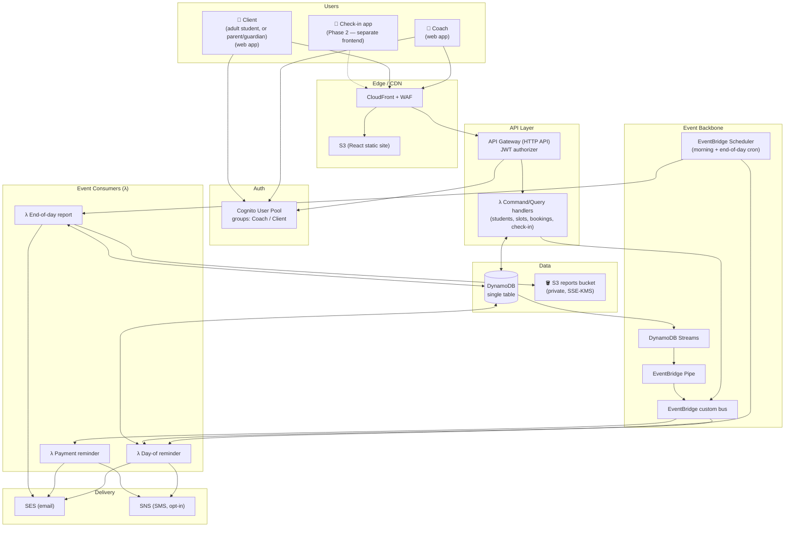
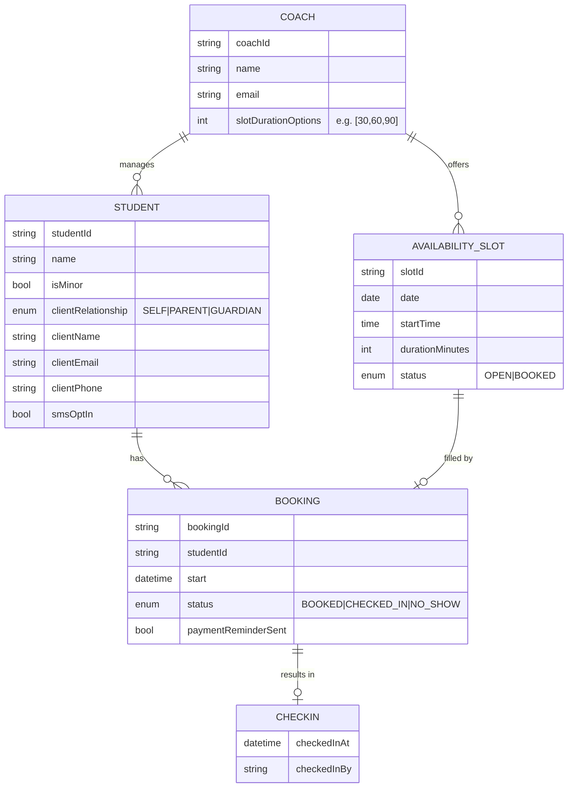
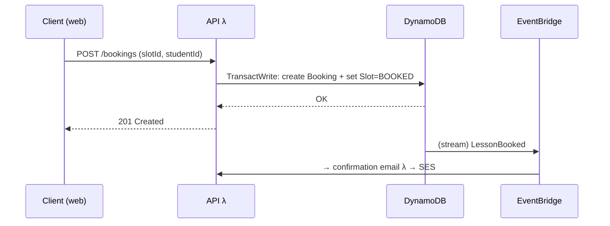
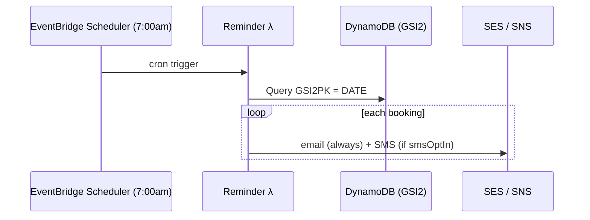
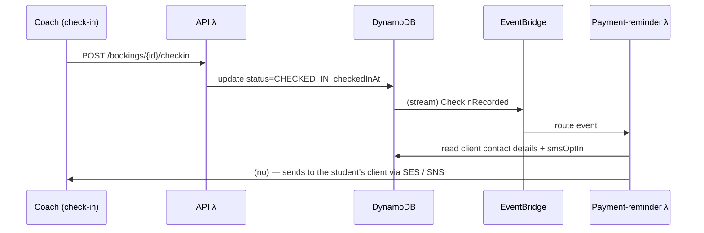
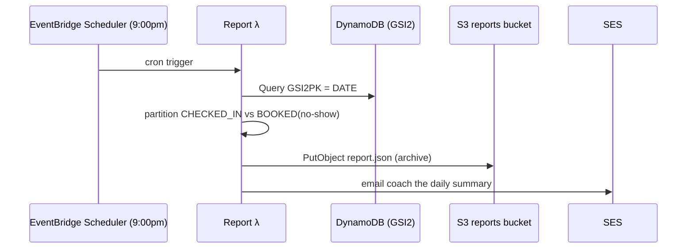

# BladeBook — Architecture

> A scheduling, student-management, and payment-reminder platform for hockey / figure-skating coaches.

**Status:** Design (pre-implementation)
**Last updated:** 2026-07-28

---

## 0. Terminology

A **student** may be a child *or* an adult, so "parent" is not a universal role. The model uses **client** instead:

| Term | Meaning |
|---|---|
| **Student** | The person taking the lesson — any age. |
| **Client** | The person who books, is billed, and receives notifications for a student. For an adult student that's the student themselves; for a minor it's a parent or guardian. |
| **`clientRelationship`** | `SELF` \| `PARENT` \| `GUARDIAN` — records which of the above applies. |
| **`isMinor`** | Drives the child-data obligations in §7. Only students flagged as minors pull in consent/COPPA handling. |

"Parent" appears in this document only where it genuinely means a parent or guardian of a minor.

---

## 1. Goals & Priorities

| Priority | What it means for the design |
|---|---|
| **Security-first** | Least-privilege IAM per function, Cognito auth, encryption everywhere, PII minimization — and because **some students are minors**, explicit attention to guardian-consent / child-data handling wherever that applies (see §7). |
| **Event-driven** | Domain events (`LessonBooked`, `CheckInRecorded`, …) flow through EventBridge; reminders and reports are event/schedule consumers, not inline code. |
| **Low cost at low scale** | Fully serverless, pay-per-use, no always-on infrastructure. Target **~$2–10/month idle**. |
| **AWS-native** | Deployable to AWS from day one via infrastructure-as-code. |

---

## 2. Tech Stack

| Layer | Choice | Rationale |
|---|---|---|
| **Compute** | Java on AWS **Lambda** | Language you know; pay-per-use ≈ $0 at low traffic. |
| **Java runtime** | **Lambda SnapStart** (Spring Boot) *or* **Quarkus/Micronaut** | SnapStart tames JVM cold starts for free. Quarkus/Micronaut = even faster startup if we want it. *(Decide at scaffold time — see §11.)* |
| **API** | API Gateway (HTTP API) | Cheapest API GW tier ($1/M req); JWT authorizer integrates with Cognito. |
| **Data** | **DynamoDB** (single-table, on-demand) | No VPC required → avoids ~$32/mo NAT Gateway. ~$0–2/mo at our scale. |
| **Auth** | **Cognito** User Pool | Managed auth; free up to tens of thousands of users. Groups for `Coach` / `Client` (an adult student or a minor's parent/guardian). |
| **Events** | **EventBridge** (custom bus + Scheduler) | Central event backbone + cron for scheduled jobs. |
| **Email** | **SES** | ~$0.10 per 1,000 emails. |
| **SMS** | **SNS** (per-student **opt-in**) | ~$0.01–0.02/text; requires toll-free/10DLC registration. Opt-in keeps cost + compliance contained. |
| **Frontend** | **React + TypeScript** on **S3 + CloudFront** | ~$1/mo hosting; clean split from backend. |
| **Edge security** | **WAF** on CloudFront/API GW | Optional for MVP (+~$8–15/mo), recommended given security priority. |
| **IaC** | **AWS CDK** (Java or TypeScript) | Type-safe infra; CDK-in-Java keeps one language, CDK-in-TS is more mature. |

---

## 3. System Architecture



**Key idea:** the API Lambdas only read/write DynamoDB and emit events. All notification and reporting logic lives in **independent event/schedule consumers** — so we can add, change, or split them (e.g. the separate check-in app) without touching the core API.

---

## 4. Domain Model



*Check-in is modeled as state on the Booking (`status` + `checkedInAt`) rather than a separate entity — simpler and matches the access patterns.*

*The `client*` fields are a single set regardless of age: when `clientRelationship = SELF` they hold the adult student's own details, so notification and booking code never branches on age. Only §7's consent handling reads `isMinor`.*

---

## 5. DynamoDB Single-Table Design

DynamoDB is **access-pattern-first**: we design keys around the queries, not the entities. Here are the queries the app must serve, and the table that serves them.

### Access patterns

| # | Query | Served by |
|---|---|---|
| 1 | Get a coach's profile | Main table, PK |
| 2 | List all students for a coach | Main table, `begins_with(SK, "STUDENT#")` |
| 3 | Get one student | Main table, PK+SK |
| 4 | List a coach's availability for a date range | Main table, `begins_with(SK, "SLOT#")` + range |
| 5 | List a coach's bookings for a given day | Main table, `begins_with(SK, "BOOKING#<date>")` |
| 6 | List a client's upcoming bookings (their own, or their child's) | **GSI1** (by student) |
| 7 | **List ALL bookings on a date across every coach** (for the scheduled jobs) | **GSI2** (by date) |

### Table layout

**Main table** — partition key `PK`, sort key `SK`:

| Entity | PK | SK | Notable attributes |
|---|---|---|---|
| Coach profile | `COACH#<coachId>` | `PROFILE` | name, email, slotDurations |
| Student | `COACH#<coachId>` | `STUDENT#<studentId>` | isMinor, clientRelationship, clientName, clientEmail, clientPhone, smsOptIn |
| Availability slot | `COACH#<coachId>` | `SLOT#<date>#<startTime>#<slotId>` | durationMinutes, status |
| Booking | `COACH#<coachId>` | `BOOKING#<date>#<slotId>` | studentId, status, checkedInAt, paymentReminderSent |

**GSI1 — "by student"** (client-facing views):
`GSI1PK = STUDENT#<studentId>`, `GSI1SK = BOOKING#<date>`

**GSI2 — "by date, global"** (the scheduled jobs):
`GSI2PK = DATE#<yyyy-mm-dd>`, `GSI2SK = COACH#<coachId>#<slotId>`
→ the morning reminder job and end-of-day report both do a single `Query(GSI2PK = DATE#today)`.

> **This is the crux of choosing DynamoDB here.** GSI2 is what makes the cross-coach "everyone with a lesson today" queries (features #4 and #7) O(1)-ish instead of a full table scan. It's the modeling work we traded the ~$20–45/mo Postgres+VPC bill for.

---

## 6. Event-Driven Flows

We publish domain events **reliably** using **DynamoDB Streams → EventBridge Pipe → EventBridge bus** (change-data-capture). This avoids the "dual-write" problem of writing to the DB and separately to the bus and having one fail — the event is derived from the committed write.

### 6.1 Booking a lesson (feature #3)


*The slot-claim uses a DynamoDB **conditional transaction** so two clients can't book the same slot (concurrency-safe).*

### 6.2 Day-of reminders (feature #4)



### 6.3 Check-in → payment reminder (features #5 & #6)



### 6.4 End-of-day report (feature #7)



**Report archival (S3).** Each daily report is persisted to a private S3 bucket keyed by coach and date:

```
s3://bladebook-reports/coach=<coachId>/date=<yyyy-mm-dd>/report.json
```

- `report.json` is machine-readable (per-student checked-in / no-show breakdown) so it can later feed the Phase-2 coach analytics dashboard — queryable directly with **Athena**, no DynamoDB load.
- Optionally also store `report.html`/`.pdf` — a human-readable copy of the emailed summary.
- The bucket is **private** (Block Public Access on, no public policy), **SSE-KMS** encrypted, with a **lifecycle policy** (e.g. transition to Glacier, expire past the data-retention window). See §7 for why this matters — some of that data is about minors.

### Event catalog

| Event | Source | Consumers |
|---|---|---|
| `LessonBooked` | Booking write | Confirmation email; schedule reminder |
| `LessonCancelled` | Booking delete | Cancellation notice; re-open slot |
| `CheckInRecorded` | Check-in write | Payment reminder |
| `DailyReminderDue` (scheduled) | Scheduler | Day-of reminder λ |
| `DailyReportDue` (scheduled) | Scheduler | End-of-day report λ |

---

## 7. Security Model

### Authentication
- **Cognito User Pool** with two groups: `Coach` and `Client` (an adult student booking for themselves, or a parent/guardian booking for a minor — same permissions either way).
- API Gateway **JWT authorizer** validates Cognito tokens on every request.
- MFA available for coaches (they hold the most sensitive data).

### Authorization (data isolation)
- The `coachId` / `clientId` comes from the **verified JWT claim**, never from the request body.
- Every DynamoDB key is scoped by that identity (`PK = COACH#<coachId-from-token>`), so a coach structurally cannot read another coach's students. Client access is filtered through GSI1 to the students linked to that client — themselves, or the children they're the guardian for.

### Least privilege
- **One IAM role per Lambda**, granted only the specific actions it needs (e.g. the report λ gets `dynamodb:Query` on GSI2 + `ses:SendEmail` + `s3:PutObject` scoped to the reports bucket/prefix — nothing else).
- No wildcard `dynamodb:*`, `ses:*`, or `s3:*`.

### Data protection
- **At rest:** DynamoDB + SES + the S3 reports bucket encrypted with KMS (default or CMK).
- **In transit:** TLS everywhere (CloudFront, API GW); enforce `aws:SecureTransport` on the reports bucket policy.
- **S3 reports bucket:** private — **Block Public Access** on, no public bucket policy, SSE-KMS, versioning + a retention **lifecycle policy**. It can hold attendance data about minors, so it gets the same guardrails as the database.
- **Secrets:** any third-party keys in **Secrets Manager**, never in env vars/code.
- **Audit:** CloudTrail on; consider a DynamoDB audit trail + S3 access logging for PII access.

### ⚠️ Minors' data (this is a real obligation, not a nice-to-have)
Students may be adults or children. Where `isMinor = true`, we're storing data about a child plus their **parent/guardian contact info**, which triggers:
- **Parental/guardian consent** as the lawful basis for contact; SMS especially is opt-in per student.
- Likely **COPPA** (US) considerations and, depending on where coaches operate, state privacy laws. *Flagging for legal review before launch — not something to hand-wave.*

Because a coach's roster can mix both, the safe default is to treat a student as a minor until the coach says otherwise, and to apply these controls to **all** students regardless of age:
- **Data minimization** — collect only what's needed for scheduling + contact.
- Access logging + the ability to delete a student's data on request.
- The storage guardrails below (encryption, private buckets, retention) — they cost nothing extra to apply uniformly and avoid a per-record compliance branch.

### Edge
- **WAF** managed rule sets (SQLi/XSS, rate-based rules) on CloudFront and/or API GW.
- API Gateway **throttling** to cap abuse and cost.

---

## 8. Scheduled Jobs

| Job | Trigger | What it does |
|---|---|---|
| Day-of reminders | EventBridge Scheduler, ~7:00am (per coach timezone) | Query `DATE#today`, notify each booking's client (email + opt-in SMS). |
| End-of-day report | EventBridge Scheduler, ~9:00pm | Query `DATE#today`, split checked-in vs no-show, email the coach. |

*Timezone note:* store each coach's timezone and either run one job that groups by tz, or per-tz schedules. MVP can assume a single timezone and generalize later.

---

## 9. Notifications

| Channel | Service | Cost | Notes |
|---|---|---|---|
| Email | SES | ~$0.10 / 1,000 | Primary channel; ~$0 at our scale. Must move SES out of sandbox before prod. |
| SMS | SNS | ~$0.01–0.02 / msg | **Per-student opt-in.** Requires US toll-free/10DLC number registration (~$2/mo + one-time). |

Every client always gets **email**; SMS is layered on only where `smsOptIn = true`. Delivery always targets the `client*` fields, so an adult student is notified directly and a minor's parent/guardian is notified on their behalf — same code path.

---

## 10. MVP Scope vs. Later Phases

### MVP (Phase 1)
1. ✅ Coach auth + student list with client contact info and minor/guardian status (feature #1)
2. ✅ Coach sets availability in configurable increments (feature #2)
3. ✅ Clients book open slots — adult students for themselves, parents/guardians for a minor (feature #3)
4. ✅ Day-of email reminders (feature #4)
5. ✅ Check-in *inside the coach app* (feature #5, not yet a separate app)
6. ✅ Payment-reminder email on check-in (feature #6)
7. ✅ End-of-day report email to coach (feature #7)
8. ✅ SMS opt-in wiring (send email now, SMS as the number gets registered)

### Phase 2+
- Separate, mobile-friendly **check-in app** (shares the same event backbone).
- **In-app payments** (Stripe/AWS integration) — explicitly *not* an MVP goal.
- Waitlists / recurring lessons / package plans.
- Coach analytics dashboard.
- Multi-timezone scheduling.

---

## 11. Open Decisions (for scaffold time)

| Decision | Options | Default lean |
|---|---|---|
| Java Lambda framework | Spring Boot + SnapStart · Quarkus · Micronaut | **SnapStart + Spring Boot** if Spring is familiar; **Quarkus** for lowest cold-start. |
| IaC language | CDK (Java) · CDK (TypeScript) · SAM · Terraform | **CDK** — Java to stay single-language, or TS for maturity. |
| Repo layout | Monorepo (backend + frontend + infra) · separate repos | **Monorepo** for a solo/small build. |
| Coach timezone | Single tz (MVP) · per-coach tz | **Single tz** for MVP. |

---

## 12. Cost Model (idle, us-east-1, approximate)

| Component | Monthly |
|---|---|
| Lambda (all functions) | ~$0 (free tier) |
| DynamoDB (on-demand) | ~$0–2 |
| API Gateway (HTTP) | ~$0–1 |
| Cognito | ~$0 |
| SES (email) | ~$0–1 |
| SNS (SMS) | ~$0 idle + ~$2/mo number once enabled |
| S3 + CloudFront | ~$1 |
| EventBridge | ~$0 |
| **Subtotal** | **~$2–6** |
| WAF (optional) | +~$8–15 |

> Costs scale with *usage*, and usage here is tiny — the design deliberately has **no always-on infrastructure** (no NAT gateway, no idle DB instance, no load balancer).
